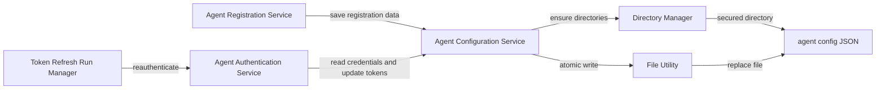
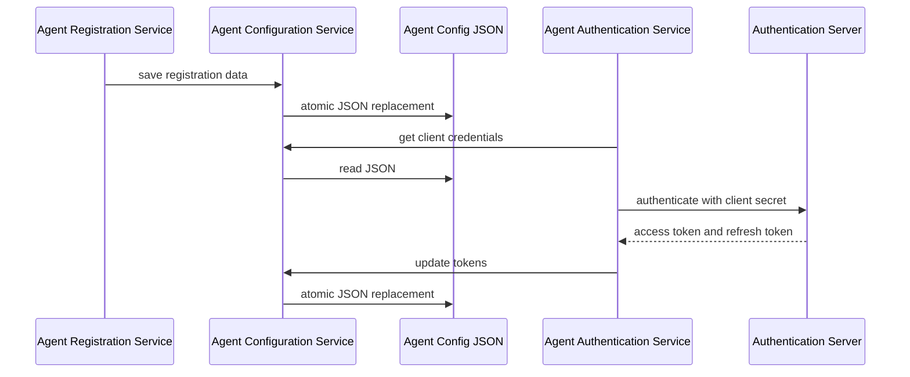
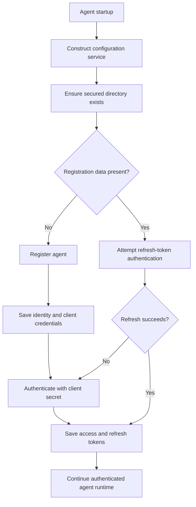

# Services Agent Configuration

Services Agent Configuration is the local persistence boundary for a running OpenFrame endpoint agent. It owns the agent configuration record that ties a device identity and registration credentials to renewable authentication tokens. The implementation is supplied by the `openframe_agent_lib` dependency from OpenFrame OSS Library; this tenant repository assembles and runs that client library.

The source implementation is [agent configuration service](https://github.com/flamingo-stack/openframe-oss-lib/blob/7a766f00e4f58b5d89db007b878ac8d6e0c344f4/clients/openframe-client/src/services/agent_configuration_service.rs).

## Responsibilities

The `AgentConfigurationService` performs five closely related tasks:

- creates the agent secure-directory hierarchy during construction;
- reads the persisted record, treating a missing configuration file as an empty default record;
- saves the registration identity: machine identifier, client identifier, and client secret;
- replaces the access and refresh tokens after authentication or token renewal; and
- exposes narrow getters for the machine identifier, registration tuple, client credentials, and individual tokens.

It does not register a machine, issue tokens, validate token expiry, or encrypt field values itself. Those responsibilities belong to the registration, authentication, token-refresh, directory, and file-system facilities that compose the endpoint agent.

## Stored State

The service stores pretty-printed JSON at `agent_config.json` beneath the `DirectoryManager` secured directory. Its record contains the following fields.

| Field | Written by | Read by | Purpose |
|---|---|---|---|
| Machine identifier | Registration save operation | Registration credential getter and machine identifier getter | Stable identifier for the registered endpoint. |
| Client identifier | Registration save operation | Client credential getter | Identifier used in client-secret authentication. |
| Client secret | Registration save operation | Registration and client credential getters | Credential paired with the device identity or client identifier. |
| Access token | Token update operation | Access-token getter | Current bearer token for authenticated agent activity. |
| Refresh token | Token update operation | Refresh-token getter | Token used by refresh-token authentication. |

A missing file is not an error: reads return the model default, whose fields are empty strings. A present but unreadable or malformed file fails the requested operation with contextual read or JSON-deserialization errors. Consumers must therefore distinguish an unregistered agent state from a corrupt or inaccessible persisted state.

## Architecture and Dependencies

### Collaborators

| Collaborator | Relationship to Services Agent Configuration |
|---|---|
| Agent Registration Service | After a fresh installation or reinstallation succeeds, it saves the returned machine identifier, client identifier, and client secret. It separately persists machine information for reinstall handling. |
| Agent Authentication Service | Obtains client credentials for initial authentication. During reauthentication it tries the refresh token first and falls back to client credentials; successful token responses update the local configuration. |
| Token Refresh Run Manager | Drives reauthentication on its refresh schedule and is therefore an indirect producer of token updates. |
| Directory Manager | Provides the secure-directory path and ensures logs, application support, secure storage, and optional user-log directories exist. |
| File Utility | Provides the atomic replacement primitive used for every configuration write. |

## Registration and Authentication Data Flow

Registration persists only identity and client credentials, preserving any current token fields because the service follows a read-modify-write pattern. Token updates similarly preserve machine and client fields. This behavior is essential because registration and token renewal own disjoint portions of one record.

## Consistency and Failure Behavior

### In-process write serialization

Each service instance holds an asynchronous mutex shared by its clones. `save_registration_data` and `update_tokens` acquire this lock before reading the existing record, changing their owned fields, and saving it. This serializes writes made through the same service instance or its clones, preventing registration and token persistence from overwriting each other's fields through a stale read.

The lock is not a cross-process lock. Independently running agent processes or separately constructed service instances can still race over the same file. The normal service lifecycle should consequently maintain a single writer authority per endpoint installation.

### Atomic replacement

The write path serializes the complete record before calling the shared atomic-write utility. That utility writes to a temporary file in the target directory, flushes it with a file synchronization operation, and then persists it over the target. On Windows it has a held-target replacement fallback. This avoids exposing a partially written JSON document after an interrupted write and provides durability protection against a rename with unwritten file data.

Read-modify-write errors are propagated. Neither save operation reports partial success: if serialization or atomic persistence fails, callers receive an error and can retry according to their owning workflow.

## Security Considerations

The record includes a client secret, access token, and refresh token. It must be handled as secret material:

- Do not log the JSON document, its fields, or errors augmented with secret values.
- Limit access to the secured directory and retain the directory permission checks provided by `DirectoryManager`.
- Treat backups, diagnostics bundles, and endpoint migration tooling as sensitive if they can include this path.
- Rotate or replace credentials through the registration and authentication workflows rather than editing the file manually.

The directory manager creates the secure directory with admin-only permissions. Maintainers should also review the file-permission behavior of the shared atomic-write utility for the target platform: on Unix it explicitly assigns mode `0644` to its temporary file before persistence. Directory access therefore remains a significant part of the effective protection model, and deployments with stricter file-level secret requirements should validate the resulting file permissions.

## Operational Lifecycle

The configuration service is intentionally synchronous for reads and asynchronous for mutations. The asynchronous API on credential and token getters keeps callers compatible with the surrounding authentication workflow, while reads themselves load and deserialize the local file directly.

## Maintenance Guidance

1. **Preserve field ownership.** Registration writes identity and client-secret fields; authentication writes only token fields. Any new mutation should retain the existing record and change only its owned fields unless a deliberate credential reset is required.
2. **Use the service rather than direct file writes.** Bypassing it loses mutex serialization, contextual failures, and atomic persistence.
3. **Evolve the JSON model compatibly.** A missing file currently maps to default values, but malformed present data stops execution. Additive fields should preserve deserialization compatibility with existing endpoint records.
4. **Test interruption paths.** Verify malformed JSON, inaccessible directories, serialization failure, and concurrent registration-plus-token updates. Include platform-specific checks for replacement when the target file is held on Windows.
5. **Treat service creation as a prerequisite.** Constructor failure means the secure directory could not be prepared; the agent should not proceed to persist credentials until that condition is resolved.

## Module Boundary

Services Agent Configuration is part of the Rust endpoint client supplied by OpenFrame OSS Library version `0.0.5` in this repository's dependency graph. It is a local state service: it has no network client of its own. Network registration and authentication services use it as the durable handoff between server-issued identity, credential issuance, initial authentication, and recurring token renewal.
