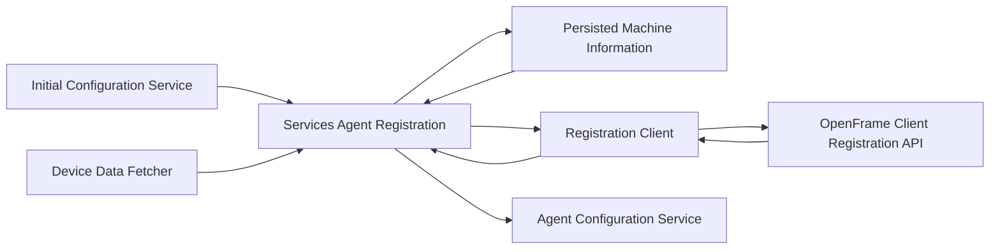
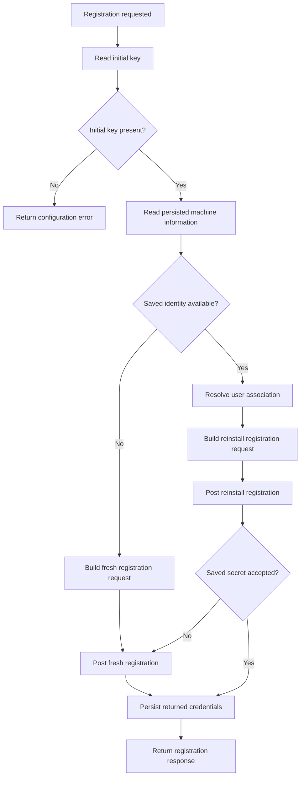
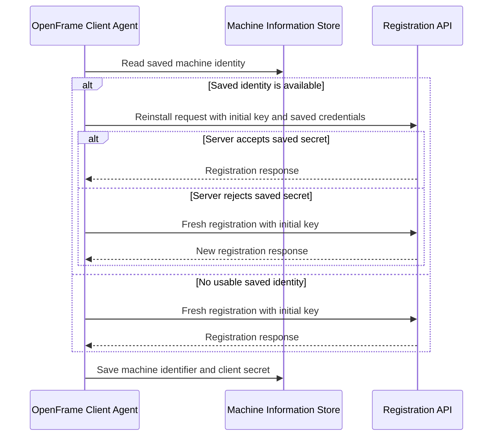

# Services Agent Registration

Services Agent Registration is the OpenFrame Client agent bootstrap service. It turns install-time configuration and local machine facts into a registration request, chooses a fresh-registration or reinstall path, and stores the credentials needed for later authenticated operation. The runtime implementation is supplied by the OpenFrame OSS Library as part of the `openframe_agent_lib` Cargo dependency; this repository assembles and runs it through its OpenFrame Client service.

The service deliberately preserves a device identity across uninstall and reinstall cycles when a complete local machine record is available, while retaining a recovery path that registers a new machine if that identity is no longer accepted by the server.

## Responsibilities

- Require a non-empty initial key before contacting the registration API.
- Collect hostname, agent version, operating-system type, organization identifier, optional user identifier, and tags.
- Read the locally persisted machine identifier, client secret, and optional associated user identifier.
- Retry failures while reading persisted identity before treating the invocation as a fresh installation.
- Select the fresh or reinstall registration endpoint and authenticate the request with the required headers.
- Fall back from a rejected reinstall secret to fresh registration.
- Persist the returned machine credentials both as reinstall identity and in the agent configuration.

## Runtime Architecture

The client-side `AgentRegistrationService` composes four dependencies:

| Dependency | Role in the registration operation |
|---|---|
| Initial Configuration Service | Supplies the initial key plus optional organization, user, and tag settings. |
| Device Data Fetcher | Resolves hostname, compiled agent version, and operating-system type. |
| Registration Client | Performs the HTTP request and distinguishes an invalid saved client secret from other failures. |
| Agent Configuration Service | Persists the machine identifier, client identifier, and client secret returned by the server. |

A separate machine-information store retains only the reinstall identity: machine identifier, client secret, and optional user identifier. This separation lets the registration flow preserve enough data to attempt an identity-continuing reinstall while also updating the normal agent configuration with the complete server response.

## Registration Contract

The request body is represented by `AgentRegistrationRequest` and contains the following fields.

| Field | Origin | Behavior |
|---|---|---|
| Hostname | Device Data Fetcher | An unresolved hostname is logged and sent as an empty value. |
| Agent version | Device Data Fetcher | Obtained from the client build version. |
| Operating-system type | Device Data Fetcher | Identifies Windows or macOS in the current implementation. |
| Organization identifier | Initial Configuration Service | Omitted when empty. |
| User identifier | Install configuration or persisted machine information | Omitted when empty. Install-time input takes priority. |
| Tags | Initial Configuration Service | Omitted when no tags are configured. |

A successful response contains a machine identifier, client identifier, and client secret. The service writes the machine identifier and client secret to persisted machine information, then saves all three values to agent configuration. A failure to write the reinstall record is logged but does not prevent configuration persistence or a successful registration result.

## API Interaction

The Registration Client posts JSON to the OpenFrame Client registration API. Both calls require the `X-Initial-Key` header. Reinstall requests additionally carry `X-Machine-Id` and `X-Client-Secret` from persisted machine information.

| Registration mode | Endpoint | Additional request headers |
|---|---|---|
| Fresh registration | `/clients/api/agents/register` | None |
| Reinstall | `/clients/api/agents/reinstall` | Machine identifier and client secret |

At the receiving service, the controller exposes matching `/api/agents/register` and `/api/agents/reinstall` routes. The repository gateway configuration routes `/clients/**` traffic to the OpenFrame Client service, so the client-side prefix is the gateway-facing form of those routes.

## Registration Process

### User Association Resolution

The request uses the install-time user identifier when configured. If that value is absent and persisted machine information exists, Services Agent Registration reuses the user identifier saved at the original installation. This makes the association resilient to a reinstall that does not repeat the user argument.

### Persisted-Identity Read Recovery

Reading persisted machine information may fail because of transient local storage or permission problems. The underlying reader attempts permission repair when access is denied. Services Agent Registration then retries failed reads after one, three, and five seconds. If the read still fails after those retries, it logs the condition and continues as though no persisted identity exists, initiating fresh registration rather than blocking installation indefinitely.

## Reinstall and Recovery Semantics

Only the registration client's typed invalid-secret outcome triggers automatic fallback to fresh registration. Other registration failures, including transport errors or unexpected server responses, are returned with contextual error messages. This avoids silently changing device identity on failures that are not evidence that the saved secret is invalid.

An empty initial key is rejected before any read or API call. The implementation explains that the key is cleared once the device holds a log key; a later registration therefore requires a new installation command rather than reusing a cleared key.

## Operational Considerations

- **Identity continuity:** Preserve the machine-information store during an intended reinstall. Its machine identifier and client secret enable the reinstall route.
- **New identity fallback:** If server-side state no longer recognizes the saved client secret, the service registers a new machine automatically. Operators should expect the returned machine identifier to change in this case.
- **Hostname quality:** Kernel hostname is used when valid. The fetcher has macOS fallbacks, but registration remains possible with an empty hostname if all resolution attempts fail.
- **Sensitive data:** Initial keys and client secrets are credentials. They are transported in headers and written to local configuration or machine-information storage, so filesystem permissions and log hygiene are security-critical.
- **Partial persistence:** A successful server response can still have a logged machine-information write failure. The agent configuration save remains required for a successful method result, but a future reinstall may lack the separate identity record.

## Source and System Placement

The implementation is maintained in the OpenFrame OSS Library and is consumed by this repository at runtime through `openframe_agent_lib` version `v0.0.5`. The source file is [Agent Registration Service in OpenFrame OSS Library](https://github.com/flamingo-stack/openframe-oss-lib/blob/7a766f00e4f58b5d89db007b878ac8d6e0c344f4/clients/openframe-client/src/services/agent_registration_service.rs).

Within the tenant deployment, the OpenFrame Client service is one of the images released by this repository. Its gateway route accepts the `/clients/**` path and directs it to the client service, which hosts the registration controller used by this agent flow.
