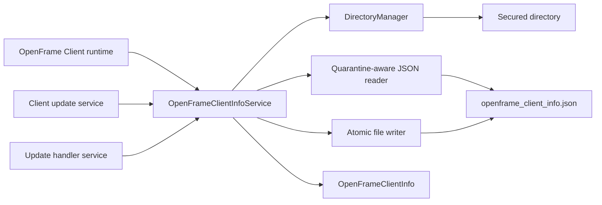
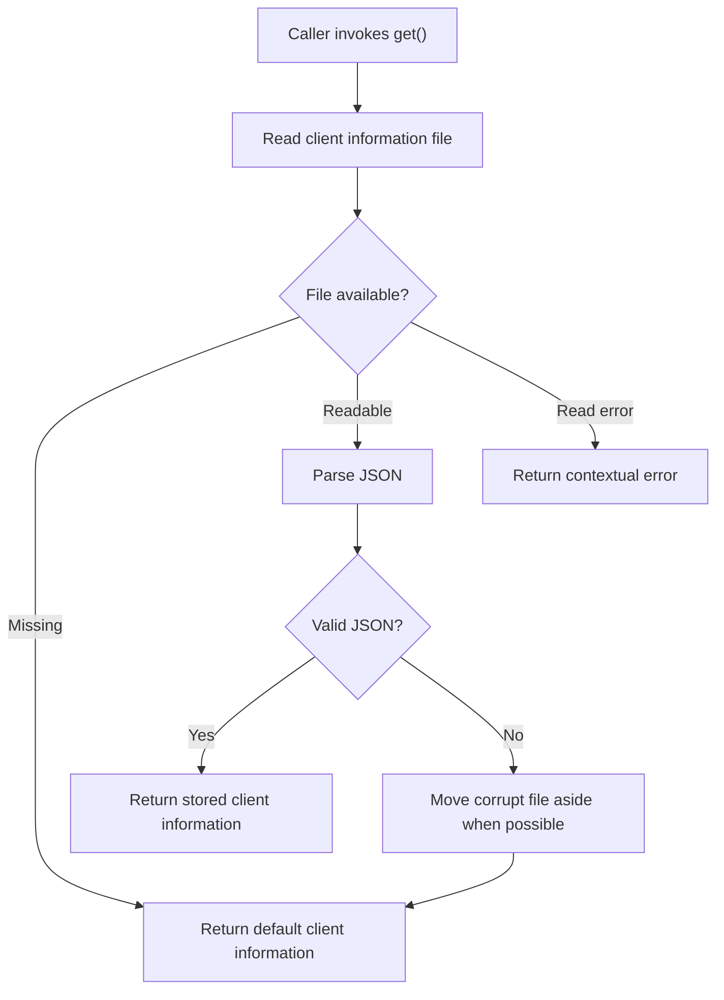
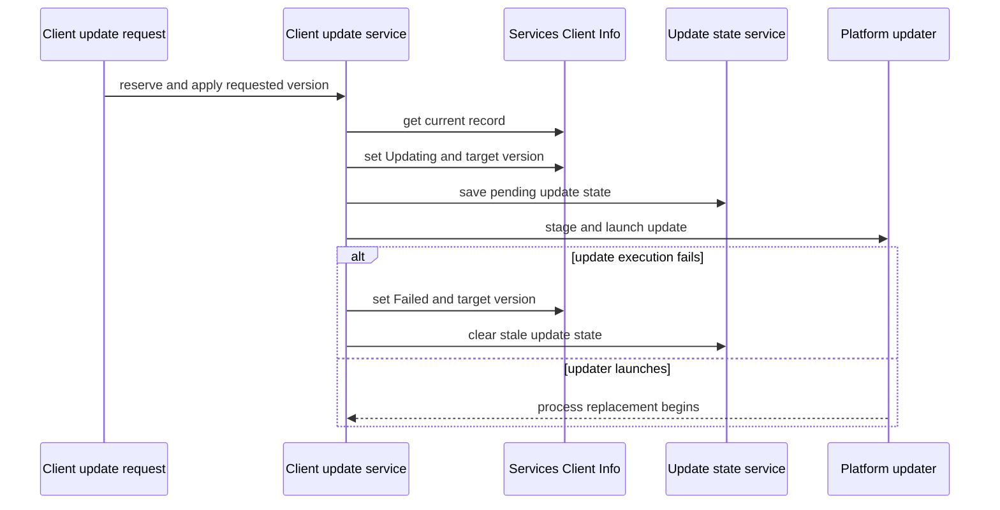
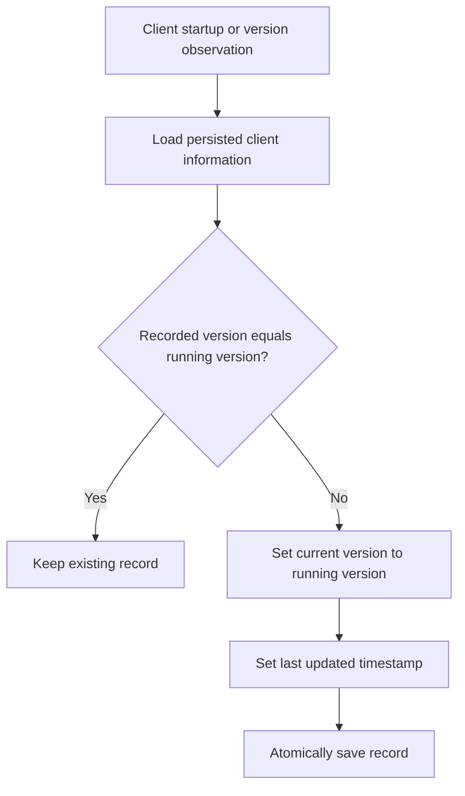

# Services Client Info

Services Client Info is the OpenFrame Client agent's durable local record of its own executable identity and update lifecycle. It is implemented by `OpenFrameClientInfoService` in the upstream `openframe_agent_lib` Rust library, which this repository consumes at version `v0.0.5`. The service creates, reads, and atomically replaces a JSON record in the agent's secured directory so that restarts and updater handoffs retain a consistent view of the installed client.

The implementation is provided by the [upstream source file](https://github.com/flamingo-stack/openframe-oss-lib/blob/7a766f00e4f58b5d89db007b878ac8d6e0c344f4/clients/openframe-client/src/services/openframe_client_info_service.rs). This repository assembles that library into the OpenFrame Client runtime.

## Responsibilities

Services Client Info owns the `openframe_client_info.json` record. It does not download, replace, or launch binaries itself. Its responsibilities are:

- establish the secured storage location through `DirectoryManager`;
- return a default information record when the file has not been created yet;
- serialize and persist the record using an atomic write;
- track the recorded current version and reconcile it with the version of the binary actually running;
- record an update target and lifecycle status; and
- retain the binary path used by update and recovery workflows.

The service is deliberately small and stateful only through the file. Its cloneable value contains the resolved path rather than an in-memory cache, so each operation reads the latest persisted state before applying a targeted mutation.

## Persisted Record

`OpenFrameClientInfo` is the schema managed by this module. The associated `ClientUpdateStatus` values are `Current`, `Updating`, `Updated`, and `Failed`.

| Field | Purpose | Updated by |
|---|---|---|
| `current_version` | Version currently recorded for the client binary. | `update_version` or `reconcile_version` |
| `target_version` | Optional version requested by an update operation. | `set_update_status` |
| `status` | Update lifecycle state. The default is `Current`. | `set_update_status` |
| `binary_path` | Persisted path of the client executable. | `set_binary_path` |
| `last_update_check` | RFC 3339 time at which update status was changed. | `set_update_status` |
| `last_updated` | RFC 3339 time at which the recorded current version changed. | `update_version` or `reconcile_version` |

The record is stored beneath the `DirectoryManager` secured directory as `openframe_client_info.json`. The directory is ensured during service construction. The precise platform-specific directory selection remains the responsibility of the upstream directory manager.

## Architecture and Dependencies

The information service depends on three upstream library abstractions:

- **Directory management** supplies the secured directory and ensures the directory hierarchy exists before the information service is returned.
- **File utilities** make storage resilient. Reads distinguish missing files from other I/O failures, while malformed JSON is moved aside to a quarantine path and treated as a fresh record. Writes create a temporary file in the destination directory, flush it, and atomically persist it over the target.
- **Client information model** defines the record and update-state vocabulary shared with the update workflow.

This module is a local persistence boundary. Network communication, message delivery, binary staging, and service process management belong to other OpenFrame Client components.

## Lifecycle Operations

| Operation | Behavior |
|---|---|
| `new` | Resolves the secured record path, ensures required directories exist, then returns the service. Construction fails if directory preparation fails. |
| `get` | Reads and decodes the JSON record. A missing or quarantined corrupt file becomes a default `OpenFrameClientInfo`; unreadable files still return an error. |
| `save` | Pretty-serializes a supplied record and replaces the stored file atomically. |
| `update_version` | Loads the record, assigns a supplied version to `current_version`, stamps `last_updated`, and saves it. |
| `reconcile_version` | Compares the stored version with a caller-provided running-binary version. It writes only when the values differ, then stamps `last_updated`. |
| `set_update_status` | Loads the record, sets `status` and `target_version`, stamps `last_update_check`, and saves it. |
| `set_binary_path` | Loads the record, changes only `binary_path`, and saves it. |

All mutating operations perform a read-modify-write sequence. Callers should therefore treat the service as the authority for this record and avoid concurrent, out-of-band modifications to the file.

## Read and Recovery Flow

The missing-file path supports first start without a separate initialization transaction. Corrupt JSON is not silently reused: the utility attempts to rename it aside, logs the condition, and returns a non-persisted default record. A later successful mutation recreates the primary record through the atomic save path.

## Update Interaction

The module participates in update bookkeeping but does not decide whether a version is valid or whether an update can proceed. The client update service validates and canonicalizes the requested version, prevents overlapping work, considers downgrade protection, and coordinates staging and launching. When it begins the update execution, it records `Updating` and the canonical target version through Services Client Info. If execution fails, it records `Failed` with the same target version; bookkeeping errors are logged without independently blocking the binary update.

On a later client start, the update handler loads its separate update-state record and compares its target to the compiled running version. A matching running version follows its success handling; a nonmatching version can remain pending during verification or enter failure handling based on the recorded phase. Services Client Info complements that durable update state by holding the agent-facing version and status record, while the update-state service governs the update transaction and boot recovery decisions.

## Version Reconciliation

A persisted version can differ from the executable after an update, recovery action, manual replacement, or interrupted process handoff. `reconcile_version` repairs this drift by accepting the observed running version as the source of truth. It changes only `current_version` and `last_updated`; it does not alter `target_version`, `status`, `binary_path`, or `last_update_check`.

This separation is important: reconciliation confirms what is executing, whereas `set_update_status` records update workflow progress. Maintaining both signals lets the wider client lifecycle distinguish a reported target from the binary that actually started.

## Persistence Guarantees and Operational Considerations

- **Crash-resistant replacement:** writes occur through a temporary file in the target directory, synchronize file content, and then atomically replace the destination. This avoids exposing a partially written primary JSON file during normal writes.
- **Corruption containment:** invalid JSON is quarantined where possible and does not prevent the agent from obtaining a default in-memory record.
- **Contextual failures:** directory preparation, file reads, serialization, and persistence are returned with operation-specific context, allowing callers to log or handle a precise failure.
- **No automatic repair on read:** a missing or corrupt file produces a default record, but `get` alone does not create a file. Persistence occurs when a caller invokes a mutation or `save`.
- **Timestamp semantics:** version mutations set `last_updated`; status mutations set `last_update_check`; binary-path changes do not update either timestamp.
- **File access:** on Unix, the atomic writer restores ordinary readable file permissions after creating its private temporary file. The secured parent directory remains the primary placement control.

## Integration Boundaries

Within the OpenFrame Client, maintainers should use Services Client Info for durable client identity and update metadata. It is not a replacement for these adjacent responsibilities:

- update orchestration, download, staged-binary replacement, rollback anchors, and updater launch;
- update transaction state and boot-attempt recovery;
- directory selection and platform permission management; or
- publication of the running version to the control plane.

Keeping those concerns distinct allows a client restart to recover transaction state independently while still retaining an inspectable local record of version, target, executable path, and last update status.
