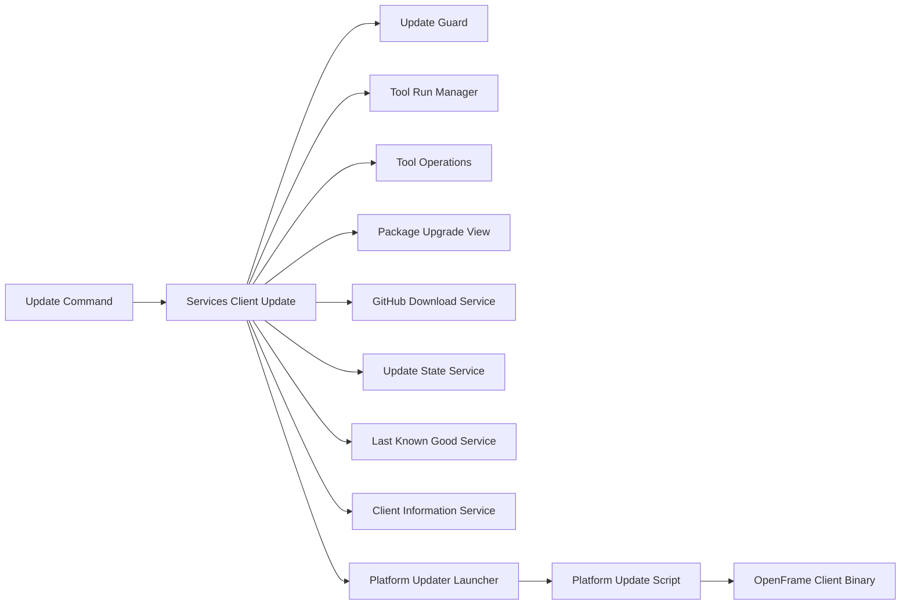
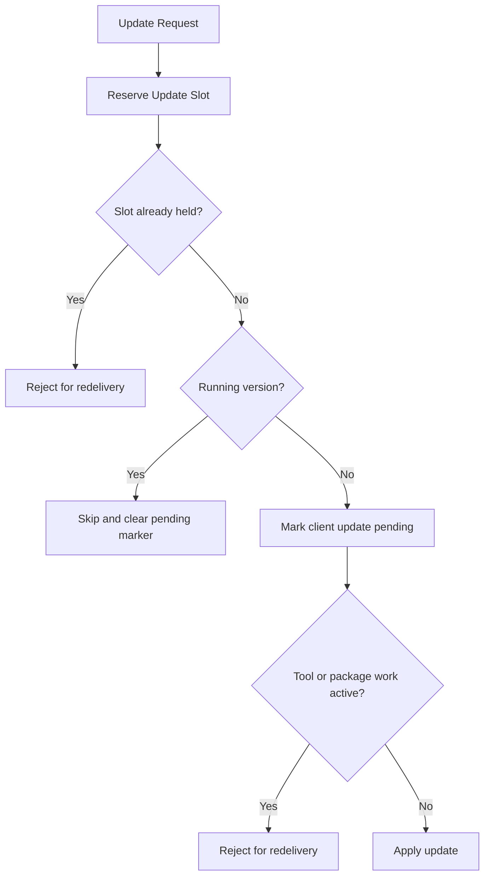
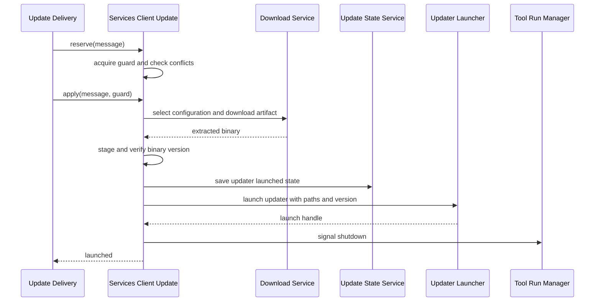
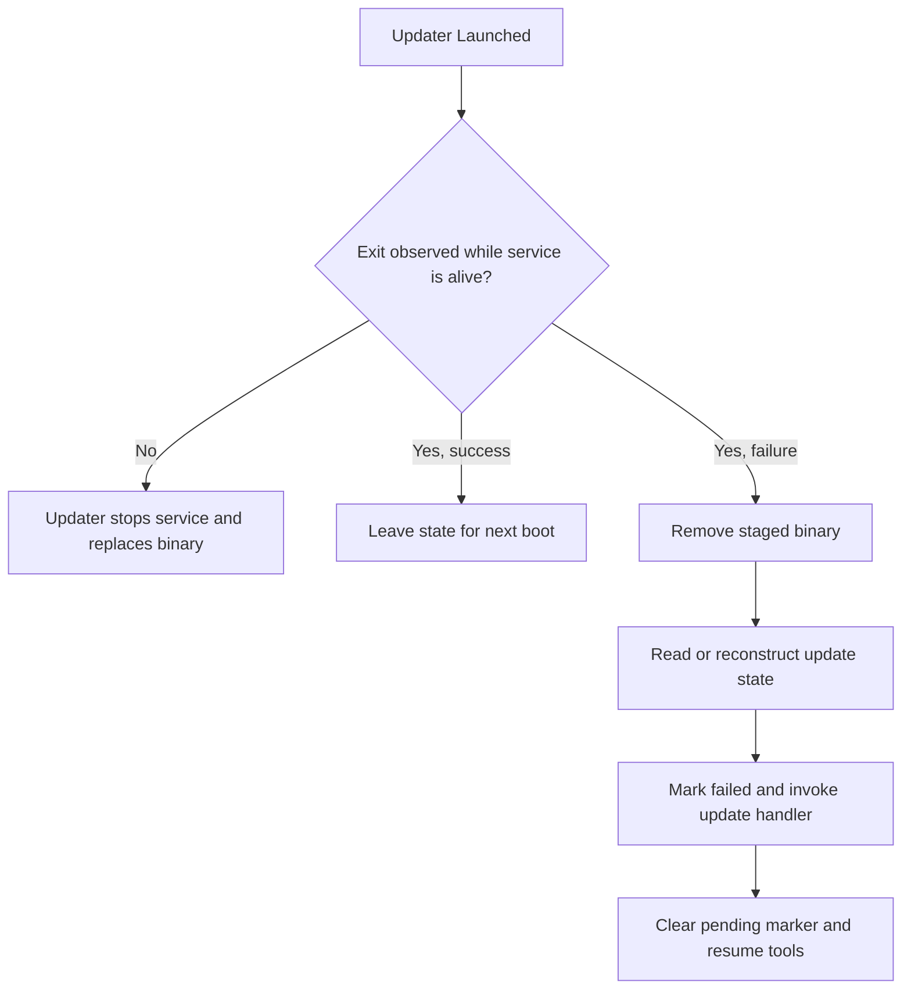

# Services Client Update

Services Client Update is the endpoint-agent subsystem that coordinates a replacement of the OpenFrame Client executable without allowing it to race with tool work or package upgrades. It is implemented by `OpenFrameClientUpdateService` in the OpenFrame OSS Library's Rust client code, which is assembled into this repository through the `openframe_agent_lib` Cargo dependency. Its source is available in the [OpenFrame OSS Library](https://github.com/flamingo-stack/openframe-oss-lib/blob/7a766f00e4f58b5d89db007b878ac8d6e0c344f4/clients/openframe-client/src/services/openframe_client_update_service.rs).

The service accepts a versioned update message, reserves an exclusive update slot, downloads the operating-system-specific artifact, stages and validates it, records durable recovery metadata, and launches a platform-specific updater. It does not replace the process itself: the launched updater stops the service and performs the swap.

## Responsibilities

`OpenFrameClientUpdateService` owns the live-update handoff. Its principal operations are:

| Component | Responsibility |
| --- | --- |
| `new` | Wires client information, downloading, update state, recovery, tool coordination, package-upgrade visibility, and boot-time failure handling dependencies. |
| `reserve` | Acquires the process-local update lock, marks a client update as pending when appropriate, and rejects work that conflicts with tool or package activity. |
| `apply` | Validates and normalizes the requested version, applies same-version and downgrade protections, updates best-effort status, and starts the update workflow. |
| `UpdateLaunch` | Distinguishes a successfully launched updater from an intentionally skipped request. |

The request model supplies a target version and one or more download configurations. The download service selects the configuration matching the current operating system; this subsystem does not choose an artifact for another platform.

## Architecture and Dependencies

### Dependency roles

- **Client Information Service** records `Updating` and `Failed` states on a best-effort basis and provides the current installed version for diagnostics. Its bookkeeping failure does not prevent an update.
- **GitHub Download Service** chooses an operating-system-compatible download configuration, downloads the artifact, and extracts a candidate executable.
- **Update State Service** persists the target version and phase immediately before updater launch. The updater consumes its state-file path, and later startup handling can use it to detect incomplete work.
- **Last Known Good Service** supplies the downgrade anchor, boot-marker path, reserved recovery-binary location, and transcript destination used by the updater.
- **Tool Run Manager** blocks new tool supervision while an update is pending, signals tool loops to shut down before replacement, and can resume supervision after an early updater failure.
- **Tool Operations** exposes whether a tool operation is active. **Package Upgrade View** exposes whether a package upgrade is active. Either condition defers the update rather than interrupting the conflicting work.
- **Platform Updater Launcher** receives an `UpdaterParams` value containing the staged binary, current executable, service name, update-state path, target version, recovery paths, transcript path, and rollback mode.
- **Update Handler Service** finalizes an updater failure that occurs before the service is stopped, including recovery and reporting work outside this module.

## Reservation and Concurrency

The service keeps an atomic update-in-progress flag. `reserve` acquires it through an internal guard whose destructor releases the flag. The guard is intentionally retained until the updater has completed interaction with the current process. This prevents redelivered update messages from overlapping the live update.

A request for the version already built into the running binary obtains the guard but bypasses the pending-tool marker and conflict checks. `apply` subsequently clears any pending marker and returns `Skipped`.

For a different version, reservation marks the client update as pending, then checks whether a tool operation or package upgrade is active. If either is active, reservation returns an error so the caller can redeliver the message later. A second conflict check is made after download and before the state is saved, covering work that begins while an artifact is being fetched.

## Update Processing Flow

`apply` performs the policy and coordination work; `execute_update` carries out the update preparation and handoff.

1. **Validate and canonicalize the version.** The version must be nonempty, begin with a digit or `v`, and otherwise use only alphanumeric characters plus `.`, `-`, and `+`. It is parsed through the shared semantic-version comparator and normalized to its canonical semantic-version string.
2. **Avoid no-op replacement.** A valid request whose normalized version equals the compile-time `OPENFRAME_VERSION` is skipped.
3. **Protect the recovery anchor.** When downgrade support is disabled, the target cannot have lower precedence than the persisted last-known-good version. An unreadable or unparsable anchor is logged and does not block the request.
4. **Record update intent.** The service initializes an `UpdateState` for the canonical target and attempts to set the client status to `Updating`. This status write is informational rather than a prerequisite.
5. **Select and download.** The matching operating-system download configuration is selected, then the artifact is downloaded and extracted into memory.
6. **Stage and inspect.** A UUID-named file is written below the update staging directory. The agent probes the staged executable version with a configured timeout. A version that is readable but differs from the target is rejected and removed. A binary that cannot report its version is explicitly allowed to proceed as unverified.
7. **Recheck conflicts and persist state.** The service verifies that tool work and package upgrades have not begun during the download. It changes the update phase to `UpdaterLaunched` and saves the state only after all pre-launch checks pass.
8. **Launch and quiesce.** The platform updater is launched with the staged binary and recovery metadata. The client signals all tool run loops to shut down; the updater script is responsible for stopping the service and swapping the executable.

## Failure Handling and Recovery

Any failure before a successful updater launch causes `apply` to attempt three cleanup actions: set the client status to `Failed`, clear persisted update state so it cannot trigger a later crash-loop decision, and return an error for message retry. Failures in the status or state cleanup are logged; the original update error remains decisive.

After launch, the service watches an optional updater exit handle while retaining the update guard. An updater that exits unsuccessfully while the current service is still alive is considered to have failed before the executable swap. The service then:

1. Removes the staged binary unless it has already disappeared.
2. Reads the update state, tolerating missing, corrupt, or unreadable state according to the observed condition.
3. Marks the update as failed when it was not already failed or rolled back, including the updater exit status in the error text.
4. Delegates final failure handling to the Update Handler Service.
5. Clears the client-update-pending marker and asks the Tool Run Manager to resume tool supervision.

An updater that reports success while the current process remains alive is not treated as a completed update by this watcher. Its state is left for subsequent boot-time handling.

## Persistent Data and State Boundaries

The update service writes only the staged executable and the update-state record directly. Recovery artifacts and transcripts are named or reserved through the Last Known Good Service, while final status persistence is delegated to the Client Information Service.

| Data | Producer or owner | Purpose |
| --- | --- | --- |
| Update message | Command delivery path | Declares target version and candidate downloads. |
| Staged executable | Services Client Update | Temporary input for the platform updater, named with a UUID to avoid collisions. |
| Update state | Update State Service | Gives the updater and later startup handling the target and phase. |
| Last-known-good anchor | Last Known Good Service | Blocks a lower-precedence target when downgrades are disabled. |
| Client update status | Client Information Service | Exposes update progress or failure to the rest of the client. |
| Boot marker, recovery binary, transcript | Last Known Good Service and updater | Supports post-swap verification, rollback, and diagnostics. |

## Operational Guarantees and Limits

- Client replacement never begins while a known tool operation or package upgrade is active; conflicts are deferred for redelivery.
- A duplicate request cannot run concurrently with a live update because the in-memory guard remains held through updater observation.
- The target is checked against semantic-version policy before download, and a staged binary that positively reports a different version is not installed.
- The updater state is saved only immediately before launcher invocation, preventing an earlier failure from presenting as an in-progress boot update.
- Downloaded artifacts are not cryptographically verified by this service itself. Its direct validation is operating-system selection plus the best-effort executable-version probe.
- The concurrency guard is process-local. Durable recovery and cross-restart handling belong to the update-state, last-known-good, updater, and boot-time handler collaborators.

## Maintenance Notes

When changing this service, preserve the ordering between conflict checks, state persistence, and launcher invocation. In particular, state must not be saved before the second busy check, and tools must not be signaled to shut down until updater launch succeeds. Maintain the distinction between a deliberate `Skipped` outcome and an error: errors are eligible for message redelivery, while a same-version or policy-rejected request is intentionally not launched.

The source implementation is supplied by the pinned OpenFrame OSS Library dependency rather than this repository. Changes to its behavior should therefore be coordinated with the library release consumed by OpenFrame OSS Tenant.