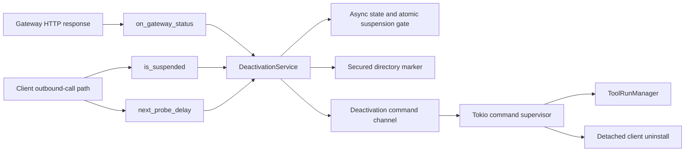
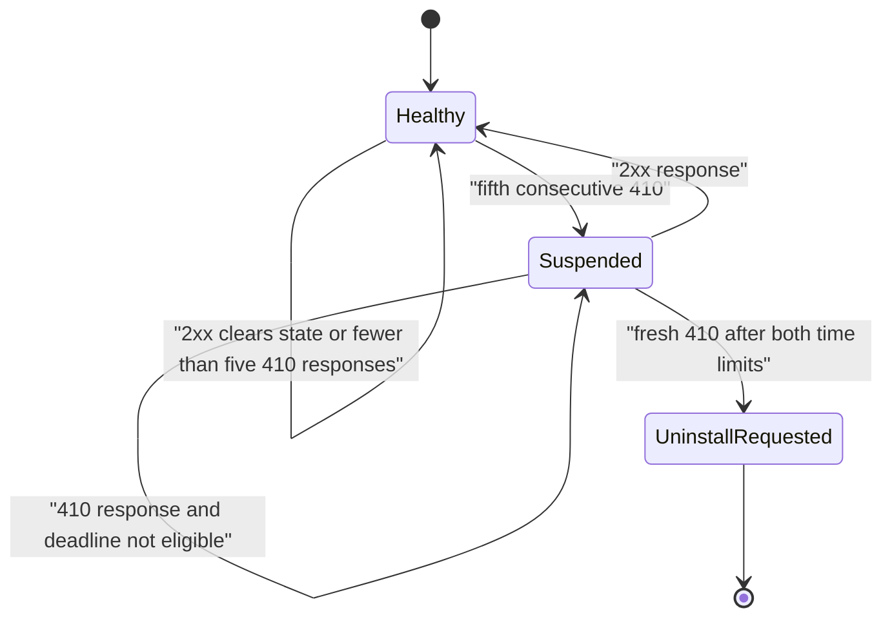
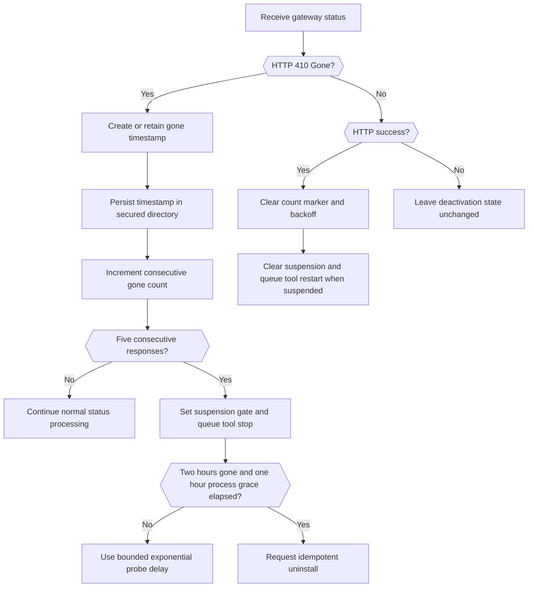
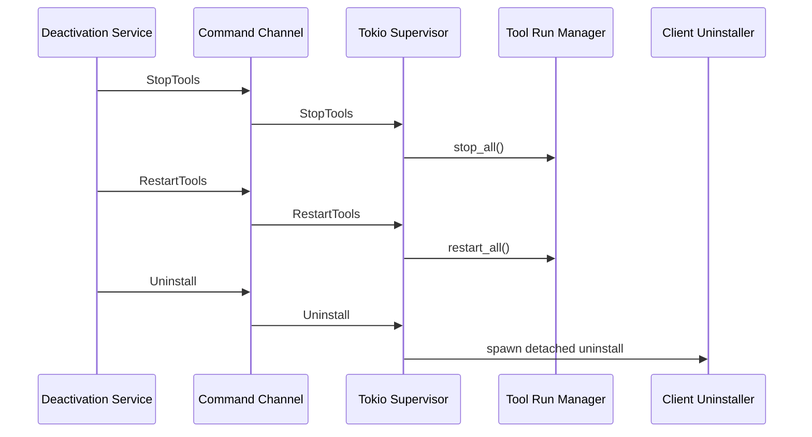

# Services Deactivation

Services Deactivation is the OpenFrame Client safeguard that reacts when the gateway confirms that the device's tenant is gone. It distinguishes a definitive HTTP `410 Gone` response from ordinary connectivity, authentication, or server failures; temporarily suspends managed tools after repeated confirmation; and eventually initiates a detached client uninstall if the tenant remains gone.

The implementation is supplied by the `openframe_agent_lib` Cargo dependency from OpenFrame OSS Library. Its source is [deactivation_service.rs](https://github.com/flamingo-stack/openframe-oss-lib/blob/7a766f00e4f58b5d89db007b878ac8d6e0c344f4/clients/openframe-client/src/services/deactivation_service.rs). The tenant repository runs the client that assembles this library code.

## Scope and Guarantees

The module is intentionally narrow: it is a stateful decision service, not a gateway probe implementation. A caller supplies observed gateway HTTP statuses through `on_gateway_status`, checks `is_suspended` to gate outbound activity, and uses `next_probe_delay` to schedule increasingly infrequent probes while the client is suspended.

| Concern | Behavior |
|---|---|
| Supported platforms | Enabled only on macOS and Windows. It is a no-op on Linux because Linux self-uninstall is unsupported. |
| Definitive loss signal | Only HTTP `410 Gone` advances deactivation state. |
| Recovery signal | Any successful `2xx` status resets the gone episode and restores normal operation. |
| Transient failures | Non-success statuses other than `410`, including timeouts, `5xx`, and authorization failures as described by the source, leave the state unchanged. |
| Tool suspension | Five consecutive `410` responses stop managed tools and set the outbound-call gate. |
| Probe backoff | Starts at one minute and doubles per delay request, capped at 30 minutes. |
| Self-uninstall | Requires both a continuous gone period of two hours and a one-hour grace period after the current process started. A fresh `410` is required before the deadline is evaluated. |

## Architecture

`DeactivationService` owns shared state behind an asynchronous mutex, an atomic suspension indicator for inexpensive read access, a secured-directory marker, and a single-consumer command channel. Detection updates state synchronously with respect to other status notifications. Potentially slow work, such as stopping tools or spawning an uninstaller, runs in a separate Tokio supervisor task.

### Core Components

| Component | Responsibility |
|---|---|
| `DeactivationService::new` | Creates the command channel, records the secured directory, initializes state, and loads the persisted tenant-gone timestamp on supported platforms. Loading a marker alone never causes removal. |
| `DeactivationService::on_gateway_status` | Routes `410 Gone` to the gone-state path and `2xx` responses to recovery. Other inputs do not alter the state machine. |
| `DeactivationService::is_suspended` | Returns the atomic outbound-call gate. It always returns `false` where the feature is disabled. |
| `DeactivationService::next_probe_delay` | Returns the current suspension probe delay and updates the next delay with bounded exponential backoff. |
| `DeactivationService::start` | Starts the one-time supervisor after a `ToolRunManager` exists. A second call has no effect because the receiver is consumed. |
| `DeactivationService::request_uninstall` | Idempotently records that uninstall was triggered and sends the terminal command to the supervisor. It is the shared entry point for deadline-based and future explicit decommission paths. |

## State Model

The service maintains two phases. `Healthy` accepts normal operation and counts a current run of gone responses. `Suspended` means the tenant has been repeatedly confirmed gone, tools have been asked to stop, and the client should limit outbound work to backoff probes.

### Tracked State

- **Consecutive gone count:** Incremented for every `410`; reset by `2xx`. The count must reach five before suspension.
- **Gone-since timestamp:** Set at the first `410` of an episode and persisted in the secured directory as `tenant_gone_since`. It permits the continuous-gone period to survive a restart.
- **Probe backoff:** Reset to one minute when an episode starts recovering or enters suspension; doubled when a caller asks for the next delay, up to 30 minutes.
- **Process-start instant:** Monotonic timing used to enforce the one-hour post-restart grace period. This prevents a persisted wall-clock timestamp from making a restarted client immediately eligible for removal.
- **Uninstall-triggered flag:** Prevents duplicate terminal action requests.
- **Suspension atomic:** Mirrors the active phase for callers that must cheaply decide whether to make normal outbound calls.

## Deactivation Flow

The following flow shows the confirmation threshold, persistence, recovery, and terminal action. The response source and the caller's actual probing loop are outside this module; this module only receives statuses and publishes decisions.

### Gateway Status Handling

A first `410` starts a gone episode and writes its UTC RFC 3339 timestamp. Further `410` responses extend the confirmation count but do not replace the original timestamp. Once the count reaches five while healthy, the service:

1. changes to `Suspended`;
2. sets the atomic suspension gate;
3. resets probe backoff to one minute; and
4. queues `StopTools` for the supervisor.

A successful gateway response is a recovery confirmation. It resets the count, removes the persisted marker when present, resets the probe backoff, and, if suspension was active, clears the gate and queues `RestartTools`. A successful response before the fifth `410` clears the episode without stopping or restarting tools.

## Command Supervision and Uninstall

The detection path does not await tool lifecycle operations or the uninstaller. `start` transfers the channel receiver to a Tokio task, which serially handles three commands:

For uninstall, the supervisor obtains the client installation location and attempts to launch a detached `openframe-client uninstall`. Because this action is terminal, it retries launch failures up to three times with a 30-second delay. A launch failure is logged; no further uninstall command is enqueued because the request is intentionally idempotent.

## Persistence, Restart Safety, and Recovery

The marker provides continuity for the two-hour tenant-gone window. On startup, the service loads the marker on supported platforms and logs that a live `410` must reconfirm removal eligibility. The loaded marker does not itself suspend the process or trigger uninstall.

Two controls avoid unsafe removal after restart:

1. The deadline is evaluated only while the service is suspended, which requires five consecutive `410` responses in the current process.
2. Even after the persisted two-hour wall-clock window has elapsed, the current process must have been running for at least one hour and a fresh `410` must invoke the check.

A malformed marker is treated as unavailable and logged, effectively restarting the gone-duration window on the next `410`. Failure to write or delete the marker is also logged, allowing the service to continue while making reduced persistence reliability visible.

## Operational Signals

The implementation logs to the `deactivation` tracing target. Important reason values include:

| Reason | Meaning |
|---|---|
| `marker_loaded` | A persisted gone timestamp was found during construction. |
| `backoff_started` | The first `410` of an episode was received. |
| `calls_stopped` | Five consecutive gone responses suspended outbound calls and initiated tool shutdown. |
| `recovered` | A successful gateway response cleared the episode, either before or after suspension. |
| `grace_deferred` | The gone-duration deadline was met but the post-restart grace period was still active. |
| `self_destroy_triggered` | The idempotent uninstall request was accepted. |

When diagnosing unexpected behavior, correlate these events with gateway response status, the presence and validity of the secured-directory marker, tool stop or restart errors, and self-uninstall launch failures. Do not treat a generic gateway outage as a deactivation incident unless `410` responses appear: other error classes are deliberately ignored by this state machine.

## Integration Responsibilities

Integrators must:

- construct the service with the same `DirectoryManager` that defines the secured directory;
- call `start` once after constructing the `ToolRunManager`;
- supply actual gateway HTTP statuses to `on_gateway_status`;
- honor `is_suspended` by suppressing ordinary outbound work during suspension; and
- schedule the limited probe path using `next_probe_delay` while suspended.

The module does not define the gateway endpoint, create probe requests, or decide which non-probe client operations should consult the suspension gate. Those behaviors belong to the surrounding OpenFrame Client runtime.
