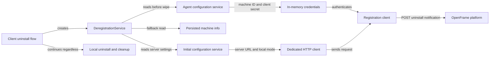
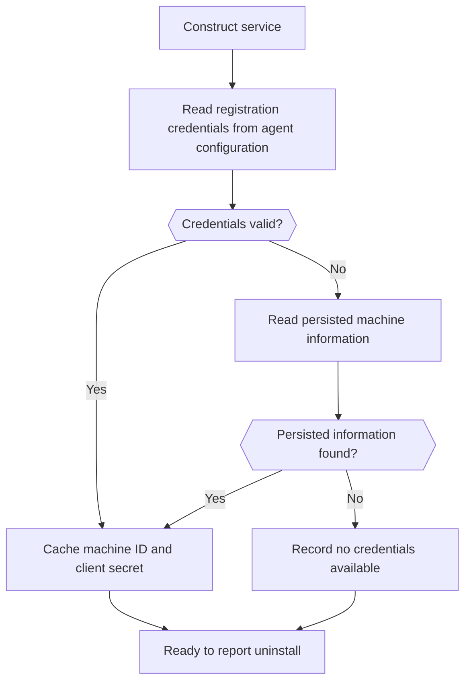
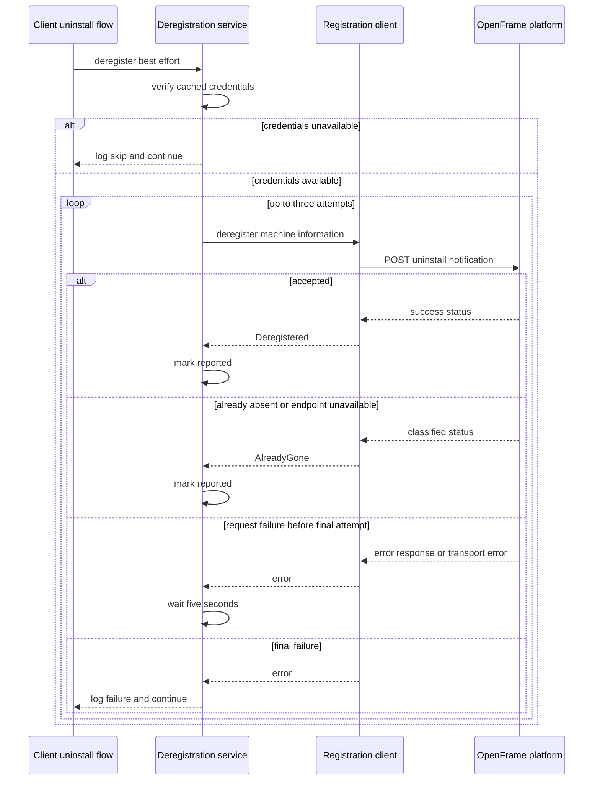
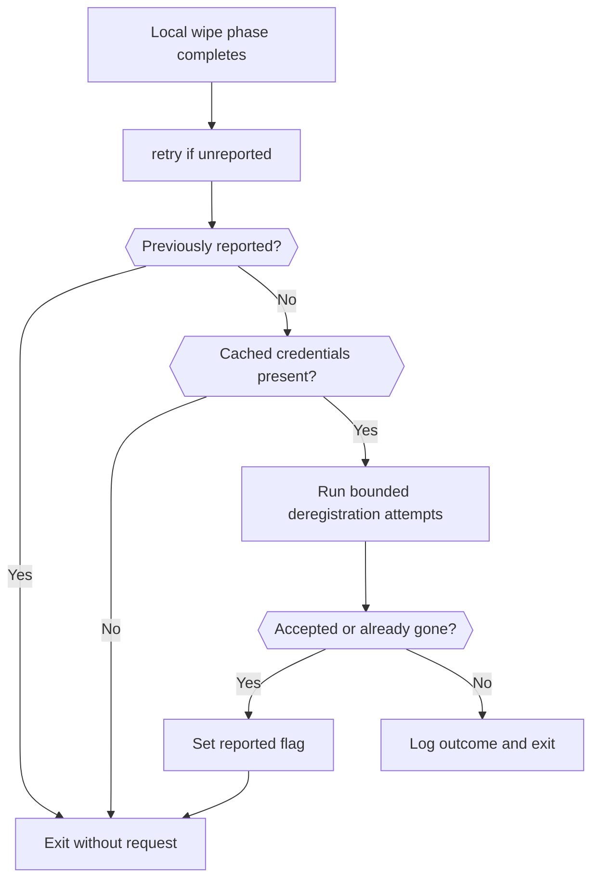

# Services Deregistration

Services Deregistration is the OpenFrame client agent's uninstall-reporting boundary. Before local uninstall removes agent state, it uses the device's persisted registration credentials to tell the OpenFrame platform that the machine is being removed. The operation is deliberately **best effort**: an unavailable server, invalid response, or exhausted retry budget is logged but never prevents the local uninstall from continuing.

This behavior is implemented by `DeregistrationService` in the `openframe_agent_lib` Cargo dependency, version `v0.0.5`, supplied by the OpenFrame OSS Library. The tenant repository runs that client library as part of its OpenFrame client workload. The implementation source is [deregistration service.rs](https://github.com/flamingo-stack/openframe-oss-lib/blob/7a766f00e4f58b5d89db007b878ac8d6e0c344f4/clients/openframe-client/src/services/deregistration_service.rs).

## Responsibilities

- Build a dedicated, short-lived HTTP client for the removal notification.
- Resolve the platform base URL and whether local TLS certificates may be accepted from initial configuration.
- Capture registration credentials before the uninstall can erase their on-disk sources.
- Submit an authenticated uninstall notification to the platform.
- Treat both successful deletion and an already-absent machine as a completed report.
- Retry transient failures within a bounded time budget, then allow local cleanup to proceed.
- Make one final retry available after the local wipe while in-memory credentials remain available.

The module does **not** remove services, binaries, directories, or integrated tools. Those local cleanup responsibilities remain in the client uninstall and platform-uninstall facilities. It also does not create registration credentials; it only reads the credentials created during registration.

## Architecture and Boundaries

`DeregistrationService::new` establishes the dependencies needed for a future report rather than waiting until teardown begins:

1. It creates `InitialConfigurationService` and `AgentConfigurationService` from the supplied directory manager.
2. It constructs an HTTP client with a 15-second request timeout, proxy bypassing, and no retained idle connections per host.
3. When the initial configuration identifies local mode, the client accepts invalid TLS certificates; otherwise normal certificate validation applies.
4. It derives the base URL as `https://` plus the configured server URL and creates `RegistrationClient`.
5. It loads registration credentials immediately and retains them in memory.

Early credential loading is intentional. A partial or successful local wipe may destroy configuration files, but the post-wipe retry must still be able to authenticate its notification.

## Credential Resolution

The module needs a machine identifier and client secret. It first reads both from agent configuration through `AgentConfigurationService::get_registration_credentials`. Empty or whitespace-only values are not considered usable. If that read fails or produces incomplete values, it falls back to the persisted machine-information store.

The persisted store is explicitly a resilience fallback because it can survive a partial cleanup. Its read path may repair store permissions and retry when the first read is denied. Failures from either source are logged; they do not make construction fail unless initialization of the configuration services or HTTP client itself fails.

## Platform Request Contract

`RegistrationClient::deregister` sends a `POST` request to the configured platform base URL with the path `/clients/api/agents/uninstall`. The request supplies:

| Element | Purpose |
|---|---|
| `X-Machine-Id` header | Identifies the registered machine. |
| `X-Client-Secret` header | Authenticates the client associated with that machine. |
| JSON body containing `deletedAt` | Supplies the UTC deletion timestamp with microsecond precision. A non-empty body is required for compatibility with the load balancer, although the backend does not require the field for its contract. |
| 15-second timeout | Bounds any individual request during teardown. |

A successful HTTP status produces `Deregistered`. Statuses classified by the registration client as already gone produce `AlreadyGone`; this covers a machine the platform no longer knows and compatibility with a platform where the uninstall endpoint has not been deployed. Both outcomes mark the report as complete.

## Deregistration Process

`deregister_best_effort` is the normal uninstall-time entry point. If there are no cached credentials, it logs that reporting is skipped. Otherwise it invokes the common attempt loop.

The common attempt loop has these fixed limits:

- **Three total attempts** per invocation.
- **Five seconds** between failed attempts when another attempt remains.
- **Fifteen seconds** maximum duration for each HTTP request.
- **No propagated failure** from `deregister_best_effort` to the uninstall flow.

A fully unsuccessful normal run can therefore delay the local uninstall only by bounded request waits and two retry pauses. The implementation does not promise platform deletion when the network or service is unavailable; it prioritizes completing local removal.

## Completion State and Final Retry

The service tracks accepted reporting with an atomic boolean. It is set with release ordering when the platform accepts removal or declares the machine already absent, and it is read with acquire ordering before a final retry. This makes the completion signal safe for coordinated asynchronous use without re-reporting an already accepted deregistration.

`retry_if_unreported` is the last-chance entry point intended after local wipe work. It exits immediately when the atomic completion flag is set or no credentials were available. Otherwise it reruns the same three-attempt loop using the credentials retained in memory.

## Failure Semantics and Operational Considerations

### Non-blocking cleanup guarantee

The central invariant is that platform notification cannot indefinitely block local removal. Missing credentials, malformed headers, network failures, TLS failures, unexpected status codes, and exhausted retries are handled as logged outcomes. The uninstall continues.

### Idempotent completion handling

The platform can respond that the device is already gone. The service treats that as success because the desired postcondition is that the platform no longer retains the machine. This also permits gradual deployment where an uninstall endpoint might not exist on a target platform yet.

### TLS and network isolation

The dedicated client disables proxy use and disables HTTP connection reuse for this endpoint. It accepts invalid certificates only when initial configuration identifies local mode. Maintainers should preserve this distinction: broadening invalid-certificate acceptance beyond local mode would weaken the agent-to-platform trust boundary.

### Sensitive data

The machine ID and client secret are authentication material. They are held only as the service's cached credential structure and passed as headers to the deregistration request. Logs describe outcomes and errors, but the module's normal messages do not intentionally emit credential values.

## Maintainer Guidance

When modifying this module, retain the following behavioral contracts:

1. Load credentials before local cleanup begins and preserve them for the final retry.
2. Keep teardown reporting bounded and best effort; do not return an error that blocks uninstall.
3. Preserve success treatment for both accepted removal and already-absent outcomes.
4. Keep timeout, attempt count, and retry delay deliberate and visible constants so their cumulative uninstall impact is reviewable.
5. Keep the deregistration request compatible with the registration client's non-empty JSON-body requirement.
6. Ensure any change to credential persistence continues to support the persisted-machine-information fallback.

The module's correctness is primarily observable through structured logs: credential-source failures, individual retry failures, an accepted deregistration, an already-absent response, and the final exhausted-retry warning each provide distinct operational signals.
