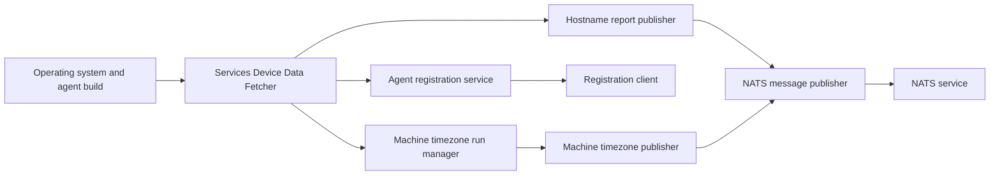
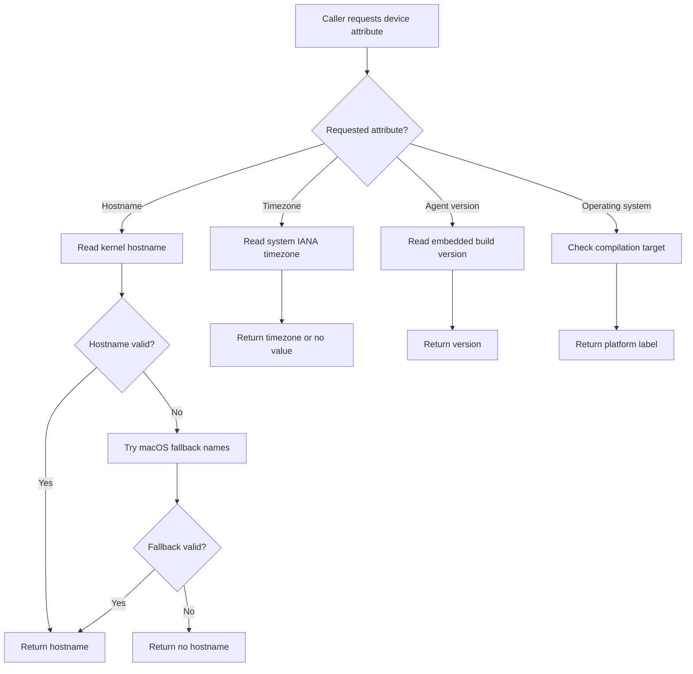
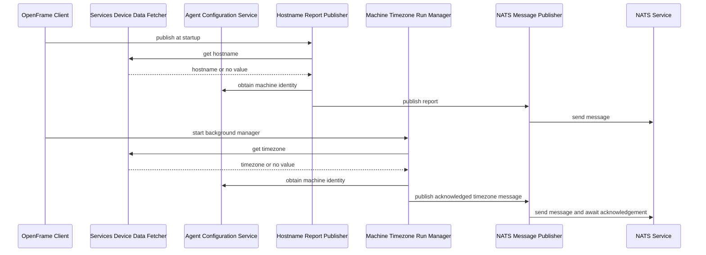

# Services Device Data Fetcher

Services Device Data Fetcher is a small, stateless OpenFrame client service that reads machine identity attributes from the local operating system. It is supplied by the `openframe_agent_lib` dependency from OpenFrame OSS Library and assembled into the OpenFrame client that this repository runs. Its outputs support initial agent registration plus hostname and timezone reporting; it does not persist data or communicate with the network itself.

The implementation is in the OpenFrame OSS Library at [device data fetcher source](https://github.com/flamingo-stack/openframe-oss-lib/blob/7a766f00e4f58b5d89db007b878ac8d6e0c344f4/clients/openframe-client/src/services/device_data_fetcher.rs).

## Responsibilities

The service exposes five relevant operations:

| Operation | Result | Behavior |
|---|---|---|
| `new` | `DeviceDataFetcher` | Creates an empty, cloneable, stateless fetcher. `Default` delegates to this constructor. |
| `get_hostname` | Optional hostname | Obtains and validates the kernel hostname, with macOS-only fallback names when necessary. |
| `get_timezone` | Optional IANA timezone name | Uses the system timezone provider and returns no value when it cannot resolve a timezone. |
| `get_agent_version` | Optional build version | Reads the compile-time `OPENFRAME_VERSION` value embedded in the agent binary. |
| `get_os_type` | Platform label | Returns `WINDOWS` for Windows builds and `MAC_OS` for every other build supported by this implementation. |

The optional return types deliberately let callers distinguish unavailable hostname or timezone information from a successfully resolved value. The platform label is non-optional because it is determined from the binary target rather than an operating-system query.

## Position in the Client Architecture

The OpenFrame client creates one fetcher during client construction, then clones it into the registration, hostname-reporting, and timezone-reporting paths. The fetcher remains local to the agent process; downstream components own configuration lookup, message construction, acknowledgement, and delivery.

The client startup sequence establishes registration and authentication, connects to NATS, starts the timezone manager, and makes a one-shot hostname report. This ordering matters: the reporting services require the machine identifier and an available messaging connection, whereas the fetcher itself requires neither.

## Component Relationships

### Registration

Client construction injects a clone of Services Device Data Fetcher into the agent registration service. That service performs registration using the configured installation credentials and persists returned registration data through the agent configuration service. The fetcher supplies local device attributes to that broader registration workflow; it does not manage credentials, machine identifiers, configuration files, or HTTP requests.

### Hostname reporting

The hostname report publisher receives the fetcher, the agent configuration service, and the NATS publisher. During startup, the client invokes the publisher once. The publisher handles failures by logging a warning instead of interrupting client startup. The fetcher is responsible only for resolving the hostname value.

### Timezone reporting

The machine timezone run manager owns a fetcher, a timezone publisher, and the NATS connection manager. It is started during normal client startup. When a timezone is available, the publisher serializes a machine-timezone message and publishes it with acknowledgement on a subject formed from the configured machine identifier. The fetcher does not construct the message or select its subject.

## Data Acquisition Flow

### Hostname validation and fallback

The primary hostname comes from the `hostname` crate's kernel lookup. Before returning it, the fetcher trims lossily decoded text and rejects the following values:

- an empty string;
- a value that parses as an IP address;
- `localhost`; or
- `localhost.localdomain`.

On macOS only, an invalid or unavailable kernel hostname causes two sequential `scutil` fallbacks:

1. `LocalHostName`, with `.local` appended before validation;
2. `ComputerName`, validated as returned.

Each fallback invokes `/usr/sbin/scutil --get` and rejects empty command output or a failed command status. On non-macOS targets, no fallback is compiled, so a failed or invalid kernel lookup returns no hostname. Every failure or rejected value is logged, while accepted values record their source in an informational log entry.

### Timezone, version, and platform behavior

Timezone resolution delegates to `iana_time_zone::get_timezone`. A successful lookup is logged at debug level and returned unchanged; lookup errors become warnings and yield no value.

The agent version comes from the compile-time `OPENFRAME_VERSION` environment value. Because it is compiled into the binary, this method does not inspect package metadata, the filesystem, or a remote release service at runtime.

The operating-system method uses compile-time target checks. It returns `WINDOWS` when compiled for Windows; all other targets return `MAC_OS`. Maintainers extending the agent to additional target families should treat this mapping as an explicit compatibility constraint and update it rather than assuming an automatically detected OS name.

## Reporting Interaction

The precise timing and retry behavior of the background timezone manager belong to that manager and its connection handling. Services Device Data Fetcher remains deterministic for a given host state and is safe to clone because it has no mutable state.

## Operational Characteristics

- **No network ownership:** The service never opens HTTP, WebSocket, or NATS connections.
- **No persistence:** It does not create or modify files, registration state, or agent configuration.
- **Failure isolation:** Lookup failures are converted to warnings and optional missing values, allowing the client to continue running.
- **Observability:** Successful hostname and version reads use informational logs; successful timezone resolution uses debug logging; failures and rejected hostname candidates use warnings.
- **Build sensitivity:** Version and OS classification are compile-time-derived. Runtime changes cannot alter those values for an already-built executable.

## Maintenance Guidance

When changing Services Device Data Fetcher, preserve the separation between local collection and transport. New attributes should follow the existing pattern: return a value or an explicit absence, log contextual diagnostics, and let registration or publisher services decide how to transmit the value.

Hostname changes need particular care because invalid names are intentionally excluded before they reach device records. Any broadened validation rule should account for the current rejection of address literals and loopback-style placeholder names, as well as the macOS fallback order. Platform support changes should update both the platform-label mapping and any platform-specific collection branches so that consumers do not receive a misleading `MAC_OS` label on newly supported targets.
