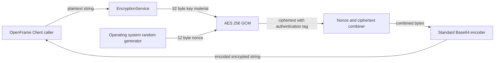
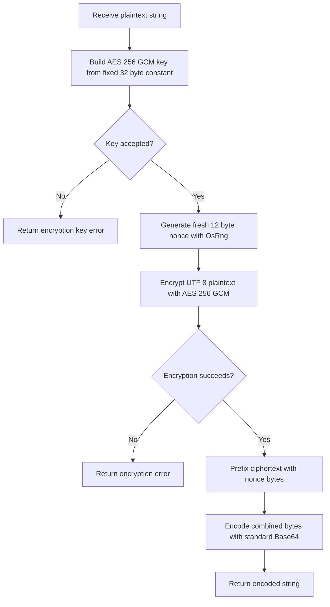
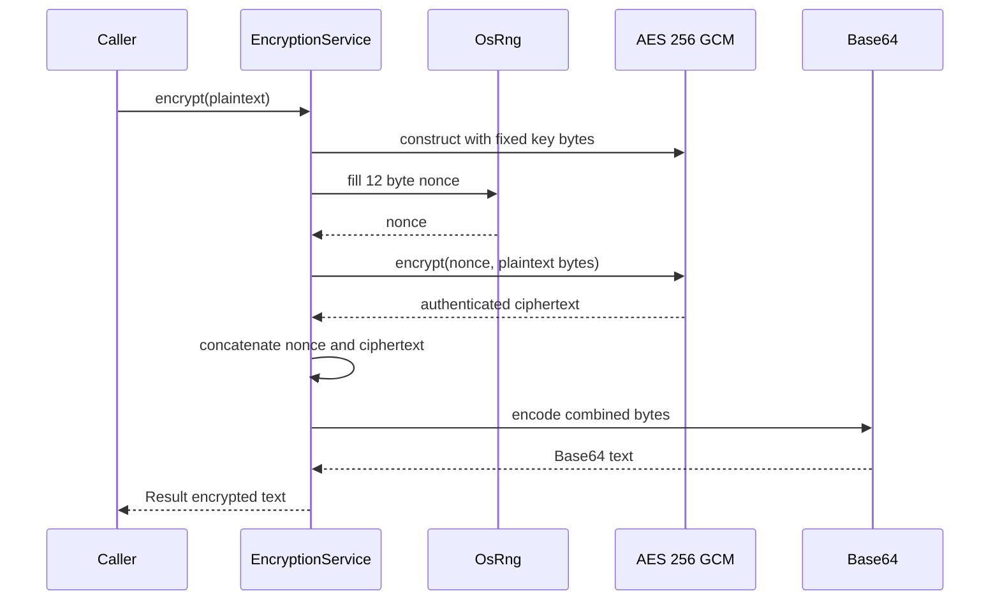
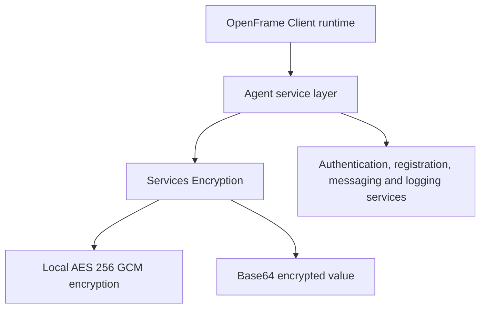

# Services Encryption

Services Encryption is a small, stateless encryption utility in the OpenFrame Client agent runtime. It accepts a UTF-8 string, encrypts it locally with AES-256-GCM, prefixes the resulting ciphertext with the nonce used for that operation, and returns the combined bytes as standard Base64 text.

The implementation is supplied by the `openframe_agent_lib` Cargo dependency from OpenFrame OSS Library and is run by this repository's OpenFrame Client. Its complete implementation is available in the [OpenFrame OSS Library source](https://github.com/flamingo-stack/openframe-oss-lib/blob/7a766f00e4f58b5d89db007b878ac8d6e0c344f4/clients/openframe-client/src/services/encryption_service.rs).

## Scope and Public Surface

`EncryptionService` exposes two relevant operations:

| Operation | Responsibility | Result |
|---|---|---|
| `new()` | Constructs an empty `EncryptionService`. | A clonable, stateless service instance. |
| `encrypt(data)` | Encrypts a string using a newly generated nonce. | A fallible Base64 string containing nonce-prefixed authenticated ciphertext. |

The module has no public decrypt operation, persistence layer, network client, configuration object, or key-rotation interface. Callers that need to consume an encrypted value must use a compatible AES-256-GCM decryptor and understand the nonce-prefix wire layout described below.

## Architecture

The service is a local cryptographic boundary rather than a transport mechanism. It relies on `aes-gcm` for authenticated encryption, `OsRng` for per-operation randomness, and `base64` for textual representation. Errors during key construction or encryption are mapped into `anyhow::Result` failures.



### Component Responsibilities

- **Encryption Service** owns the fixed key constant and orchestration of encryption. Because it stores no per-request state, cloning or reconstructing it does not alter encryption behavior.
- **AES-256-GCM** provides confidentiality and authentication. A successful encryption returns ciphertext that includes the algorithm's authentication data; it is not merely an unauthenticated encrypted byte sequence.
- **Operating-system random generator** fills a fresh 12-byte nonce array for every `encrypt` invocation.
- **Base64 encoder** converts binary output to a string suitable for text-only storage or transport. Base64 is encoding, not an additional cryptographic protection layer.

## Encryption Data Flow

The following process describes the exact implementation path for `encrypt(data)`.



The returned value has this binary layout before Base64 encoding:

```text
nonce: 12 bytes || AES 256 GCM ciphertext and authentication tag: variable length
```

The nonce is intentionally included with the encrypted payload. It is required for later authenticated decryption but is not treated as secret material. The encryption key is not included in the output.

## Operation Sequence



## Cryptographic and Format Properties

| Property | Implemented behavior | Maintenance implication |
|---|---|---|
| Cipher | AES-256-GCM via `aes-gcm`. | Decryptors must use AES-256-GCM. |
| Key size | The constant is 32 ASCII bytes, matching AES-256 key material length. | A replacement key must retain the required length or key construction fails. |
| Nonce size | 12 random bytes are generated for every encryption. | Do not reuse nonces with the same key. The module's random generation supports per-call uniqueness probabilistically. |
| Authentication | GCM supplies integrity protection along with encryption. | Decryption must reject authentication failure rather than accepting modified output. |
| Output representation | Standard Base64 of nonce followed by ciphertext. | Decode Base64 first, extract the first 12 bytes as the nonce, and use the remaining bytes as ciphertext. |
| Associated data | None is supplied to the cipher. | There is no separately authenticated context bound to an encrypted value by this module. |

## Key Management Limitation

The current source declares a fixed, in-code key and explicitly marks it with a TODO to use a generated key. This is a significant security and operational constraint:

- Every build that contains the same implementation uses the same key material.
- The module does not expose key identifiers, versioning, rotation, revocation, or selection.
- Changing the key makes previously produced ciphertext undecryptable unless a separate migration or multi-key decryption strategy exists.
- The nonce provides uniqueness for individual encryption operations; it does **not** compensate for a shared static key.

Treat the encrypted result as protected only to the extent that the key remains secret. Avoid documenting, logging, or emitting plaintext input, key material, decoded payloads, or full ciphertext values when they may be sensitive.

## Error Handling and Caller Contract

`encrypt` returns `Result<String>`. The implementation can report failures while constructing the cipher key or while invoking authenticated encryption. It does not silently fall back to returning plaintext, omit the nonce, or return partially encoded bytes.

Callers should therefore:

1. Propagate or explicitly handle the encryption failure.
2. Avoid replacing failed encrypted output with the original plaintext.
3. Store or transmit the entire returned Base64 value as one opaque value.
4. Ensure any downstream decryptor uses the documented byte layout and exact key lifecycle.

## Relationship to the OpenFrame Client

Services Encryption is one service within the OpenFrame Client's agent-side service collection. It performs no HTTP, NATS, filesystem, registration, token-refresh, or service-management work itself. Those concerns are handled by dedicated client services elsewhere in the agent. This separation keeps encryption synchronous and local: a caller supplies a value, and the module returns an encoded encrypted value or an error.



## Maintenance Guidance

When modifying this module, preserve the following compatibility and security expectations unless a coordinated format migration is planned:

- Keep the nonce at the beginning of the binary payload if existing consumers expect this layout.
- Generate a nonce for every encryption call using a cryptographically secure source.
- Do not downgrade to unauthenticated encryption or use a deterministic nonce.
- Introduce explicit versioning before changing the cipher, nonce length, Base64 variant, or key-management model.
- Test successful encryption, distinct output across repeated encryption of the same plaintext, Base64 decodability, nonce extraction, and decryption by a compatible implementation.
- Plan key generation, secure storage, distribution, rotation, and backward decryption before replacing the current fixed key.

The module has no dedicated test component in the supplied module tree. Any future tests should verify the externally observable payload contract rather than relying solely on implementation details.