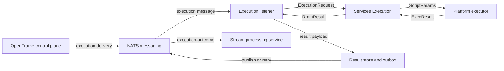
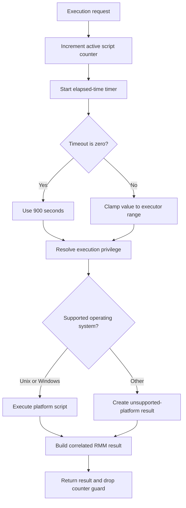
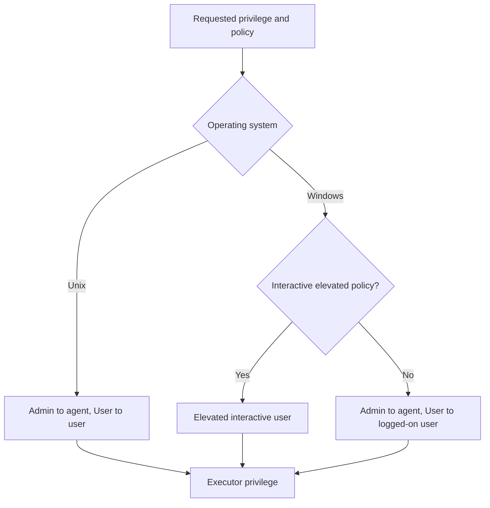
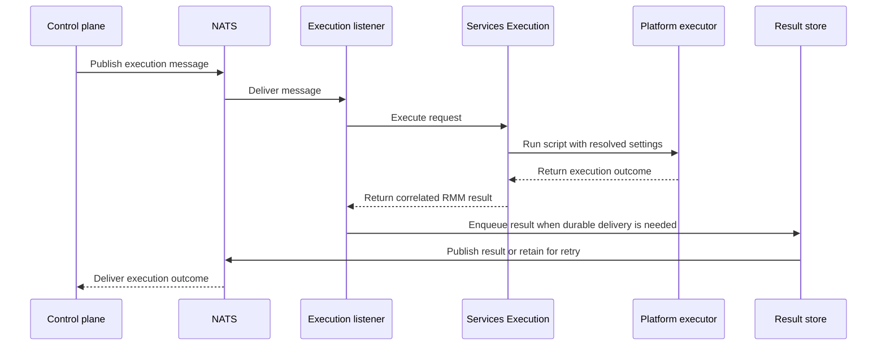

# Services Execution

Services Execution is the endpoint-agent subsystem that turns a received remote-management execution request into a platform-specific script invocation and returns a normalized result. It is implemented by `ExecutionService` in the OpenFrame OSS Library's Rust `openframe_client` crate, which this repository consumes as `openframe_agent_lib` version `v0.0.5`.

The service has a deliberately narrow responsibility: it tracks active scripts, applies a safe default timeout, resolves the requested execution identity, delegates to the operating-system executor, and preserves request correlation in the result. Message subscription, retryable result delivery, agent registration, and server-side execution-history processing are separate responsibilities.

**Implementation source:** [execution service](https://github.com/flamingo-stack/openframe-oss-lib/blob/7a766f00e4f58b5d89db007b878ac8d6e0c344f4/clients/openframe-client/src/services/execution_service.rs).

## Responsibilities

| Area | Services Execution behavior |
|---|---|
| Active-work visibility | Maintains a shared atomic count of scripts that are currently inside `execute`. |
| Request interpretation | Receives an `ExecutionRequest` containing script text, shell, arguments, timeout, environment variables, identifiers, and privilege settings. |
| Execution policy | Converts a zero timeout to 900 seconds and clamps a supplied value to the maximum `u32` value accepted by the executor parameters. |
| Privilege resolution | Maps `Admin` to the agent identity and `User` to an interactive user where supported. On Windows, an `InteractiveElevated` policy selects an elevated interactive user. |
| Platform execution | Calls the Unix or Windows executor when compiled for that platform. Other targets return a structured unsupported-platform result. |
| Outcome normalization | Returns an `RmmResult` with standard output, standard error, exit code, elapsed time, timeout status, request IDs, and selected error detail. |

## Position in the Agent Architecture

The tenant repository assembles backend services and configuration, while endpoint execution runs in the Rust agent library. The client service consumes command messages through NATS, calls Services Execution for each request, and submits results to the backend processing pipeline.

### Component Boundaries

- **Execution listener** owns subscription lifecycle. Its `start` method reconnects after a replaced NATS client, an ended stream, or listener error. It holds the execution service, configuration service, NATS publisher, durable result store, and an outbox wake-up notification.
- **Services Execution** owns only in-process execution accounting and conversion of one request into one `RmmResult`.
- **Platform executors** create temporary scripts, apply execution environment and identity, launch the selected interpreter, enforce timeouts, and clean up temporary files.
- **Result store and outbox** provide deferred publication. If durable storage is available, pending payloads are enqueued and a run manager flushes them periodically or when notified; successful delivery removes the entry.
- **Stream processing service** contains backend-side handlers for command and script execution outcomes. It is outside the agent process and should not be duplicated in this module.

## Public Types and Contract

### Execution Service

`ExecutionService` is cloneable and defaults to an empty active-script counter. Construct it with `new`, call `execute` asynchronously, and obtain a `RunningScripts` observation handle through `running_scripts`.

`RunningScripts::any` performs an acquire atomic read and returns whether at least one execution is in progress. This is a lightweight status signal rather than a registry: it does not identify scripts, expose individual completion, or cancel execution.

The counter is incremented at the beginning of `execute`. A private RAII guard decrements it when the call exits, including early returns and errors, so callers do not need a separate cleanup path.

### Request and Result Data

| Type | Meaning | Key fields |
|---|---|---|
| `ExecutionRequest` | A borrowed execution instruction produced from an incoming command or scheduled script message. | execution ID, code, shell, arguments, timeout, environment variables, requested privilege, optional script ID, optional schedule ID, privilege policy |
| `ScriptParams` | Executor-specific projection of the request. | code, shell string, arguments, timeout as `u32`, resolved privilege, environment variables |
| `ExecResult` | Raw platform-executor outcome. | standard output, standard error, numeric return code, timeout flag |
| `RmmResult` | Correlated result returned to the messaging layer. | execution ID, machine ID, outputs, exit code, duration, timeout flag, optional error, script ID, schedule ID |

The `ExecutionMessage` abstraction used by the listener supplies an execution identifier and produces one or more `ExecutionRequest` values. It also declares the message kind and result kind and may opt into durable delivery. This keeps Services Execution independent of the wire format for commands, direct scripts, and scheduled scripts.

## Execution Process

### Timeout and Timing

A timeout of zero is intentionally interpreted as the default of 900 seconds, not as an unlimited execution. A positive `u64` timeout is capped before it becomes the executor's `u32` timeout parameter. The service measures elapsed wall-clock time with `Instant` and records whole milliseconds in `execution_time_ms`, including setup and executor time.

### Privilege Mapping

On Unix, `Admin` maps to the agent execution identity and `User` maps to user execution. On Windows, the default `AsRequested` policy uses the same base mapping. The Windows-only `InteractiveElevated` policy overrides the base request and asks the executor to run as an elevated interactive user.

This mapping is not authorization. Authorization and dispatch policy must be applied by the server-side command path before a message reaches the agent. The service only translates an already accepted request into the executor privilege enum.

## Platform Execution Details

### Unix

The Unix executor resolves the run-as identity, normalizes script line endings, creates a temporary script, builds the shell command with arguments, applies supplied environment variables, configures pre-execution behavior, and executes with the requested timeout. A temporary-file guard removes the temporary script when the attempt finishes. Failure during identity resolution, file creation, or process setup becomes an executor spawn error.

### Windows

The Windows executor accepts PowerShell and Command Prompt interpreters. It rejects unsupported shell names before starting a process. It writes a temporary script using the interpreter extension, waits for the file to be readable, then either starts the process normally as the agent or launches it in the logged-on user's session. The session mode may be ordinary interactive or elevated interactive according to the resolved privilege.

### Unsupported Targets

When the agent is built for neither Unix nor Windows, Services Execution returns an `RmmResult` without attempting to spawn a process. It has exit code `85`, an explanatory standard-error value, `timed_out` set to false, and an `unsupported platform` error value.

## Result Semantics and Delivery

The service copies standard output, standard error, exit code, and timeout state from the executor. It also copies the execution ID, machine ID, optional script ID, and optional schedule ID so downstream processors can update the correct execution record.

Exit code `85` has an additional local meaning: when returned by a supported platform executor, it is treated as a script-start failure. The result preserves the executor's standard error in the optional `error` field and logs a warning with the execution ID and resolved privilege. Other nonzero exit codes remain represented by the exit code and standard error without this special error classification.

The result outbox protects results after they are serialized for delivery, not script execution itself. The outbox run manager skips startup when the result store is not durable. Otherwise it wakes on an interval or notification, loads pending payloads, applies the publisher's maximum-payload limit, publishes with an acknowledgement when the result subject requires it, and removes the entry only after successful publication. Publish failures and timeouts leave entries available for a later retry.

## Concurrency and Lifecycle Considerations

- Multiple calls to `execute` can run concurrently. The atomic counter records aggregate activity only; it does not serialize scripts.
- Consumers that need to defer a disruptive lifecycle operation can retain a `RunningScripts` handle and query `any`. A false value is a point-in-time observation, so it is not a lock or admission-control mechanism.
- Execution accounting begins before platform preparation and ends only when the asynchronous call returns. This includes unsupported-platform handling and executor setup failures.
- The listener is responsible for resilience at the transport boundary by resubscribing after disconnection conditions. The outbox is responsible for resilience at the result-publication boundary.
- Long-running scripts consume active-script capacity for their full measured lifetime. The timeout policy is therefore both an execution safeguard and a lifecycle-management input.

## Operational Diagnostics

When investigating a failed execution, inspect the following in order:

1. Confirm the listener is connected and receiving the expected execution message kind.
2. Correlate logs by execution ID. The service logs an information event before execution and logs a warning when a script fails to start with exit code `85`.
3. Inspect the returned `RmmResult`: standard output, standard error, exit code, timeout indicator, elapsed time, machine ID, and optional script or schedule IDs.
4. For a Windows failure, verify the shell is PowerShell or Command Prompt and determine whether the requested policy required an interactive session.
5. For a Unix failure, verify identity resolution, temporary-file creation, command preparation, and required permissions.
6. If execution completed but the platform has no outcome, inspect durable result-store state and outbox publication retries.

## Maintenance Guidance

Changes to Services Execution should preserve these invariants:

- Every call to `execute` must balance the active-script counter, including errors and early returns.
- Request correlation fields must be copied into every result path, including unsupported platforms.
- Zero timeout must retain its bounded default behavior unless the agent-wide execution policy is intentionally changed.
- Platform-specific privilege changes require review of both the request policy and the corresponding executor implementation.
- Exit code `85` is part of the agent's start-failure convention; changing it requires coordinated changes in callers and observability expectations.
- Delivery changes belong in the execution listener, result store, or outbox manager unless they alter the execution contract itself.

The source implementation is maintained in the [OpenFrame OSS Library](https://github.com/flamingo-stack/openframe-oss-lib/blob/7a766f00e4f58b5d89db007b878ac8d6e0c344f4/clients/openframe-client/src/services/execution_service.rs), while the OpenFrame OSS Tenant repository integrates the service through its client runtime and backend services.
