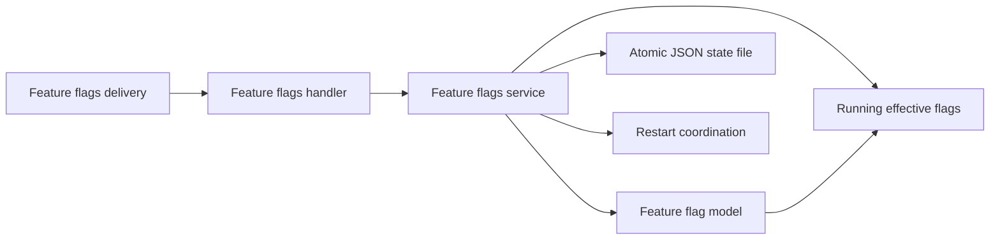
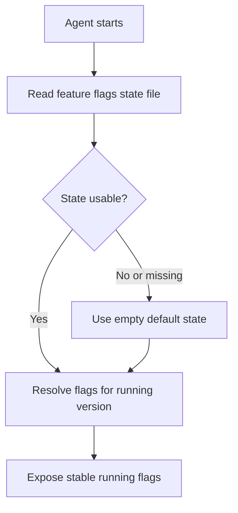
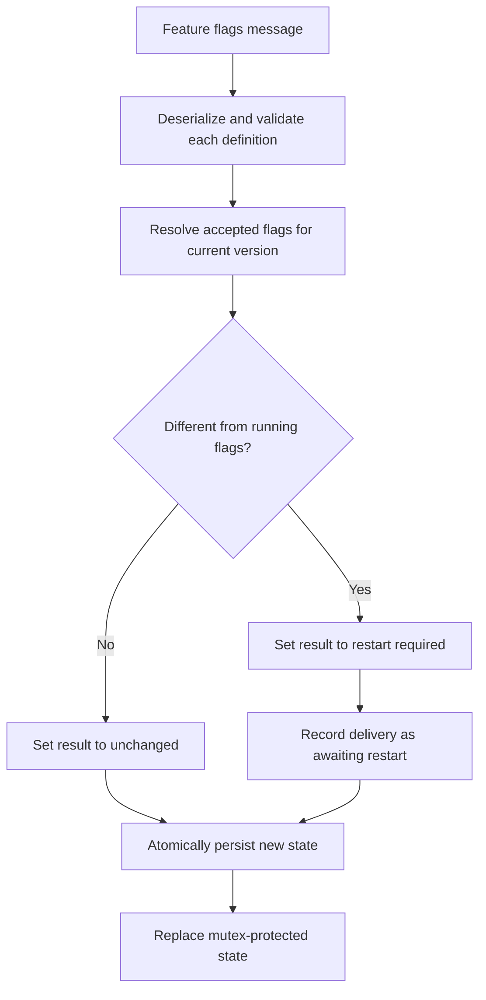
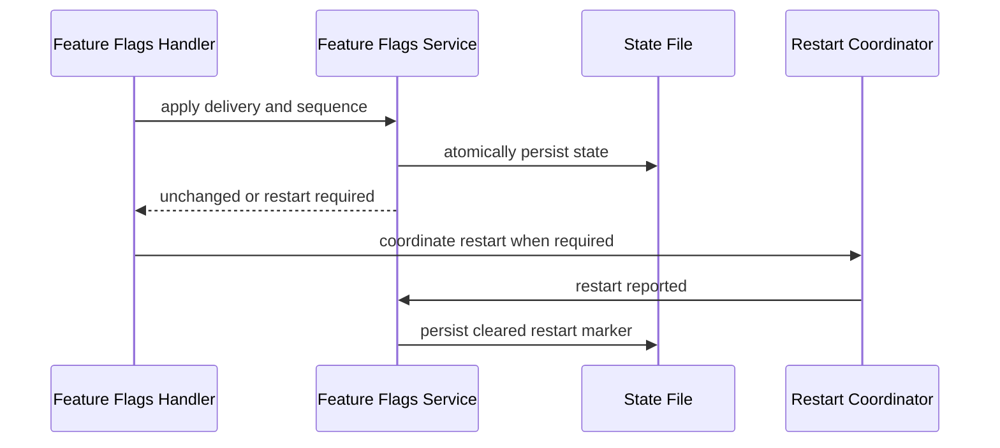

# Services Feature Flags

Services Feature Flags is the OpenFrame Client agent component that safely receives, validates, persists, and activates remote feature-flag policy. It is implemented by `FeatureFlagsService` in the `openframe_agent_lib` crate from **OpenFrame OSS Library** and runs as part of this repository's OpenFrame Client deployment. Its intentionally conservative default is that every currently defined remotely controlled capability is disabled unless the agent has a valid applicable flag.

The implementation is in [feature_flags_service.rs](https://github.com/flamingo-stack/openframe-oss-lib/blob/7a766f00e4f58b5d89db007b878ac8d6e0c344f4/clients/openframe-client/src/services/feature_flags_service.rs).

## Responsibilities and boundaries

The module owns the local, durable feature-flag state and the decision of whether a newly delivered policy needs an agent restart. It does not fetch policy itself, initiate a restart, or choose which commands to dispatch. Those activities belong to the command listener, its feature-flags handler, and the wider client runtime.

| Responsibility | Services Feature Flags behavior |
|---|---|
| Load startup state | Reads the persisted JSON state and derives the effective flags for the currently running agent version. |
| Fail safely | Missing, unreadable, or invalid state is treated as empty state, leaving all known features disabled. |
| Validate incoming definitions | Accepts only definitions that deserialize as `FeatureFlag` values and have a parseable semantic `minVersion`. |
| Resolve enabled capabilities | Uses the feature-flag model to resolve known flags against the running version. |
| Persist an accepted delivery | Atomically writes the complete new state before replacing the in-memory state. |
| Coordinate restart acknowledgement | Records the delivery that changed the effective runtime set, then clears that marker only after restart reporting succeeds. |
| Scope delivery sequencing | Returns the stored sequence only when it belongs to the current machine registration. |

## Supported capabilities

The feature-flag model defines four known features. Their default state is disabled. Unknown names are not part of the resolved runtime feature set.

| Wire name | Controlled capability |
|---|---|
| `delivery-tool-installation` | Tool-installation delivery |
| `delivery-client-uninstall` | Client-uninstall delivery |
| `delivery-client-update` | Client-update delivery |
| `package-auto-update` | Package auto-update |

Each accepted definition supplies an `enabled` boolean and a `minVersion` value. The model resolves the definitions for the agent version that was supplied to `FeatureFlagsService::load`. Consequently, receiving a valid definition does not by itself make it effective for an incompatible running version.

## Architecture and dependencies

The service is constructed with a local state-file path and the running agent version. `FeatureFlagsHandler` is the command-side adapter that owns an `Arc` to the service. The handler receives feature-flag deliveries from the command-listener subsystem and invokes the service; restart coordination and delivery acknowledgement occur in surrounding runtime components.

### Component roles

- **FeatureFlagsService** holds the state-file path, immutable running version, immutable runtime `FeatureFlags`, and a mutex-protected persisted-state view. Recovering a poisoned mutex preserves availability rather than panicking the agent.
- **FeatureFlagsMessage** carries a map from flag name to untyped JSON. This permits the receiver to reject malformed entries independently rather than rejecting the whole delivery.
- **FeatureFlag** is a validated definition with `enabled` and `minVersion` fields.
- **FeatureFlags** is the resolved set of known enabled `Feature` values. Callers use `is_enabled` rather than interpreting delivery JSON directly.
- **FeatureFlagsState** is the persisted record: registered machine identifier, applied sequence, validated definitions, and an optional restart-pending `DeliveryRef`.
- **FlagsApplied** reports either `Unchanged` or `RestartRequired` to the command-processing layer.

## Lifecycle

### Startup and steady-state reads

`load(path, version)` reads the prior state. A missing file creates default state. File-read or JSON-deserialization errors are logged as warnings and also fall back to default state. The service resolves this state once for the supplied running version and retains that result as `running`; `flags()` returns this stable effective set.

This design means a newly persisted change is deliberately not hot-applied to the current process. A changed effective set is activated through the restart path, avoiding a mixed runtime where some subsystems were initialized using an earlier flag set.

### Applying a delivered policy

`apply(machine_id, delivery, sequence, message)` creates a fresh ordered map of accepted definitions. For each entry, it attempts to deserialize a `FeatureFlag` and confirms that `minVersion` parses as a semantic version. An invalid entry is logged and omitted. It then resolves the accepted map for the current agent version and compares that result with the service's startup `running` flags.

If the effective set is the same, the result is `Unchanged`; no restart delivery is recorded. If it differs, the result is `RestartRequired`, and the provided delivery reference is stored in `awaiting_restart`. In both cases, the new machine identifier, sequence, and validated map are atomically persisted before the in-memory state is replaced. A persistence error is returned and prevents the in-memory update.

### Restart completion and delivery recovery

The optional `awaiting_restart` value is a durable association with the original `DeliveryRef`, which includes delivery type, target identifier, dispatch identifier, and optionally a sequence. Runtime code can inspect it with `awaiting_restart()` after a restart cycle. Calling `restart_reported()` creates a copy with this marker cleared, persists that copy, and replaces the in-memory state only after persistence succeeds.

The service itself does not request or perform a process restart. The command listener's restart gate is responsible for coordinating a restart with other client work, including running scripts, tool work, client updates, and package upgrades.

## Delivery sequence and registration behavior

`applied_sequence(machine_id)` protects sequence continuity across registration changes. If the persisted machine identifier matches the supplied identifier, it returns the stored sequence. If they differ, it logs that the policy belonged to another registration and returns `0`, allowing the new registration to accept deliveries without inheriting the previous machine's sequence position.

`apply` records the sequence it receives, but it does not independently reject stale or out-of-order messages. Ordering and duplicate-delivery policy therefore belong to the delivery and command-listener layers that call this service.

## Persistence contract

The persisted state is JSON written through the client library's atomic-write utility. Its logical fields are:

| Field | Purpose |
|---|---|
| `machine_id` | Identifies the registration for which the state was accepted. |
| `sequence` | Last recorded feature-flag delivery sequence for that registration. |
| `flags` | Validated name-to-definition map retained for the next startup. |
| `awaiting_restart` | Optional original delivery reference whose changed policy still awaits restart reporting. |

The loader supports absent `machine_id` and `awaiting_restart` fields through serialization defaults, preserving compatibility with earlier state records. A corrupted state file is not trusted; the client starts with no enabled flags rather than attempting a partial recovery.

## Operational guidance

- Treat a `RestartRequired` result as durable work: the state file has recorded both the accepted definitions and the delivery reference that must be reconciled after the restart.
- Investigate warnings about unreadable state files or ignored definitions. The resulting behavior is safe but can disable expected capability.
- Ensure all producers send feature names from the known set and valid boolean-plus-semantic-version definitions. Invalid entries are ignored individually.
- Do not expect an accepted changed policy to alter current-process behavior before restart. Code that checks `flags()` observes the startup-resolved set.
- Keep feature names, version policy, and delivery behavior aligned across the agent library and the platform services that publish client feature flags.

## System placement

OpenFrame OSS Tenant packages and runs the OpenFrame Client alongside API, gateway, management, and stream services. The management-side initializer and the client-core server components provide the broader feature-flag control plane; this library module is the endpoint-side safety boundary. It turns a delivered policy into a validated local record and a restart-aware activation decision, while keeping remote policy from enabling unsupported or malformed behavior by default.

The behavior documented here is supplied by the `openframe_agent_lib` dependency from OpenFrame OSS Library. OpenFrame OSS Tenant consumes the Cargo artifact at version `v0.0.5`; the OpenFrame Client runtime assembles it into the deployed service.