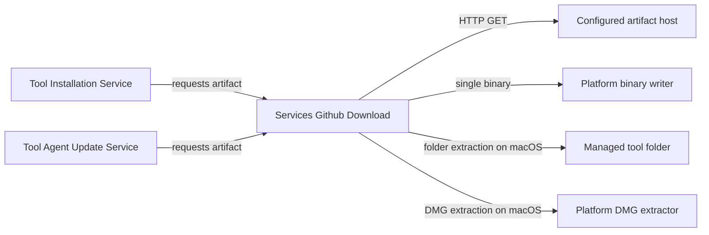
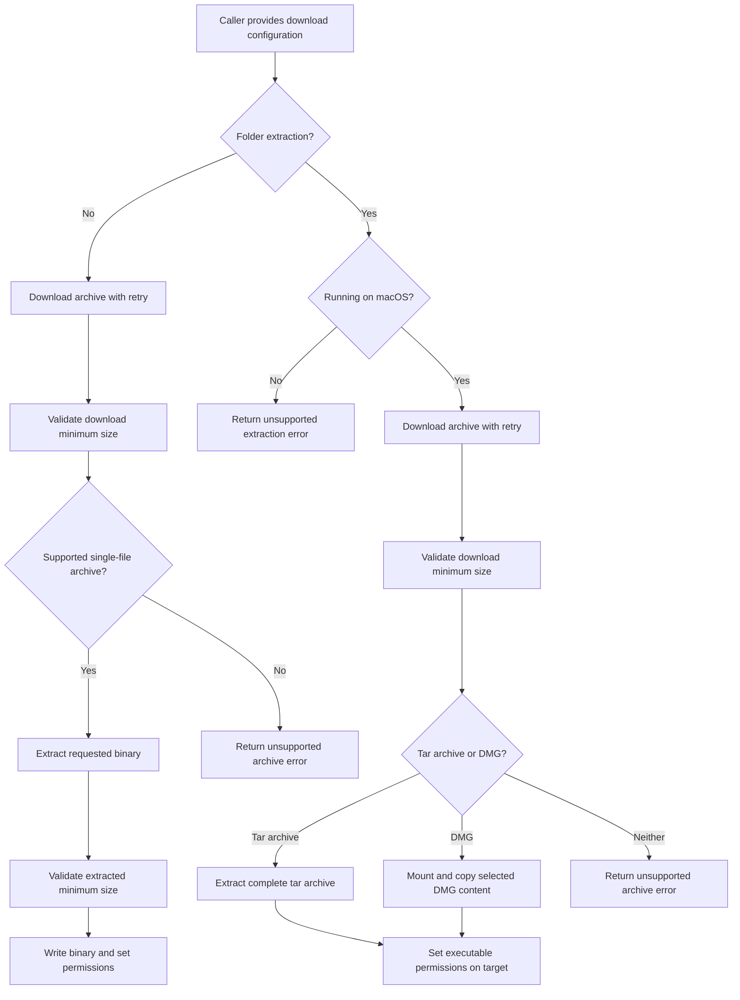

# Services Github Download

Services Github Download is the OpenFrame Client agent component that retrieves packaged tool artifacts from a configured URL, validates their size, extracts the executable or application bundle appropriate to the running operating system, and places the result in the agent-managed filesystem. Despite its name, the service receives an arbitrary configured download link; it does not call the GitHub API or resolve releases itself.

The implementation is supplied by the `openframe_agent_lib` Cargo library from OpenFrame OSS Library and is assembled into the client runtime by this repository. Its source is [github_download_service.rs](https://github.com/flamingo-stack/openframe-oss-lib/blob/7a766f00e4f58b5d89db007b878ac8d6e0c344f4/clients/openframe-client/src/services/github_download_service.rs).

## Responsibilities

- Select the first `DownloadConfiguration` that matches Windows, macOS, or Linux.
- Retrieve artifact bytes with a bounded retry policy for transient failures.
- Reject downloads and extracted executables below the configured minimum binary size.
- Extract a single executable from platform-supported ZIP or compressed tar archives.
- On macOS, extract a complete tool folder from compressed tar or DMG archives.
- Write a single binary through the platform binary writer, or set executable permissions after a folder extraction.

The service deliberately does not determine whether a tool needs installation or update, track installed versions, stop a running tool, or launch an installed tool. Those lifecycle decisions belong to its callers.

## Architecture and Placement

`GithubDownloadService` holds a reusable asynchronous HTTP client and a DMG extractor. Tool installation and tool-agent update services each own an instance and invoke it after their respective orchestration and locking steps.

### Collaborating Components

| Component | Relationship | Responsibility at the boundary |
|---|---|---|
| `DownloadConfiguration` | Input | Supplies the OS name, archive file name, artifact URL, target file name, and installation metadata. |
| `ToolInstallationService` | Caller | Coordinates a reserved installation, tool state, directories, and post-installation workflow. |
| `ToolAgentUpdateService` | Caller | Decides whether a registered tool or one of its assets needs repair or version update before initiating download work. |
| Platform binary writer | Output adapter | Creates parent directories, writes and flushes the replacement binary, performs best-effort recovery for locked files, and applies executable permissions. |
| Platform DMG extractor | macOS output adapter | Mounts a downloaded DMG temporarily, copies the selected content recursively, then attempts cleanup. |

## Download Configuration Contract

A configuration has the following relevant fields:

| Field | Use in Services Github Download |
|---|---|
| `os` | Compared case-insensitively with the compiled target OS: `windows`, `macos`, or `linux`. |
| `file_name` | Determines archive handling from its suffix. |
| `target_file_name` | Identifies the expected executable in a single-file archive, or the relative executable path after folder extraction. |
| `link` | Used directly as the HTTP GET URL. |
| `installation_type` | Carried as installation metadata; it does not choose archive extraction behavior here. |

A target filename with more than one path component is treated as a folder extraction. This distinction controls whether the service extracts a complete archive into the supplied tool directory or writes one extracted binary to the default agent path.

## Artifact Format and Platform Matrix

| Operation | Windows | Linux | macOS |
|---|---|---|---|
| Extract one binary | ZIP only | Compressed tar only | Compressed tar only |
| Extract entire archive into tool folder | Unsupported | Unsupported | Compressed tar or DMG |
| ZIP target matching | Case-insensitive suffix match | Not supported | Not supported |
| Compressed tar target matching | Not supported | Case-insensitive basename match | Case-insensitive basename match |

Compressed tar means a `.tar.gz` or `.tgz` file. ZIP handling on Windows scans archive entries and returns the first entry whose name ends with the requested target filename, ignoring case. Compressed tar handling outside Windows compares the entry basename, ignoring case, and excludes macOS metadata names that begin with `._`.

The whole-archive macOS path supports DMG files in addition to compressed tar. For a DMG, the first component of `target_file_name` is supplied as the source path within the mounted image. For a compressed tar, every archive entry is placed under the destination tool directory.

## Download and Installation Flow

For normal extraction, the service returns the bytes of the requested binary and delegates durable writing to the platform binary writer. For folder extraction, it extracts into the provided tool folder, applies executable permissions to the configured target path, warns if that executable does not exist after extraction, and returns the target path relative to the tool folder.

## Retry and Failure Behavior

Each download attempt is bounded by one overall retry deadline. The initial pause grows exponentially after each failed attempt and is capped by configuration. The service retries the following conditions until the budget is exhausted:

- Request failures with no HTTP status.
- HTTP server errors.
- HTTP `403`, `408`, and `429` responses.

Any other HTTP status causes an immediate failure. If the remaining retry budget cannot accommodate the next delay, the last error is returned with the attempt count. The service logs the attempt number, delay, and failure details, while successful downloads log the attempt on which they completed.

Validation failures are terminal for the operation:

- Downloaded archive bytes smaller than the configured minimum are rejected.
- A missing requested archive entry is rejected.
- An extracted executable smaller than the configured minimum is rejected.
- An archive format unavailable for the current platform is rejected.
- A whole-archive operation outside macOS is rejected.

## macOS Extraction Safety

For complete compressed-tar extraction, Services Github Download validates every archive entry path before writing it. Only normal path segments and current-directory segments are allowed. Absolute paths, parent-directory traversal, path prefixes, and other unsafe components cause extraction to fail rather than write outside the target directory. Directory entries are created as needed; file entries are copied and receive their archive mode when available. An empty archive is rejected.

DMG extraction is delegated to the platform DMG extractor. That adapter writes the image to a temporary location, mounts it, copies the requested path or mounted contents to the target directory, then attempts to unmount and remove the temporary image even when copying fails.

## Component API

| Member | Role |
|---|---|
| `new` | Creates the service from an HTTP client and a DMG extractor. |
| `find_config_for_current_os` | Returns the first configuration matching the compiled OS, or an error when no match exists. |
| `download_and_extract` | Downloads a supported archive, extracts one target binary, validates it, and returns its bytes. |
| `download_and_save` | Selects single-binary or folder behavior and returns the relative executable path only for folder extraction. |
| `download_and_extract_all` | Performs macOS-only complete archive extraction; on other targets it returns an unsupported-operation error. |

## Operational Considerations

- The caller should provide a correctly ordered configuration list if multiple entries target the same OS because selection returns the first match.
- Artifact names must agree with the platform matrix. A ZIP configuration on Linux, for example, is downloaded but cannot be extracted as a single binary.
- The minimum-size checks provide a coarse guard against empty or clearly invalid artifacts; they do not establish publisher identity, checksum integrity, or code signature validity.
- A successful folder extraction only warns when the expected executable path is absent. Callers that require a runnable tool should validate the resulting artifact as part of their lifecycle workflow.
- Download links are trusted configuration inputs. Maintain deployments should restrict who can set them and ensure artifact-host connectivity is available to the agent.

## System Role

Services Github Download is a narrow artifact-acquisition layer in the client agent. Installation and update orchestration use it to materialize tool binaries and application bundles, while platform adapters own filesystem writes, executable modes, and DMG mechanics. This division keeps update policy and installed-tool state separate from network transfer and archive handling.
