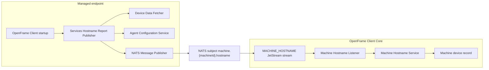
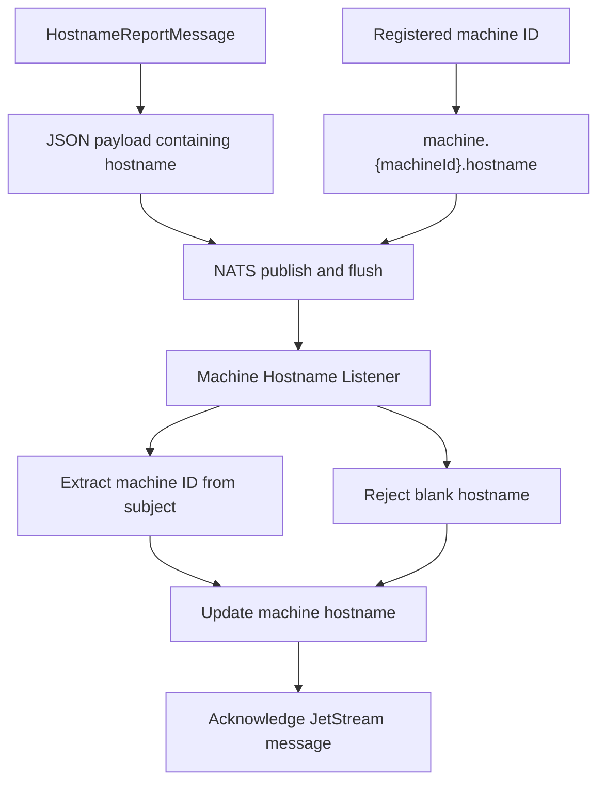
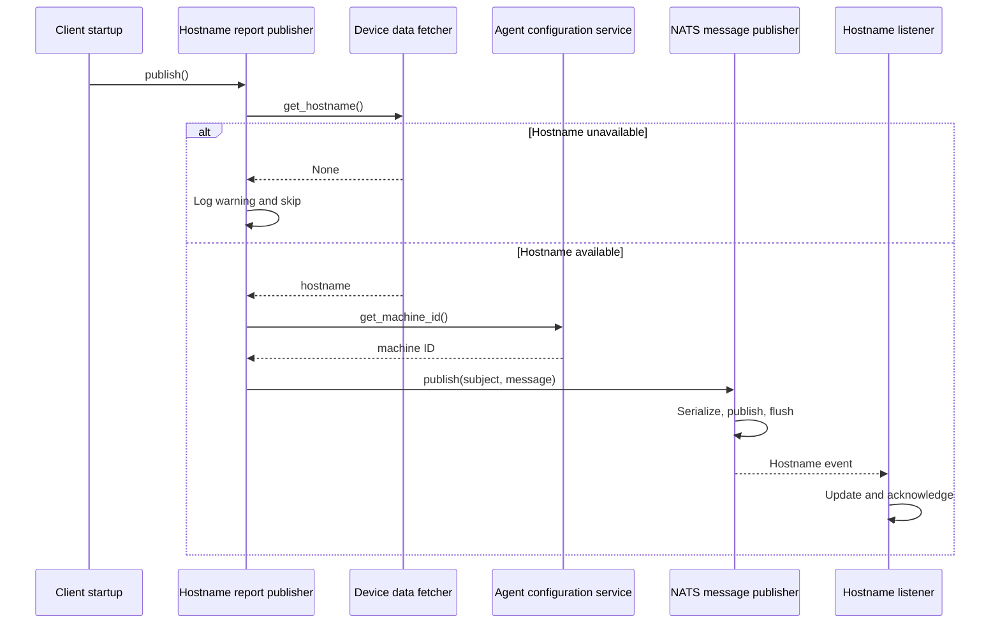

# Services Hostname Report Publisher

Services Hostname Report Publisher is a small, stateless OpenFrame Client service that reports the endpoint's current hostname when the client starts. It lets the platform reconcile a device rename without requiring the agent to be reinstalled. The implementation is supplied by the `openframe_agent_lib` artifact from the OpenFrame OSS Library and runs as part of this repository's OpenFrame Client deployment.

The publisher deliberately does not retain a last-reported hostname or implement local delivery recovery. Instead, every client startup produces a fresh observation, while the server determines whether that hostname changes the device record. A missed report therefore has a bounded recovery path: the next client startup attempts another report.

## Responsibilities

The module has three public elements in the library implementation:

| Component | Responsibility |
|---|---|
| `HostnameReportPublisher` | Holds the collaborators needed to resolve, identify, serialize, and publish a hostname report. It is cloneable so it can be shared by client startup orchestration. |
| `new` | Builds the publisher from a NATS message publisher, agent configuration service, and device-data fetcher. |
| `publish` | Executes the non-fatal reporting attempt. It logs a warning when publication fails rather than returning an error to its caller. |

The source implementation is [`hostname_report_publisher.rs`](https://github.com/flamingo-stack/openframe-oss-lib/blob/7a766f00e4f58b5d89db007b878ac8d6e0c344f4/clients/openframe-client/src/services/hostname_report_publisher.rs) in the OpenFrame OSS Library.

## Position in the System

The OpenFrame Client obtains the device hostname from the local operating system, obtains the persistent machine identifier from its registration configuration, and sends an event addressed to that machine. The client uses the NATS publisher's ordinary publish-and-flush path. On the server side, the OpenFrame Client Core listener subscribes to the matching wildcard subject through the `MACHINE_HOSTNAME` JetStream stream and updates the corresponding machine's hostname.



## Component Relationships

### Local collaborators

| Collaborator | Input to the publisher | How it is used |
|---|---|---|
| `DeviceDataFetcher` | Current hostname | `get_hostname()` attempts the kernel hostname first. It trims the value and rejects empty or invalid-looking values. On macOS, it can fall back to `scutil` local-host and computer-name values. |
| `AgentConfigurationService` | Persistent machine ID | `get_machine_id()` reads the registered machine identity from agent configuration. Failure to read this configuration prevents publication. |
| `NatsMessagePublisher` | Transport abstraction | Serializes the report as JSON, gets the active NATS client, publishes it, and flushes the client. Serialization, connection, publish, or flush failures are returned to the hostname publisher's internal attempt. |
| `HostnameReportMessage` | Wire payload | Contains exactly one field, `hostname`. The machine ID is not duplicated in the payload because it is encoded in the NATS subject. |

### Server-side consumer contract

The server listener accepts `machine.*.hostname`, extracts the machine ID from the message subject, and deserializes the payload into its Java hostname message model. A blank hostname is acknowledged without updating the record. For a non-blank hostname, the listener calls its machine-hostname service and acknowledges the message only after that update completes. If parsing, extraction, or update processing throws, the listener leaves the message unacknowledged so the stream may redeliver it.



## Publication Flow

The public `publish` method is intentionally a best-effort boundary: it invokes an internal fallible operation and converts failures into a warning log. Consequently, hostname-report failures do not stop the surrounding client startup path.



## Failure and Recovery Behavior

| Condition | Publisher behavior | Resulting recovery behavior |
|---|---|---|
| No usable hostname can be resolved | Logs a warning and returns successfully without emitting an event. | A later startup tries hostname resolution again. |
| Agent configuration cannot provide a machine ID | The internal attempt fails and the public method logs a warning. | A later startup retries after configuration becomes readable. |
| JSON serialization, NATS connection, publication, or flush fails | The internal attempt fails and the public method logs the error with context. | The publisher keeps no outbox or retry state. A later client startup sends a new report. |
| Backend receives a blank hostname | The listener acknowledges the message without updating the device record. | No redelivery is requested for intentionally unusable content. |
| Backend processing fails unexpectedly | The listener does not acknowledge the message. | JetStream can redeliver according to server-side stream and consumer configuration. |

This split is intentional: endpoint delivery is lightweight and startup-driven, while durable consumption and retry semantics belong to the server-side JetStream listener.

## Subject and Payload Contract

The published subject is derived at runtime:

```text
machine.{machineId}.hostname
```

The braces represent the registered machine ID value, not literal characters. The payload serializes the hostname message model:

```json
{
  "hostname": "example-host"
}
```

Changes to either contract require coordinated client and server updates. In particular, the listener identifies the target machine from the subject, and expects a JSON field named `hostname` in the message body.

## Operational Notes

- **Invocation cadence:** This service is designed to publish once per client startup, rather than continuously polling for name changes.
- **Idempotency location:** The endpoint sends the currently observed value. The backend is responsible for comparing it with the existing device hostname and applying the appropriate update.
- **Observability:** Successful publication logs the hostname and resolved subject at info level. Hostname-resolution failure and all attempted-publication errors are logged at warning level.
- **Privacy and scope:** The event carries a hostname only. The identity binding is the machine ID embedded in the destination subject.
- **Transport completion:** NATS publication includes an explicit flush, so a successful publisher call has completed both the publish operation and flush request; it is not an acknowledgement that the backend has persisted the new hostname.

## Maintenance Guidance

When modifying this service, preserve the separation of concerns:

1. Keep local hostname resolution in `DeviceDataFetcher` so platform-specific fallback and validation remain centralized.
2. Continue reading the machine ID from agent configuration rather than adding device identity to the message payload.
3. Preserve the subject shape unless the server listener and its stream configuration are updated in lockstep.
4. Treat `publish` as non-fatal to client startup. If stronger delivery guarantees are required, introduce them deliberately with persistent state and an explicit retry lifecycle rather than silently changing the current best-effort behavior.
5. Validate changes against both halves of the contract: JSON serialization and the wildcard subject on the client side, then machine ID extraction, blank-value handling, update, and acknowledgement on the server side.
