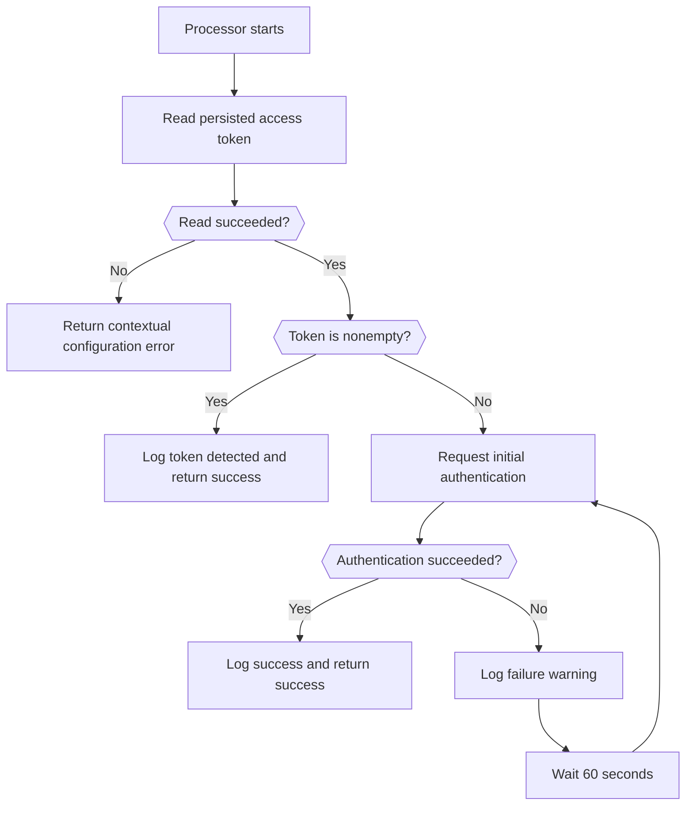
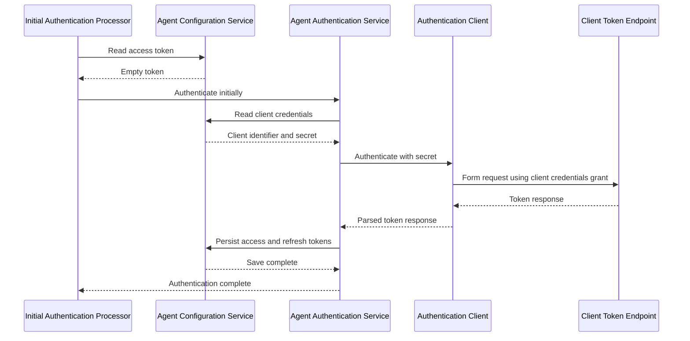

# Services Initial Authentication Processor

Services Initial Authentication Processor ensures that an OpenFrame client agent has an access token before the client continues past its startup authentication stage. It is implemented by `InitialAuthenticationProcessor` in the OpenFrame OSS Library Rust client and is assembled into this repository through the `openframe_agent_lib` dependency.

The processor is deliberately narrow: it reuses an existing nonempty access token, or repeatedly delegates first-time authentication until it succeeds. It does not itself parse credentials, issue tokens, or define refresh-token behavior.

**Implementation source:** [initial authentication processor in OpenFrame OSS Library](https://github.com/flamingo-stack/openframe-oss-lib/blob/7a766f00e4f58b5d89db007b878ac8d6e0c344f4/clients/openframe-client/src/services/initial_authentication_processor.rs)

## Responsibilities

- Read the persisted access token through `AgentConfigurationService`.
- Avoid an unnecessary initial authentication request when that token is nonempty.
- Invoke `AgentAuthService` for client-credentials authentication when no token is present.
- Keep startup authentication retrying after failures, with a fixed 60-second delay.
- Add contextual errors at the configuration-read and authentication-service boundaries, while emitting informational and warning logs.

## Position in the Client Startup Path

The processor belongs to the Rust client contained in the OpenFrame OSS Library. This repository consumes that library as `openframe_agent_lib` version `v0.0.5`; the shown implementation is sourced from the library revision linked above. The processor coordinates local configuration and the authentication API client rather than communicating with the platform directly.

### Collaborators

| Collaborator | Role in this flow | Observed behavior |
|---|---|---|
| `AgentConfigurationService` | Reads persisted authentication state. | Supplies the current access token. Its token-update operation serializes read-modify-write changes before saving access and refresh tokens. |
| `AgentAuthService` | Performs the domain-level initial authentication operation. | Obtains client credentials from configuration, requests a token, and saves the received tokens. |
| `AuthClient` | Performs the HTTP token request. | Sends a form-encoded client-credentials request to the client token endpoint and deserializes the token response. |
| Shared token service | Is owned by the authentication service. | The processor does not call it directly; its use is part of the authentication-service implementation. |

## Component API

`InitialAuthenticationProcessor` is cloneable and owns an `AgentAuthService` plus an `AgentConfigurationService`.

| Member | Purpose |
|---|---|
| `new(auth service, configuration service)` | Constructs the processor from its two service dependencies. No authentication occurs during construction. |
| `process()` | Asynchronously verifies or establishes an initial access token. It completes successfully after finding a nonempty token or after one successful authentication attempt. |
| Internal authentication attempt | Calls initial authentication and decorates an error if the authentication service fails. |

`process()` returns an error only when the initial read of the access token fails. Once the processor reaches the retry loop, individual authentication failures are logged and retried instead of being returned to the caller.

## Authentication Decision and Data Flow

The first branch is a presence check, not a validity, expiry, or authorization check. Any nonempty stored access token causes the processor to return successfully. Token refresh and later reauthentication are responsibilities outside this module.

When initial authentication is required, the delegated services move credentials and tokens through the following path.

The authentication client targets the path `/clients/oauth/token` below its configured base URL. It submits form fields for the client-credentials grant, client identifier, and client secret, and treats a non-success HTTP response or an unparseable response as an authentication failure. It also reports the HTTP status to its deactivation integration before evaluating the response.

## Retry Behavior and Operational Semantics

After the processor confirms that no access token is stored, it enters an unbounded retry loop:

1. Call the initial authentication operation.
2. On success, log success and return.
3. On failure, log the error at warning level.
4. Sleep for 60 seconds and try again.

There is currently no exponential backoff, maximum retry count, jitter, cancellation policy, or retry classification in this processor. The source marks exponential backoff as future work. Consequently, startup can remain blocked in this stage while credentials, reachability, endpoint availability, or token-response processing continue to fail.

## State and Persistence

The processor itself has no independent persistent state. Its observable state is derived from the agent configuration and authentication-service side effects.

| State transition | Trigger | Result |
|---|---|---|
| Existing token to ready | A nonempty access token is read. | No network authentication request is issued by this processor. |
| No token to authenticating | The stored token is empty. | The processor invokes initial authentication. |
| Authenticating to ready | The authentication service succeeds. | The authentication service persists the access token and refresh token through the configuration service. |
| Authenticating to retry wait | The authentication service returns an error. | The failure is logged and the processor waits 60 seconds before another attempt. |

## Error Handling and Observability

The configuration read is the only error path that escapes immediately. A failure is returned with context indicating that the existing access token could not be read. Errors from the delegated initial-authentication operation are wrapped with context indicating that the authentication service returned an error, then consumed by the retry loop.

Log events are intentionally concise:

- Informational event when an existing token causes the initial flow to be skipped.
- Informational event when the processor begins the authentication loop.
- Informational event when authentication succeeds.
- Warning event for every failed authentication attempt, including the error and stated 60-second retry delay.

Avoid logging client credentials, access tokens, refresh tokens, or raw token responses when extending this module.

## Maintenance Guidance

- Preserve the fast path for a nonempty persisted token unless the startup contract changes to require token validation.
- Keep credential acquisition, HTTP details, and token persistence in their existing collaborating services; this module is the retrying orchestration boundary.
- If adding backoff, make its timing, cancellation behavior, and testability explicit. The current fixed delay is asynchronous through Tokio and does not block an operating-system thread.
- Review consequences for service startup before introducing a retry limit or returning authentication failures, because current callers can rely on the processor waiting until it obtains credentials.
- Test at least the existing-token path, configuration-read failure, eventual authentication success, and repeated authentication failure with time controlled or abstracted.

## Source Scope

This documentation describes the processor and its directly observed library collaborators. Platform-side registration, the token endpoint implementation, token validation, refresh scheduling, and service startup composition are outside the source file and therefore are not specified here.
