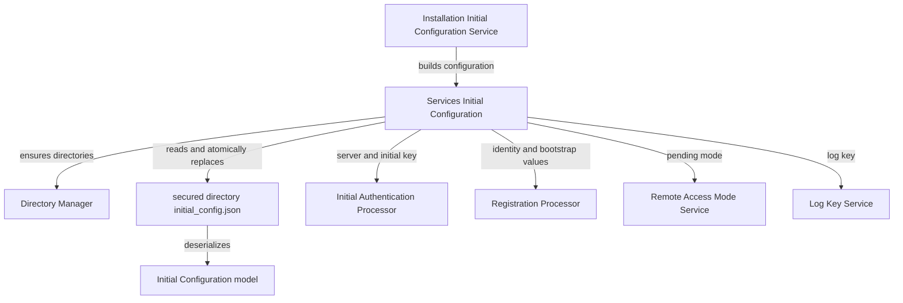
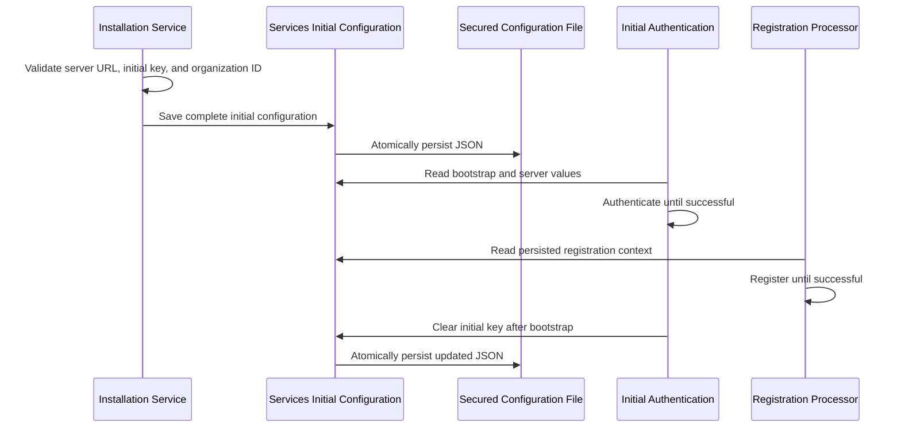
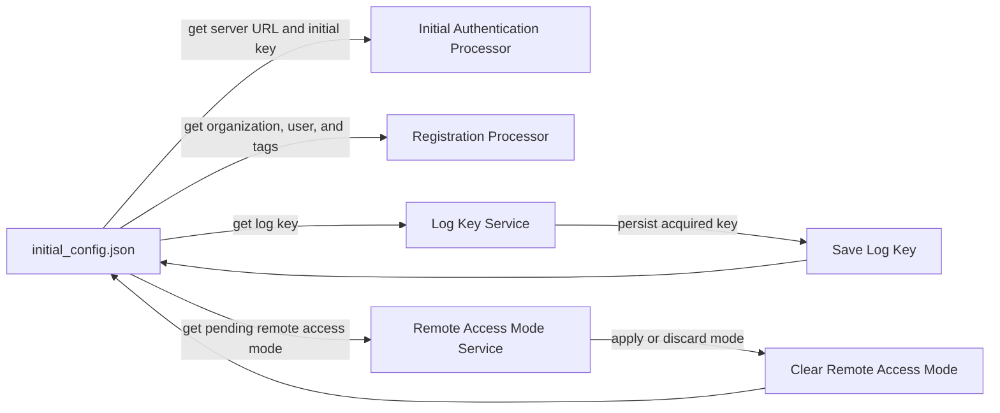

# Services Initial Configuration

Services Initial Configuration is the OpenFrame client agent's durable install-time configuration boundary. It owns the `initial_config.json` record in the agent's secured directory and exposes focused accessors for the server endpoint, bootstrap key, log-stream key, organization and user identities, local-mode TLS material, device tags, and a pending remote-access mode.

The implementation runs from the `openframe_agent_lib` artifact supplied by [OpenFrame OSS Library](https://github.com/flamingo-stack/openframe-oss-lib/blob/7a766f00e4f58b5d89db007b878ac8d6e0c344f4/clients/openframe-client/src/services/initial_configuration_service.rs). This repository consumes version `v0.0.5` of that Cargo artifact through its OpenFrame client runtime.

## Responsibilities

- Creates the agent directory layout before configuration is used.
- Reads and deserializes a single persisted `InitialConfiguration` document.
- Writes complete configuration documents through an atomic replacement operation.
- Serializes read-modify-write updates for the log key, bootstrap key, and remote-access mode within a process.
- Refuses to report the agent as configured unless the document parses and has a non-blank server host.
- Provides narrow getters so startup services do not need to interpret the persisted JSON directly.

The module is storage-oriented: it does not authenticate, register a device, perform remote-access changes, or stream logs itself. Those operations are performed by neighboring client services using the values it persists.

## Configuration Record

The record is the `InitialConfiguration` model from OpenFrame OSS Library. Installation constructs it with a required server URL, initial key, and organization identifier. Other fields either have install-time defaults or are optional.

| Field | Population and meaning | Lifecycle |
| --- | --- | --- |
| `server_host` | Required server URL supplied at installation. | Retained and used as the configured-state condition. |
| `initial_key` | Required bootstrap credential supplied at installation. | Cleared after the bootstrap phase through `clear_initial_key`. |
| `log_key` | Optional install-time log-stream key, or a key acquired later. | Replaced by `save_log_key`; retained independently of the initial key. |
| `org_id` | Required organization identity. | Retained. |
| `user_id` | Optional user identity. | Retained. |
| `local_mode` | Indicates local deployment mode. | Retained. |
| `local_ca_cert_path` | Resolved path to `rootCA.pem` when local mode is enabled. | Empty when local mode is disabled. |
| `tags` | Device tags parsed from installation input. | Retained. |
| `remote_access_mode` | Optional install-time remote access mode encoded for transport. | Cleared after it is handled or when it is invalid. |

## Architecture and Dependencies

### Storage Initialization

`InitialConfigurationService::new` derives the file location by appending `initial_config.json` to `DirectoryManager::secured_dir()`. It then calls `ensure_directories`; construction fails when that preparation fails. The service holds the resulting path and a shared mutex in an `Arc`, so clones of the service serialize their own read-modify-write mutations.

### Reads and Configuration Gate

All public getters load the document afresh. A read fails if the file is absent, cannot be read, or contains JSON that cannot be deserialized as `InitialConfiguration`.

`is_configured` deliberately converts those failures to `false`. It returns `true` only when the record parses and `server_host`, after trimming whitespace, is non-empty. This protects the startup awaiting-auth gate from a missing, malformed, or incomplete configuration file.

### Writes and Update Safety

The generic `save` method serializes the complete record as pretty JSON and delegates persistence to `atomic_write`. The helper creates a temporary file in the destination directory, writes and flushes it, then persists it over the target path. On Windows it also handles a held target through the platform replacement path. This avoids exposing a partially written JSON document during normal replacement.

The specialized mutation methods acquire the write mutex before reading and saving:

- `save_log_key` preserves every other field while replacing `log_key`.
- `clear_initial_key` does nothing when the initial key is already blank; otherwise it clears only that field.
- `clear_remote_access_mode` clears only the pending mode.

The mutex prevents lost updates among cloned instances in the same process. It is not an inter-process lock, so other processes must not independently edit the file without coordination.

## Installation and Bootstrap Flow

The installation layer uses `InstallationInitialConfigService::build_and_save` to validate and persist first-run input. It requires non-blank `server_url`, `initial_key`, and `org_id`; it accepts optional user ID, log key, tags, local-mode selection, and remote-access mode.

When local mode is enabled, the installer executes `mkcert -CAROOT`, requires a successful result, and verifies that `rootCA.pem` exists under the reported root before saving its path. When local mode is disabled, it does not resolve a CA path.

The initial authentication processor skips its retry loop when an access token already exists; otherwise it retries authentication every 60 seconds after failures. The registration processor similarly skips work when a machine identifier is already persisted and otherwise retries registration every 60 seconds. These retry policies belong to those processors, not to Services Initial Configuration.

## Runtime Consumers and Data Flow

### Authentication and Registration

Startup services use the configuration as the install-time source of truth while credentials and machine registration are being established. Once bootstrap authentication no longer needs the initial key, the module can persist a blank value without affecting the server endpoint, organization data, tags, or log key.

### Log Key Handoff

`get_log_key` retrieves the durable log-stream key and `save_log_key` supports a later handoff from the log-key flow. After its run completes, the log-key service requests a client restart through its restart gate so logging can start with the new key. Services Initial Configuration only persists the value; it does not launch the restart or open a streaming connection.

### Remote Access Reconciliation

The remote-access service starts only when `get_remote_access_mode` returns a value. It translates the wire name to a supported remote-access mode, applies that mode asynchronously, and clears an unknown install-time value rather than retrying it indefinitely. The pending field therefore represents intent awaiting backend acknowledgement, not the authoritative long-term remote-access state.

## Failure Behavior and Operational Notes

| Condition | Module behavior | Operational effect |
| --- | --- | --- |
| Secured directory cannot be prepared | Service construction fails with context. | Installation or startup cannot safely initialize configuration storage. |
| File does not exist | Getters return an error; `is_configured` returns `false`. | The authentication gate remains closed. |
| File is unreadable or malformed | Getters return contextual read or deserialization errors; `is_configured` returns `false`. | Callers should surface the failure and preserve the gate. |
| Serialization or replacement fails | The saving operation returns an error with context. | The caller must treat the requested state transition as incomplete. |
| Mutex is poisoned | The service recovers the inner guard and continues. | A previous panic does not permanently block later in-process updates. |
| Blank server host | `is_configured` returns `false`. | A syntactically valid but incomplete record cannot release startup. |

The configuration contains bootstrap and operational credentials. Access to the secured directory must be managed as sensitive host state. The atomic-write helper creates its temporary file with restrictive defaults, but on Unix it restores permissions to `0644` before persistence; deployment directory ownership and platform-level access controls remain important.

## Maintenance Guidance

- Keep `InitialConfiguration` backward compatible: several fields use serialization defaults so older documents can deserialize when fields are added.
- Route all full-document updates through `save` and all partial changes through a serialized read-modify-write operation to avoid overwriting unrelated fields.
- Do not weaken `is_configured` into a file-exists check; the non-blank server-host validation is the startup safety invariant.
- Treat clearing the initial key as an explicit bootstrap-completion transition. Do not clear it before a durable replacement succeeds.
- Keep local-mode CA discovery in the installation service, where `mkcert` is validated, rather than introducing command execution into this storage service.

## Source Files

- [Initial configuration service](https://github.com/flamingo-stack/openframe-oss-lib/blob/7a766f00e4f58b5d89db007b878ac8d6e0c344f4/clients/openframe-client/src/services/initial_configuration_service.rs)
- [Initial configuration model](https://github.com/flamingo-stack/openframe-oss-lib/blob/7a766f00e4f58b5d89db007b878ac8d6e0c344f4/clients/openframe-client/src/models/initial_configuration.rs)
- [Installation configuration builder](https://github.com/flamingo-stack/openframe-oss-lib/blob/7a766f00e4f58b5d89db007b878ac8d6e0c344f4/clients/openframe-client/src/installation_initial_config_service.rs)
- [Atomic file writer](https://github.com/flamingo-stack/openframe-oss-lib/blob/7a766f00e4f58b5d89db007b878ac8d6e0c344f4/clients/openframe-client/src/utils/fs.rs)
