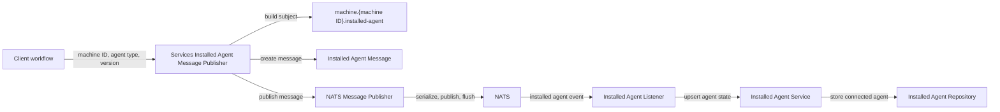
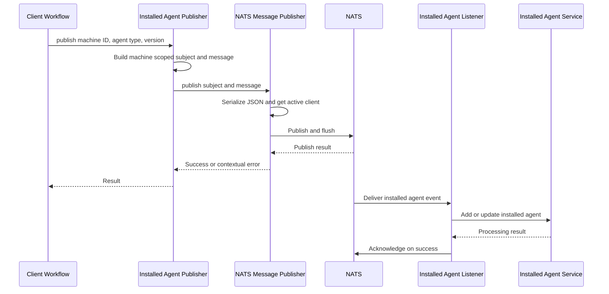
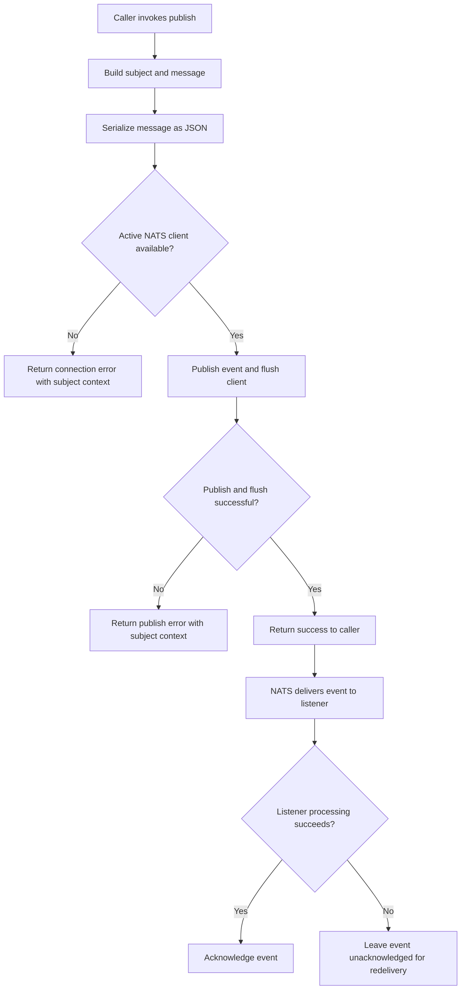

# Services Installed Agent Message Publisher

Services Installed Agent Message Publisher is a small outbound messaging adapter in the OpenFrame endpoint client. It reports that a particular agent type and version are installed on a machine by publishing an `InstalledAgentMessage` to NATS. The implementation is supplied by the OpenFrame OSS Library's `openframe_agent_lib` dependency and runs in this repository's OpenFrame client deployment.

Its source is [installed agent message publisher](https://github.com/flamingo-stack/openframe-oss-lib/blob/7a766f00e4f58b5d89db007b878ac8d6e0c344f4/clients/openframe-client/src/services/installed_agent_message_publisher.rs).

## Responsibility and Boundary

The module has one responsibility: turn three caller-provided values into a machine-scoped installed-agent event and hand it to the shared NATS publisher.

| Input or dependency | Role |
|---|---|
| Machine identifier | Selects the NATS subject namespace for the endpoint. |
| Agent type | Identifies the installed agent or integration. |
| Version | Records the version reported by the endpoint client. |
| NATS message publisher | Serializes, sends, and flushes the message through the active NATS connection. |

The publisher does not discover installation state, validate field values, persist pending events, or wait for server-side processing. Callers are responsible for supplying meaningful machine, agent-type, and version values; the backend is responsible for validating and storing the received report.

## Architecture



The Rust publisher is intentionally thin. Its collaboration with `NatsMessagePublisher` centralizes JSON serialization and broker interaction. The NATS publisher obtains the active client from the connection manager; if a connection has not been initialized, the publish attempt fails before an event is sent.

On the service side, the Java `InstalledAgentListener` subscribes to `machine.*.installed-agent` through the `INSTALLED_AGENTS` stream. It extracts the machine identifier from the subject, deserializes the payload, invokes `InstalledAgentService`, and acknowledges the broker message only after successful handling.

## Components

### Installed Agent Message Publisher

`InstalledAgentMessagePublisher` is cloneable and contains one dependency: `NatsMessagePublisher`. Its constructor accepts the prepared NATS publisher and retains it without creating a connection or performing network activity.

`publish(machine_id, agent_type, version)` performs the complete module workflow:

1. Builds the subject `machine.{machine ID}.installed-agent`.
2. Builds an `InstalledAgentMessage` with the supplied agent type and version.
3. Delegates publication to `NatsMessagePublisher`.
4. Adds the subject to any returned error context.

The contextual error identifies the subject that failed, which makes endpoint logs actionable without changing the lower-level error returned by serialization, connection retrieval, publishing, or flushing.

### Installed Agent Message Contract

The message is serialized as JSON by the shared NATS publisher. Its wire payload has two fields:

```json
{
  "agent_type": "example-agent",
  "version": "1.2.3"
}
```

The Rust model exposes `agent_type` and `version`. The receiving listener reads corresponding agent type and version properties before passing them to the backend service. The subject—not the payload—carries the machine identity.

### NATS Message Publisher

The shared publisher serializes its generic payload to JSON, requests the active NATS client from the connection manager, publishes to the supplied subject, and flushes the client. A successful return therefore means the client completed its local publish-and-flush operation. It does not mean the installed-agent listener has stored the record or acknowledged the event.

### Server-side Consumer

The server-side listener handles the wildcard subject and uses a durable consumer named `installed-agent-processor-v1` in delivery group `installed-agent`. For each received event, it calls `InstalledAgentService` to validate the machine identifier and agent type, confirm that the machine exists, and then either create a record or update the matching machine-and-agent-type record. Stored agents are marked connected, and their version and update time are refreshed.

If handling throws, the listener leaves the broker message unacknowledged so that broker delivery policy can redeliver it. This is separate from the endpoint publisher's result: publisher success does not prevent a later server-side retry.

## Publication Data Flow



## Subject and Routing Contract

The publisher constructs exactly one subject pattern:

```text
machine.{machine ID}.installed-agent
```

The placeholder is the machine identifier provided by the caller. This subject design allows the backend listener to subscribe once to `machine.*.installed-agent`, derive the machine identity from the routing key, and keep the JSON message focused on installed-agent attributes.

Changing the subject prefix, segment order, or final `installed-agent` segment is a compatibility change. The existing listener and its stream configuration depend on the wildcard contract.

## Process Outcomes



## Failure Semantics and Operational Notes

- **No active connection:** the underlying connection manager reports that NATS has not been initialized. The caller receives an error enriched with the target subject.
- **Serialization failure:** the shared publisher returns an error before contacting NATS. The installed-agent payload contains only strings, but serialization remains part of the delegation boundary.
- **Broker publish or flush failure:** the endpoint caller receives an error. This module itself does not maintain an outbox or perform retry scheduling.
- **Consumer failure after publication:** the publisher may already have returned success. The listener deliberately does not acknowledge failed work, allowing NATS delivery behavior to determine redelivery.
- **Invalid or unknown machine:** server-side processing validates machine identity and existence. A failure in this stage is handled by the listener's unacknowledged-message path.

For troubleshooting, correlate the endpoint-side error subject with the machine identifier, then inspect the `INSTALLED_AGENTS` stream consumer and server-side listener logs. Avoid treating a successful endpoint publish as confirmation that the installed-agent record is already visible in backend storage.

## Maintenance Guidance

Keep the publisher focused on event construction and transport delegation:

- Preserve the machine-scoped subject format unless the producer, stream configuration, and consumer wildcard are updated together.
- Preserve the two-field message contract or evolve it compatibly with the Java consumer.
- Propagate errors rather than suppressing them, because the caller is the only component that can decide whether and when to retry the reporting operation.
- Do not add server-side validation rules here without aligning them with the authoritative backend service; this module currently treats its parameters as caller-owned input.
- When changing NATS delivery behavior, distinguish transport completion from listener acknowledgement and persistence.
