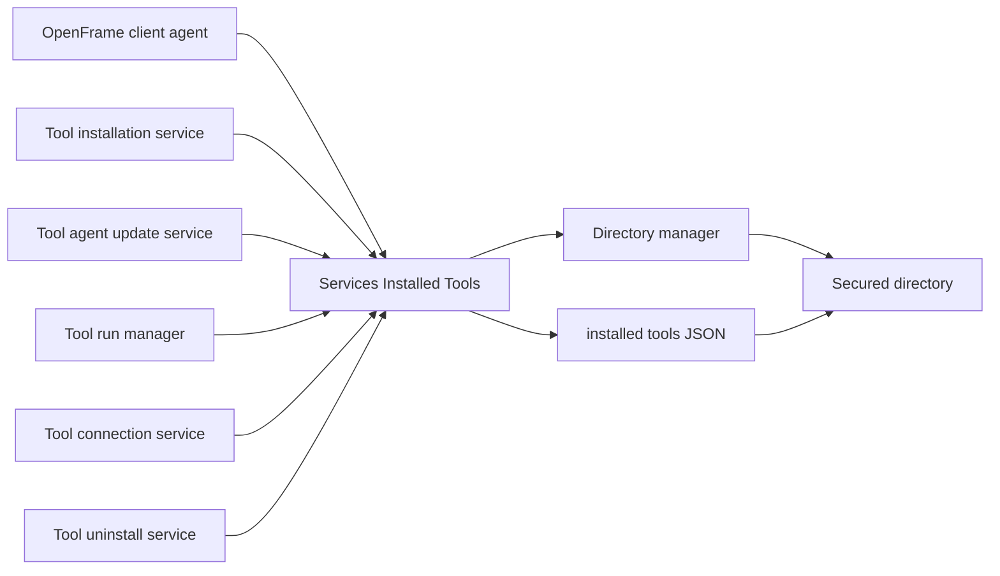
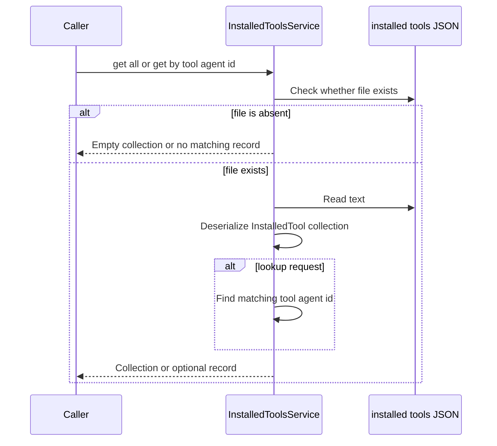
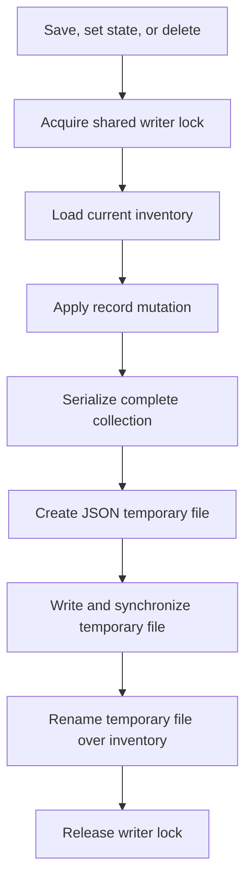
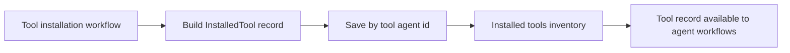
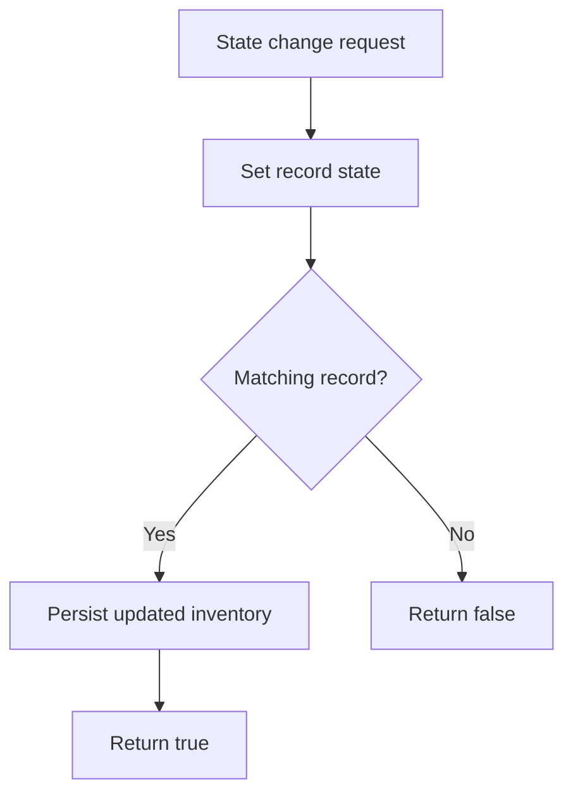

# Services Installed Tools

Services Installed Tools is the OpenFrame client agent's durable local inventory for integrated tools. It is implemented by `InstalledToolsService` in the Rust `openframe_client` library supplied by OpenFrame OSS Library and run by this repository's OpenFrame client deployment. The service stores one `InstalledTool` record per tool-agent identifier, making the local record available to installation, update, connection, execution, and removal workflows even when they are coordinated asynchronously.

The implementation is intentionally narrow: it owns a JSON file in the agent's secured directory, provides asynchronous reads and serialized mutations, and atomically replaces the file after a successful write. It does not download, launch, stop, or uninstall tools itself; those responsibilities belong to the surrounding agent services.

**Implementation source:** [`installed_tools_service.rs`](https://github.com/flamingo-stack/openframe-oss-lib/blob/7a766f00e4f58b5d89db007b878ac8d6e0c344f4/clients/openframe-client/src/services/installed_tools_service.rs)

## Responsibilities

The module provides a small repository-style API over the `installed_tools.json` inventory:

| Capability | Operation | Behavior |
|---|---|---|
| Initialize storage | `new` | Resolves the inventory path beneath the secured directory and ensures managed directories exist before the service is returned. |
| Read the inventory | `get_all` | Returns every persisted `InstalledTool`; a missing inventory file is treated as an empty inventory. |
| Look up one tool | `get_by_tool_agent_id` | Reads the inventory and returns the record that matches a tool-agent identifier, if present. |
| Create or replace | `save` | Upserts a record by tool-agent identifier, then persists the complete collection. |
| Change lifecycle state | `set_state` | Updates `ToolRecordState` for an existing record and reports whether a matching record was found. |
| Remove a tool | `delete_by_tool_agent_id` | Deletes a matching record and reports whether the inventory changed. |

`InstalledTool` is the persisted domain record. Its `tool_agent_id` is the uniqueness key enforced by `save`, while `ToolRecordState` represents the record's lifecycle state. The service persists the whole collection rather than exposing a partial-record write API, which keeps the JSON document as the single local inventory snapshot.

## Position in the Agent

Services Installed Tools is part of the Rust OpenFrame client core rather than a server-side service. The agent composes it with tool-specific services that coordinate installation, updates, execution, connections, and removal. Those services can use the inventory as the durable local representation of which tool-agent records exist and their current states.

The diagram describes component boundaries and data ownership. The current implementation directly depends only on `DirectoryManager`, `InstalledTool`, and `ToolRecordState`; adjacent tool services are integration peers in the client module, not direct dependencies shown in this source file.

## Storage Design

### File location and initialization

Construction receives a `DirectoryManager`, obtains its secured directory, and selects the fixed filename `installed_tools.json`. Before returning, `new` calls `ensure_directories`. Failure to prepare the secured directory is returned with context, so the agent does not silently continue with an unusable storage location.

The service has two fields:

- `file_path` is the resolved path of the JSON inventory.
- `writer` is a shared asynchronous mutex. Clones of the service share this mutex because it is wrapped in `Arc`.

The file is absent on a first run or after cleanup. `get_all` treats that condition as a normal empty inventory rather than an error. Conversely, an existing file that cannot be read or whose content cannot be deserialized produces an error with contextual diagnostics. This distinction prevents a corrupted record of installed tools from being interpreted as an intentionally empty inventory.

### Record identity and upsert semantics

`save` loads the current list while holding the writer mutex and compares each record's `tool_agent_id` with the incoming record:

1. If a matching record exists, the service replaces the complete existing record.
2. Otherwise, it appends the incoming record.
3. It persists the resulting full collection.

This gives exactly one stored record for a tool-agent identifier when the inventory was built through this API. Saving the same identifier updates the stored metadata and state rather than adding another entry.

`set_state` is more selective. It changes only the `state` field of an existing record. The returned boolean distinguishes a successful state transition from a request for an unknown tool-agent identifier; callers can make that distinction without treating a missing record as a filesystem failure.

### Removal semantics

`delete_by_tool_agent_id` retains every record except the one matching the requested identifier. It only persists when the number of records changes. If no record matches, it returns `false` and leaves the file untouched. As with saves and state changes, removal is serialized by the same writer mutex.

## Read and Write Paths

### Read path

A lookup is deliberately implemented in terms of `get_all`, so read behavior and JSON error handling are centralized. Reads do not acquire the writer mutex in this implementation. Mutations, however, serialize their read-modify-write sequence so two writes performed through the same service or one of its clones cannot interleave.

### Durable mutation path

The persistence routine serializes the collection with pretty JSON, writes it to a sibling path using the `json.tmp` extension, synchronizes that temporary file, then renames it over the target. The rename is the replacement step used by this module to avoid writing the final inventory file incrementally. Errors from serialization, temporary-file creation, writing, synchronization, or rename are propagated with path-specific context.

The lock remains held across loading, modification, and persistence. Consequently, each successful mutating call observes the result of earlier successful calls that used the same shared service state. This guards against lost updates caused by concurrent read-modify-write operations inside the process.

## Interaction Scenarios

### Tool installation or registration

A surrounding installation workflow creates an `InstalledTool` record and calls `save`. The record becomes the local inventory entry after the atomic replacement succeeds. If the same tool-agent identifier is later reinstalled or its metadata is refreshed, another `save` replaces the record rather than duplicating it.

### State transition

Tool lifecycle orchestration can request a state transition without recreating the full record. A positive result confirms that the inventory contained the identifier and that the changed collection was persisted. A `false` result identifies an unknown record, while an error identifies a read, serialization, or filesystem failure.

### Tool removal

When higher-level cleanup decides that a tool record should no longer be retained, it calls `delete_by_tool_agent_id`. The method updates the inventory only if a matching record exists. Physical tool cleanup and process control are deliberately outside this module, allowing the caller to coordinate those actions with its own failure and retry policy.

## Error Handling and Operational Properties

| Condition | Service behavior | Operational meaning |
|---|---|---|
| No inventory file | Returns an empty collection | Normal initial or cleaned state. |
| Secured directory cannot be prepared | `new` returns an error | Initialization fails before the service can be used. |
| File cannot be read | Read operation returns an error with the path | The agent cannot safely determine its installed-tool inventory. |
| JSON cannot be decoded | Read operation returns a deserialization error | Existing inventory content is invalid or incompatible. |
| Tool identifier is not present for state change or delete | Returns `false` | The request made no durable inventory change. |
| Temporary write or replacement fails | Mutation returns an error | The old target file is not reported as successfully replaced. |

The design does not repair malformed JSON, deduplicate pre-existing duplicate identifiers, or coordinate writes from external processes that edit the same file outside this service. Maintainers should preserve the single-writer usage model and treat the secured directory as an agent-owned persistence boundary.

## Maintenance Guidance

- Preserve `tool_agent_id` as the key for save, lookup, state transition, and deletion unless all callers and persisted records are migrated together.
- Keep lifecycle mutation separate from tool execution and filesystem installation logic. This service should remain the source of local record state, not an orchestrator.
- Retain the temporary-file, synchronization, and rename sequence when changing the storage format or write path. A direct write to the final JSON file would weaken replacement safety.
- Preserve the shared mutex across cloned service instances if additional mutating methods are introduced.
- Add explicit migration or compatibility handling before changing the serialized `InstalledTool` schema, because existing agents may already have an inventory file on disk.

## Scope and Related Concepts

Services Installed Tools is the durable inventory layer for integrated tools in the OpenFrame client. The adjacent model defines the persisted record and state types, platform directory management provides the secured storage location, and other client services carry out installation, updating, running, connection management, and uninstallation. Refer to the platform documentation for deployment-specific filesystem permissions and service lifecycle behavior.
