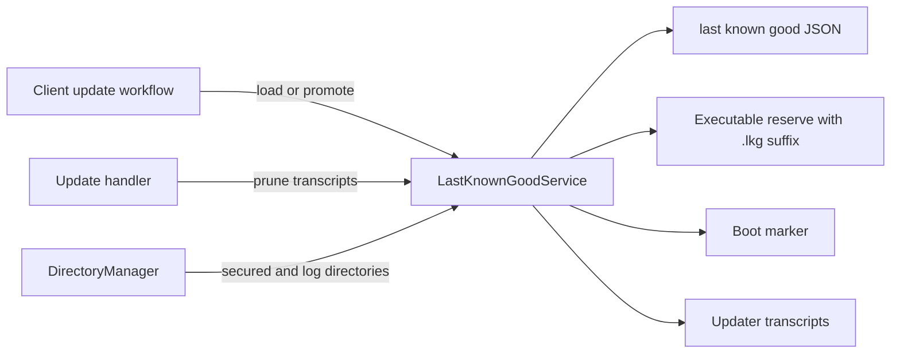
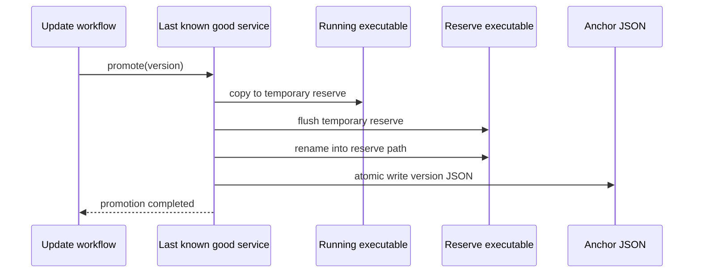
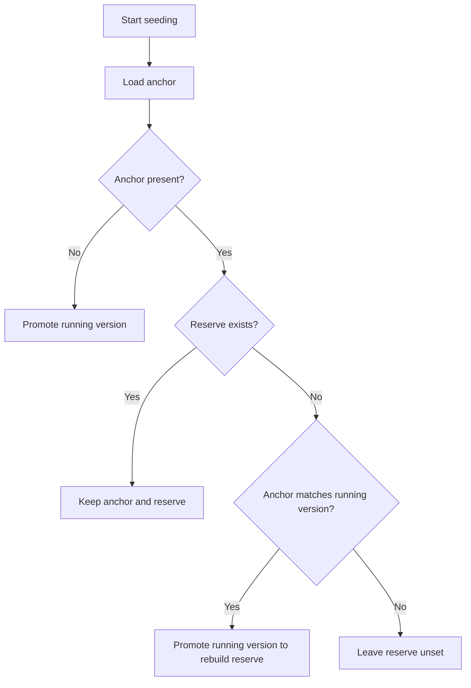
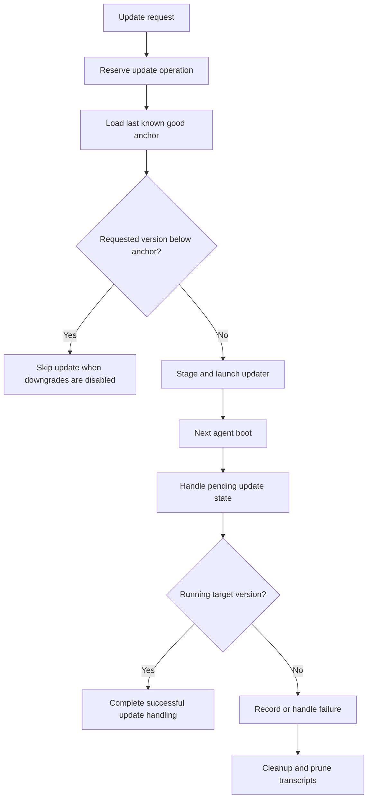

# Services Last Known Good

Services Last Known Good is the OpenFrame Client agent's local rollback anchor. It records the version that has been promoted as safe, retains a copy of the currently running agent executable beside that executable, writes a boot marker, and manages updater transcript retention. The implementation is supplied by the `openframe_agent_lib` crate from OpenFrame OSS Library and is assembled into this repository's OpenFrame Client runtime.

The module is deliberately local-only: it does not call HTTP or NATS directly. Its contract is durable state on the managed device, used by the client update workflow to prevent unsafe downgrades and to provide a known executable for rollback handling.

**Source:** [last known good service](https://github.com/flamingo-stack/openframe-oss-lib/blob/7a766f00e4f58b5d89db007b878ac8d6e0c344f4/clients/openframe-client/src/services/last_known_good_service.rs)

## Responsibilities

`LastKnownGoodService` owns five related concerns:

- **Anchor metadata:** persists the promoted version as JSON in the secured directory.
- **Executable reserve:** copies the running agent binary to a sibling path with the `.lkg` suffix.
- **Boot evidence:** atomically replaces a boot marker containing the build-time `OPENFRAME_VERSION`.
- **Updater diagnostics:** creates timestamped updater transcript paths in the agent log directory and removes older transcripts beyond a caller-selected retention count.
- **Recovery-oriented initialization:** seeds a missing anchor and reserve from the currently running binary without replacing a reserve that represents a different anchored version.

The service obtains its secured and log locations from `DirectoryManager`. Construction calls `ensure_directories`, which creates and verifies the log, application-support, and secured directories; the secured directory is created with its dedicated restrictive permission handling.

## Architecture

The service sits beneath two update-facing services:

- `OpenFrameClientUpdateService` loads the anchor before an update. When downgrade protection is enabled, a requested version with lower semantic-version precedence than the anchored version is skipped.
- `UpdateHandlerService` owns post-launch update handling. On a failed update it performs cleanup, asks Services Last Known Good to prune updater transcripts, and clears persisted update state. Its unresolved-boot guard can treat an update as failed after its configured boot-attempt threshold and then initiate reserve rollback handling.

## Persistent State and Placement

| Item | Location | Contents | Purpose |
|---|---|---|---|
| Anchor | Secured directory, `last_known_good.json` | JSON object with `version` | Declares the version accepted as last known good. |
| Reserve | Next to the running executable, with `.lkg` appended | Copy of the running executable | Provides a stable binary candidate for rollback logic. |
| Boot marker | Secured directory, `boot.marker` | Current build-time version text | Records that the agent wrote its startup marker. |
| Transcript | Log directory, `updater-<version>-<UTC timestamp>.log` | Updater output | Preserves update diagnostics. |

The anchor JSON contains only a version field. It is not a checksum, a download manifest, or update state. Update progress and phases are maintained by the separate update-state service.

## Promotion and Durability

Calling `promote(version)` establishes a new local rollback point in this order:

1. Copy the currently running executable to a temporary reserve file.
2. Flush that temporary file to disk with `sync_all`.
3. Rename the temporary reserve into the `.lkg` reserve path.
4. Serialize the supplied version into the anchor JSON.
5. Persist the JSON through `atomic_write`.

Both persistence paths are designed to reduce power-loss corruption. The executable copy is flushed before its rename. `atomic_write` writes the anchor through a temporary file, flushes it, and atomically persists it in the target directory. On Windows, its helper also has handling for a held destination file.

## Loading and Corruption Handling

`load()` returns an optional version:

- A missing anchor is a normal condition and returns no version.
- A readable, valid JSON anchor returns its version.
- A read failure is returned to the caller with context.
- Invalid JSON is handled by the shared filesystem helper: it attempts to move the bad file aside to a quarantine path and reports the anchor as unavailable rather than treating malformed contents as a version.

This behavior allows callers to distinguish an absent or recovered anchor from an I/O failure, while avoiding reuse of corrupt metadata.

## Initialization Policy

`seed_if_missing()` reconciles the anchor and reserve against the binary that is currently running. Its policy is conservative:

If loading itself fails, the method logs the failure and treats the anchor as missing, allowing the running binary to seed a new anchor. If an anchor exists but its reserve is absent, the reserve is rebuilt only when the anchor equals the running build version. When they differ, the service leaves the reserve unset rather than overwriting rollback protection with an unverified binary. A later verified update can rebuild it through promotion.

## Boot Marker and Transcripts

`write_boot_marker()` writes the current compile-time OpenFrame version to a temporary marker and renames it into `boot.marker`. This produces replacement semantics for the marker rather than exposing a partially written final file.

`new_transcript_path(target_version)` creates a log filename using the supplied target version and a UTC timestamp formatted to seconds. It only computes a path; creating and writing the transcript remain the caller's responsibility.

`prune_transcripts(keep)` scans the log directory for files whose names start with `updater-` and end with `.log`. It orders files by modification time from newest to oldest, retains the requested number, and attempts to delete the rest. Directory-reading, metadata, and deletion errors are logged; transcript cleanup does not fail the surrounding update handling.

## Update Flow Integration

The last-known-good anchor is a guardrail, not the complete update state machine:

- `OpenFrameClientUpdateService.reserve()` serializes update attempts and rejects overlapping work before the update proceeds.
- `OpenFrameClientUpdateService.apply()` validates the requested version. Unless downgrades are allowed, it compares the request with the anchor using semantic-version precedence and skips versions below the anchor.
- An update request for the already running version is skipped without parking tool work.
- `UpdateHandlerService.handle_pending_update()` considers the update successful when the running build version equals the target version. For unresolved updater-launch or verification phases it preserves state for another boot.
- `UpdateHandlerService.record_boot_attempt()` increments unresolved attempts when the target differs from the running version. Once its crash-loop maximum is reached, it handles failure and invokes reserve rollback handling.

## Operational Considerations

- The `.lkg` reserve is a copy of the executable at promotion time. Promotion should therefore occur only after the surrounding update lifecycle has established that the running binary is suitable as a rollback candidate.
- Do not manually edit `last_known_good.json`. A malformed anchor is quarantined and can cause the client to reseed from its currently running binary.
- A missing reserve with a mismatched anchor is intentionally not repaired during seeding. This is a protection against replacing a previously verified rollback target with a different, unverified version.
- Updater transcripts are useful for diagnosing failures, but their retention is best-effort. Ensure the log directory is writable and has enough disk capacity during updates.
- The boot marker and anchor use the build-time `OPENFRAME_VERSION`; release packaging must ensure that value correctly represents the executable being deployed.

## Key API Surface

| Member | Role |
|---|---|
| `new(directory_manager)` | Ensures required directories exist and derives anchor, marker, log, executable, and reserve paths. |
| `load()` | Reads the optional anchored version using quarantine-aware JSON parsing. |
| `promote(version)` | Replaces the reserve executable and atomically writes the anchored version. |
| `seed_if_missing()` | Establishes or safely repairs the anchor and reserve for the running binary. |
| `reserve_path()` | Exposes the calculated reserve location for rollback-related callers. |
| `boot_marker_path()` | Exposes the boot marker location. |
| `write_boot_marker()` | Atomically replaces the marker with the current build version. |
| `new_transcript_path(target_version)` | Returns a timestamped updater-log path. |
| `prune_transcripts(keep)` | Removes updater logs older than the retained newest set. |

## Ownership and Source Boundary

Services Last Known Good runs as part of OpenFrame OSS Tenant's OpenFrame Client deployment, but its Rust implementation belongs to OpenFrame OSS Library version `v0.0.5` as consumed through `openframe_agent_lib`. Changes to behavior should be made in the library source, then brought into this repository through the pinned dependency and client release process.
