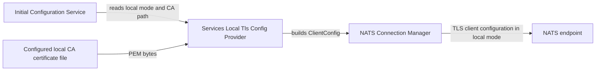
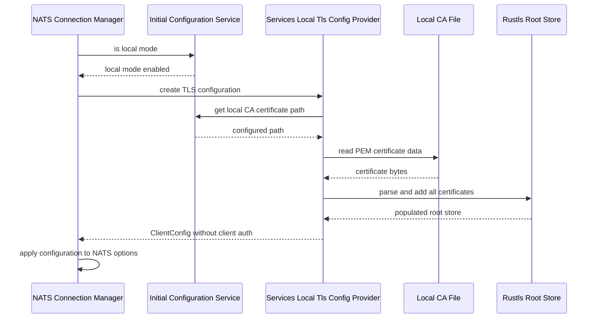
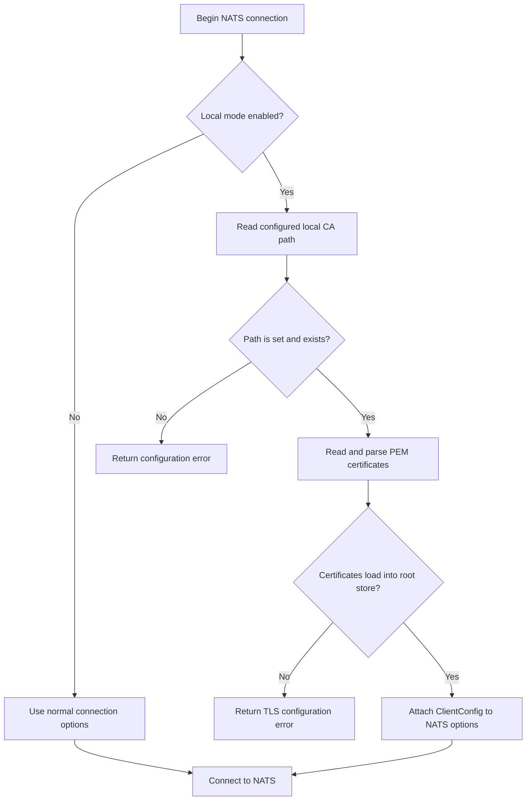

# Services Local Tls Config Provider

Services Local Tls Config Provider supplies the OpenFrame client agent with a Rustls client configuration for **local development mode**. It reads the local certificate-authority file selected during initial configuration, makes that certificate a trust anchor, and returns a configuration with server authentication enabled and no client certificate. The provider is implemented by the `LocalTlsConfigProvider` type in the OpenFrame OSS Library's `openframe_agent_lib` artifact, which this repository consumes at version `v0.0.5`.

The implementation source is maintained in the [OpenFrame OSS Library](https://github.com/flamingo-stack/openframe-oss-lib/blob/7a766f00e4f58b5d89db007b878ac8d6e0c344f4/clients/openframe-client/src/services/local_tls_config_provider.rs).

## Purpose and Scope

The module addresses a narrow trust problem: a locally deployed development endpoint can use a certificate signed by a local certificate authority that is not trusted by the operating system or the standard Rustls root set. Rather than disabling certificate validation, Services Local Tls Config Provider builds an explicit `ClientConfig` whose root store contains the configured local CA certificate.

It does not:

- download, generate, rotate, or persist certificates;
- alter the operating system trust store;
- configure client-certificate authentication;
- enable TLS for every client connection; or
- bypass server certificate validation.

The NATS connection manager invokes it only when the initial configuration reports local mode. Non-local connections retain the normal connection options and do not receive this custom TLS configuration.

## Architecture

### Components and Responsibilities

| Component | Responsibility |
|---|---|
| `LocalTlsConfigProvider` | Holds a clone of the initial configuration service and exposes TLS configuration creation. |
| `new` | Constructs the provider with the configuration dependency. It performs no file access or certificate parsing. |
| `create_tls_config` | Resolves and reads the CA file, parses its PEM certificates, loads them into an empty Rustls root store, and creates a no-client-auth Rustls configuration. |
| Initial Configuration Service | Persists and reads the initial client configuration. Its local CA path accessor returns the saved `local_ca_cert_path`; its local-mode accessor decides whether the provider is used. |
| NATS Connection Manager | Owns the provider and applies its output to async NATS connection options when local mode is active. |

## Certificate Configuration Lifecycle

The certificate path is configuration data, not a hard-coded development default. Initial configuration must store a non-empty `local_ca_cert_path` pointing to an existing certificate file before a local-mode NATS connection is established.

### Construction Steps

1. `create_tls_config` requests the saved local CA path from the initial configuration service.
2. The provider rejects an empty path and verifies that the path exists.
3. It reads the referenced file as bytes and parses PEM certificate entries with `rustls_pemfile`.
4. It starts with an empty `RootCertStore` and adds each parsed certificate. A parse or insertion failure stops construction.
5. It builds `async_nats::rustls::ClientConfig` using that root store and `with_no_client_auth`.
6. The caller receives the completed configuration or a contextual error. No partial configuration is used.

An empty PEM bundle that parses successfully produces an empty root store; in practice, the subsequent TLS validation cannot establish trust through a CA in that bundle. Deploy a PEM file containing the required CA certificate or chain.

## Local-Mode Decision Flow

## Failure Behavior and Diagnostics

The module fails fast and adds context at each boundary. This makes a local-mode connection failure distinguishable from an authentication, DNS, or NATS transport failure.

| Condition | Result |
|---|---|
| Initial configuration cannot be read | Error indicating that the local CA path could not be obtained. |
| Local CA path is empty | Error that `local_ca_cert_path` is not set. |
| Configured path does not exist | Error that identifies the non-existent configured file. |
| Certificate file cannot be read | Error with the affected file path. |
| PEM cannot be parsed | Certificate parsing error. |
| A parsed certificate cannot be added | Root-store insertion error. |
| Provider failure in the connection manager | The manager wraps it as a failure to create the development TLS configuration and does not attempt the connection with a weakened trust policy. |

The provider emits informational tracing events while resolving the path and creating the configuration. Those events report the selected certificate path, so operators should ensure that ordinary logs are treated appropriately for local environment details.

## Security Characteristics

- **Explicit trust boundary:** Trust is limited to certificates loaded from the configured local CA file rather than inheriting an unrestricted custom policy.
- **Server authentication remains required:** The returned configuration uses the provided root store for peer validation. It is not equivalent to accepting invalid certificates.
- **No mutual TLS:** `with_no_client_auth` means this component supplies no client certificate or private key.
- **Configuration integrity matters:** The certificate path controls the trust anchor. The initial configuration file and referenced certificate should be writable only by authorized local administrators.
- **Process restart or reconnect behavior:** The NATS manager creates the configuration while connecting. Updating the CA file or the saved path requires a new connection attempt to take effect.

## Integration in the Client Agent

Services Local Tls Config Provider belongs to the Rust OpenFrame client runtime bundled through the OpenFrame OSS Library. Its direct integration point is the NATS connection manager: that manager reads local mode from the same initial configuration service, requests a TLS configuration only when local mode is true, and passes the result to async NATS before connecting.

This scope is intentionally separate from the agent HTTP client factory. The HTTP client factory builds request clients with machine identification headers, timeouts, proxy bypassing, and a caller-provided invalid-certificate setting; it does not consume this provider. Maintain that separation when extending local-development transport behavior so NATS certificate trust and HTTP client policy do not become implicitly coupled.

## Maintenance Guidance

When changing this module:

1. Preserve the local-mode gate in the connection manager; custom CA loading must not become the default production path.
2. Keep contextual errors around configuration lookup, file I/O, parsing, and root-store insertion.
3. Treat certificate bundles as potentially containing more than one PEM certificate and retain the loop that adds every parsed entry.
4. Do not replace explicit root-store construction with a certificate-validation bypass.
5. Test successful loading, empty paths, missing files, malformed PEM input, and connection-manager behavior in both local and non-local modes.
