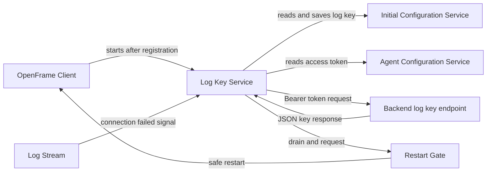
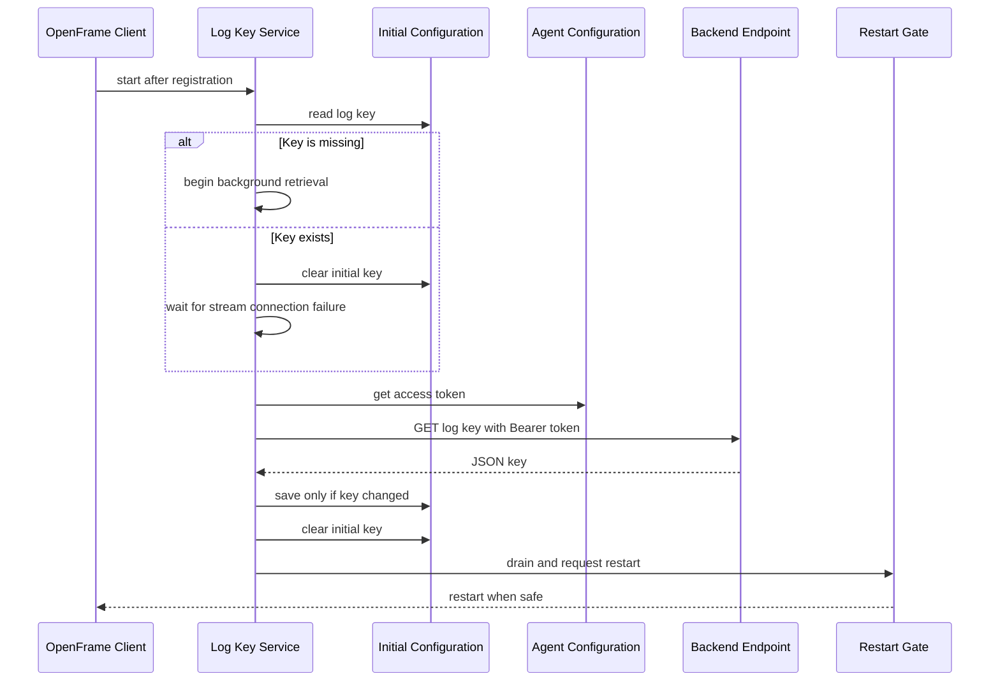
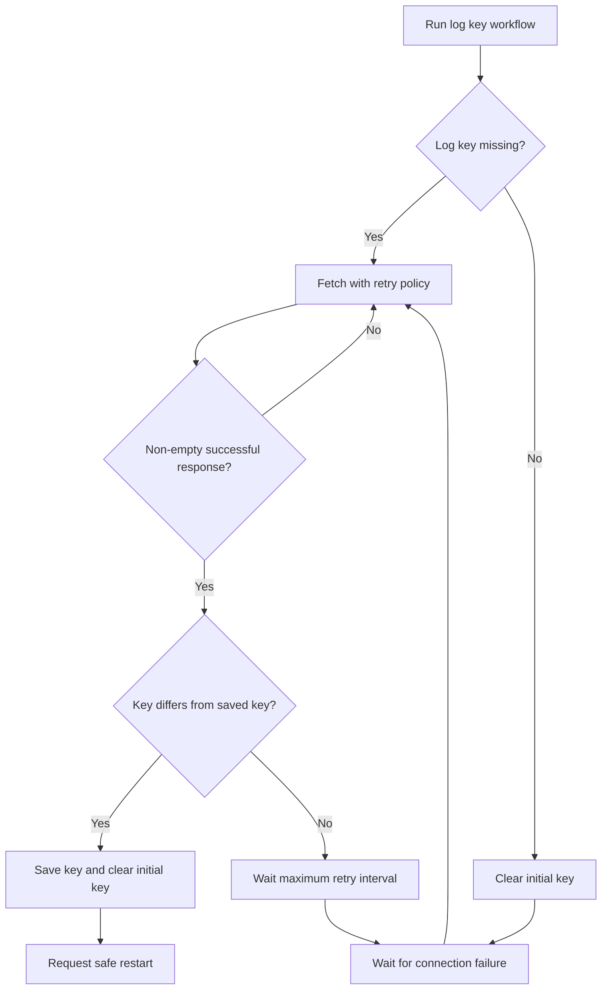

# Services Log Key

Services Log Key is the OpenFrame Client agent component that obtains and persists the tenant-specific key used by the agent log stream. It runs after device registration and resolves two conditions: the local configuration has no log key, or the log-stream connection reports a failure that can be caused by a rejected key. When it stores a changed key, it requests a controlled client restart so the log-stream subsystem, which reads the key only during startup, is recreated with the new credential.

The implementation is supplied by the OpenFrame OSS Library's `openframe_agent_lib` artifact and executed by this repository's OpenFrame Client deployment. Its implementation source is [log key service](https://github.com/flamingo-stack/openframe-oss-lib/blob/7a766f00e4f58b5d89db007b878ac8d6e0c344f4/clients/openframe-client/src/services/log_key_service.rs).

## Responsibilities

`LogKeyService` is deliberately scoped to key acquisition and refresh coordination. It:

- reads the stored log key from `InitialConfigurationService`;
- obtains the agent access token from `AgentConfigurationService`;
- sends an authenticated request to the configured backend URL;
- verifies that the response contains a non-empty `key` value;
- writes the replacement key only when it differs from the stored value;
- removes the enrollment initial key after a registered agent has a log key; and
- coordinates a safe restart through `RestartGate` after a successful key replacement.

It does not stream, parse, rotate, or ship log records. Those responsibilities belong to the OpenFrame Client logging components, including log source collection, parsing, rotation, batching, and NATS streaming.

## Architecture and Dependencies



### Runtime collaborators

| Collaborator | Role in Services Log Key |
|---|---|
| `reqwest::Client` | Sends the key retrieval request. The service receives this client through its constructor, so connection behavior is configured outside this module. |
| `base_url` | Forms the request target by appending `/clients/agent/log-key`. |
| `InitialConfigurationService` | Reads `log_key`, persists a replacement key, and clears the enrollment `initial_key`. Its writes are serialized to avoid read-modify-write field loss. |
| `AgentConfigurationService` | Supplies the persisted access token for the authorization header. |
| `DeactivationService` | Is passed into the retry helper so retrieval retries can settle consistently with device deactivation behavior. |
| `Notify` | Accepts connection-failure notifications from the log stream and wakes a waiting refresh cycle. |
| `RestartGate` | Defers the restart request until it can drain work safely, rather than restarting immediately from the background task. |

## Key Retrieval Contract

The service makes a `GET` request to the following path relative to its configured base URL:

```text
/clients/agent/log-key
```

It includes the agent access token as a Bearer authorization value and expects a JSON object containing a non-empty `key` field:

```json
{
  "key": "tenant-log-stream-key"
}
```

A non-success HTTP response is rejected. For diagnostic context, the error includes the HTTP status and at most the first 200 characters of the response body. A successful response with an empty key is also rejected. The key value itself is not logged by this service.

On the server side, the module tree includes agent log key controllers in the client and API service cores, and an `AgentLogKeyInitializer` in Management that calls `createIfMissing` during application startup. Together, these components establish and expose the server-managed key; Services Log Key is the agent-side consumer.

## Startup and Refresh Flow



`start` spawns this workflow on the Tokio runtime. It waits for its internal workflow to complete before calling `drain_and_request`, so no restart is requested merely because an attempt was made. A restart follows only after a new value was persisted.

### Initial-key handling

The enrollment initial key is no longer needed once a registered device holds a log-stream key. The service therefore attempts to clear it in either of these cases:

1. a log key was already present when the service began waiting for a connection failure; or
2. a new or changed log key was saved successfully.

Failure to clear the initial key is logged as a warning, but it does not prevent key retrieval or a subsequent restart request.

## Retry and Change Semantics



Retrieval uses `retry_until_settled` with an initial retry delay of 30 seconds and a maximum delay of 600 seconds. This applies to failures such as unavailable transport, failed access-token lookup, non-success backend responses, invalid JSON, and an empty returned key.

If the backend returns the same key already stored locally, no restart occurs. The service logs that result, waits for the maximum retry interval, and then waits for another stream connection-failure notification before trying again. This prevents a repeated unchanged response from causing a restart loop.

## State and Security Boundaries

The persistent state managed here has two distinct purposes:

| State | Owner and use |
|---|---|
| Agent access token | Read from agent configuration and used only to authorize retrieval from the backend. |
| Log key | Read and saved in initial configuration so the log stream can consume it when the client starts. |
| Enrollment initial key | Cleared after registration has progressed to a usable log key, reducing retention of obsolete enrollment material. |

The service emits operational events such as missing configuration, successful key save, failed save, and restart intent. It avoids logging the access token and key contents. Backend failure bodies are truncated before inclusion in an error, which limits but does not eliminate the sensitivity of server-provided diagnostic text; backend responses should therefore avoid placing credentials in error bodies.

## Operational Behavior

- **Normal first run:** a missing local key starts background retrieval immediately. Once a valid changed key is persisted, the client receives a gated restart request.
- **Existing key:** the service clears the obsolete enrollment key, then remains idle until the logging stream reports a failed connection.
- **Rejected or stale key:** the stream calls `connect_failed`; the service retrieves a replacement with retry behavior and restarts only if the key changes.
- **Deactivation-aware retry:** retry execution receives the shared deactivation service, allowing this work to honor the client's wider deactivation lifecycle.
- **Storage failure:** a failed configuration save is logged. The service does not restart and later waits for a subsequent failure signal before attempting again.

## Maintenance Guidance

When modifying Services Log Key, preserve these invariants:

1. Never accept or persist an empty backend key.
2. Do not restart when the backend returns the currently stored key.
3. Keep restart orchestration behind `RestartGate`; a direct process restart can interrupt active agent work.
4. Retain serialized configuration updates so writing the log key cannot overwrite unrelated configuration fields.
5. Treat tokens, log keys, and backend error bodies as sensitive operational data.
6. Keep the key-fetch loop asynchronous; the client service must not block its primary runtime while waiting for retry delays or stream-failure notifications.
