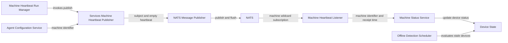
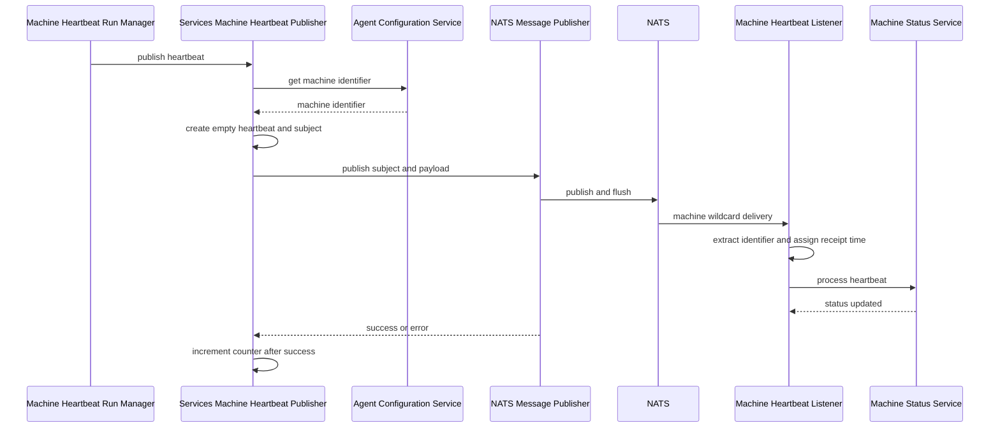
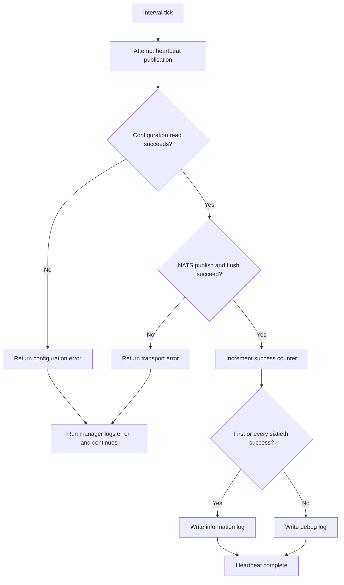

# Services Machine Heartbeat Publisher

Services Machine Heartbeat Publisher is the OpenFrame Client agent component that emits a liveness signal for its registered machine. It obtains the persisted machine identifier, creates an intentionally empty heartbeat payload, and publishes it to the machine-specific NATS subject. The server identifies the machine from that subject and records the receipt time; the heartbeat payload itself does not carry a machine identifier or timestamp.

The implementation is supplied by the OpenFrame OSS Library's `openframe_agent_lib` artifact, pinned by this repository at version `v0.0.5`. Its source is [machine heartbeat publisher.rs](https://github.com/flamingo-stack/openframe-oss-lib/blob/7a766f00e4f58b5d89db007b878ac8d6e0c344f4/clients/openframe-client/src/services/machine_heartbeat_publisher.rs).

## Responsibilities

- Build a `MachineHeartbeatPublisher` from a NATS message publisher and the agent configuration service.
- Read the registered machine identifier from persisted agent configuration for every publication.
- Publish to the NATS subject `machine.{machineId}.heartbeat`.
- Emit a lightweight empty `MachineHeartbeatMessage`; identity and the effective event time are assigned outside the payload.
- Provide bounded operational logging: the first publication and then every 60th publication are logged at information level, while intervening successful publications are debug-level events.

This module publishes a signal only. It does not schedule periodic execution, maintain a local outbox, retry a failed send, or decide whether a device is online or offline.

## Architecture and System Position

The publisher runs inside the Rust OpenFrame Client agent from the OpenFrame OSS Library. The tenant deployment supplies the NATS datasource used by OpenFrame Client services. On the server side, the OpenFrame Client Core listener subscribes to `machine.*.heartbeat`, extracts the machine identifier from the subject, and uses `Instant.now()` as the heartbeat event time before delegating to machine status processing. The Management service can periodically evaluate stale device state when heartbeat offline detection is enabled.

## Component Model

| Component | Role | Key behavior |
|---|---|---|
| `MachineHeartbeatPublisher` | Publication façade | Owns the NATS publisher, configuration service, and an atomic successful-publication counter. It is cloneable, allowing the run manager to use it in a spawned task. |
| `new` | Constructor | Stores the supplied dependencies and initializes the counter to zero. |
| `publish_heartbeat` | One heartbeat attempt | Loads the machine identifier, serializes a new empty heartbeat, computes the NATS subject, publishes it, then records success in the logs. |
| `MachineHeartbeatMessage` | Transport model | An empty structure. The subject carries identity and the receiving service supplies the timestamp. |
| `NatsMessagePublisher` | Transport abstraction | Retrieves the active NATS client, publishes the payload, and flushes the client. Failures are returned to the caller. |
| `MachineHeartbeatRunManager` | Lifecycle scheduler | Starts an asynchronous interval loop and applies a timeout to each call to `publish_heartbeat`. It logs errors and continues with subsequent intervals. |

## Publication Flow

### Detailed Behavior

1. The run manager starts a Tokio task and waits for its configured interval tick. It wraps each publication in its configured timeout.
2. `publish_heartbeat` calls `AgentConfigurationService::get_machine_id`. If configuration cannot be read, the method returns an error before any network action.
3. The publisher constructs `MachineHeartbeatMessage::new()`, which contains no fields, then serializes it.
4. It creates `machine.{machineId}.heartbeat`, where `{machineId}` is the persisted registered-machine value.
5. The NATS publisher obtains the current client from the connection manager, publishes the message, and flushes the client. A publish, connection, serialization, or flush failure is returned to the run manager.
6. Only after successful publication and flush does the publisher increment its relaxed atomic counter and log the successful heartbeat.
7. The server listener receives messages matching `machine.*.heartbeat`. It derives the identity from the subject rather than the body, timestamps the event on receipt, and forwards it to machine-status processing.

## Wire Contract

| Contract element | Value or behavior |
|---|---|
| NATS subject | `machine.{machineId}.heartbeat` |
| Payload model | Empty `MachineHeartbeatMessage` |
| Machine identity | The subject segment selected by the wildcard subscription |
| Event timestamp | Created at the receiving server when the listener handles the message |
| Delivery semantics | The publisher performs a NATS publish followed by `flush`; it does not wait for an application-level acknowledgement in this module. |
| Receiver subscription | `machine.*.heartbeat` |

Because the receiver does not rely on payload fields to determine identity or time, changing the subject format is a compatibility-sensitive change. It would affect the publisher, the listener's machine identifier extraction, and any monitoring or routing that depends on the subject pattern.

## Failure and Logging Behavior

The publisher itself does not catch and suppress errors. This preserves a clear boundary: configuration and transport failures remain visible to the caller. The run manager records either a returned failure or a timeout and proceeds to the next cycle, so one failed heartbeat does not stop future attempts. There is no persistence or replay path in this component; transient messages that fail to publish are not queued here.

The counter uses `AtomicU64` with relaxed ordering because it is used only for log sampling, not for coordinating delivery or enforcing correctness. The information-level log includes the machine identifier, cumulative successful send count, and the compile-time `OPENFRAME_VERSION`; routine success logs remain at debug level to reduce noise.

## Operational Considerations

- **Registration prerequisite:** the agent configuration must contain a valid machine identifier. Heartbeats cannot be addressed without it.
- **NATS connectivity:** a usable client must be available through the NATS connection manager. The run manager's timeout message specifically indicates that NATS may be disconnected, but a timeout alone does not prove the cause.
- **Clock interpretation:** liveness time is server receipt time, not an agent-provided timestamp. Device clock skew therefore does not alter the recorded heartbeat event time.
- **Offline state:** heartbeat emission does not itself mark a device offline. Offline classification is downstream and conditional on the server-side offline-detection configuration.
- **Observability:** look for the sampled information log to establish sustained successful publications, and enable debug logging when per-heartbeat confirmation is required. Errors are emitted by the run manager for failures and timeouts.

## Maintenance Guidance

When changing this module, preserve the relationship between the subject naming contract and server-side wildcard listener. Any additional payload fields should be treated as a versioned transport-contract decision: the current receiver intentionally obtains identity and time independently. If delivery guarantees stronger than publish-and-flush are required, add them explicitly through an acknowledgement or durable-outbox design rather than inferring them from the current implementation.

Test changes at three boundaries:

1. Configuration failure prevents transport activity.
2. The generated subject uses the persisted machine identifier exactly.
3. A successful NATS publish and flush increments the sampling counter, while failed or timed-out attempts are surfaced to the run manager and do not increment it.
