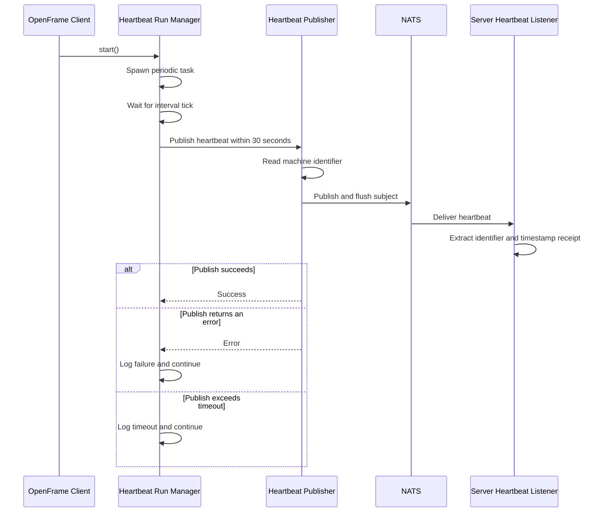
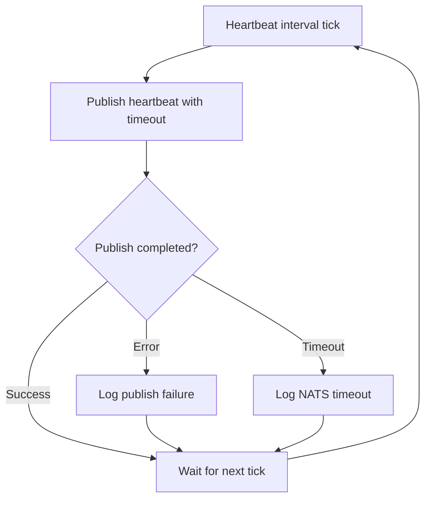

# Services Machine Heartbeat Run Manager

Services Machine Heartbeat Run Manager is the OpenFrame Client agent's background scheduler for device-liveness signals. It starts a Tokio task that attempts a heartbeat immediately and then on a 60-second cadence. Each individual attempt has a 30-second upper bound, so a blocked publish does not permanently stop later heartbeats.

The implementation belongs to the `openframe_agent_lib` Cargo dependency supplied by OpenFrame OSS Library version `v0.0.5`; this tenant repository runs it through its OpenFrame Client. The implementation source is [machine heartbeat run manager](https://github.com/flamingo-stack/openframe-oss-lib/blob/7a766f00e4f58b5d89db007b878ac8d6e0c344f4/clients/openframe-client/src/services/machine_heartbeat_run_manager.rs).

## Responsibilities

- Own the recurring execution loop, rather than the heartbeat payload or NATS connection lifecycle.
- Clone and invoke `MachineHeartbeatPublisher` from a detached Tokio task.
- Bound each publish attempt to 30 seconds.
- Log failed publishes and timeouts, then retain the loop for the next scheduled attempt.
- Avoid local persistence, retry queues, acknowledgements, and shutdown coordination in this component.

## Architecture and Placement

The OpenFrame Client completes registration and authentication, connects to NATS, starts its connection watchdog, and only then starts Services Machine Heartbeat Run Manager. This startup order means the first heartbeat is issued after the NATS connection setup has been attempted.

```mermaid
flowchart LR
    ClientStart["OpenFrame Client startup"] --> Auth["Registration and authentication"]
    Auth --> NatsConnect["NATS connection manager"]
    NatsConnect --> Watchdog["NATS connection watchdog"]
    Watchdog --> RunManager["Services Machine Heartbeat Run Manager"]
    RunManager --> Publisher["Machine Heartbeat Publisher"]
    Publisher --> NatsPublisher["NATS message publisher"]
    NatsPublisher --> Nats["NATS subject machine machine id heartbeat"]
    Nats --> Listener["Machine Heartbeat Listener"]
    Listener --> Status["Machine status service"]
    Status --> Offline["Offline detection scheduler"]
```

The run manager is deliberately narrow. `MachineHeartbeatPublisher` resolves the registered machine identifier from agent configuration, creates the heartbeat message, and chooses the subject in the form `machine.{machineId}.heartbeat`. The NATS publisher obtains the active client, publishes, and flushes it. On the server side, the client-core listener subscribes to `machine.*.heartbeat`, extracts the machine identifier from the subject, and assigns the event timestamp when processing the heartbeat. Consequently, device identity and the authoritative receipt time are carried outside the message body.

## Components

| Component | Role |
| --- | --- |
| `MachineHeartbeatRunManager` | Holds the publisher dependency and owns the spawned periodic task. |
| `new` | Constructs the manager with a `MachineHeartbeatPublisher`. It has no I/O or task side effects. |
| `start` | Logs startup, clones the publisher, spawns the task, schedules ticks, applies the timeout, and records errors. |
| `MachineHeartbeatPublisher` | Builds a heartbeat and publishes it to the machine-specific NATS subject. |
| `NatsMessagePublisher` | Sends and flushes the message through the currently managed NATS client. |

## Heartbeat Execution Flow

Tokio intervals produce their first tick without waiting for the full period. Therefore, after `start` spawns the task, the manager attempts the initial heartbeat right away; subsequent ticks are separated by the configured 60-second interval. The timeout wraps the complete publisher operation.

## Failure Behavior and Recovery Boundaries

A publish error, such as failure to obtain an active NATS client or failure to publish or flush, is logged as a heartbeat-send failure. A publish that lasts more than 30 seconds is logged as a timeout with an indication that NATS may be disconnected. Neither case terminates the task or propagates an error to the client startup path.

The manager does not implement retries within a tick and does not retain a missed heartbeat for replay. It relies on the following independent behavior:

- The next interval produces a new heartbeat attempt.
- The NATS connection manager watchdog monitors activity and can replace a stalled client.
- The server records receipt time, so a successful later heartbeat refreshes liveness.
- The management service's offline detection scheduler periodically evaluates stale devices when its heartbeat-offline-detection setting is enabled.

## Operational Notes

- A startup log confirms that Services Machine Heartbeat Run Manager has been started; individual successful heartbeats are handled by the publisher rather than this scheduler.
- Repeated timeout logs point to a potentially disconnected or blocked NATS path. Correlate them with NATS connection-manager watchdog logs and server-side heartbeat listener logs.
- The server accepts the wildcard subject pattern, so the subject naming convention is an interoperability contract: the machine identifier must remain the subject segment expected by the listener.
- Because the server generates the timestamp, agent clock skew does not determine the recorded heartbeat time.
- `start` is non-async and returns immediately after spawning. Callers must keep the Tokio runtime alive, which the OpenFrame Client does with its long-running service loop.

## Source and System Integration

The client-side scheduler and publisher are supplied by OpenFrame OSS Library. The tenant deployment provides the server components that consume the event: the OpenFrame Client service includes the machine-heartbeat listener, and the OpenFrame Management service includes optional offline detection. Their roles are connected by NATS, configured for the platform as a datasource in the tenant environment.

For implementation changes, keep scheduler cadence and timeout decisions separate from message construction and NATS recovery. Changes to subject composition or the server listener must be reviewed as a protocol change because the listener derives the device identity from the subject rather than from the payload.
