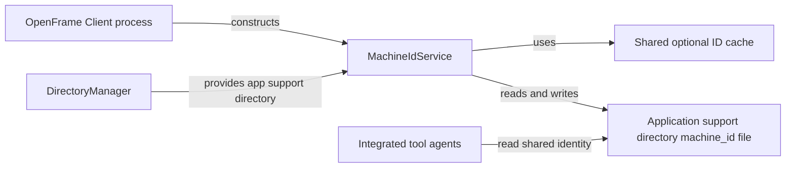
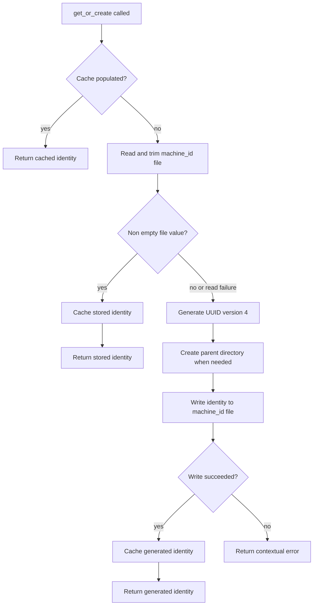
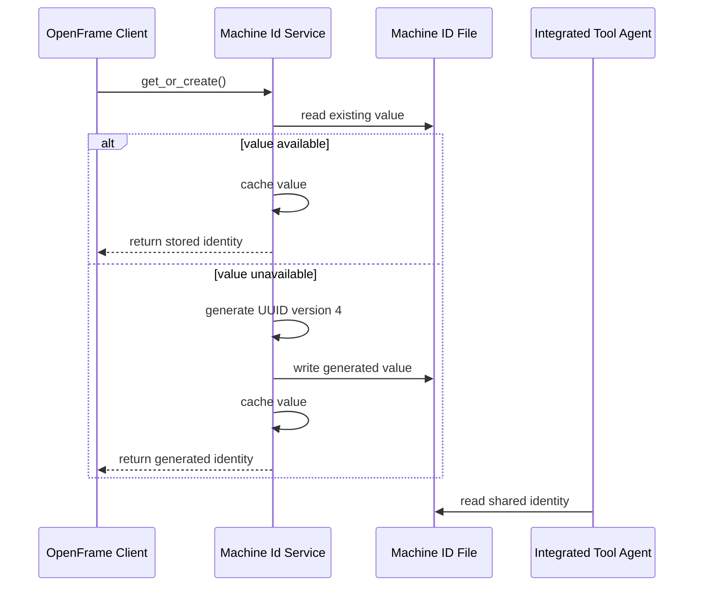

# Services Machine Id

Services Machine Id supplies a stable, locally generated identifier for an OpenFrame Client installation. It is implemented by `MachineIdService` in the `openframe_agent_lib` Cargo library, version `0.0.5`, which this repository consumes to run its OpenFrame Client. The implementation is maintained in the [OpenFrame OSS Library source](https://github.com/flamingo-stack/openframe-oss-lib/blob/7a766f00e4f58b5d89db007b878ac8d6e0c344f4/clients/openframe-client/src/services/machine_id_service.rs).

The identifier is intentionally separate from the server-assigned `machine_id` stored in agent configuration. Its purpose is local, shared machine identity: the client stores it in the common application-support directory so integrated tool agents, including Mesh and Fleet agents, can read the same value. The module also defines the `x-machine-id` header-name constant for consumers that need to attach this identity to requests.

## Responsibilities and Boundaries

Services Machine Id has a deliberately small scope:

- Resolve the identity from an in-memory cache when it is already available.
- Restore a non-empty identity from the `machine_id` file in the application-support directory.
- Create a version 4 UUID only if no usable persisted value can be read.
- Persist a newly generated value and cache it for subsequent calls in the process.
- Provide a non-creating cache accessor for components that must not trigger file I/O or identity creation.

It does not register a device, authenticate it, call an API, validate that a stored value is a UUID, or synchronize identity between devices. Registration and server-issued credentials belong to the agent registration and agent configuration services.

## Architecture

`MachineIdService` receives a `DirectoryManager` at construction. It derives a single persistence location by appending `machine_id` to the manager's shared application-support path. An `Arc` plus read-write lock makes the optional cached value shareable across clones of the service within the client process.

## Components

| Component | Role | Notes |
|---|---|---|
| `MachineIdService` | Owns identity lookup, creation, persistence, and the process-local cache. | The type derives `Clone`; cloned instances share the same cache through `Arc`. |
| `new` | Builds a service from `DirectoryManager`. | Establishes the persistence path but does not access the file or generate an ID. |
| `get_or_create` | Resolves the usable machine identity. | Cache first, then disk, then UUID generation and persistence. Returns `Result<String>`. |
| `get` | Returns the cache contents only. | Returns an empty string before `get_or_create` has populated the cache. |
| `MACHINE_ID_HEADER` | Declares the header name `x-machine-id`. | It is a constant only; this module does not send HTTP requests. |

## Identity Resolution Flow

The first successful `get_or_create` call establishes the process cache. A later call does not re-read disk. On a fresh service instance, the persisted file is preferred over generating a new UUID. A read error of any kind, including an empty file, falls through to new-identity creation; failure to create the parent directory or write the file is returned to the caller.

## API Semantics

### Constructing the Service

`new(directory_manager)` is lightweight. It computes the path from `DirectoryManager.app_support_dir()` and initializes the cache as absent. It neither verifies directory permissions nor creates the directory at construction time.

### Resolving an Identity

`get_or_create()` is the canonical operation for callers that require an identity:

1. Acquire a read lock and return the cached string when present.
2. Attempt to read the identity file as text and trim leading and trailing whitespace.
3. Accept any non-empty stored string, cache it, and return it. The implementation does not parse or enforce UUID format for existing content.
4. If reading fails or the trimmed file is empty, generate a random UUID version 4 string.
5. Ensure the parent directory exists, write the new value, cache it, and return it.

The read and write operations add the affected path to their error context, which makes filesystem failures diagnosable by the caller or client logs.

### Reading Without Creation

`get()` only examines the shared in-memory cache. It returns the cached identity after resolution, otherwise `String::new()`. This distinction is important for callers that need to observe initialization state without triggering persistence or UUID generation.

## Component Interaction

The service is local-only. It does not itself perform registration or transport, but the stored identity can be shared with other local client components and integrated agents. The server-assigned identity remains part of agent configuration and must not be conflated with this value.

## Persistence and Operational Characteristics

- **Location:** The file is named `machine_id` beneath the shared application-support directory returned by `DirectoryManager`.
- **Format:** The file contains the generated UUID string without an explicit trailing newline. Read logic trims surrounding whitespace before use.
- **Lifetime:** The identity remains stable while the file remains readable and non-empty. Removing, emptying, or making the file unreadable causes a later fresh service instance to generate and persist a replacement value.
- **In-process consistency:** The read-write lock protects the shared cache used by service clones. The initial cache miss, filesystem lookup, and write are not presented as a cross-process locking protocol.
- **Error behavior:** Write and directory-creation errors stop the operation and are returned. Read failures are treated as a reason to attempt creation, so a subsequent write may still report the underlying filesystem problem.

## Security Considerations

The value is a locally generated identifier rather than an authentication credential. Nevertheless, it can be used to correlate machine activity. The module relies on the directory and filesystem environment provided by `DirectoryManager`; it does not configure access control itself.

Maintain the shared application-support directory according to the client platform's access-control policy. In particular, protect the identity file from unintended modification because any non-empty replacement value is accepted on the next disk-backed resolution. If the `x-machine-id` header is used by another component, that component is responsible for choosing an appropriate authenticated and encrypted transport.

## Maintenance Guidance

When changing Services Machine Id, preserve these invariants:

- Keep the local identity distinct from the server-issued agent configuration identifier.
- Do not change the persistence file name or directory contract without a migration plan for existing installations and tool agents that share the file.
- Preserve `get()` as a cache-only operation unless all its callers are reviewed for the added I/O and creation side effects.
- Treat changes to UUID generation, stored-value validation, or error fallback as compatibility changes because existing installations may have legacy file contents or filesystem failures.
- If multi-process writers become possible, introduce an explicit cross-process coordination strategy rather than relying on the in-process cache lock.

## Relationship to the OpenFrame System

This module is part of the Rust OpenFrame Client packaged by OpenFrame OSS Tenant. It is supplied at runtime by the OpenFrame OSS Library dependency rather than being implemented in this repository. OpenFrame OSS Tenant also deploys the client-facing and backend services that support device management, but Services Machine Id itself remains an on-device identity utility with no network endpoint or server datastore.
