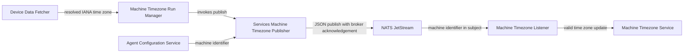
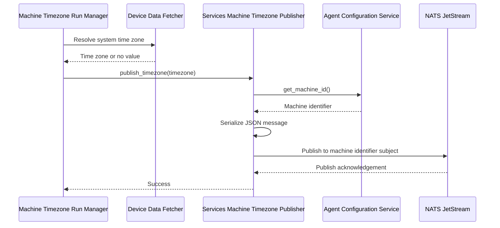
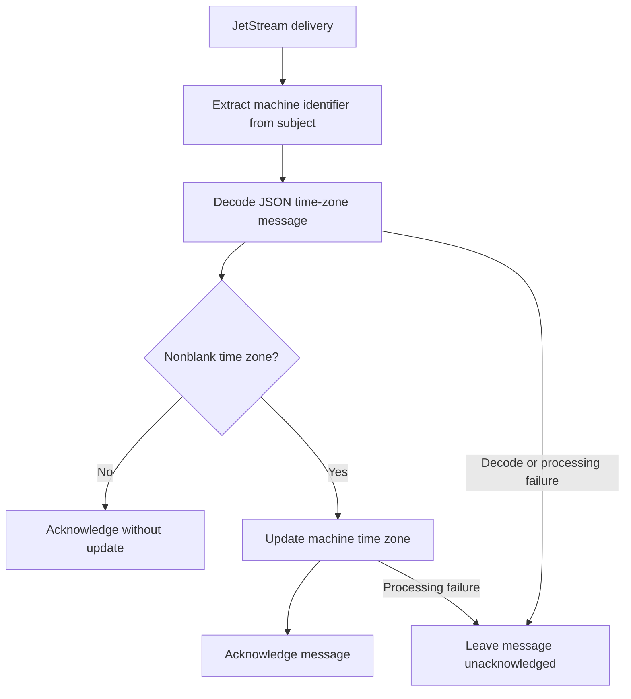

# Services Machine Timezone Publisher

Services Machine Timezone Publisher is an OpenFrame Client agent component that reports the endpoint's resolved IANA time zone to the platform over NATS JetStream. It belongs to the Rust `openframe_agent_lib` artifact supplied by OpenFrame OSS Library version `0.0.5`; this tenant repository runs the client that assembles the library.

The implementation is in [Machine Timezone Publisher](https://github.com/flamingo-stack/openframe-oss-lib/blob/7a766f00e4f58b5d89db007b878ac8d6e0c344f4/clients/openframe-client/src/services/machine_timezone_publisher.rs). The module deliberately has a narrow responsibility: it creates and reliably publishes a time-zone update. Time-zone discovery and scheduling are delegated to adjacent client services, while server-side processing is delegated to the OpenFrame Client Core listener.

## Responsibilities

- Read the enrolled machine identifier from persisted agent configuration.
- Accept a resolved time-zone string from its caller.
- Serialize that value as a `MachineTimezoneMessage` JSON payload.
- Publish the payload to the machine-specific JetStream subject and wait for the broker acknowledgement.
- Emit an informational log only after the publish acknowledgement succeeds.

It does not discover the local time zone, retry failed publication itself, persist an outbox entry, or update a server-side machine record directly.

## Architecture



### Component roles

| Component | Role in the flow |
|---|---|
| `MachineTimezonePublisher` | Owns message construction, subject formation, and acknowledged publication. |
| `AgentConfigurationService` | Supplies the configured machine identifier through `get_machine_id()`. Failure to read configuration prevents publishing. |
| `NatsMessagePublisher` | Obtains the current NATS client, publishes through JetStream, and awaits the broker acknowledgement. |
| `MachineTimezoneRunManager` | Starts its asynchronous work in a Tokio task and coordinates the publisher, device-data fetcher, and NATS connection manager. |
| `DeviceDataFetcher` | Uses the IANA time-zone library to resolve the operating system time zone. It returns no value when resolution fails. |
| `MachineTimezoneListener` | Server-side JetStream consumer for the wildcard machine time-zone subject. It validates, applies, and acknowledges accepted updates. |

## Publication contract

The publisher receives `timezone` as a string. It reads `machine_id` from agent configuration and serializes a payload with one field:

```json
{
  "timezone": "America/New_York"
}
```

The JetStream subject is constructed as follows:

```text
machine.{machineId}.timezone
```

The machine identifier is carried by the subject, not duplicated in the JSON message. Consequently, a machine identifier must be available in agent configuration before a report can be sent.

## Publication sequence



The `NatsMessagePublisher` uses the connection manager to retrieve the active client, creates a JetStream context, sends the bytes, and waits for the publish acknowledgement. A connection, publish, serialization, or configuration-read failure is returned to the caller. Since the informational report log is written after this call, it represents a broker-acknowledged publish rather than an attempted send.

## Server-side handling

The server listener subscribes to `machine.*.timezone` in the `MACHINE_TIMEZONE` stream. Its durable consumer is named `machine-timezone-processor-v1`, uses the `machine-timezone` delivery group, and receives deliveries through `machine.timezone.delivery`.



A blank time-zone value is acknowledged without changing machine data. Unexpected decoding, subject-extraction, or update errors are not acknowledged, allowing JetStream redelivery. This makes the publisher's successful broker acknowledgement distinct from successful persistence by the downstream consumer.

## Lifecycle and operational behavior

`MachineTimezoneRunManager.start()` logs its startup and spawns its run loop on Tokio. The manager owns the publisher, `DeviceDataFetcher`, and `NatsConnectionManager`, establishing the runtime boundary around this publisher. The supplied components do not expose a fixed run interval, retry policy, or change-detection rule; maintainers should not assume one without inspecting the current run-manager implementation.

The local discovery layer logs a debug event when it resolves the operating system IANA time zone and logs a warning when discovery fails. In the failure case it returns no time-zone value, so no publication should be initiated from that result.

## Failure boundaries

| Stage | Outcome |
|---|---|
| System time-zone lookup fails | The device-data layer returns no value and logs a warning. |
| Agent configuration cannot provide the machine identifier | `publish_timezone` returns an error before serialization or transport. |
| JSON serialization fails | `publish_timezone` returns an error and nothing is sent. |
| NATS client retrieval or JetStream publication fails | `publish_timezone` returns an error; no publisher success log is emitted. |
| Broker acknowledgement succeeds but server processing fails | The publisher has completed successfully, while the listener leaves the message unacknowledged for JetStream redelivery. |
| Server receives a blank time zone | The listener acknowledges the delivery without updating the machine record. |

## Maintenance guidance

- Keep the message body limited to the `timezone` field unless the server message contract and listener are changed together.
- Preserve the `machine.{machineId}.timezone` subject pattern because the server extracts the machine identifier from it and subscribes using the matching wildcard.
- Preserve acknowledged publication for this inventory signal. Treat a completed publisher call as transport acceptance, not proof that the server stored the value.
- Validate changes across the agent publisher, the run manager, and the server listener so discovery, routing, schema, acknowledgement, and persistence behavior remain compatible.
