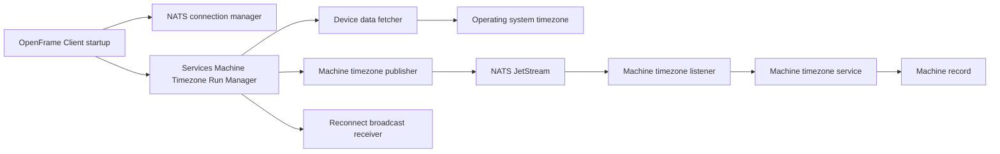
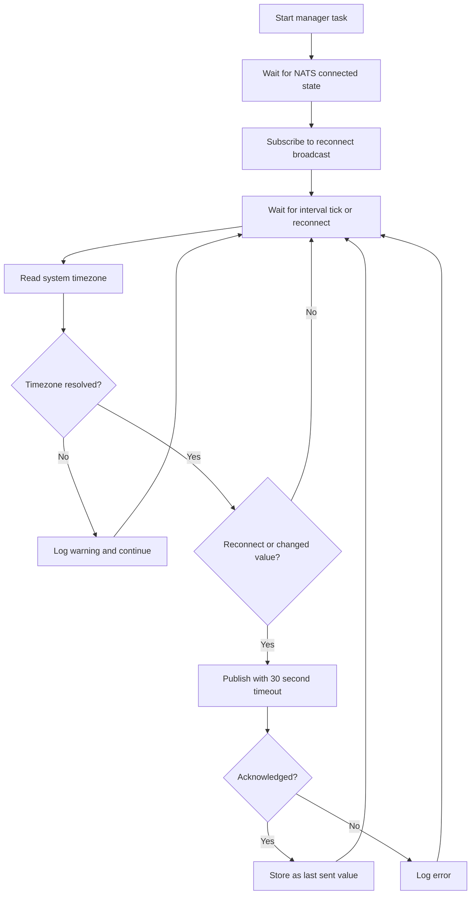
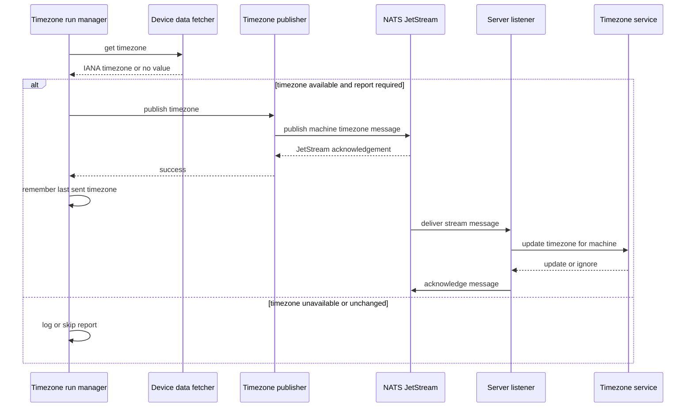

# Services Machine Timezone Run Manager

Services Machine Timezone Run Manager is the OpenFrame Client background task that keeps the platform’s stored timezone for an enrolled machine current. It runs inside the Rust client supplied by the `openframe_agent_lib` dependency from OpenFrame OSS Library, rather than in a service defined directly by this repository. The implementation polls the operating system for an IANA timezone, publishes a report only when it is needed, and republishes following a NATS reconnect so the server can converge after a transient connection loss.

The implementation is [machine timezone run manager source](https://github.com/flamingo-stack/openframe-oss-lib/blob/7a766f00e4f58b5d89db007b878ac8d6e0c344f4/clients/openframe-client/src/services/machine_timezone_run_manager.rs) in OpenFrame OSS Library. This repository consumes `openframe_agent_lib` version `v0.0.5` and runs the client as part of its tenant deployment.

## Responsibilities

- Start an independent Tokio task after the OpenFrame Client has connected to NATS.
- Wait for a connected NATS client before beginning its reporting loop.
- Read the system timezone through `DeviceDataFetcher`.
- Publish a `MachineTimezoneMessage` containing the timezone to the per-machine JetStream subject.
- Avoid unchanged periodic reports during a continuous connection.
- Force a report when the NATS connection manager signals a reconnect.
- Bound each publish attempt to 30 seconds and log failures without stopping the task.

The manager does not persist the timezone locally, modify the system timezone, or directly update server-side device records. It coordinates collection and transport; the publisher and the server-side listener own those respective concerns.

## Runtime Architecture

`Client.start()` starts the manager after authentication, NATS connection, and the NATS connection watchdog are initialized. The manager therefore waits on a concrete connection state as an additional safeguard, even though it is started after `connect()` returns.



### Components and Ownership

| Component | Role | Key behavior |
|---|---|---|
| `MachineTimezoneRunManager` | Client-side orchestration | Owns the polling loop, reconnect handling, change suppression, timeout, and error logging. |
| `DeviceDataFetcher` | Local data collection | Resolves the host timezone using the IANA timezone provider and returns no value when resolution fails. |
| `MachineTimezonePublisher` | Message construction and delivery | Reads the configured machine ID, serializes `MachineTimezoneMessage`, and waits for the JetStream publish acknowledgement. |
| `NatsConnectionManager` | Connection lifecycle | Exposes the current NATS client and a broadcast subscription that reports reconnect events. |
| `MachineTimezoneListener` | Server-side ingestion | Consumes `machine.*.timezone` messages from the `MACHINE_TIMEZONE` stream and delegates processing. |
| `MachineTimezoneService` | Server-side state update | Validates the IANA zone, finds the machine, ignores invalid, unknown, deleted, or unchanged records, then writes a changed timezone. |

## Startup and Scheduling

Calling `new()` injects the publisher, device data fetcher, and NATS connection manager. Calling `start()` logs startup and spawns a cloned manager on Tokio; it does not block the main client startup sequence.

Before the reporting loop is created, the spawned task repeatedly reads the NATS client and checks for the `Connected` state. It sleeps for 500 milliseconds between checks. This waiting phase has no deadline in the manager itself, so the task remains dormant until a usable NATS connection exists.

Once connected, the manager creates a five-minute interval and initializes `last_sent` as absent. Each loop iteration waits for whichever event arrives first:

1. the interval ticks, or
2. the reconnect broadcast receiver yields an event.

The initial Tokio interval tick is processed by the loop, so a newly connected client can publish its timezone without waiting for the first five-minute period. A reconnect triggers the same reporting path immediately.



## Publish Contract and Data Flow

The publisher obtains the machine identifier from the agent configuration service, creates a JSON `MachineTimezoneMessage`, and publishes it with JetStream acknowledgement semantics. The subject has the following form:

```text
machine.{machineId}.timezone
```

The payload model contains one field:

```json
{
  "timezone": "IANA timezone identifier"
}
```

The manager considers a report successful only if the publisher finishes successfully before its 30-second timeout. On success it records the reported timezone in memory. On a publish error or timeout, it leaves `last_sent` unchanged, allowing a later interval or reconnect to retry. This means the module does not claim delivery merely because the local timezone was read successfully.



## Change Detection and Reconnect Semantics

The in-memory `last_sent` value prevents repetitive transmission of the same timezone on normal five-minute ticks. This optimization is deliberately bypassed for a reconnect event: the manager republishes the current timezone even if it is identical to the previously acknowledged value.

The reconnect receiver is a Tokio broadcast subscription. A lagged receive is treated as a reconnect signal, prioritizing state convergence over trying to account for every individual reconnect. If the broadcast channel closes, the manager logs an error and stops permanently because it can no longer observe future reconnects.

The deduplication state is process-local. Restarting the client resets it, which permits an initial report after each client process start. The server independently ignores a timezone that already matches the stored machine value, so a harmless duplicate does not cause a write.

## Failure Behavior and Operational Signals

| Condition | Behavior | Consequence |
|---|---|---|
| NATS client is unavailable or not connected at startup | Poll every 500 milliseconds. | No timezone read or publish occurs until connection succeeds. |
| System timezone cannot be resolved | Log a warning and skip the iteration. | The next interval or reconnect retries collection. |
| Timezone is unchanged during a regular tick | Skip publishing. | Reduces recurring JetStream traffic. |
| Publisher returns an error | Log an error and do not update the remembered value. | A future trigger can retry the report. |
| Publish exceeds 30 seconds | Log an error indicating a possible NATS disconnection. | The task remains alive and a future trigger can retry. |
| Reconnect receiver is lagged | Treat as a reconnect. | The current timezone is republished. |
| Reconnect receiver is closed | Log an error and return from the task. | Automatic reconnect-driven reporting ends for that client process. |
| Server receives invalid, unknown, deleted, or unchanged machine data | The server listener acknowledges the message after the service declines the update. | The invalid update is not retried indefinitely. |
| Server listener fails unexpectedly while processing a message | It leaves the message unacknowledged. | JetStream can redeliver the message. |

## Server-Side Acceptance Rules

The server listener extracts the machine ID from the NATS subject, deserializes the payload, and uses a durable JetStream consumer for the `MACHINE_TIMEZONE` stream. It accepts the `machine.*.timezone` subject pattern and uses the `machine-timezone-processor-v1` consumer identity.

Before writing, the server-side service requires a nonblank timezone that appears in Java’s available IANA zone set. It then requires a known machine that is not in a deleting or deleted state. If the incoming timezone equals the stored value, it does nothing. These checks provide a second layer of idempotence beyond the client’s in-memory suppression.

## Maintenance Considerations

- Keep the message subject and payload model aligned with the server listener. The subject carries the machine identity; the payload carries the timezone value.
- Preserve the publish acknowledgement and manager timeout distinction. A transport call that starts but does not receive a JetStream acknowledgement is not a successful report.
- Preserve reconnect-triggered publication when changing deduplication logic. It is the recovery mechanism for state that may not have reached the platform during a disconnection.
- Treat timezone values as IANA zone identifiers. The server explicitly validates them, so operating-system collection changes must still produce compatible identifiers.
- Test normal ticks, changed timezones, reconnects, unavailable timezone data, publish errors, timeouts, lagged reconnect notifications, and closed reconnect channels when changing the run loop.
