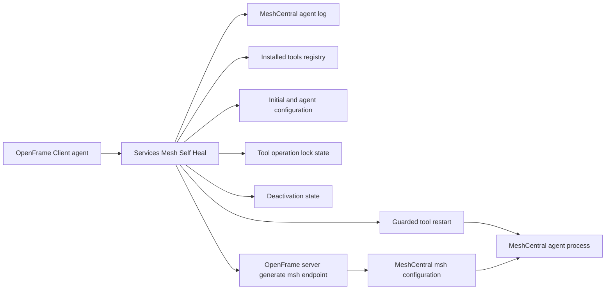
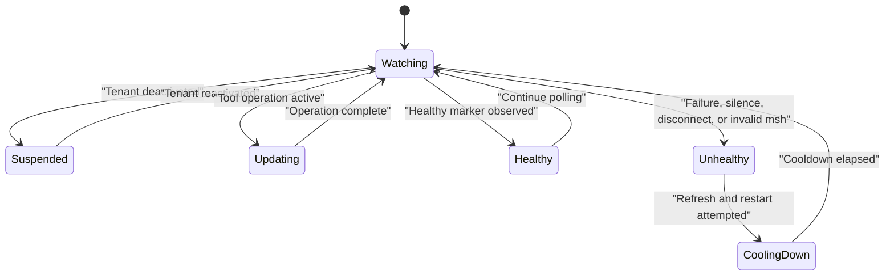
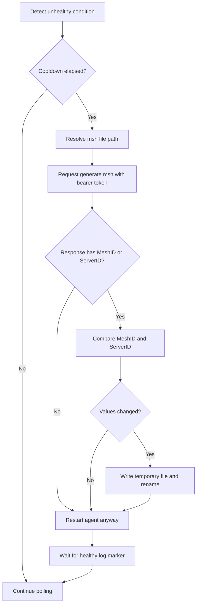
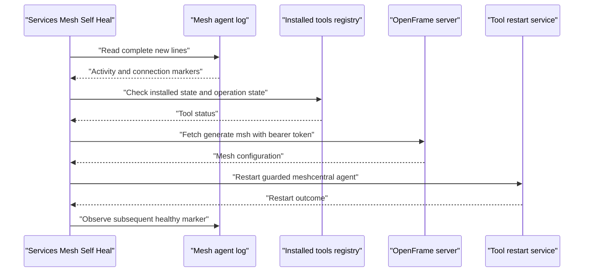

# Services Mesh Self Heal

Services Mesh Self Heal is the OpenFrame Client agent's background recovery watcher for the `meshcentral-agent` integrated tool. It observes the local MeshCentral agent log and validates the agent's `.msh` connection configuration. When the agent is demonstrably unhealthy, it refreshes the `.msh` file from the configured OpenFrame server and restarts the agent through the shared guarded restart path.

The implementation is supplied by the `openframe_agent_lib` Rust dependency from OpenFrame OSS Library, version `v0.0.5`, and is run by this repository's OpenFrame Client workload. Its source is [`mesh_self_heal_service.rs`](https://github.com/flamingo-stack/openframe-oss-lib/blob/7a766f00e4f58b5d89db007b878ac8d6e0c344f4/clients/openframe-client/src/services/mesh_self_heal_service.rs).

## Purpose and Scope

The watcher addresses failure modes in which the integrated MeshCentral agent is installed but cannot maintain an authenticated control-channel session. It is intentionally scoped to the tool identifier `meshcentral-agent`; it does not supervise arbitrary tools.

It reacts to these conditions:

- An unresolved `Connection FAILED` log entry persists for ten minutes.
- The MeshCentral agent log has no new complete line for 90 minutes.
- The log remains active but no accepted authentication marker is observed for three hours, subject to a bounded retry policy.
- An installed agent has no `.msh` file, the file cannot be read, or it lacks `ServerID`.

A recovery attempt refreshes configuration from the server and asks the common tool-restart service to restart the agent. The watcher is defensive: it pauses during tenant deactivation and tool update operations, survives its own panics, backs off repeated attempts, and avoids turning a changed log format into an indefinite restart loop.

## Runtime Placement

The service is constructed with local state, lifecycle, authentication, and tool-operation collaborators. It runs inside the OpenFrame Client agent process, rather than as a server-side controller. The client starts the watcher asynchronously; `run()` returns once its resilient background task has been scheduled.

## Core Components

| Component | Responsibility |
| --- | --- |
| `MeshSelfHealService` | Holds the collaborators needed to observe, diagnose, refresh, and restart the MeshCentral agent. |
| `new` | Receives the directory manager, installed-tool registry, kill and restart services, configuration services, tool-operation coordinator, deactivation service, and HTTP client. |
| `run` | Starts a detached watcher task. If the watcher returns or panics, records the failure and waits 60 seconds before creating another watcher cycle. |

### Collaborator Responsibilities

The service relies on adjacent OpenFrame Client library capabilities rather than implementing their responsibilities itself:

- **Directory management** resolves the application-support location, tool executable path, and therefore the default `.msh` location when no existing file is found.
- **Installed tools state** identifies whether `meshcentral-agent` is present and fully installed, and supplies its recorded executable location.
- **Initial configuration** provides the configured server host. **Agent configuration** supplies the access token used to authorize the configuration download.
- **Tool operations** indicates that a tool installation or update is in progress. The watcher clears its timing state and does not intervene while MeshCentral is busy.
- **Deactivation** suspends self-healing while the tenant is inactive; activation resets the watcher grace periods.
- **Tool restart** applies the shared guarded restart behavior. If the registry says the tool is absent, the service falls back to terminating the tool process so the operating-system supervisor can relaunch it.

## Health Signals and State

The watcher polls every 30 seconds. At startup, it begins reading at the end of the log to avoid treating old entries as fresh failures. It also examines the final 64 KiB of the file to determine whether the latest historical connection marker was healthy or failing, and seeds its activity time from the file modification timestamp. This lets it detect an already-wedged or silent agent without treating the entire log history as a current failure.

A healthy session is established only by one of these accepted log phrases:

- `Server fully authenticated`
- `Received CoreOk from server`
- `Server verified meshcore`

A line containing `Connection FAILED` starts or maintains the unresolved-failure timer. Any healthy marker clears that timer, clears the action cooldown, and resets the consecutive failed-heal counter.

### Detection Thresholds

| Signal | Threshold | Interpretation |
| --- | ---: | --- |
| Poll interval | 30 seconds | Frequency of log scanning. |
| Unresolved failure | 10 minutes | A failure marker has no subsequent healthy marker. |
| Silence | 90 minutes | The log has not produced activity, suggesting a wedged or dead agent. |
| Missing healthy marker | 3 hours | The log may be active, but there is no positive proof of an authenticated server session. |
| Initial cooldown | 1 hour | Minimum wait after any heal outcome, including a no-op, busy result, or error. |
| Maximum missing-marker heals | 5 | After five unsuccessful heals, missing markers alone no longer trigger action. |

The disconnect safeguard is important: absence of an error is not considered healthy. Conversely, a watcher begins with a three-hour grace period before it has seen any healthy marker, so a newly started watcher does not immediately restart the agent.

## Recovery Process

All unhealthy branches use one recovery path. The path first tries to repair the connection configuration, then restarts the agent even if refresh failed. A failed configuration fetch must not prevent a restart that could recover a transient agent-side fault.

### Refreshing the `.msh` File

1. The watcher searches the MeshCentral application-support directory for an existing `.msh` file. If none exists, it derives the expected file beside the registered tool executable.
2. It obtains the server host from initial configuration and the agent access token from persisted agent configuration.
3. It requests the validated endpoint path `/tools/agent/meshcentral-server/generate-msh` over HTTPS, with the server host also supplied as the `host` query parameter. The request carries a bearer token and has a 30-second timeout.
4. The response must contain at least `MeshID` or `ServerID`. The service compares these fields with the current file and does not rewrite a configuration whose identifiers are unchanged.
5. When a rewrite is necessary, it creates the parent directory, writes the response to a temporary file, then renames the temporary file into place. This avoids replacing the active configuration with a partially written file.

The comparison deliberately preserves the current file when identifiers already match. The agent restart still occurs afterward, allowing the agent to re-import known-current configuration and reconnect.

### Restart Outcomes

The guarded restart service can report that the tool was restarted, is busy, or is not installed. A busy tool is left alone. A missing registry entry triggers a best-effort process stop as a fallback. Restart errors and fallback kill errors are logged, but do not terminate the watcher.

## Resilience Controls

Services Mesh Self Heal includes several protections against false positives and recovery storms:

- **Suspension awareness:** no heal is attempted while deactivation reports the tenant as suspended. Timing state is reset on reactivation.
- **Sleep and suspend detection:** if a polling sleep exceeds five normal intervals, the process treats it as host suspension and restarts grace timers instead of blaming the agent for elapsed host sleep.
- **Update coordination:** a busy `meshcentral-agent` resets health timing and prevents a stale pre-update log from restarting the newly updated process.
- **Exponential backoff:** each consecutive unsuccessful heal doubles the one-hour cooldown, capped at an eight-hour delay.
- **Bounded marker-based remediation:** after the fifth failed heal without a healthy marker, the watcher logs that the agent likely needs reinstallation and stops healing solely because the marker is absent. Other concrete conditions, such as a broken `.msh` file, remain independently detectable.
- **Watcher supervision:** panics are captured and logged. An exited or panicked watcher is recreated after 60 seconds so task failures are observable and do not silently disable recovery.

## Data Flow and Observability

Operational evidence is emitted through structured tracing. Important messages identify watcher startup, unreadable logs, failed refreshes, configuration rewrites, restart results, repeated failures, watcher exits, and panics. The log includes file paths and high-level condition details, but avoids logging the bearer token or the `.msh` response body.

## Maintenance Guidance

When changing this module, preserve the distinction between **positive session proof** and the absence of failure. The service is intentionally compatible with multiple MeshCentral agent log wordings, and its thresholds are tuned to tolerate normal periodic reconnect behavior.

Changes to `.msh` generation should retain the `MeshID` and `ServerID` validation contract. In particular, a successful HTTP response without either identifier is rejected, and local file replacement should remain atomic. Changes to tool lifecycle behavior should continue to respect the shared tool-operation lock and deactivation state, because those controls prevent collisions with installation, update, and tenant shutdown flows.

This module has no child documentation generated with it. For broader client lifecycle, tool management, deactivation, and messaging behavior, refer to the corresponding OpenFrame Client module documentation in the platform documentation.
