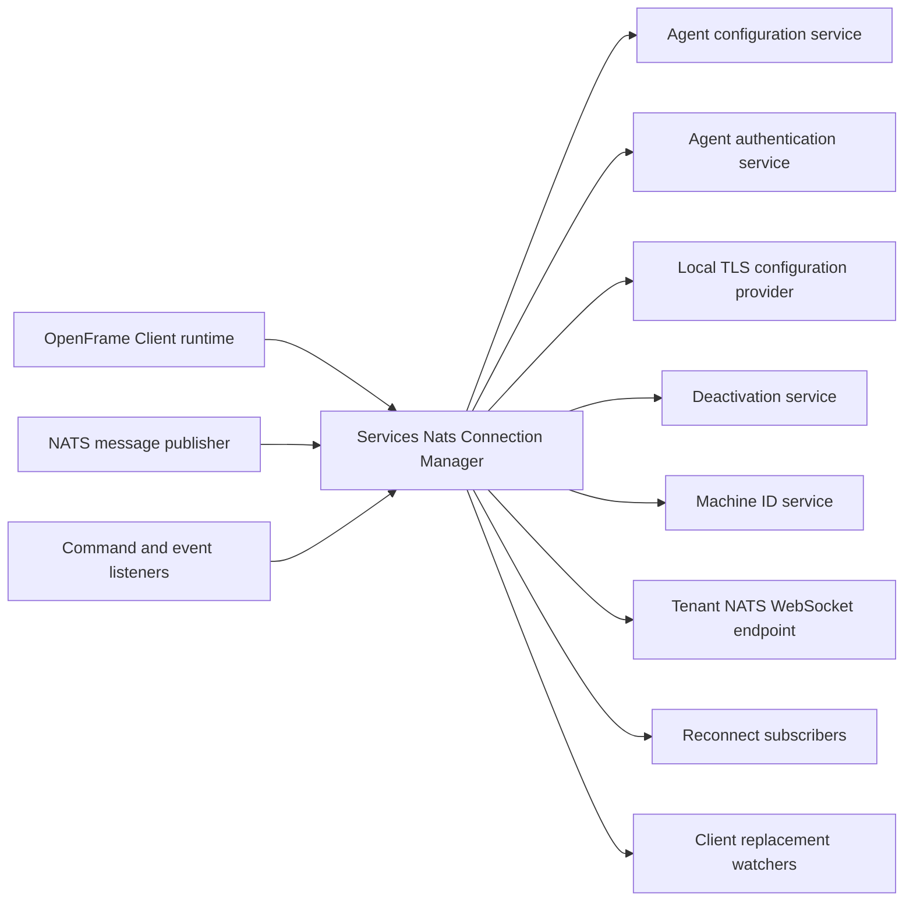
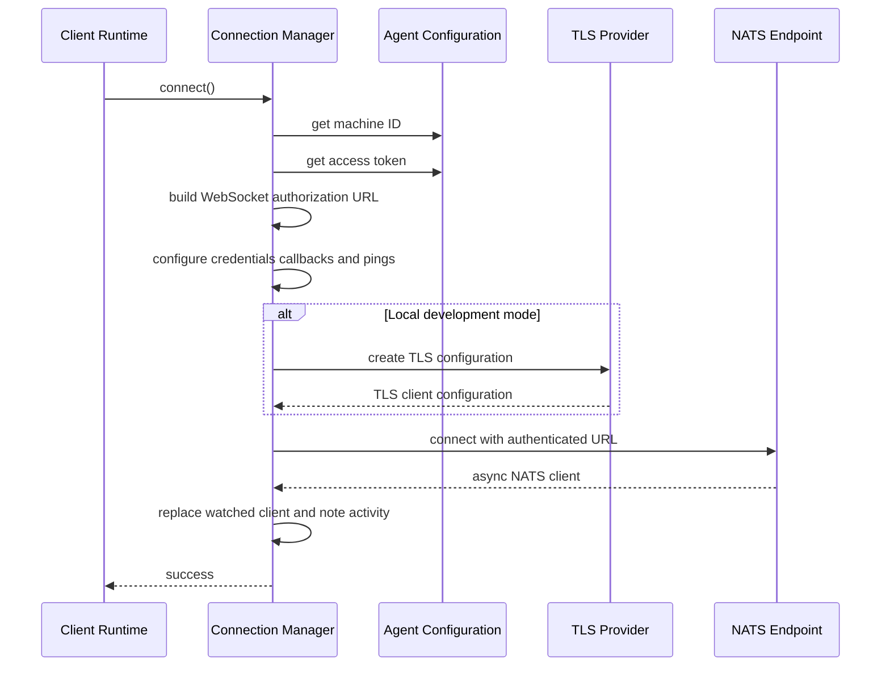
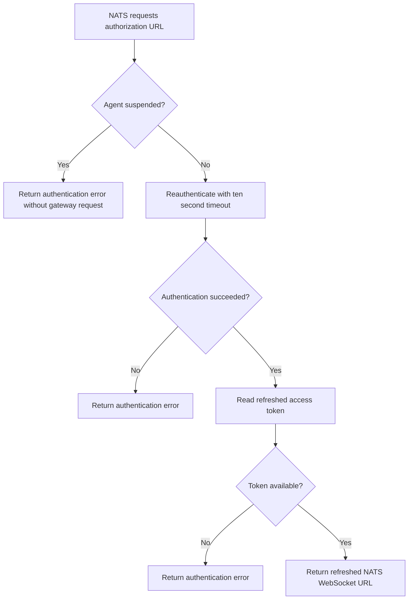
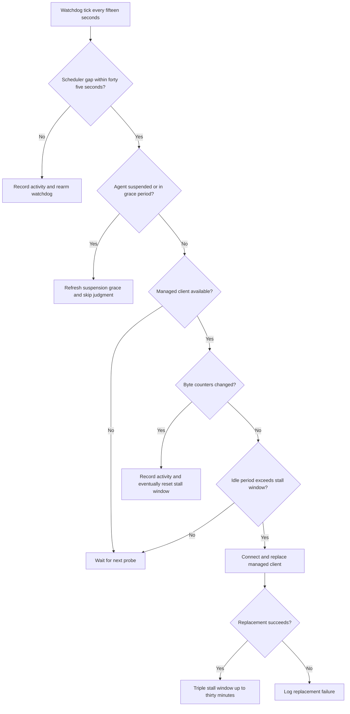

# Services Nats Connection Manager

Services Nats Connection Manager owns the OpenFrame Client agent's live connection to the tenant NATS endpoint. It constructs the authenticated WebSocket URL, configures the NATS client, exposes the current client to message-oriented agent services, and restores a usable client when the event loop appears stalled. The implementation is supplied by the `openframe_agent_lib` artifact from OpenFrame OSS Library and runs in this repository's OpenFrame Client deployment.

The module is implemented in [the OpenFrame OSS Library source](https://github.com/flamingo-stack/openframe-oss-lib/blob/7a766f00e4f58b5d89db007b878ac8d6e0c344f4/clients/openframe-client/src/services/nats_connection_manager.rs). It is a connection lifecycle component rather than a message protocol implementation: publishing is delegated to the NATS message publisher, while command, execution, and remote-access listeners obtain the managed client for their own subscriptions.

## Responsibilities

- Build a NATS-over-WebSocket endpoint from the configured tenant host and current access token.
- Identify the connection with the server-assigned machine identifier while sending the locally derived machine identifier in a custom header.
- Configure machine credentials, initial-connect retry, unlimited reconnect attempts, ten-second pings, and lifecycle callbacks.
- Reauthenticate when the NATS client requests a fresh authorization URL.
- Publish two local lifecycle signals: reconnection events and client replacement updates.
- Apply a five-minute reconnect delay while deactivation marks the tenant as suspended, avoiding repeated gateway requests for a deleted or suspended tenant.
- Run a watchdog that detects prolonged inactivity and replaces a stalled client without stopping the agent process.

## Position in the Client Runtime

The manager keeps the active `async_nats::Client` behind a Tokio watch channel. Consumers call `get_client()` to receive the current shared client. Components that must react to a replacement use `on_client_replaced()` and receive a watch receiver whose value changes from the old client to the newly connected one. Consumers that need to restore subscriptions after a successful reconnection use `subscribe_reconnect()` to receive broadcast notifications.

## Dependencies and Identity

| Dependency | Contribution |
| --- | --- |
| Agent configuration service | Reads the server-assigned machine identifier and the current access token. |
| Machine ID service | Supplies the local machine identifier placed in the NATS custom header. |
| Agent authentication service | Reauthenticates when NATS calls the authorization URL callback. |
| Initial configuration service | Determines whether the agent runs in local development mode. |
| Local TLS configuration provider | Supplies a TLS client configuration only in local development mode. |
| Deactivation service | Indicates suspension, which suppresses reauthentication and increases reconnect delay. |
| Tokio watch and broadcast channels | Deliver the latest client and nonpersistent reconnect notifications to in-process consumers. |
| Async NATS client | Maintains the NATS-over-WebSocket connection, pinging, retries, events, and authorization callback. |

Two identifiers have distinct roles. The persisted configuration machine identifier names the NATS connection. The local machine identifier is attached under the client machine-ID header. Keeping these values separate allows server-recognized connection identity and local agent identity to be transmitted independently.

## Connection Establishment

`new()` creates an empty client watch channel, initializes the activity timestamp, and creates a reconnect broadcast channel with capacity for 16 pending notifications. At this point, `get_client()` returns an error; the runtime must call `connect()` first.

`connect()` performs the following sequence.

The endpoint format is the configured NATS server URL followed by the NATS WebSocket path and an authorization query value containing the access token. The URL is rebuilt both for the initial connection and after successful reauthentication, so a fresh token is used for a later authorization challenge.

The NATS connection options:

- use the fixed device user name `machine` and an empty password;
- retry the first connection and allow an unlimited number of reconnects;
- send NATS pings every ten seconds;
- set the connection name to the configured machine identifier;
- attach the local machine identifier in the custom machine-ID header; and
- load development TLS settings only when local mode is active.

## Authentication and Reconnection

Async NATS invokes the authorization URL callback when it needs renewed authorization. The callback first checks whether the agent is suspended. A suspended agent returns an authentication error immediately and does not contact the gateway.

For an active agent, it calls `reauthenticate()` with a ten-second timeout. A successful authentication is followed by a read of the newly stored access token and construction of a fresh NATS WebSocket URL. Authentication failures, token-read failures, and timeouts become NATS authentication errors, allowing the client library's reconnect behavior to continue rather than masking the failure.

The event callback logs all NATS events. It emits a reconnect notification only when an `Event::Connected` occurs after the first successful connection. The atomic connected flag prevents the initial connection from being misreported as a reconnection. Broadcast receivers are lossy by design: a lagging receiver can miss a notification, so subscribers should treat the signal as a prompt to reconcile state rather than as a durable event log.

During reconnect attempts, activity is recorded. For an active agent the callback logs the attempt and waits five seconds. When suspended, it waits five minutes. This changes repeated failed reconnects into infrequent probes and automatically returns to the regular five-second interval once the deactivation service reports recovery.

## Watchdog and Client Replacement

`start_connection_watchdog()` starts one asynchronous probe loop. It runs every 15 seconds and uses byte counters from the active NATS client to distinguish observed traffic from inactivity. It does not block caller execution.

A scheduler pause longer than 45 seconds is not treated as a connection fault. Instead, the watchdog records activity and starts a new observation period. This avoids replacing a healthy client merely because the task was delayed.

Suspension creates a grace period lasting the suspended reconnect delay. While inside it, the watchdog continuously records activity and declines to evaluate a stall. This works with the reconnect callback to avoid a replacement loop while a tenant is unavailable.

For an active client, unchanged byte counts do not trigger immediate replacement. The manager compares elapsed inactivity with a stall window that starts at 90 seconds. When the threshold is exceeded, it drops its current local client reference, calls `connect()`, and replaces the watched client on success. Every successful watchdog-driven replacement widens the threshold by a factor of three, capped at 30 minutes. Sustained traffic for at least the minimum window resets the threshold to 90 seconds. This progressive backoff reduces churn when a deeper network or broker fault persists.

## Public Interface

| Member | Purpose |
| --- | --- |
| `new(...)` | Creates an unconnected manager with its dependencies and notification channels. |
| `connect()` | Builds options, opens the NATS connection, and atomically makes the new client current. |
| `get_client()` | Returns the current shared NATS client or an error before the first successful connection. |
| `subscribe_reconnect()` | Returns a broadcast receiver for post-initial connection events. |
| `on_client_replaced()` | Returns a watch receiver for the current client value and future client replacements. |
| `start_connection_watchdog()` | Spawns the periodic stalled-connection detector and replacement loop. |

## Operational Behavior

### Startup order

Start the manager before components that publish or subscribe through NATS. A consumer calling `get_client()` before a successful connection receives an explicit initialization error. Start the watchdog after connection management is configured; its loop can safely continue through temporary absence of a client and will retry its assessment on later ticks.

### Failure boundaries

- The initial connection retries through the async NATS configuration. A failed `connect()` call includes context identifying the NATS connection failure.
- Authorization renewal is bounded to ten seconds and returns a typed NATS authentication error on failure.
- Client replacement is isolated to the watchdog task. A failed replacement is logged, while the watchdog remains running for later attempts.
- The manager records reconnect attempt activity, traffic observations, successful connections, and watchdog rearming so temporary inactivity is not mistaken for a stalled event loop.

### Observability

The component emits informational messages for connection starts, NATS events, reauthentication, successful refreshed URLs, watchdog startup, and client replacement. It warns for active reconnect attempts and scheduler gaps. Errors identify stalled clients, failed watchdog replacements, token retrieval failures, authentication failures, and authorization timeouts. When diagnosing disconnects, distinguish a regular NATS reconnect attempt from a watchdog replacement: the latter means traffic counters and recorded activity remained unchanged longer than the current stall window.

## Maintenance Notes

Changes to connection replacement must preserve the watch-channel update, because callers may retain a client obtained before a replacement. Services that establish subscriptions should use the reconnect notification or client-replacement watch channel to recreate any state tied to the former NATS client.

The suspension checks are a protective control, not merely an optimization. Removing them would allow both the authentication callback and NATS reconnect loop to repeatedly contact a gateway for a tenant that is intentionally unavailable. Any change to timeout, probe, or backoff values should be evaluated against the interaction between the ten-second ping interval, the 15-second watchdog probe, the 90-second minimum stall window, and the five-minute suspended reconnect delay.
