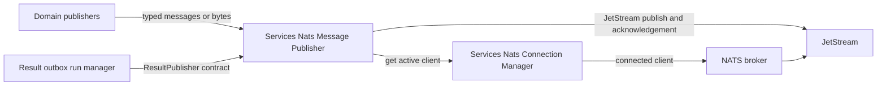
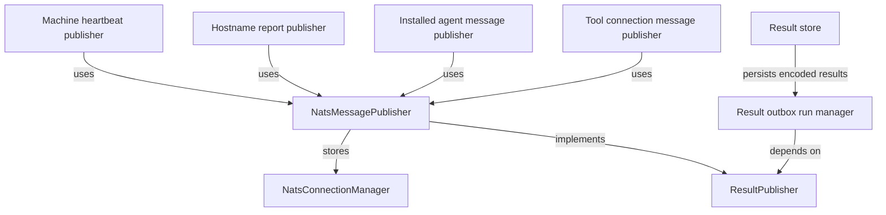
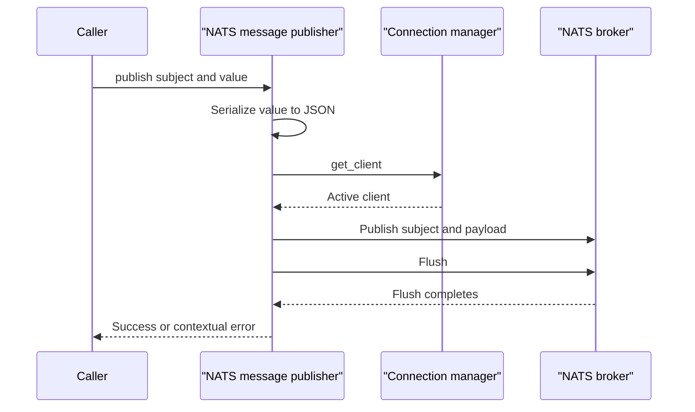
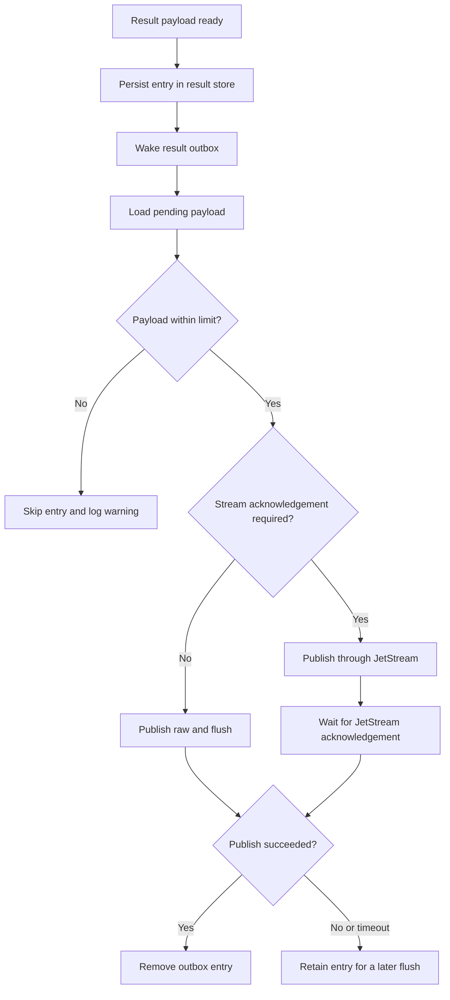

# Services Nats Message Publisher

Services Nats Message Publisher is the OpenFrame client agent's shared outbound transport adapter for NATS. It obtains the current client connection from the connection manager, serializes typed messages when required, and publishes them either through core NATS or through JetStream with a server acknowledgement. The implementation is supplied by the `openframe_agent_lib` dependency from OpenFrame OSS Library and runs inside this repository's OpenFrame client deployment.

The implementation is in [NATS message publisher source](https://github.com/flamingo-stack/openframe-oss-lib/blob/7a766f00e4f58b5d89db007b878ac8d6e0c344f4/clients/openframe-client/src/services/nats_message_publisher.rs).

## Responsibilities

- Resolve the active `async_nats` client immediately before each publish operation.
- Convert values implementing `Serialize` to JSON for normal typed publishing.
- Send caller-provided bytes unchanged when a payload is already encoded.
- Flush normal NATS publishes so transport errors are surfaced before reporting success.
- Use JetStream publishing when a durable acknowledgement is required.
- Expose the broker's advertised maximum payload size to result delivery code.
- Implement the `ResultPublisher` abstraction used by the durable result outbox.

The module does not choose subjects, construct domain messages, buffer data, retry failed messages, or establish a NATS connection. Those responsibilities belong to its callers, the result store and outbox manager, and Services Nats Connection Manager respectively.

## Position in the Client Agent



The connection manager owns connection lifecycle concerns: configuration, authentication, optional local TLS configuration, reconnection notifications, and its watchdog. Its `get_client` operation returns an error when no client has been initialized, so a publish can only proceed after the agent has connected.

## Public Interface

`NatsMessagePublisher` is cloneable and is constructed with a `NatsConnectionManager`. Its operations are asynchronous and return `anyhow::Result` except for `max_payload`, which returns `Option<usize>` because connection lookup may be unavailable.

```rust
pub fn new(nats_connection_manager: NatsConnectionManager) -> Self

pub async fn publish<T: Serialize>(&self, subject: &str, payload: T) -> Result<()>

pub async fn publish_raw(&self, subject: &str, bytes: &[u8]) -> Result<()>

pub async fn publish_acked(&self, subject: &str, bytes: &[u8]) -> Result<()>

pub async fn max_payload(&self) -> Option<usize>
```

| Operation | Payload treatment | Transport completion condition | Intended use |
|---|---|---|---|
| `publish` | Serializes the supplied value to a JSON string. | Core NATS publish succeeds and `flush` succeeds. | Domain publishers with a serializable message value. |
| `publish_raw` | Copies and sends supplied bytes without serialization. | Core NATS publish succeeds and `flush` succeeds. | Pre-encoded payloads, including outbox data. |
| `publish_acked` | Copies and sends supplied bytes without serialization. | JetStream confirms the publication with an acknowledgement. | Results whose subject requires stream acknowledgement. |
| `max_payload` | Does not publish. | Reads `server_info().max_payload` from the active client. | Payload admission checks in the result outbox. |

All publishing variants attach contextual errors. Serialization failure is reported separately from NATS publish failure, flush failure, and JetStream acknowledgement failure, allowing calling services to preserve a useful failure cause.

## Component Relationships



The following agent services are known direct users of this adapter:

- **Machine Heartbeat Publisher** publishes `MachineHeartbeatMessage` to the machine heartbeat subject.
- **Hostname Report Publisher** publishes hostname report data and logs publishing failures rather than propagating them from its public entry point.
- **Installed Agent Message Publisher** reports installed-agent type and version for a machine.
- **Tool Connection Message Publisher** reports tool connection information for a machine.
- **Result Outbox Run Manager** is generic over `ResultPublisher`; with this implementation it sends durable result payloads using either core NATS or JetStream.

## Normal Publish Flow

The typed and raw operations differ only in payload preparation. Both acquire the current client for each operation rather than retaining a client handle in the publisher. This lets the publisher follow a client replacement made by the connection manager.



For `publish_raw`, the serialization step is omitted: the provided byte slice is copied into the NATS payload and then published and flushed using the same sequence. A successful return from either normal publishing method means the local client accepted the publish and the flush completed; it is not an application-level acknowledgement from a consumer.

## Acknowledged Result Delivery

The result outbox provides durability above the normal publisher. It stores encoded payloads with their target subject, wakes on notification or a periodic interval, and checks the broker limit returned by `max_payload`. The outbox selects JetStream acknowledgement only for subjects classified by the delivery model as requiring a stream acknowledgement; other subjects use raw core-NATS publication.



`publish_acked` creates a JetStream context from the active NATS client, publishes the byte payload, then awaits the returned acknowledgement future. This is the stronger transport guarantee used by the outbox: the method does not report success merely because the client submitted the publication.

## Payload Limits and Failure Semantics

`max_payload` is advisory metadata from the connected server. If there is no active client, it returns `None`; the outbox applies its own fallback limit when that occurs. It does not preflight ordinary `publish`, `publish_raw`, or `publish_acked` calls, so direct callers must ensure their payloads are appropriate for the broker.

| Condition | Publisher behavior | Caller or outbox consequence |
|---|---|---|
| Typed payload cannot be serialized | Returns an error annotated as serialization failure. | No publish is attempted. |
| Connection manager has no active client | Returns an error from client retrieval. | Direct callers decide how to handle it; the outbox retains its entry for retry. |
| Core NATS publish fails | Returns an annotated publish error. | No success is reported. |
| Core NATS flush fails | Returns an annotated flush error. | The caller receives failure even after submitting the publish. |
| JetStream publish or acknowledgement fails | Returns an annotated JetStream error. | The durable outbox retains the entry for a later attempt. |
| Outbox payload exceeds the effective limit | Not sent by the outbox. | Entry is skipped so it does not block healthy pending results. |

## Maintenance Guidance

- Prefer `publish` when the service owns a serializable domain value. Prefer `publish_raw` only when serialization has already occurred or exact bytes are required.
- Use `publish_acked` for streams that require JetStream confirmation, particularly through the `ResultPublisher` contract. Do not substitute it for ordinary fire-and-flush events without a delivery requirement.
- Preserve the per-call connection lookup when modifying this module. Caching a client here could keep publications attached to a stale connection after the manager replaces it.
- Preserve the `flush` calls in normal NATS paths. Removing them would weaken the method's successful-return signal and defer transport errors.
- Keep subject selection and retry policy outside this adapter. It is intentionally a small transport boundary; the result store and outbox are responsible for persistence and retry.

## Related Module Boundaries

Services Nats Connection Manager supplies the authenticated, reconnecting NATS client used by this module. The result store and Result Outbox Run Manager add persistent result delivery and choose between raw and acknowledged publishing. Domain publisher services define event-specific subjects and payload models before delegating to Services Nats Message Publisher.
