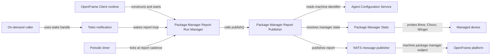
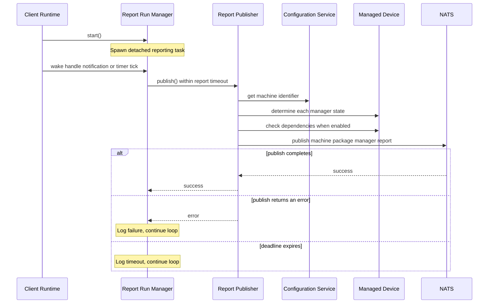
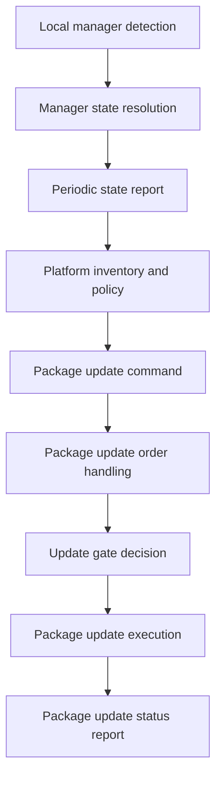

# Services Package Manager Report Run

Services Package Manager Report Run is the background scheduler that keeps OpenFrame Client's package-manager inventory current. It owns the cadence and wake-up mechanism for publishing package-manager state; it does not itself detect managers or construct the report payload. The implementation is supplied by the `openframe_agent_lib` Cargo dependency from [OpenFrame OSS Library](https://github.com/flamingo-stack/openframe-oss-lib/blob/7a766f00e4f58b5d89db007b878ac8d6e0c344f4/clients/openframe-client/src/services/package_manager/report_run_manager.rs), which is run by this repository's client distribution.

## Responsibilities

- Create a shareable asynchronous wake handle for on-demand report requests.
- Start a detached Tokio task that publishes at a periodic interval or when woken.
- Bound each report attempt with a timeout derived from the configured package-manager presence-probe timeout.
- Log publish failures and timeouts while retaining the run loop for later attempts.

The module is intentionally an orchestration boundary. Package-manager detection, manager-state resolution, dependency collection, message serialization, and NATS delivery are delegated to the report publisher and package-manager services.

## Architecture



### Component roles

| Component | Role |
|---|---|
| `PackageManagerReportRunManager` | Holds the publisher and an `Arc<Notify>` wake primitive, then schedules bounded report attempts. |
| `new` | Creates the manager with a supplied publisher and a fresh notification primitive. |
| `start` | Clones shared dependencies and spawns the asynchronous, long-lived reporting loop. It does not block the caller. |
| `wake_handle` | Returns a clone of the notification primitive so another client component can request an earlier reporting pass. |
| `PackageManagerReportPublisher` | Obtains the machine identifier, determines the state of every known manager, optionally reports dependencies, and sends the resulting message. |

The current manager set is Brew, Choco, and Winget. A manager can be reported as present, missing, or unknown. The publisher also records whether a console user is present while resolving manager state, and can include dependency reports only when dependency reporting is enabled and the owning manager is present.

## Scheduling and Timeout Model

The nominal report interval is 900 seconds. The manager calculates an attempt deadline as:

```text
report timeout = presence probe timeout × number of managers + 10 seconds
```

The extra 10 seconds are publishing grace. The timer interval is the larger of 900 seconds and the calculated attempt timeout plus another 10-second grace window. This lower bound prevents a configured probe budget from making the periodic schedule shorter than a report attempt.

A report may begin for either of these reasons:

1. The periodic Tokio interval ticks.
2. A collaborator signals the handle returned by `wake_handle`.

Both signals enter the same publishing path. The wake mechanism is a scheduling signal rather than a separate reporting implementation; report construction and delivery remain centralized in the publisher.

## Report Data Flow



## Runtime Behavior

On `start`, the manager logs its startup and launches one Tokio task. That task waits on a `select` between the periodic ticker and the notification primitive. After either branch completes, it invokes `PackageManagerReportPublisher.publish` through Tokio's timeout wrapper.

A successful publication requires the publisher to obtain a machine identifier from agent configuration. It then builds a per-manager state map by resolving every known package manager against the local device. The outgoing message is sent through the client NATS publisher on a subject scoped to that machine. The run manager treats successful completion as terminal only for that iteration; it immediately returns to waiting for the next tick or wake signal.

If the publisher returns an error, the manager writes an error-level log containing the failure. If the asynchronous attempt exceeds its computed deadline, it logs a timeout. Neither outcome terminates or restarts the task, and the code does not add a distinct retry delay. A subsequent periodic tick or wake notification is the next opportunity to publish.

## Interaction with Package Updates

Reporting is inventory-oriented, whereas package updating is command-oriented:

- This module regularly describes the locally observed availability of package managers and eligible dependencies.
- The package update workflow receives update commands, tracks orders and reports execution status.
- Manager state and support checks supply the local facts that these workflows rely on.

Keeping reporting separate from update execution avoids making a routine state report responsible for installing software or applying a package change.



## Operational Considerations

- **Startup lifecycle:** Call `start` once during client initialization. Repeated calls create additional detached loops because the method itself does not provide a start-once guard.
- **Wake usage:** Retain and share the handle obtained from `wake_handle` where prompt inventory refresh is needed. It only wakes the loop; it does not carry a requested report payload or result.
- **Timeout sizing:** The attempt deadline scales with the number of known managers. Adding a manager expands the maximum probe budget automatically, while the timer floor continues to leave a publishing grace window.
- **Failure visibility:** Inspect client logs for either `Failed to report package manager state` or `Package manager report timed out`. The loop is designed to survive these conditions, so the presence of either message does not by itself mean reporting has stopped.
- **Delivery dependency:** A report can only be published after a machine identifier is available and the NATS publishing path can complete. Errors from either layer are surfaced through the publisher result and logged by this manager.

## Source and Ownership

This repository consumes `openframe_agent_lib` version `v0.0.5`; the package-manager report scheduler is implemented in OpenFrame OSS Library. The source of truth for the run-loop implementation is [Package Manager Report Run Manager source](https://github.com/flamingo-stack/openframe-oss-lib/blob/7a766f00e4f58b5d89db007b878ac8d6e0c344f4/clients/openframe-client/src/services/package_manager/report_run_manager.rs). The adjacent publisher implementation is available in [Package Manager Report Publisher source](https://github.com/flamingo-stack/openframe-oss-lib/blob/7a766f00e4f58b5d89db007b878ac8d6e0c344f4/clients/openframe-client/src/services/package_manager/report_publisher.rs).
