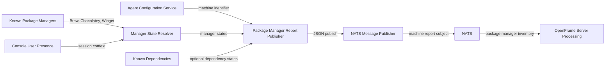
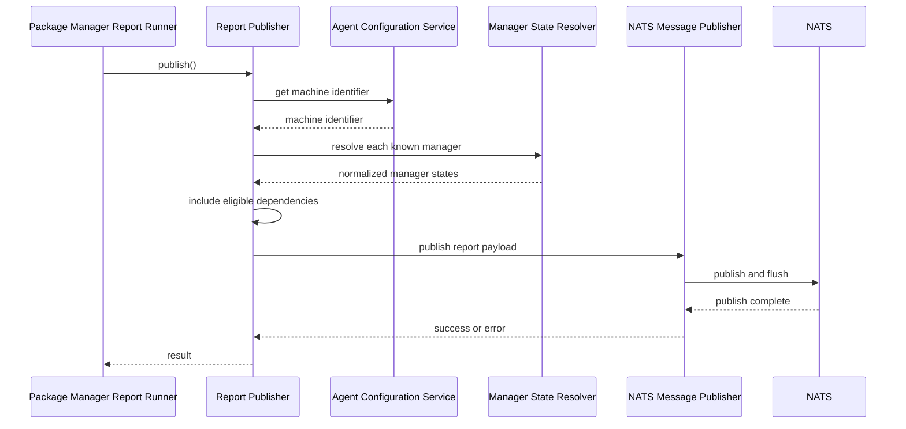
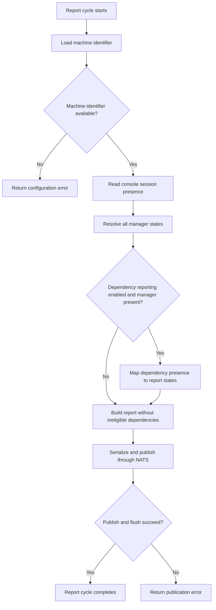

# Services Package Manager Report

Services Package Manager Report is the OpenFrame Client agent capability that publishes a device-local inventory of supported package managers and, when enabled, selected prerequisites. It is implemented by `PackageManagerReportPublisher` in the OpenFrame OSS Library's `openframe_agent_lib` Cargo artifact and runs in this repository's OpenFrame Client deployment. The report lets the server-side software-management path determine which package-management operations are feasible for a machine without treating a missing manager as a transport failure.

**Implementation source:** [report publisher in OpenFrame OSS Library](https://github.com/flamingo-stack/openframe-oss-lib/blob/7a766f00e4f58b5d89db007b878ac8d6e0c344f4/clients/openframe-client/src/services/package_manager/report_publisher.rs)

## Responsibilities

The module has three focused responsibilities:

- Obtain the agent's persisted machine identifier and derive the machine-specific NATS subject.
- Evaluate every known package manager, currently Brew, Chocolatey, and Winget, into a reportable state.
- Optionally inspect dependencies and publish the complete JSON report through the shared NATS publisher.

It does not install, update, or remediate software. Package-update ordering, execution, and status reporting belong to the adjacent package-update components. This module only reports discovery state.

## Runtime Position



`PackageManagerReportPublisher` is constructed with three collaborators or settings:

| Input | Role |
|---|---|
| `NatsMessagePublisher` | Serializes the report, publishes it to NATS, and flushes the publish operation. |
| `AgentConfigurationService` | Supplies the persisted machine identifier used in routing. |
| `report_dependencies` | Controls whether dependency data is included. |

The associated report run manager is responsible for invoking `publish` on an interval or after an explicit wake signal. It bounds each publication attempt with a timeout and logs failed or timed-out attempts, keeping scheduling policy separate from report construction.

## Package Manager State Model

Each member of `ManagerId::ALL` is evaluated. The known manager identifiers are Brew, Chocolatey, and Winget. The resulting value is a `ManagerState`:

| State | Meaning |
|---|---|
| `Present` | The manager is available for use on the machine. |
| `Missing` | The manager was not found. |
| `Unsupported` | The manager does not apply to the current platform. |
| `Unknown` | The client could not conclusively determine availability. |

State resolution combines asynchronous presence detection, platform support, and whether a console user is present. The publisher captures console-user presence once per reporting cycle and uses that same context for every manager, producing a coherent point-in-time report.

The discovery implementation varies by manager. For example, Brew is considered present when one of its configured paths exists; other managers use their respective detection routines. Callers should consume the normalized `ManagerState` rather than assuming equivalent detection mechanics across operating systems.

## Dependency Reporting

The current dependency catalog contains the Winget client module, which is associated with the Winget manager. Dependencies are only added when both conditions hold:

1. Dependency reporting is enabled with `report_dependencies`.
2. The dependency's owning manager was reported as `Present`.

A dependency's low-level `Presence` is normalized before it enters the payload:

| Dependency presence | Published state |
|---|---|
| `Present` | `Present` |
| `Absent` | `Missing` |
| `Unknown` | `Unknown` |

This gating prevents the report from presenting a prerequisite state for a package manager that cannot currently be used. An unsupported or missing manager therefore has no dependency entry in this publisher's payload.

## Publication Flow



The subject is constructed as `machine.{machineId}.package-managers`, where `{machineId}` is the identifier loaded from the agent configuration. The publisher uses a sorted map for package managers, so serialized manager entries have deterministic key ordering.

## Message Contract

The report is serialized as JSON. The top-level field names use camel case; the dependency item fields retain their declared names.

```json
{
  "packageManagers": {
    "Brew": "Present",
    "Choco": "Unsupported",
    "Winget": "Present"
  },
  "dependencies": [
    {
      "manager": "Winget",
      "name": "WingetClientModule",
      "state": "Missing"
    }
  ]
}
```

The example illustrates shape only. Actual managers, states, and dependency entries reflect the device's platform, detection outcome, console-session context, and the dependency-reporting setting.

## Component Interaction and Failure Boundaries



A missing machine identifier fails the cycle before any NATS publication. Serialization, obtaining an active NATS client, publishing, or flushing can also fail and are returned to the caller. The run manager records these failures and continues later cycles; it does not change package-manager state as a side effect of a failed publication.

## Operational Considerations

- The report is device scoped. Do not reuse the subject format for tenant-wide events because the machine identifier is part of the routing key.
- Treat `Unknown` as distinct from `Missing`: it signals an inconclusive probe, not confirmed absence.
- Enabling dependency reporting increases payload detail only for managers that are already present; it does not trigger package-manager installation or extra reporting for unavailable managers.
- NATS publication includes an explicit flush. A successful call therefore represents completion of the publisher's send-and-flush sequence, while downstream processing remains asynchronous.
- Logging emits the resolved manager map, the included dependencies, and console-user presence at information level before publication. Avoid interpreting this diagnostic output as an audit record or a delivery acknowledgement.

## Maintenance Guide

When adding a manager or dependency, maintain the report invariants:

1. Add the manager to the package-manager catalog so it participates in the all-manager iteration.
2. Ensure presence, platform support, and session-sensitive state resolution yield one of the normalized manager states.
3. Associate each dependency with its owning manager and provide a presence probe.
4. Preserve the dependency gate so prerequisites are emitted only for managers reported as present.
5. Update consumers of the `machine.{machineId}.package-managers` event contract to recognize the expanded enumeration values.

This module belongs to the OpenFrame Client agent library supplied by OpenFrame OSS Library. The tenant repository consumes that library as `openframe_agent_lib` version `v0.0.5`; the source implementation linked above is the authoritative location for its runtime behavior.
