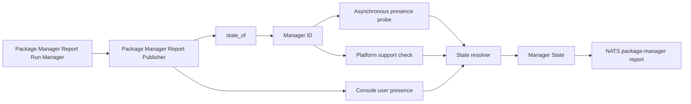
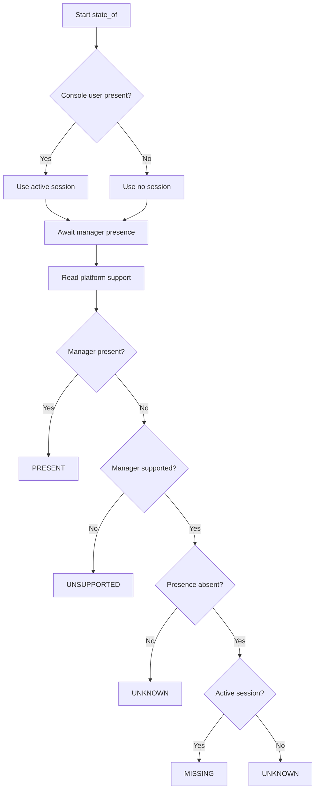
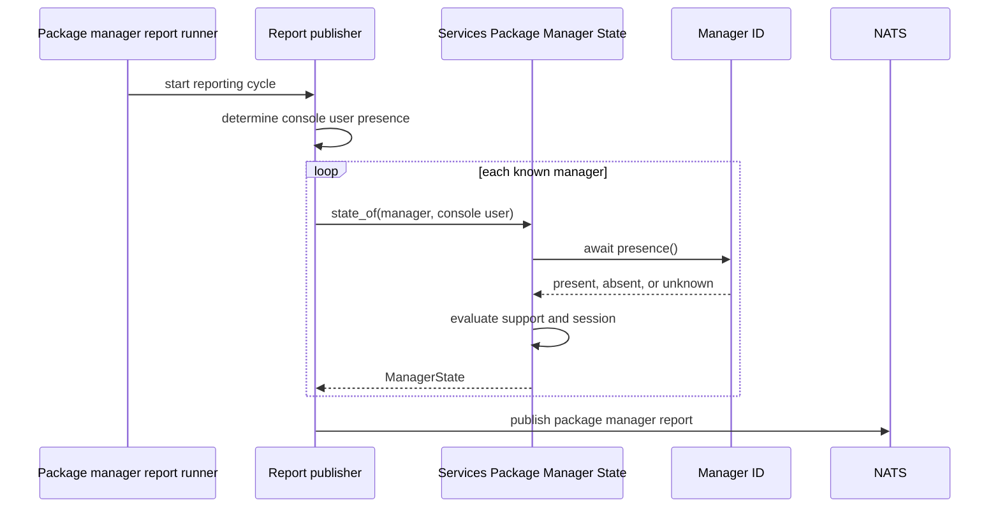
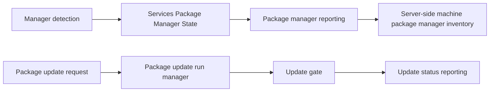

# Services Package Manager State

Services Package Manager State classifies the availability of each package manager on a managed endpoint. It is a small, side-effect-free decision layer in the Rust OpenFrame Client: it combines an asynchronous presence probe, platform support, and whether an interactive console user is present into a serializable state suitable for inventory reporting.

The implementation is supplied by the OpenFrame OSS Library artifact `openframe_agent_lib` and runs inside this repository's OpenFrame Client deployment. Its source is [state.rs](https://github.com/flamingo-stack/openframe-oss-lib/blob/7a766f00e4f58b5d89db007b878ac8d6e0c344f4/clients/openframe-client/src/services/package_manager/state.rs).

## Responsibilities

- Expose `ManagerState` as the stable four-value reporting vocabulary: `PRESENT`, `MISSING`, `UNSUPPORTED`, and `UNKNOWN`.
- Evaluate a `ManagerId` asynchronously through `state_of`.
- Preserve uncertainty rather than reporting an absence when the probe cannot determine presence or when an absent manager requires an unavailable console session to validate.
- Prioritize a detected installation over platform support metadata, so a present manager is reported as present.

The package-manager subsystem identifies Brew, Chocolatey, and Winget through `ManagerId`. The manager-specific presence check returns `Present`, `Absent`, or `Unknown`; the support layer identifies whether that manager is supported on the current platform.

## Architecture

`PackageManagerReportPublisher` obtains the console-user signal once per report, invokes `state_of` for every known manager, and publishes the resulting manager map. It also reports dependencies only when their associated manager is `PRESENT`; dependency reporting maps its own presence values into the same state vocabulary.

## Component Model

| Component | Role | Key behavior |
| --- | --- | --- |
| `ManagerState` | Public report value | Derives debug, clone, copy, equality, and serialization traits. Serde serializes enum variants in uppercase. |
| `state_of` | Asynchronous entry point | Converts the console-user boolean into an internal session condition, awaits the manager presence probe, checks platform support, and resolves one manager state. |
| Internal resolver | Decision table | Applies ordered matching rules to the presence, support, and session inputs. |
| Internal session value | Context guard | Distinguishes an active console user from no console user; it is not published outside the module. |

## Resolution Rules

The resolver uses the following precedence. The ordering is intentional and is part of the module's observable semantics.

| Support result | Presence result | Console user | Reported state | Meaning |
| --- | --- | --- | --- | --- |
| Any | Present | Any | `PRESENT` | The manager was detected, regardless of support metadata. |
| Not supported | Absent or unknown | Any | `UNSUPPORTED` | The endpoint platform does not support this manager and it was not detected. |
| Supported | Absent | Present | `MISSING` | The manager is expected on this platform and an active console session permits a definitive missing result. |
| Supported | Absent | Not present | `UNKNOWN` | An absence cannot be promoted to missing without a console user. |
| Supported | Unknown | Any | `UNKNOWN` | The manager probe was inconclusive. |

`MISSING` therefore has a narrower meaning than a failed file or command lookup: it represents a supported manager confirmed absent under the session condition required by the client. Consumers should preserve this distinction rather than treating `UNKNOWN` as missing.

## State Resolution Flow

## Data Flow and Serialization

The module itself does not persist state, execute package installation, or send network traffic. Its asynchronous boundary exists because manager presence detection may require an asynchronous probe, notably for some manager implementations. NATS publication is performed by the report publisher after all states have been resolved.

## Relationship to the Package Update Path

Package-manager state is inventory and eligibility context, not an update command. The adjacent update flow accepts package-update messages, tracks orders and statuses, and uses a gate to decide whether an update may proceed. Services Package Manager State contributes a precise manager availability signal to platform reporting; it does not make an update-gate decision or mutate an order.

## Maintenance Notes

- Keep `ManagerState` values backward compatible because they are serialized into machine reports. Renaming a variant changes its uppercase wire value.
- Preserve the decision precedence: a detected manager must remain `PRESENT`, even if support detection returns false.
- Add a resolver test for every new presence, support, or session branch. The module includes a dedicated `state_tests.rs` test module.
- When adding a package manager, implement its `ManagerId` presence behavior and support classification before relying on `state_of`; otherwise the module can correctly return `UNKNOWN` or `UNSUPPORTED` but cannot establish availability.
- Do not infer update readiness solely from this state. The package update gate and update-order lifecycle own execution safety and status semantics.
