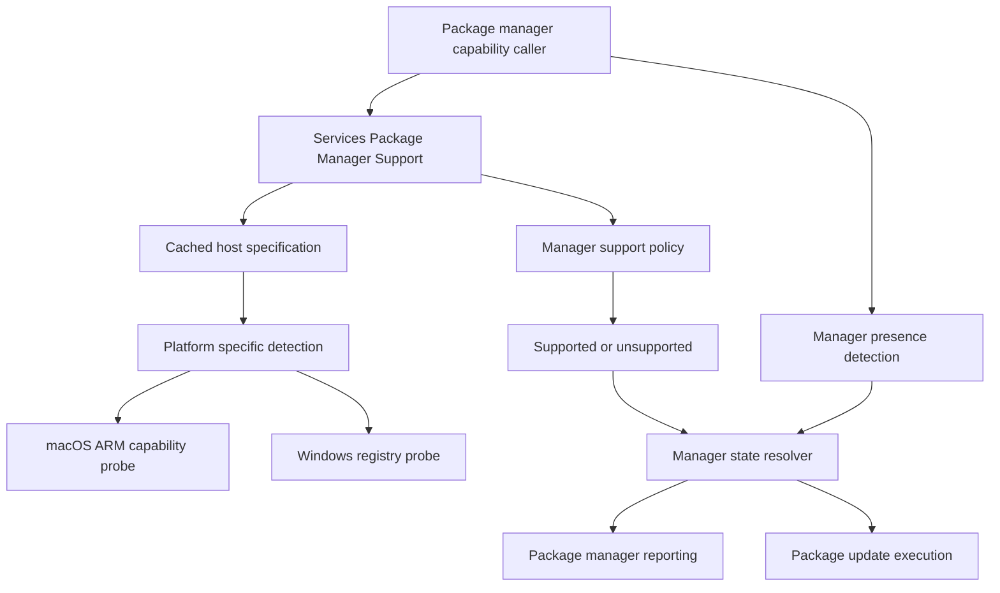
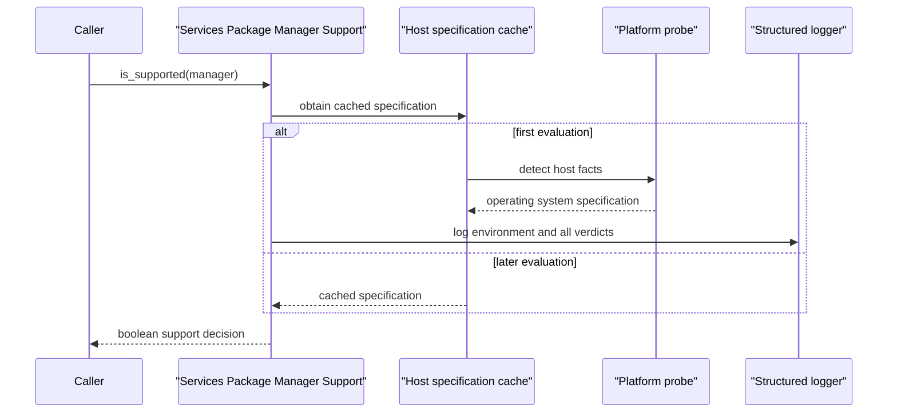
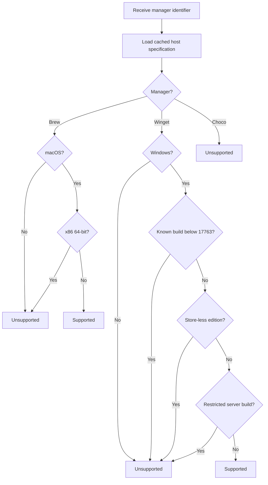
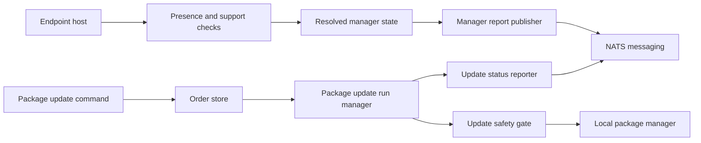

# Services Package Manager Support

Services Package Manager Support is the local capability policy used by the OpenFrame client agent before it reports or acts on a package manager. It answers one deliberately narrow question: **is this manager permitted on the current operating-system environment?** It does not detect whether a manager binary is installed, install a manager, or perform package updates.

The implementation is supplied by the OpenFrame OSS Library's Rust client artifact, `openframe_agent_lib` version `0.0.5`, which this repository assembles into its client runtime. The implementation source is [support.rs](https://github.com/flamingo-stack/openframe-oss-lib/blob/7a766f00e4f58b5d89db007b878ac8d6e0c344f4/clients/openframe-client/src/services/package_manager/support.rs).

## Responsibilities and Boundary

The public entry point, `is_supported(ManagerId)`, evaluates a package-manager identifier against a cached description of the host. The supported identifiers are `Brew`, `Winget`, and `Choco`.

Services Package Manager Support owns:

- Platform and hardware classification required for the policy decision.
- Platform-specific acceptance rules for Homebrew and winget.
- A deny decision for Chocolatey.
- One-time structured logging of the discovered environment and the verdict for every known manager.

It does **not** own executable discovery or user-session suitability. The adjacent package-manager capability layer separately checks manager presence, and the state resolver combines presence, support, and console-session information. Consequently, a manager can be supported but absent, or present but unsupported.

## Support Policy

| Manager | Supported when | Rejected when |
|---|---|---|
| Homebrew | The host is macOS and the detected architecture is Apple Silicon or could not be determined. | The host is not macOS, or macOS is explicitly detected as x86 64-bit. |
| winget | The host is Windows, the build is at least `17763` when known, the edition has Microsoft Store support, and server hosts meet the Windows Server rule. | The host is not Windows, its known build is below `17763`, its edition is Store-less, or a non-multi-session server has a known build below `26100`. |
| Chocolatey | Never. | Always, because Chocolatey is not enabled by this policy. |

The winget build threshold `17763` corresponds to Windows 10 version 1809 or later. The server threshold is build `26100`, described by the implementation as Windows Server 2025 or later. `ServerRdsh` is treated as a multi-session edition and is exempt from that server-build restriction.

The Store-less Windows edition identifiers are `EnterpriseS`, `EnterpriseSN`, `IoTEnterprise`, and `IoTEnterpriseS`. Matching is case-insensitive. They are rejected because winget requires the Microsoft Store, which the policy considers unavailable on those editions.

Unknown values are handled narrowly rather than as universal failures. For example, an unknown macOS architecture remains eligible for Homebrew, and an unavailable Windows build does not independently cause rejection. In contrast, the policy rejects positively identified incompatible operating systems, architectures, editions, and builds.

## Architecture

The code resides under the OpenFrame client package-manager service. Its direct input is the `ManagerId` enum; its effective host input is an internal `OsSpec` containing operating system, architecture, product type, Windows edition identifier, and Windows build number. The result exposed to callers is a boolean, while the internal `Support` value retains a reason for rejection so that the one-time diagnostic log can include a manager-by-manager verdict.

## Host Discovery and Caching

Services Package Manager Support resolves host facts lazily on the first call. A process-wide `OnceLock` retains the resulting `OsSpec`, so later calls use the same snapshot and do not repeat registry or system queries. A separate `Once` ensures the diagnostic record is emitted only once.

On macOS, the probe calls the `hw.optional.arm64` system control to distinguish Apple Silicon from x86 64-bit hardware. A missing control is interpreted as x86 64-bit; other probe errors leave the architecture unknown.

On Windows, the probe reads the local machine registry:

- `PROCESSOR_ARCHITECTURE` determines ARM64, AMD64, or unknown architecture.
- `ProductType` determines workstation, server, or unknown product type.
- `EditionID` determines whether the edition is Store-less or multi-session.
- `CurrentBuildNumber` supplies the numeric build when it can be parsed.

On operating systems other than macOS and Windows, the probe returns an `Other` operating system classification with unknown architecture and product type. That makes both Homebrew and winget unsupported, while Chocolatey is already disabled regardless of host.

## Decision Flow

The restricted-server branch applies only when all of the following are true: the product type is server, the edition is not `ServerRdsh`, and a known build is below `26100`.

## Relationship to Package Management Workflows

The boolean produced here is one input to the broader package-management workflow:

1. The package-manager abstraction identifies a manager and probes its local presence.
2. Services Package Manager Support applies the host eligibility policy.
3. The manager state resolver combines presence, eligibility, and whether a console user is present into `ManagerState`.
4. The reporting run manager publishes package-manager state through the agent messaging infrastructure.
5. For package updates, the command handler stores incoming work orders; the update run manager processes them, with the update gate protecting against unsafe application updates.

This placement is important for maintainers: changing eligibility in Services Package Manager Support changes the state that the agent reports and can determine whether later package-update work is actionable. It does not replace the update gate, which separately examines application and process conditions before an update is allowed.

## Observability

At first evaluation, the module writes an `info`-level event named `Resolved package manager support`. It includes the operating system, architecture, product type, edition identifier, build, and a sorted map of verdicts for every manager in `ManagerId::ALL`. The ordered map makes the logged manager list deterministic.

The log is a diagnostic snapshot, not a continuous inventory. Because host facts are cached for the life of the client process, changes to the operating system environment require a process restart before they can be rediscovered and logged again.

## Maintenance Guidance

- Keep support policy separate from installation detection. A binary existing on disk must not imply it is supported on that host.
- Add a manager in the shared `ManagerId` definition and give it an explicit policy branch. Avoid a permissive fallback.
- When adding Windows exceptions, preserve case-insensitive edition matching and distinguish known incompatibility from unavailable registry data.
- Keep the support decision free of network access and side effects. It is called as part of state resolution and is intentionally based on local host facts.
- Treat the one-time log as an operational contract: include enough facts to explain a verdict without logging credentials or other sensitive agent configuration.

## Source and Runtime Context

The implementation is library code from OpenFrame OSS Library and runs inside the OpenFrame client agent delivered by this repository. The tenant deployment provides NATS to OpenFrame client workloads, enabling the broader reporting and update-status paths shown above; Services Package Manager Support itself has no network calls, configuration keys, HTTP routes, or persistent storage.
