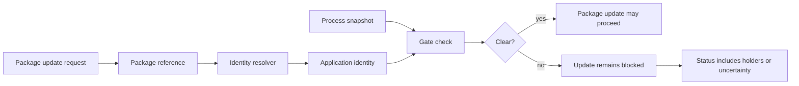
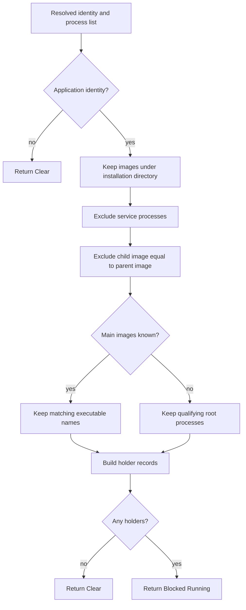

# Services Package Manager Update Gate

## Purpose

Services Package Manager Update Gate is a local safety boundary in the OpenFrame client agent. Before a package update can replace or modify a managed application, it determines whether the application is in use. Active qualifying processes block the update; missing or unreliable information also blocks it. This fail-closed approach avoids modifying application files while they may be in use.

The module is implemented by the `openframe_client` Rust library from the [OpenFrame OSS Library](https://github.com/flamingo-stack/openframe-oss-lib), artifact `openframe_agent_lib`. This repository runs that library as part of its OpenFrame client application. The gate is not an HTTP endpoint and does not persist state.

## Responsibilities

- Resolve a package reference into an application identity for supported package-manager and operating-system combinations.
- Collect a current operating-system process snapshot without blocking the asynchronous runtime.
- Identify qualifying root, non-service application processes below a resolved installation directory.
- Return a clear or blocked verdict, including process-holder details where available.
- Fail closed when package identity or process state cannot be determined safely.

## Architecture

The gate belongs to the client-side package-update workflow. Package-update orchestration is responsible for ordering, installation, restart signaling, and status publication; this module supplies the local safety verdict immediately before update work may proceed.

## Supported Resolution Paths

The module contract and orchestration live in the [update gate module](https://github.com/flamingo-stack/openframe-oss-lib/blob/7a766f00e4f58b5d89db007b878ac8d6e0c344f4/clients/openframe-client/src/services/package_manager/update_gate/mod.rs).

| Package reference | Gate identity result |
|---|---|
| Homebrew formula | `NoApp`; the package is treated as not installing a runnable application. |
| WinGet package on Windows | Delegated to the Windows-specific resolver. |
| Homebrew cask on macOS | Delegated to the macOS-specific resolver. |
| Other package manager or platform combinations | `ManagerUnsupported`, which blocks the update. |

`resolve` performs platform-aware identity lookup. `snapshot` executes process enumeration through Tokio's blocking-task executor. `check` combines a resolved identity with a current snapshot: it calls `decide` only when both inputs succeeded; otherwise it returns a blocking `Undetermined` result.

## Core Model

| Component | Responsibility |
|---|---|
| `AppIdentity` | Represents what the package manager and OS establish about a package. `NoApp` means there is no runnable application; `App` contains its installation directory and main-image strategy. |
| `MainImages` | Restricts holder detection to derived executable names, or falls back to conservative matching when names are unknown. |
| `Holder` | Provides process ID, executable image path, and optional session ID for a detected holder. |
| `GateDecision` | The final verdict: `Clear` or `Blocked`. |
| `BlockReason` | Distinguishes known running holders from an undetermined safety state. |
| `Undetermined` | Captures package absence, unsupported manager, unknown installation location, resolver failure, or snapshot failure. |

## Process Decision Logic

[Decision logic](https://github.com/flamingo-stack/openframe-oss-lib/blob/7a766f00e4f58b5d89db007b878ac8d6e0c344f4/clients/openframe-client/src/services/package_manager/update_gate/decide.rs) is a pure filtering operation over a resolved identity and a supplied list of running processes.

A process becomes a holder only when all of the following are true:

1. Its executable image is strictly under the resolved installation directory.
2. It is not identified as a service process.
3. Its parent image is absent or differs from its own image, avoiding duplicate child instances of the same executable as independent holders.
4. When derived main image names are available, its executable file name matches one of those names without regard to case.

If no holder is found, the decision is `Clear`. Otherwise, the result is `Blocked(Running)` with the complete qualifying holder list.

## Path and Fallback Semantics

The `is_under` helper compares paths case-insensitively, supports both Windows and Unix separators, and trims trailing separators from the installation directory. It requires the candidate image to be strictly below the directory boundary. Therefore, a similarly prefixed directory is not treated as part of the installation.

`MainImages::Unknown` deliberately broadens detection: any qualifying root, non-service process below the installation directory blocks the update. This conservative fallback is necessary when the resolver cannot derive the application's expected executable names.

## Decision Outcomes

| Condition | Decision | Meaning |
|---|---|---|
| Resolved identity is `NoApp` | `Clear` | No application process needs protection. |
| Resolved application has no qualifying holder | `Clear` | The gate found no active process that would make the update unsafe. |
| One or more qualifying holders exist | `Blocked(Running)` | The update must wait while the application is running. |
| Resolution or process capture fails | `Blocked(Undetermined)` | The gate cannot establish that the update is safe. |

## Operational Boundaries

The gate neither installs packages nor stops processes. It produces structured evidence for the package-update workflow, which can report an active holder or an indeterminate safety condition. Because process state may change between checks, callers should obtain a fresh snapshot as close as practical to the update attempt. Package identity can be resolved separately from the repeated snapshot-and-check operation.

## Maintenance Notes

- Preserve fail-closed behavior when adding package managers, operating systems, or resolver paths. Uncertainty must become `Undetermined`, not a clear decision.
- Retain the process ID, executable image, and session in `Holder`; these fields provide the diagnostic evidence for a running-process block.
- Maintain case-insensitive executable matching and the conservative `Unknown` fallback when changing image derivation.
- Preserve strict path-boundary matching. Simple prefix matching would incorrectly classify similarly named directories as descendants.

## Source Files

- [Module contract and orchestration](https://github.com/flamingo-stack/openframe-oss-lib/blob/7a766f00e4f58b5d89db007b878ac8d6e0c344f4/clients/openframe-client/src/services/package_manager/update_gate/mod.rs)
- [Process decision logic](https://github.com/flamingo-stack/openframe-oss-lib/blob/7a766f00e4f58b5d89db007b878ac8d6e0c344f4/clients/openframe-client/src/services/package_manager/update_gate/decide.rs)

For implementation questions or operational discussion, use the [OpenMSP Slack community](https://join.slack.com/t/openmsp/shared_invite/zt-36bl7mx0h-3~U2nFH6nqHqoTPXMaHEHA).

## Scope

This document covers the Services Package Manager Update Gate module only. It is supplied by OpenFrame OSS Library version `7.0.11` in this repository's runtime dependency set.
