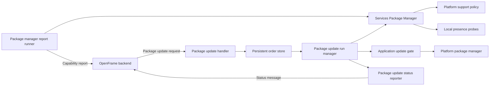
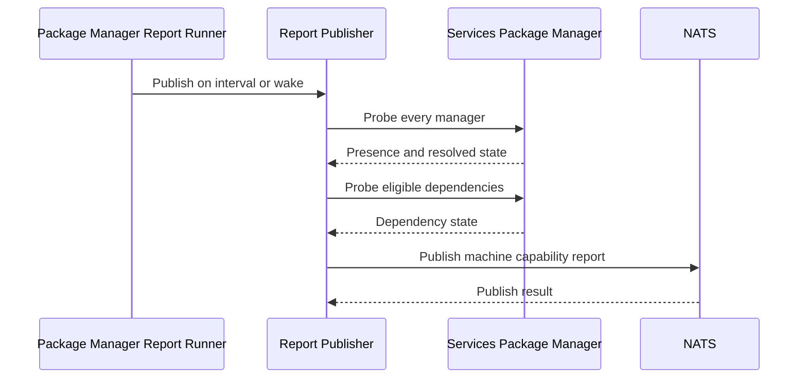
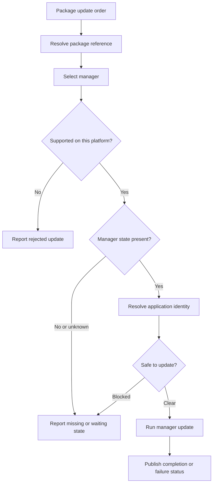

# Services Package Manager

Services Package Manager is the OpenFrame Client subsystem that identifies the local software package manager required by a package reference and reports whether that manager is usable on the current endpoint. It is implemented in the `openframe_agent_lib` crate from the OpenFrame OSS Library and runs inside this repository's OpenFrame Client deployment.

Its narrow responsibility is capability discovery and normalization. The module does not itself install packages: package-update workers use its manager identity, support assessment, and application-safety gate to decide whether an update can proceed.

**Implementation source:** [package manager module in OpenFrame OSS Library](https://github.com/flamingo-stack/openframe-oss-lib/blob/7a766f00e4f58b5d89db007b878ac8d6e0c344f4/clients/openframe-client/src/services/package_manager/mod.rs).

## Responsibilities

- Maps every `PackageRef` variant to its owning package manager.
- Defines the supported manager set: Homebrew, Chocolatey, and WinGet.
- Probes locally for manager availability and represents inconclusive probes explicitly.
- Describes a manager prerequisite that the backend can bootstrap: the all-users Microsoft WinGet Client PowerShell module.
- Provides capability state to periodic reporting and update execution components.
- Helps prevent graphical application updates while a relevant user process is still running.

## Position in the Client Architecture

The client receives package update requests through its command listener. The package-update path turns a request's package reference into a manager identifier, verifies support and local presence, records and reports order state, then invokes the platform-specific update machinery. Separately, the report runner periodically publishes what managers and prerequisites are available on the endpoint.

## Core Model

### Manager Identity

`ManagerId` is a serializable identity with uppercase wire values and three members:

| Manager identity | Selected for package reference | Intended platform context |
|---|---|---|
| `Brew` | `PackageRef::Brew` | Homebrew-managed packages |
| `Choco` | `PackageRef::Choco` | Chocolatey-managed packages on Windows |
| `Winget` | `PackageRef::Winget` | WinGet-managed packages on Windows |

`ManagerId::of` is the authoritative mapping from `PackageRef` to a manager. Consumers should use it rather than duplicate matching logic, so reporting, support checks, and execution all agree about the responsible manager.

`ManagerId::ALL` supplies a stable list for capability reporting. This means the report can express both managers that are available and managers that are missing or unsupported rather than only reporting detected tools.

### Presence Is Three-Valued

The `Presence` result deliberately distinguishes an absent manager from one that cannot be assessed:

| Value | Meaning | Operational implication |
|---|---|---|
| `Present` | The client positively detected the manager or dependency. | The manager can proceed to platform-support and update-safety checks. |
| `Absent` | The applicable probe completed and did not find it. | The backend can treat it as missing and may bootstrap an eligible prerequisite. |
| `Unknown` | The platform does not apply or probing could not produce a reliable answer. | The client must not misreport this as an explicit absence. |

This distinction is particularly important for cross-platform reporting: Chocolatey and WinGet return `Unknown` outside Windows instead of appearing missing on systems where they do not apply.

### Dependency Model

`Dependency` represents a requirement beyond the package manager executable. At present, the only declared value is `WingetClientModule`, associated with `ManagerId::Winget`. The dependency model is serializable using screaming-snake-case wire values and has its own `ALL` collection for report generation.

The WinGet Client module is considered present only when it is installed for all users beneath the `ProgramFiles` PowerShell module path and contains `Microsoft.WinGet.Client.psd1`. A copy installed only in an individual user's Documents directory does not satisfy the endpoint-wide requirement. On non-Windows platforms, its state is `Unknown`.

## Local Detection Behavior

The detection strategy intentionally varies by manager because each platform exposes a different reliable signal.

| Manager | Detection mechanism | Result behavior |
|---|---|---|
| Homebrew | Checks the known paths defined by the Homebrew integration. | A matching path yields `Present`; otherwise `Absent`. |
| Chocolatey | On Windows, reads the machine `ChocolateyInstall` registry value, falling back to the `ProgramData` Chocolatey directory, then looks for `bin/choco.exe`. | Windows detection returns `Present` or `Absent`; other platforms return `Unknown`. |
| WinGet | On Windows, runs a PowerShell probe for the Microsoft Desktop App Installer package and its `winget.exe` binary using user privilege. | Exit code `0` is present, `1` is absent, timeouts, setup failure code `85`, and unexpected results are unknown. Non-Windows platforms return `Unknown`. |

The WinGet probe has a 60-second timeout. An inconclusive result remains `Unknown`, preventing a transient setup failure or stalled command from being reported as a definite missing installation.

## State Resolution and Reporting

Raw presence alone is not the externally reported capability. The state layer combines the presence probe with the current platform support policy and whether a console user session is active. It produces one of `Present`, `Missing`, `Unsupported`, or `Unknown` as `ManagerState`.

The package-manager report publisher obtains the device machine identifier, evaluates every member of `ManagerId::ALL`, and publishes a map of manager states on the device-specific NATS subject. Dependency reports are included only when dependency reporting is enabled and the associated manager is reported as present. This avoids advertising a prerequisite for a manager that is not usable on the device.

The report run manager starts one background loop. It publishes on an interval and can also be woken early through its notification handle. Each publish is bounded by the reporting timeout plus a grace period; failures and timeouts are logged rather than terminating the reporting loop.

## Update Coordination

Services Package Manager participates in, but does not wholly own, package updating. The `PackageUpdateRunManager` starts a single worker and rejects duplicate starts. The command handler persists incoming orders, and the worker uses the manager identity and availability state while processing those orders. Status reporting communicates rejected or superseded orders and later execution state to the backend.

`PackageUpdateMessage` supplies the request identifier, package reference, update source, update mode, and an optional countdown. Status messages retain the request and machine identity along with the package, selected state, optional installed and available versions, waiting details, completion details, and failure details. This correlation lets server-side software management associate a device outcome with its requested operation.

### Application Update Gate

Before a graphical application update, the update gate can resolve a package into an `AppIdentity`, capture active processes, and return a `GateDecision`:

- `Clear` means no blocking user-owned application process was identified.
- `Blocked` includes a `BlockReason`. If identity or process discovery is indeterminate, the gate blocks rather than assuming the update is safe.
- Formula-style Homebrew packages are treated as `NoApp` and therefore clear the gate.
- On supported platforms, WinGet packages and Homebrew casks can be resolved to application identity. Unsupported combinations remain undetermined.

When an application identity contains an install directory, the decision function filters the process snapshot to non-service processes under that directory. It excludes an apparent self-parented duplicate process and, when main executable names are known, retains only matching primary application images. If any matching holders remain, the decision is blocked and includes their process identifiers, image paths, and sessions.

## Maintainer Guidance

### Adding a Package Manager

A new manager requires coordinated changes beyond adding an enum member:

1. Add its `ManagerId` value and extend `ManagerId::of` for the corresponding `PackageRef` variant.
2. Include it in `ManagerId::ALL` so endpoint reports expose its state.
3. Implement a presence probe with a precise distinction between absence and uncertainty.
4. Extend platform support resolution and manager-state resolution as necessary.
5. Add execution support in the package-update worker and ensure update requests and status contracts recognize the new reference.
6. Validate application identity and update-gate behavior for package types that update graphical applications.

### Changing Detection Logic

Keep probes non-destructive, bounded, and platform-gated. A timeout, inaccessible operating-system facility, or unexpected exit result should generally result in `Unknown`, not `Absent`. This preserves the contract that missing means the probe completed and found no usable installation.

### Operational Observability

Use the manager capability report to distinguish deployment prerequisites from update failures:

- `Unsupported` indicates that the manager is not applicable to the endpoint platform or session context.
- `Missing` identifies an applicable manager or dependency that is not installed.
- `Unknown` indicates a probe or environment limitation requiring further endpoint investigation.
- A blocked update gate identifies active application processes, allowing the backend to wait for a suitable user-session condition instead of forcibly replacing an in-use application.

## Scope Boundaries

This module does not search package catalogs, create package-update policies, install the package managers themselves, or persist server-side software state. Those responsibilities belong to the API, management, and client-core services. Within the endpoint client, it supplies the normalized package-manager facts that the command, update, and reporting paths depend on.
