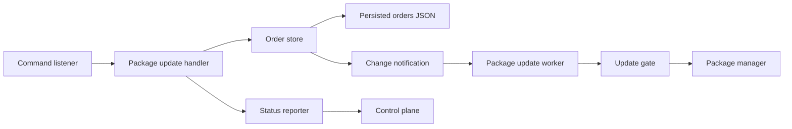
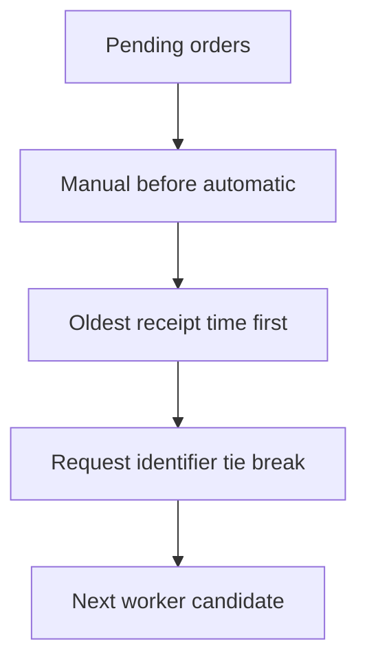
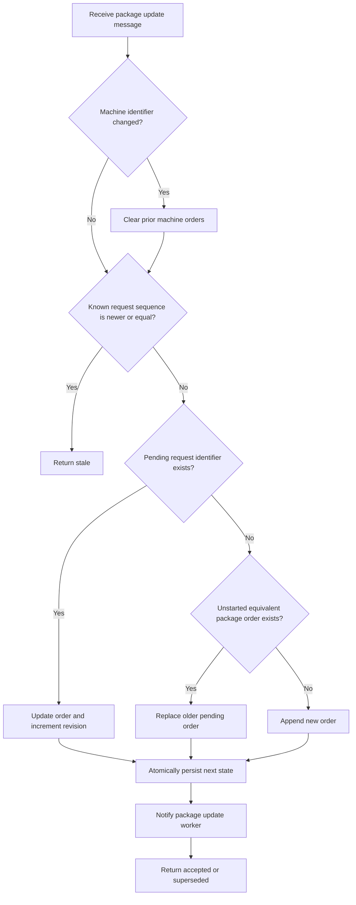
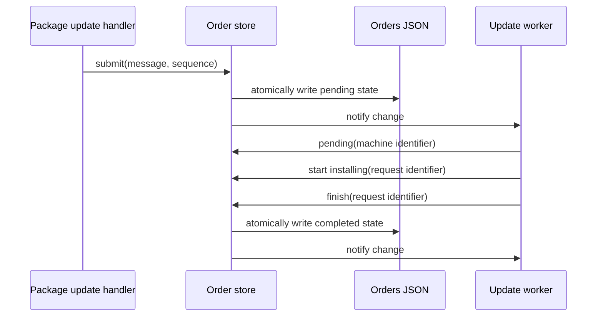

# Services Package Update Orders

Services Package Update Orders is the durable, device-local queue for software package update requests received by the OpenFrame client. It is implemented by the `openframe_agent_lib` dependency from the OpenFrame OSS Library, rather than by source in this repository. The implementation accepts or rejects incoming requests, serializes pending work across client restarts, prioritizes manual work, prevents stale replays, and records replacement of an unstarted request for the same package.

The implementation is [`orders.rs`](https://github.com/flamingo-stack/openframe-oss-lib/blob/7a766f00e4f58b5d89db007b878ac8d6e0c344f4/clients/openframe-client/src/services/package_manager/package_update/orders.rs). This repository consumes `openframe_agent_lib` at version `v0.0.5`; the linked source is the supplied implementation revision.

## Responsibilities

The module owns **orders**, not the package-manager execution itself. An order captures the requested package, source, mode, resolved force-update countdown, request identifier, sequence number, receipt time, and a revision used to make a resent waiting order observable again.

It provides these guarantees:

- **Durability:** pending orders and bounded finished-request memory are written as JSON using an atomic write before the in-memory state is committed.
- **Machine isolation:** orders belong to one machine identifier. The first submission for a different machine clears persisted pending and finished work from the prior machine.
- **Replay protection:** a request identifier with a sequence number no greater than its pending or remembered finished sequence is stale and is not accepted.
- **Same-request refresh:** a higher-sequence retransmission of an existing request updates its source, package, mode, and countdown, then increments its revision.
- **Package-level supersession:** a new request for an equivalent package replaces an earlier *pending* request for that package, except when that earlier request is already installing.
- **Stable selection:** callers receive pending work ordered by source priority, then oldest receipt time, then request identifier.
- **Worker wake-up:** successful submission and completion notify the package-update worker through an asynchronous change signal.

## Placement in the Update Pipeline

A command handler accepts package update messages and delegates queue ownership to `OrderStore`. The package update run manager owns the background worker that waits for changes and processes queued work. The status reporter publishes rejected and superseded outcomes, while the update gate and package manager determine whether and how an accepted order can be installed.

The surrounding collaborators are part of the same OpenFrame client library:

| Collaborator | Relationship to Services Package Update Orders |
|---|---|
| `PackageUpdateHandler` | Constructs with an `OrderStore` and a `StatusReporter`; it is the command-facing entry point for submitted package-update messages. |
| `PackageUpdateRunManager` | Starts one background worker and logs if a second start is attempted. The worker reacts to order changes and performs the next-stage update workflow. |
| `StatusReporter` | Reports a rejected request or a superseded pending order. A superseded report is a failed status whose reason is `Superseded`. |
| `PackageUpdateMessage` | Supplies `request_id`, source, package reference, update mode, and an optional countdown. The caller resolves the countdown passed to the store. |
| Package update status model | Represents externally reported waiting, done, and failed states. Waiting may identify an app running, a busy manager, or an unavailable user session. |

## Data Model

### Order

`Order` is the persisted unit of pending work. Its fields separate request identity and sequencing from the desired update action:

| Field | Purpose |
|---|---|
| `request_id` | Stable request identity for deduplication, refresh, completion, and stale detection. |
| `sequence` | Monotonic version for that request identifier. |
| `source` | Identifies whether work is manual or automatic and can retain its origin. |
| `package` | Package reference used to recognize competing requests for the same package. |
| `mode` | `Wait` avoids closing a running application; `Force` closes after its countdown, installs, and relaunches. |
| `countdown_seconds` | Resolved countdown used for a force update. |
| `received_at` | Receipt time used to order work within the same source priority. |
| `revision` | Starts at zero and increases on a higher-sequence resend of the same request. It allows waiting state to be reported again. |

The persisted container also holds the current `machine_id`, a vector of pending orders, and a bounded vector of finished request identifiers and sequences. The in-progress `installing` request identifier is intentionally excluded from serialization, so it is only a live-process coordination marker.

## Ordering and State Rules

Manual orders sort ahead of automatic orders. Within the same class, older receipt times sort first; request identifier is a final deterministic tie-breaker.

An order stays pending until `finish` removes it. Before installation, the worker calls `start_installing(request_id)`. That call returns false if the order has disappeared because a newer request replaced it. When installation does not proceed, `stop_installing` clears the live marker. `finish` always clears the marker if it belongs to the completed request, removes the matching pending order when present, and records its final sequence in the finished-memory list.

Finished memory holds at most 100 request entries. When the limit is exceeded, the oldest remembered entries are removed. This bounded history makes ordinary late re-sends stale without allowing the durable state to grow indefinitely.

## Submission Decision Flow

`submit` applies the state transition under a mutex, prepares a cloned next state, persists that next state, then replaces the shared state. It returns one of three outcomes: `Accepted`, `Stale`, or `Superseded` with the displaced order.

### Machine Identifier Change

The store treats queued work as machine-specific. On a submission with a new machine identifier, it drops pending and finished entries associated with the prior identifier. The current live `installing` marker is retained in the newly constructed state, which prevents a concurrent replacement request from incorrectly replacing an installation already in progress.

### Stale Sequence Rule

For a request identifier, the store searches pending orders first and then completed memory. A submission is stale when its sequence is less than or equal to the recorded sequence. Stale work does not persist state and does not wake the worker.

### Same Request Versus Same Package

A request identifier and a package reference answer different questions:

- A **same request identifier** with a newer sequence refreshes the existing pending order in place. Its original receipt time remains unchanged, preserving queue age.
- A **different request identifier** for the same package replaces the prior pending order only if that prior request is not marked as installing. The caller can report the displaced request as superseded.
- An order already being installed is never removed by package-level supersession. The newly submitted order remains queued to follow it.

## Completion and Recovery Behavior

The module writes state before making successful submit changes visible. Completion follows a deliberate degraded-persistence rule: `finish` advances in-memory state and notifies the worker even if persistence fails. A subsequent restart can therefore run that order once again, but the live process does not become stuck in an endless completion loop.

At startup, `load` reads the persisted JSON file:

- A missing file initializes an empty store.
- A read failure or invalid JSON logs a warning and initializes an empty store.
- A successfully decoded store logs the number of pending orders.

Because the installing marker is not persisted, restart recovery is driven by the durable pending queue rather than by a stale in-progress flag.

## Concurrency Contract

`OrderStore` protects its complete `Orders` state with a standard mutex. A poisoned mutex is recovered using its contained guard, favoring continued agent operation over permanently disabling update processing after a panic. State inspection methods clone orders where necessary, preventing callers from retaining mutable access to internal queue state.

The change notifier is separate from the mutex. The documented contract is that a change made while no worker is waiting remains observable by a later `changed` wait. Consumers should treat the notification as a wake-up signal and re-read `pending`, rather than assuming it transports a specific order or a one-to-one event count.

## Operational Considerations

- Do not use a request identifier for unrelated package updates. The identifier is the deduplication key and governs sequence behavior.
- Ensure the producer advances sequence numbers when resending a changed request. Equal or lower values are intentionally rejected as stale.
- Treat a superseded status as terminal for the displaced request. The replacement request has its own identifier and lifecycle.
- Do not infer installation progress from persisted data alone. The active-installation marker is process-local and is deliberately not stored.
- Monitor warnings about unreadable or unwritable orders data. An unreadable file starts empty; a failed completion write can permit one update replay after restart.
- Preserve the distinction between `Wait` and `Force`: countdown resolution belongs before `submit`, while execution behavior belongs to the downstream worker and platform integration.

## Source and Ownership

This repository packages and runs the OpenFrame client, while Services Package Update Orders is supplied by the OpenFrame OSS Library's Rust client implementation. The source reference above is therefore the authoritative implementation location for changes to order persistence, stale handling, prioritization, and supersession semantics.
