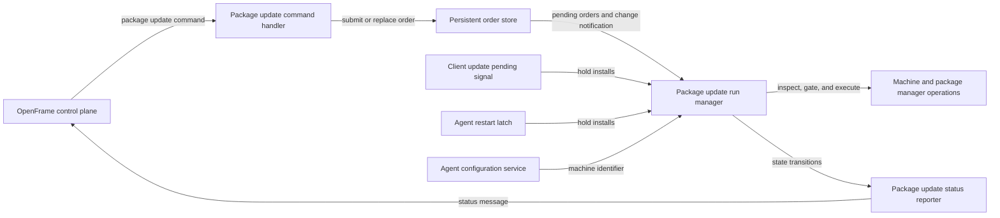
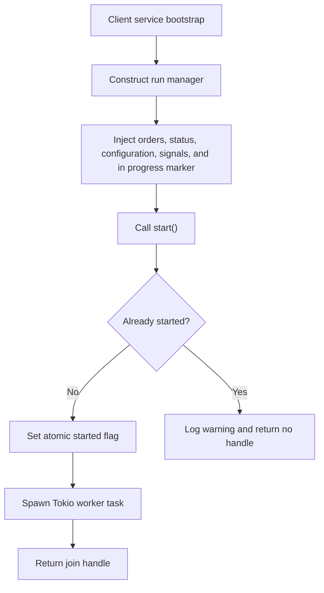
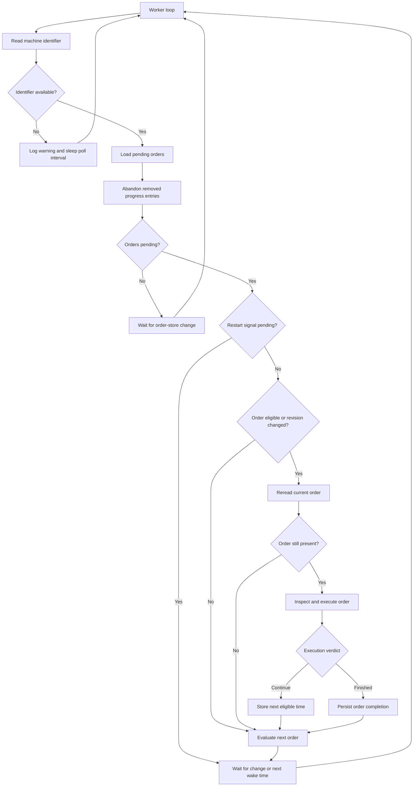
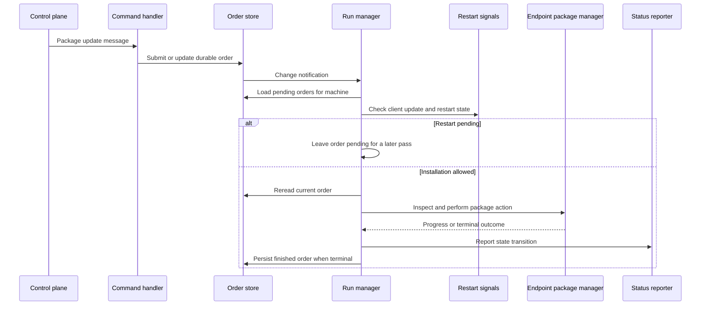

# Services Package Update Run Manager

Services Package Update Run Manager is the OpenFrame Client agent worker that executes queued operating-system package updates. It runs in the Rust `openframe_agent_lib` library, which this repository assembles into the OpenFrame Client runtime. Its responsibilities are deliberately narrow: serialize update processing, defer work while the agent is being replaced or restarted, persist completion, and ensure status changes can be reported to the control plane.

The implementation is supplied by OpenFrame OSS Library version `v0.0.5`. The authoritative source is [package update manager source](https://github.com/flamingo-stack/openframe-oss-lib/blob/7a766f00e4f58b5d89db007b878ac8d6e0c344f4/clients/openframe-client/src/services/package_manager/package_update/mod.rs).

## Purpose and Scope

The manager owns the background execution loop for package-update orders that have already been accepted and recorded locally. It does not create update requests, choose an external package manager directly, or manage the server-side delivery lifecycle. Instead, it coordinates those concerns on the endpoint:

- obtains the local machine identifier before processing device-specific work;
- reads pending orders from an `OrderStore`;
- processes orders sequentially in a deterministic loop;
- tracks per-request progress and the next eligible processing time;
- pauses package changes if a client update or agent restart is pending;
- removes progress for orders no longer present and delegates their abandonment handling;
- marks completed orders as finished in persistent storage; and
- waits efficiently for either an order-store change or the next scheduled retry time.

This separation protects endpoint consistency: package installation does not run concurrently with the agent's own replacement or restart path.

## Position in the Client Architecture

The manager is part of the endpoint-resident OpenFrame Client package-management subsystem. Package-update commands enter through the command-listener path, become durable orders, and are later executed by this manager. Status reporting is a separate collaborator, so accepting and running an order is decoupled from publishing state transitions.

### Core Types

| Component | Responsibility |
|---|---|
| `PackageUpdateRunManager` | Public lifecycle wrapper. It owns a shared worker and prevents more than one background loop from starting. |
| `RestartSignals` | Groups two installation blockers: client-update pending state and an agent-restart latch. Its internal check is true if either signal is set. |
| `Worker` | Internal dependency container holding the machine adapter, order store, status reporter, configuration service, restart signals, and in-progress marker. |
| `OrderStore` | Persistent order and notification boundary. The worker queries pending orders, rereads individual orders before execution, marks finished orders, and awaits changes. |
| `StatusReporter` | Emits package-update state transitions. It also exposes rejection and supersession reporting for command-side order handling. |
| `InProgress` | Shared marker supplied as `package_upgrades`, used by the execution path to represent that package upgrades are active. |

## Construction and Startup

`PackageUpdateRunManager::new` receives all collaborators through constructor injection. It creates a system-backed machine implementation and wraps the worker in `Arc` so the spawned asynchronous task can own a clone safely.

`start` is idempotence-protected with an atomic boolean. The first invocation records that startup occurred, logs the worker startup, and returns a Tokio `JoinHandle`. Any later invocation logs a warning and returns no handle rather than creating a competing update loop.

The single-start guard is important because two workers could otherwise observe the same pending order and attempt overlapping package-manager actions.

## Worker Loop and Scheduling

The asynchronous loop runs indefinitely after it is started. It is event-aware rather than busy-waiting: when it has no immediately eligible work, it waits for an order-store notification or a bounded timer.

1. **Resolve identity.** The worker reads the machine identifier from `AgentConfigurationService`. If it cannot obtain one, it logs the condition, sleeps for `POLL_SECS`, and tries again. No package order is processed without an endpoint identity.
2. **Load work.** It asks `OrderStore` for pending orders belonging to that machine.
3. **Reconcile progress.** It compares the local progress map with the newly loaded pending set. A request that disappeared from pending work is abandoned through the worker's abandonment path and removed from in-memory progress.
4. **Wait when idle.** If no orders remain, the worker waits on the order-store change notification and re-evaluates when an order is submitted or altered.
5. **Process eligible orders.** For each pending order, the manager first checks restart signals, then observes schedule and revision information in the corresponding `Progress` value. A re-sent order is reconsidered immediately; an unchanged order is skipped until its recorded `next_at` time.
6. **Reread before side effects.** Before inspecting an order, the worker retrieves its current record by request identifier. This avoids acting on stale data if a preceding installation took long enough for the store to change.
7. **Apply verdict.** A `Continue` verdict updates the next scheduled wake time. A `Finished` verdict removes progress and asks the order store to persist completion. Persistence failure is logged with the request identifier.
8. **Sleep or react.** The worker awaits whichever happens first: the next order-store change or the calculated wake time. The delay is never less than one second.

## Coordination and Safety Controls

### Restart Gate

`RestartSignals` blocks an installation when either of these sources indicates a pending transition:

- `ClientUpdatePending`, supplied by the tool-run manager, indicates the client binary is scheduled for update; or
- `LatchView`, supplied by the command restart gate, indicates an agent restart was requested.

The manager checks this gate before each order in the current processing round. When the gate is active, it logs that package updates will resume after restart and stops processing the remaining orders in that pass. Orders remain pending; they are not failed merely because a restart is pending.

### Sequential Execution

Orders are processed in the loop one at a time. Although the worker runs as a Tokio task, the loop awaits the outcome of an order before moving to the next. This sequencing avoids simultaneous package-manager operations and makes scheduled retries and order-state persistence tractable.

### Revision-Aware Progress

Progress is held in a map keyed by request identifier. Each entry includes a revision and `next_at` timestamp. If the same revision is not yet eligible, the manager preserves the existing schedule. If the server resends an order with a changed revision, the worker bypasses that wait and reviews it immediately. This is how revised instructions take precedence over an older local retry schedule.

### Durable State Boundaries

The order store is the durable source of truth. In-memory progress only controls local scheduling. The manager rereads each order immediately before inspecting it and explicitly persists `finish` after a terminal result. If that final persistence step fails, the manager logs the error, preserving operational visibility of a potentially repeatable order.

## Package Update Data Flow

The protocol data model includes `PackageUpdateMessage`, package references, update source information, update mode, and status messages. The run manager uses the order representation rather than directly parsing command payloads. Its status collaborator publishes state changes represented by package-update status types, including waiting and terminal outcomes.

## Integration Boundaries

The following adjacent capabilities are part of the same OpenFrame Client library and provide the manager's surrounding protocol, persistence, or operating-system behavior:

- **Package update orders:** `Order`, `OrderStore`, and `Submitted` define persistence, pending-order retrieval, submission, installation markers, and completion handling.
- **Package update status:** `StatusReporter` publishes rejected and superseded outcomes, while the broader status model defines waiting, failure, and done states.
- **Package manager support:** manager identifiers, dependency mapping, manager presence, and support checks establish whether a relevant native package manager is available.
- **Update gate:** process and application-identity inspection can produce an allowed or blocked gate decision, including an undetermined block reason when inspection cannot be completed safely.
- **Command listener:** `PackageUpdateHandler` receives package-update commands and shares the order store and status reporter used by the worker.
- **Tool run manager:** exposes the `ClientUpdatePending` view used to suspend package installations during client replacement.

These are implementation-level contracts in OpenFrame OSS Library. The tenant repository consumes the library as `openframe_agent_lib`; the worker is not an HTTP endpoint and does not introduce a new gateway route.

## Operational Behavior and Troubleshooting

| Symptom | Meaning | Investigation focus |
|---|---|---|
| Package updates do not begin after startup | The endpoint machine identifier is unavailable, so the worker intentionally waits. | Validate persisted agent configuration and machine registration. |
| Updates remain pending during an agent upgrade | This is expected while either restart signal is set. | Check client-update and restart lifecycle state, then allow the agent to restart. |
| An updated order runs earlier than expected | Its revision changed or it was resent, which causes immediate reconsideration. | Compare the request identifier and revision in control-plane delivery records. |
| A completed update reappears after a restart | Completion persistence may have failed after the worker reached a terminal verdict. | Review warning logs for failed finished-order persistence and inspect the order store. |
| The worker appears idle | It is waiting for an order change or scheduled retry time rather than polling continuously. | Confirm whether pending orders exist and whether their next eligible time has arrived. |

## Maintainer Notes

- Preserve the `start` single-worker guarantee when changing lifecycle code.
- Treat `OrderStore` as authoritative; do not make the in-memory progress map a durable source of truth.
- Keep restart gating ahead of package-manager side effects. Package installations must not race with client replacement or an agent restart.
- Maintain the reread-before-execution behavior because an earlier order can take long enough for a later order to be changed, replaced, or removed.
- Ensure every new terminal path either persists completion or emits a clear warning when persistence fails.
- Keep waits notification-driven and timer-bounded to retain responsiveness to newly submitted or revised orders without busy polling.
