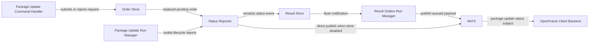
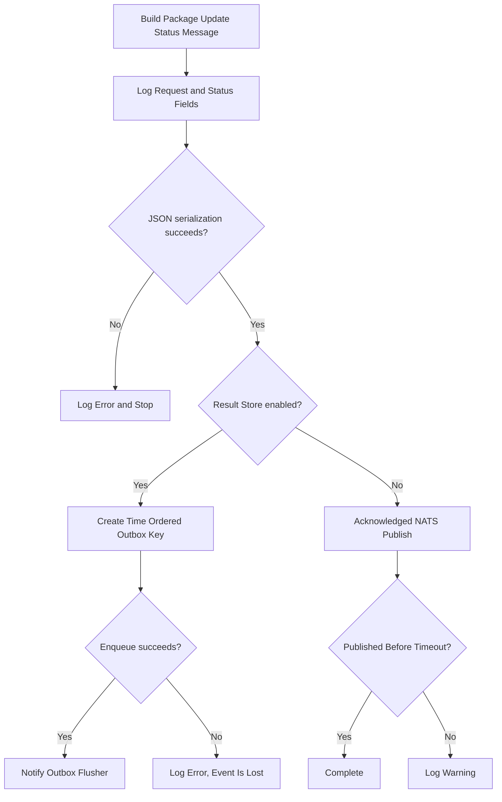
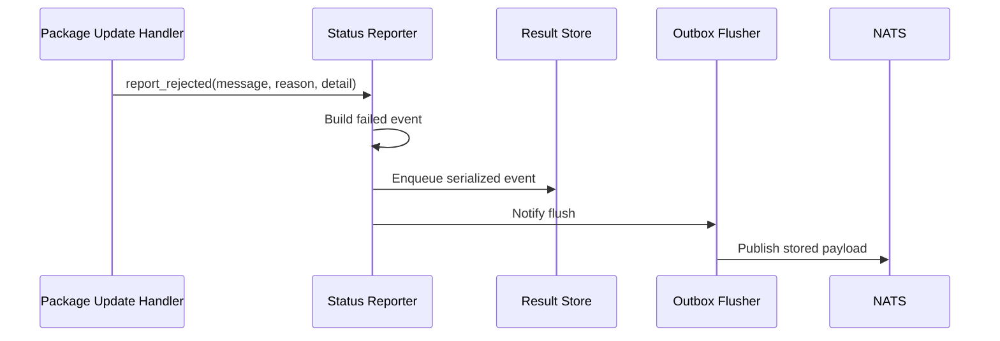
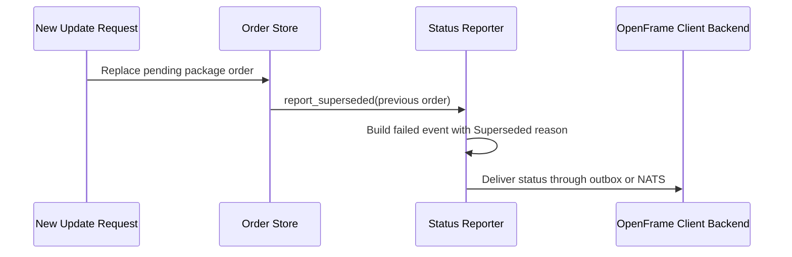

# Services Package Update Status

Services Package Update Status is the client-side reporting boundary for package-update lifecycle events. It belongs to the Rust `openframe_client` runtime supplied by the **OpenFrame OSS Library** artifact (`openframe_agent_lib` v0.0.5) and is assembled by this repository's OpenFrame Client service. Its implementation is maintained in the upstream library at [status.rs](https://github.com/flamingo-stack/openframe-oss-lib/blob/7a766f00e4f58b5d89db007b878ac8d6e0c344f4/clients/openframe-client/src/services/package_manager/package_update/status.rs).

The module makes terminal outcomes visible even when a package-update order never begins installation:

- A pending order replaced by a newer request for the same package is reported as `Superseded`.
- An order rejected before admission is reported with the supplied failure reason and explanatory detail.
- Status payloads are persisted to the durable result outbox when available, allowing delivery to survive a NATS disconnect.
- When durable storage is disabled, the status is published directly with a bounded acknowledgement wait.

## Scope and System Position

The module does not determine whether an update is permitted, execute a package-manager command, or maintain order state. Those responsibilities belong to the package-update coordinator, update gate, package-manager integrations, and order store. Services Package Update Status converts a known outcome into the wire-level `PackageUpdateStatusMessage` and routes it to the delivery mechanism.



The command handler owns an `OrderStore` and `StatusReporter`, establishing the immediate integration point for admission failures. The durable path uses `ResultStore` plus a shared `Notify`; an outbox run manager can subsequently drain persisted payloads through the NATS publishing layer.

## Core Components

| Component | Responsibility |
|---|---|
| `StatusReporter` | Cloneable façade that accepts package-update status events and selects durable, direct, or test-memory delivery. |
| `StatusReporter::new` | Configures a reporter with `NatsMessagePublisher`, shared `ResultStore`, and a flush notification handle. |
| `StatusReporter::report_superseded` | Emits a failed terminal status for a prior pending order replaced by a newer request for the same package. |
| `StatusReporter::report_rejected` | Emits a failed terminal status when the incoming update request is refused before it enters the order store. |
| Internal `report` | Logs the event, serializes it as JSON, queues it durably where possible, or performs a timeout-bounded acknowledged publish. |
| Internal `build` | Constructs a status envelope, assigns a unique event identifier and timestamp, and projects a waiting, done, or failed report into the corresponding fields. |

## Event Contract

A `PackageUpdateStatusMessage` contains the identifiers and package context needed for the backend to correlate an event with a request and device:

| Field group | Contents |
|---|---|
| Identity | `event_id`, `request_id`, and `machine_id`. A fresh UUID is assigned to every constructed event. |
| Time | `at`, generated in UTC RFC 3339 form with milliseconds. |
| Update context | Cloned `UpdateSource` and `PackageRef`, with optional installed and available versions. |
| State | `state` plus one optional state-detail object: `waiting`, `done`, or `failed`. |

The builder initializes each event as `Waiting`. A done report changes `state` to `Done` and sets `done`; a failed report changes it to `Failed` and sets `failed`. A waiting report retains the initial state and sets `waiting`. Optional state-detail fields are omitted from serialized JSON when absent.

The NATS destination is derived from the machine identifier by `package_update_status_subject`. This keeps status routing machine-specific without making the reporter responsible for the subject naming convention.

## Status Delivery Architecture



### Durable Outbox Path

When `ResultStore::enabled` is true, Services Package Update Status serializes the event and writes it to the outbox rather than publishing it immediately. The outbox key has the form shown below, with a nanosecond timestamp and event identifier:

```text
package-update-status:{unix_nanos:020}:{event_id}
```

The timestamp is first in the key so key-ordered outbox delivery preserves the order in which status events for a request are emitted. After a successful enqueue, the reporter signals the outbox flusher once. If enqueueing fails, the module records an error that includes the event identifier; the event cannot be recovered by this reporter because it was not persisted.

### Direct Publish Fallback

When no durable result store is enabled, the reporter calls `NatsMessagePublisher::publish_acked` directly. The operation is wrapped in a timeout set by `FLUSH_PUBLISH_TIMEOUT_SECS`. A timeout is normalized to a publish error and logged as a warning, alongside other direct-publish failures. This path favors bounded execution over indefinite blocking, but it has no persistence guarantee.

### Test Sink

Test builds provide an in-memory sink. Instead of serializing or publishing, it appends the complete `PackageUpdateStatusMessage` to a mutex-protected vector. This isolates status assertions from NATS and durable-store behavior.

## Terminal Failure Scenarios

### Rejected Request

`report_rejected` receives the machine identifier, original `PackageUpdateMessage`, a `FailReason`, and a descriptive detail string. It preserves the incoming request identifier, source, and package, and emits a failed event with no process exit code. This is important because rejection happens before an installation attempt, so there is no package-manager process result to report.



### Superseded Pending Order

`report_superseded` accepts the displaced `Order`. It creates a failed report with `FailReason::Superseded`, no exit code, and the fixed detail `replaced by a newer request for the same package`. The report uses the original order's request identifier, source, and package, allowing the backend to close the exact request that was replaced.



## Failure and Observability Behavior

The reporter emits structured tracing information before delivery, including the request identifier, state, and any waiting, done, or failed detail. It distinguishes failures by stage:

| Stage | Behavior |
|---|---|
| JSON serialization | Logs an error and stops. No payload can be delivered. |
| Durable enqueue | Logs an error with the event identifier. The event is lost because it was not stored. |
| Direct publish timeout or error | Logs a warning with the event identifier. The caller is not blocked indefinitely and no retry is performed in this module. |
| Durable enqueue success | Signals the outbox flusher; eventual publication is handled outside this module. |

The `rfc3339` utility converts a Unix-second value to a UTC RFC 3339 timestamp with second precision. It returns an empty string for an invalid timestamp conversion, keeping formatting failure from propagating as a reporting failure.

## Maintenance Considerations

- Preserve request, machine, package, and source fields when introducing a new reporting call site; they are the correlation boundary for backend processing.
- Use the durable outbox for reliability-sensitive status changes. Direct publishing is an explicit degraded mode and can lose a status if the acknowledgement does not complete.
- Keep timestamp-first ordering in outbox keys. Changing this ordering can reorder status events when the outbox drains queued records.
- Treat rejection and supersession as terminal results, not installation failures: neither supplies an exit code because neither necessarily runs a package-manager process.
- Extend the event contract and backend consumers together. The client emits JSON consumed over NATS, so changing enum variants or field semantics is a protocol change.

## Upstream Ownership

This repository consumes the module from OpenFrame OSS Library version `v0.0.5` of the `openframe_agent_lib` Cargo artifact. The tenant repository packages and runs the OpenFrame Client; the implementation and its source history remain in the upstream library file linked at the start of this document.
