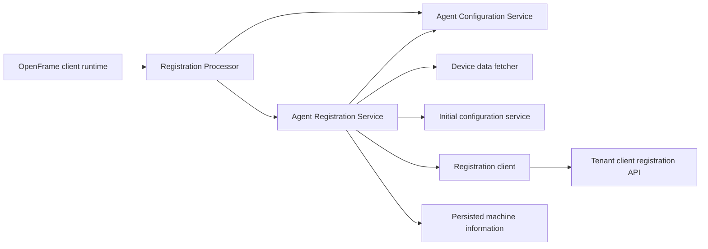
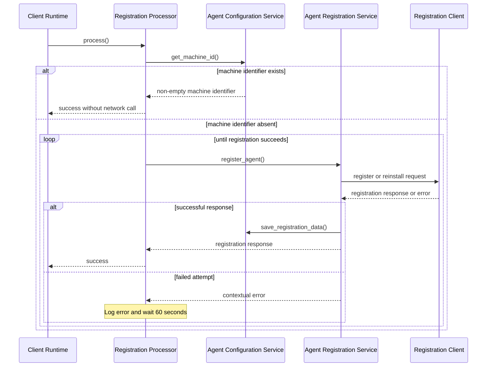
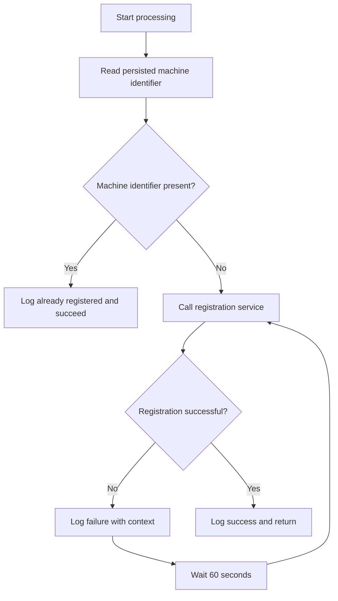
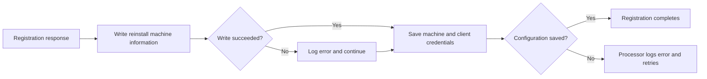

# Services Registration Processor

Services Registration Processor is the startup gate that ensures an OpenFrame endpoint agent has a server-issued machine identity before the rest of the client runs. It is implemented by `RegistrationProcessor` in the OpenFrame OSS Library's `openframe_agent_lib` Cargo artifact, which this repository consumes at version `v0.0.5`. The tenant repository runs that library as part of its OpenFrame client rather than defining the processor locally.

The processor is deliberately small: it reads the persisted machine identifier, exits when the client is already registered, and otherwise retries registration indefinitely at a fixed 60-second interval. Registration, request composition, and persistence are delegated to adjacent client-library services.

**Source:** [registration processor implementation](https://github.com/flamingo-stack/openframe-oss-lib/blob/7a766f00e4f58b5d89db007b878ac8d6e0c344f4/clients/openframe-client/src/services/registration_processor.rs)

## Responsibilities

- Prevent duplicate registration when the persisted client configuration already contains a non-empty machine identifier.
- Invoke `AgentRegistrationService` until an attempt completes successfully.
- Add contextual error information when the delegated registration service fails, while retaining the original cause for logging.
- Apply a 60-second delay between failed attempts so a temporarily unavailable tenant service does not cause a tight retry loop.
- Return success only after a registration attempt completes; return immediately if the initial local configuration lookup fails.

The processor does **not** construct the registration request, select fresh versus reinstall behavior, store credentials, or impose a retry limit. Those responsibilities belong to the delegated services.

## Placement in the Client Architecture

`RegistrationProcessor` is constructed with two dependencies:

| Dependency | Role in the registration path |
|---|---|
| `AgentConfigurationService` | Reads the current machine identifier and persists the returned machine identifier, client identifier, and client secret after registration. Its write lock serializes configuration read-modify-write operations. |
| `AgentRegistrationService` | Determines whether this is a fresh install or reinstall, gathers device information, calls the registration API, preserves reinstall information when possible, and writes returned registration data to the configuration service. |

The registration service additionally combines `DeviceDataFetcher`, `InitialConfigurationService`, and `RegistrationClient`. The request model contains hostname, agent version, operating-system type, and optional organization, user, and device-tag fields. The returned `AgentRegistrationResponse` contains `machine_id`, `client_id`, and `client_secret`.

## Component Interaction

## Registration Process

### Fast Path

`process()` first calls `get_machine_id()`. A non-empty value is the sole local idempotency check. The processor logs that the client is already registered and returns without contacting the tenant registration API.

An error while loading this value is propagated to the caller. It is not handled by the retry loop because the loop begins only after the empty-identifier check succeeds.

### Retry Path

When no machine identifier exists, each loop iteration invokes a private `attempt_registration()` helper. That helper calls `AgentRegistrationService.register_agent()` and annotates failures with `Registration service returned an error`. On failure, `process()` logs the complete error chain, sleeps for exactly 60 seconds, then repeats. There is no attempt counter, exponential backoff, jitter, or terminal failure condition in this component.

### Delegated Registration and Persistence

The registration service obtains the initial key from the initial configuration. It rejects an empty key; the implementation notes that this key is cleared after the device holds a log key, so another registration requires a fresh install command.

It then reads persisted machine information for a possible reinstall. Read failures are retried by that service using its own configured retry delays; after those retries are exhausted, it falls back to fresh registration. The registration client sends a JSON request to one of two paths:

| Condition | Server path | Additional headers |
|---|---|---|
| No persisted machine information | `/clients/api/agents/register` | `X-Initial-Key` and `Content-Type` |
| Persisted machine information is available | `/clients/api/agents/reinstall` | `X-Initial-Key`, `X-Client-Secret`, `X-Machine-Id`, and `Content-Type` |

After an accepted response, the registration service attempts to write a complete reinstall record containing the machine identifier, client secret, and optional user identifier. Failure of this auxiliary write is logged but does not stop the path. Saving the server-issued machine identifier, client identifier, and client secret through `AgentConfigurationService`, however, is fallible and is required for `register_agent()` to succeed.

## Persistence and Failure Semantics

This distinction is important operationally:

- A failed reinstall-information write reduces the client's ability to identify a later registration as a reinstall, but it does not invalidate a successful server response.
- A failed configuration save leaves the processor without the machine identifier used by its fast path. The delegated registration call therefore fails and the processor will retry after 60 seconds.
- Any non-success response from the registration API is an error. A client-secret-specific error is recognized by the registration client, while other responses retain the HTTP status and response body in the error.

## Operational Considerations

- **Startup availability:** A client without a persisted machine identifier remains in the registration loop until it can register. The processor itself provides no offline mode or deadline.
- **Retry volume:** Each failed cycle waits 60 seconds. Changing retry behavior requires changing this library component, not tenant configuration exposed by this processor.
- **Secrets:** Initial keys and returned client secrets are authentication material. The processor logs status and errors but should not be modified to log these values.
- **Idempotency:** The fast path depends only on a non-empty local machine identifier. Correct persistence is therefore essential to prevent repeated registration attempts after a successful server response.
- **Troubleshooting:** First determine whether the local machine identifier can be read. If it is empty, inspect the registration-service failure reported before the 60-second wait, then verify the initial key, device-data collection, and reachability of the tenant registration API.

## Extension Guidance

Keep `RegistrationProcessor` focused on orchestration. Request fields should be added through the registration request model and the registration service; transport behavior belongs in the registration client; and credential persistence belongs in the configuration or machine-information persistence services. Any change to retry policy should preserve the early exit for an existing machine identifier and ensure that errors remain observable without exposing credential values.
