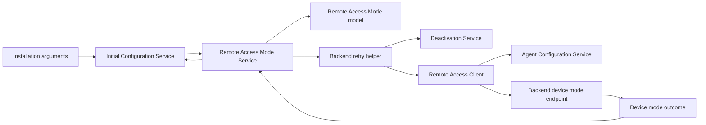
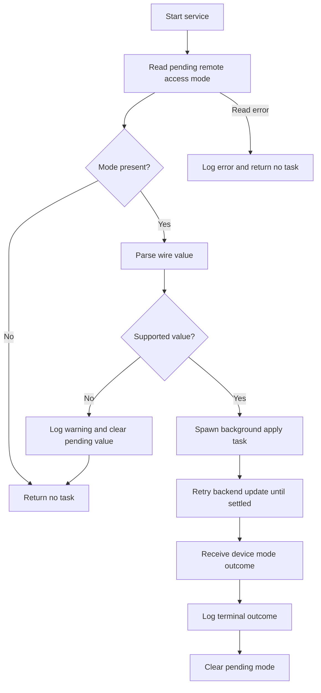
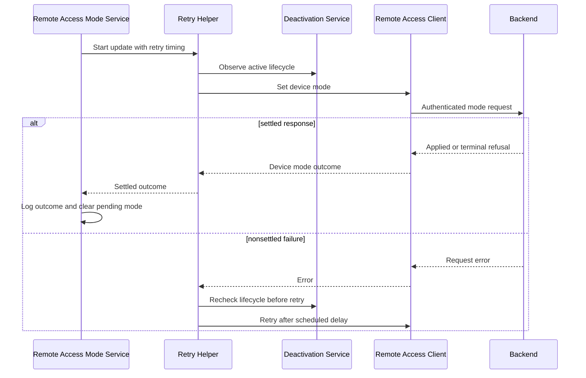

# Services Remote Access Mode

Services Remote Access Mode is the OpenFrame client-agent component that forwards an installation-time remote-access preference to the backend as a device-level override. It runs as part of the Rust `openframe_client` library supplied by [OpenFrame OSS Library](https://github.com/flamingo-stack/openframe-oss-lib/blob/7a766f00e4f58b5d89db007b878ac8d6e0c344f4/clients/openframe-client/src/services/remote_access_mode_service.rs), artifact `openframe_agent_lib` version `v0.0.5`, which this repository consumes.

The service is deliberately narrow: it consumes one pending value stored in initial configuration, validates it as a `RemoteAccessMode`, and asynchronously sends it to the backend. A successful application and terminal backend responses remove the local pending value. If the backend call cannot yet settle, the retry helper keeps attempting it while the agent remains active.

## Responsibilities

- Read the optional install-time remote-access mode from `InitialConfigurationService`.
- Validate the stored wire value against the supported `RemoteAccessMode` variants.
- Start the update without blocking client startup.
- Call `RemoteAccessClient` with the authenticated device-mode request.
- Retry transient failures using a 30-second initial delay and a maximum delay of 30 minutes.
- Cooperate with deactivation through `DeactivationService` while retrying.
- Clear the stored pending mode after a terminal result, including an unsupported backend, a pre-existing device override, or an invalid local value.

It does not establish a remote-control session, install a remote-access tool, or decide the remote-access policy itself. It transfers an install-time choice to the backend, which owns device-level policy and override resolution.

## Architecture

### Component roles

| Component | Role in the flow |
|---|---|
| `RemoteAccessModeService` | Orchestrates startup validation, background processing, terminal-outcome handling, and pending-value cleanup. |
| `InitialConfigurationService` | Persists the install-time value and serializes read-modify-write updates while clearing it. |
| `RemoteAccessMode` | Defines the accepted logical modes: `ApprovalRequired`, `NotifyOnly`, `SilentAccess`, and `DenyAccess`. Serialization and parsing provide the wire representation. |
| `RemoteAccessClient` | Obtains an access token from agent configuration and sends the authenticated JSON request containing `mode`. |
| `DeviceModeOutcome` | Represents a settled response: `Applied`, `NotSupported`, or `OverrideExists`. |
| Retry helper | Invoked with the remote-access update operation and a deactivation dependency; it returns only after the operation reaches a settled outcome. |
| `DeactivationService` | Lets the retry path observe agent deactivation rather than continuing an update independently of client lifecycle. |

## Lifecycle and Processing Flow

`start` is called on an `Arc`-managed service. It reads the stored mode synchronously, then returns either `None` when no work can begin or a Tokio `JoinHandle` for the background task.

### Startup cases

| Condition | Service behavior | Pending value |
|---|---|---|
| No configured mode | Returns `None`; no background task is created. | Unchanged because no value exists. |
| Initial configuration cannot be read | Logs an error and returns `None`. | Not cleared, allowing a later process start to try again after the local problem is corrected. |
| Wire value cannot be parsed as `RemoteAccessMode` | Logs a warning, clears the value, and returns `None`. | Removed to prevent repeated processing of an unknown value. |
| Valid mode | Logs intent and spawns the asynchronous update task. | Retained until a terminal outcome is obtained. |

## Backend Update Contract

The client request is performed by `RemoteAccessClient::set_device_mode`. It retrieves the current agent access token through `AgentConfigurationService`, places that token in an `Authorization: Bearer` header, and sends a JSON payload with a `mode` field. The service does not construct HTTP details itself.

The outcome classification exposed to Services Remote Access Mode is intentionally small:

| Outcome | Meaning | Local action |
|---|---|---|
| `Applied` | The backend accepted and applied the requested mode. | Log success and clear the pending value. |
| `NotSupported` | The backend does not support setting a device remote-access mode. | Log a warning and clear the pending value. |
| `OverrideExists` | A different override already exists for the device. | Preserve the backend value, log a warning, and clear the pending value. |

Any error that has not become one of these settled outcomes remains within the retry operation. This module therefore treats the configuration entry as a durable work item rather than removing it before the backend has reached a terminal decision.

## Retry, Deactivation, and Delivery Semantics

The service constructs `RetryTiming` with a 30-second initial retry delay and a 30-minute maximum delay. It gives these settings, the current `DeactivationService`, a descriptive operation name, and the `set_device_mode` closure to `retry_until_settled`.

The exact retry algorithm is implemented outside this module. From this service's integration point, its important guarantees are that settled outcomes reach the match block and that the retry operation is coupled to deactivation. Do not clear the install-time value before that operation resolves: doing so would discard a requested override following a transient backend failure.

## Configuration State

The pending mode is held in the initial configuration managed by `InitialConfigurationService`. `clear_remote_access_mode` uses the service's write lock, loads the existing configuration, sets only the remote-access-mode field to absent, and saves the updated configuration. This guards against concurrent configuration updates losing unrelated fields.

The mode names are parsed from the serialized enum representation rather than manually matching strings. When adding a new mode, update the `RemoteAccessMode` definition and ensure that both serialization and backend support agree before allowing it to be provided at installation time.

## Operational Behavior

### Logging

The service emits structured tracing events for these operationally relevant transitions:

- An error when the pending value cannot be read.
- A warning when the stored value is unknown.
- An informational event when a valid mode is about to be set.
- An informational event when the update is applied.
- A warning when the backend does not support the operation or when an existing override wins.
- An error if the pending value cannot be cleared after terminal processing.

A failure to clear is important: the device mode may already be settled remotely, but the local work item can be retried on a subsequent agent start.

### Concurrency

At most one task is created for one call to `start`, but the service itself does not expose a separate in-memory deduplication mechanism. Lifecycle composition should start this service once per client runtime. Its use of initial-configuration locking protects local configuration mutations, while the backend outcome `OverrideExists` protects an existing server-side choice from being overwritten.

## Extension and Maintenance Guidance

1. Keep the service orchestration-only. HTTP authentication, status mapping, and request serialization belong in `RemoteAccessClient` and the remote-access model.
2. Preserve the parse-before-spawn check. Invalid installation input must be discarded locally rather than retried indefinitely.
3. Treat every new terminal backend response explicitly. Decide whether it should clear the local value, preserve it for retry, or surface as a new outcome type.
4. Keep deactivation wired into retries. A background network operation must follow the client shutdown and deactivation lifecycle.
5. Maintain compatibility between `RemoteAccessMode` serialization and backend accepted values; the persisted value is a wire name, not a display label.
6. Exercise the no-value, unreadable-configuration, unknown-value, applied, unsupported, existing-override, transient-failure, and clear-failure paths when changing behavior.

## Source Scope

This documentation covers the implementation provided by OpenFrame OSS Library in [`remote_access_mode_service.rs`](https://github.com/flamingo-stack/openframe-oss-lib/blob/7a766f00e4f58b5d89db007b878ac8d6e0c344f4/clients/openframe-client/src/services/remote_access_mode_service.rs). The tenant repository assembles and runs the client artifact; the detailed client-agent implementation is maintained in that library source.