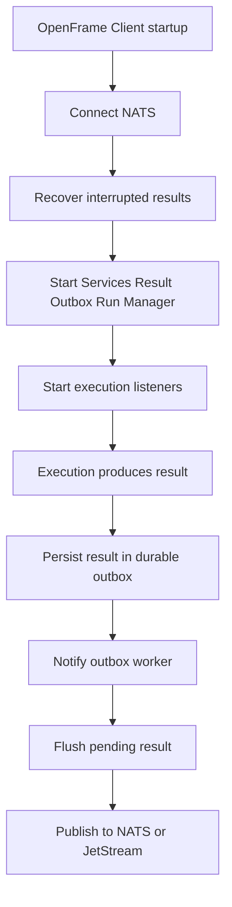
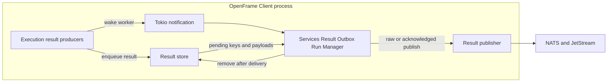
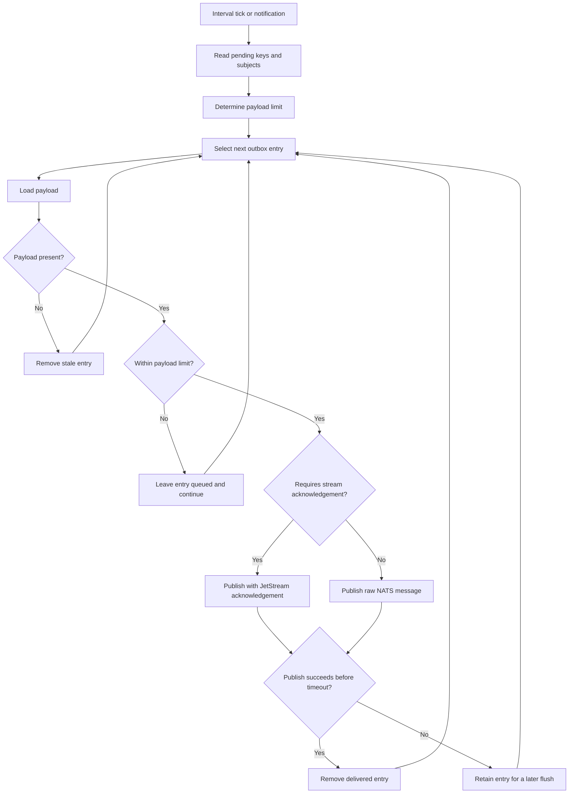
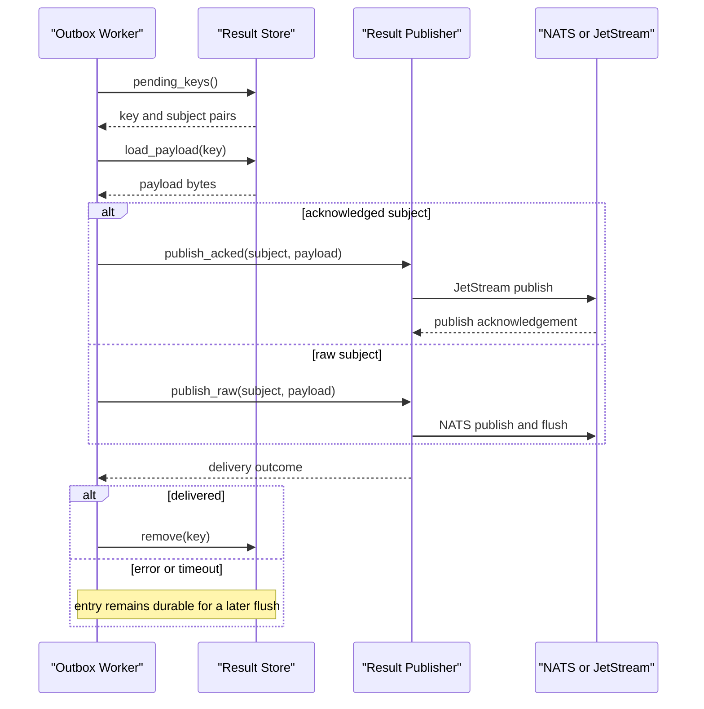

# Services Result Outbox Run Manager

The Services Result Outbox Run Manager is the OpenFrame Client background worker that delivers durable, queued execution results to NATS. It belongs to the Rust `openframe_agent_lib` supplied by OpenFrame OSS Library version `v0.0.5` and is run by this repository's OpenFrame Client deployment. Its implementation is in [the OpenFrame OSS Library source](https://github.com/flamingo-stack/openframe-oss-lib/blob/7a766f00e4f58b5d89db007b878ac8d6e0c344f4/clients/openframe-client/src/services/result_outbox_run_manager.rs).

The manager separates result production from network delivery. Results remain in the local durable result store until publishing succeeds, allowing an agent to retain results through a temporary NATS failure or a client restart.

## Responsibilities

`ResultOutboxRunManager
` owns three shared dependencies:

| Dependency | Role |
|---|---|
| `ResultStore` | Supplies pending outbox keys and subjects, loads persisted payloads, and removes a completed entry. |
| `ResultPublisher` | Abstracts raw NATS publishing, JetStream-acknowledged publishing, and broker payload-limit discovery. |
| `Notify` | Wakes the worker when a new result is available, without waiting for the next periodic flush. |

The manager exposes a constructor, `new`, and a non-async `start` method. `start` validates that durable storage is enabled, then spawns the long-running Tokio task and returns immediately.

## Placement in the Client

The client starts this worker after connecting to NATS and after attempting result-store recovery. It does so before accepting command, script, bootstrap, software, and scheduled-script execution batches. That ordering makes recovered results eligible for delivery before new execution work can add more results.

The `ResultStore::recover` operation converts journal records from interrupted scheduled scripts into error results before this worker starts. If storage is not durable, recovery returns no records and the outbox worker logs that it is disabled rather than spawning a task.

## Runtime Architecture

The manager is generic over `ResultPublisher`, which keeps persistence and loop control independent of the concrete transport. The client normally supplies a NATS-backed publisher:

- `publish_raw` publishes to a NATS subject and flushes the client.
- `publish_acked` publishes through JetStream and waits for the server acknowledgement.
- `max_payload` reads the connected server's maximum payload when available.

## Flush Cycle

The worker waits for either a periodic interval tick, configured by `OUTBOX_FLUSH_INTERVAL_SECS`, or a notification. Each wake-up runs the following cycle:

The payload limit is derived from the publisher's reported maximum payload and reduced by the result-store headroom. When no connection or server value is available, the result store uses its fallback payload limit. An entry larger than that limit is deliberately retained but skipped, so it does not prevent later healthy entries from being attempted. Its size must be reduced or the effective broker limit changed before it can be delivered.

### Delivery Mode Selection

The `requires_stream_ack` classifier selects JetStream-acknowledged delivery for subjects whose suffix identifies an execution acknowledgement, delivery result, or package-update status. All other results use raw NATS delivery. Both calls are bounded by `FLUSH_PUBLISH_TIMEOUT_SECS`.

## Durability and Failure Semantics

The worker provides at-least-retry behavior for entries still present in the durable store. It removes an entry only after the selected publish operation completes successfully. A process failure after the broker accepts a result but before local removal can therefore lead to a later retransmission; downstream result consumers must tolerate duplicates.

| Condition | Manager behavior | Result-store effect |
|---|---|---|
| Result store is disabled | Logs that flushing is disabled and does not spawn the task. | No durable outbox processing. |
| Reading pending keys fails | Logs an error and waits for the next wake-up. | Entries remain unchanged. |
| Payload is missing for a metadata key | Removes the stale entry. | Metadata and payload are deleted together. |
| Loading a payload fails | Logs a warning and stops the current pass. | Current and remaining entries await a later pass. |
| Payload exceeds the effective limit | Logs a warning and continues to later entries. | Oversized entry remains queued. |
| Publish returns an error | Logs a warning and continues to later entries. | Failed entry remains queued. |
| Publish times out | Logs a warning and continues to later entries. | Timed-out entry remains queued. |
| Publish succeeds but removal fails | Logs a warning. | Entry remains and can be republished later. |

## Operational Considerations

- The worker is intentionally inactive unless `ResultStore::enabled` reports durable storage. Treat the disabled message as a delivery-durability signal, not merely a scheduling message.
- A growing pending set indicates delivery failures, timeouts, an unreachable NATS connection, or undeliverable oversized entries. The result store exposes pending keys and count-oriented operations for diagnostics.
- Entries are processed in the order returned by the underlying store's metadata iteration. The manager does not impose additional ordering, batching, backoff, or a retry cap.
- Delivery timeouts bound each individual publish attempt. A slow or unavailable broker can delay later entries by up to the configured timeout per attempted entry.
- The background task has no explicit shutdown handle in this component. It lives with the Tokio runtime hosting the client.

## Key Implementation Boundaries

The manager does not create execution results, serialize them, or decide their subject. Those responsibilities belong to the result-store and execution paths. It also does not reconnect NATS itself; its publisher obtains the current client through the NATS connection manager. This narrow boundary keeps the manager focused on draining persisted entries safely once a transport is available.

For changes, preserve the key invariant: **never remove an outbox record before the selected publish method reports success**. Any new subject type should also be evaluated for whether raw NATS delivery is sufficient or whether server acknowledgement is required.
