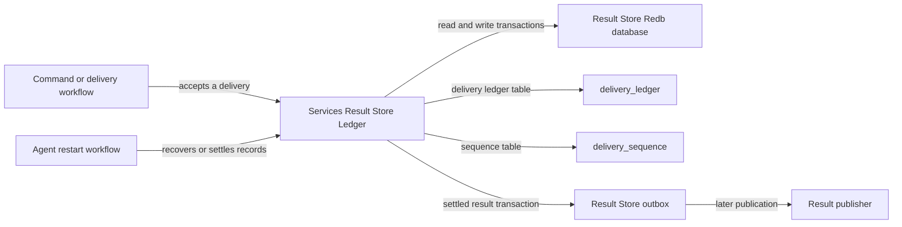
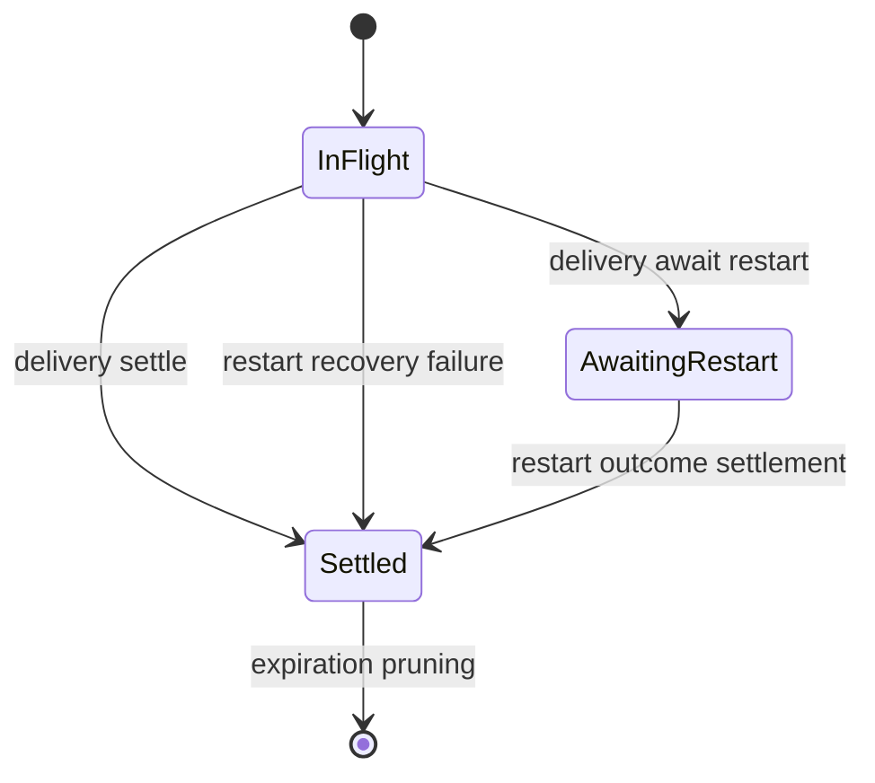
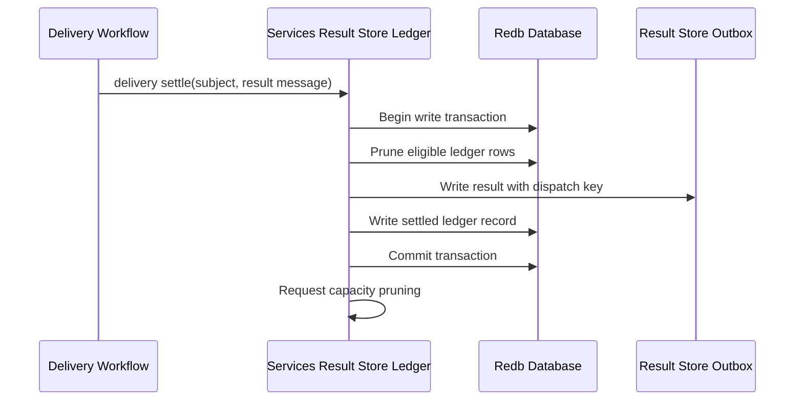
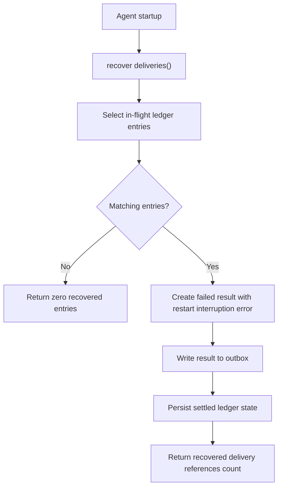
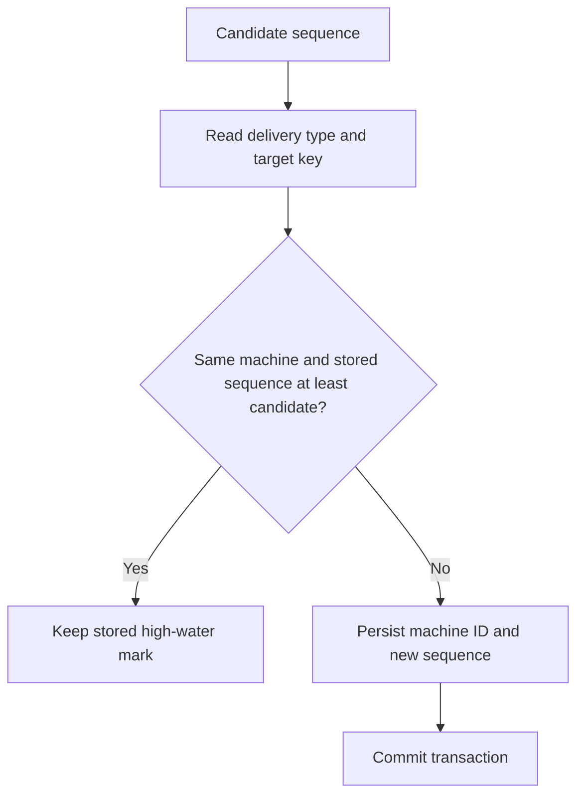

# Services Result Store Ledger

Services Result Store Ledger is the durable delivery-state layer used by the OpenFrame client agent. It is implemented by the `ledger.rs` module in the `openframe_agent_lib` dependency supplied by OpenFrame OSS Library. The tenant repository runs that agent library through its client service; the ledger records the lifecycle of each delivery by dispatch ID, makes restart outcomes explicit, persists ordered-application progress, and writes delivery results into the Result Store outbox for later publication.

The implementation is available in [the OpenFrame OSS Library source](https://github.com/flamingo-stack/openframe-oss-lib/blob/7a766f00e4f58b5d89db007b878ac8d6e0c344f4/clients/openframe-client/src/services/result_store/ledger.rs).

## Purpose and guarantees

The module solves two related reliability problems:

- **Delivery lifecycle durability.** A command accepted by an agent is persisted as `in_flight`, can be marked `awaiting_restart`, and is eventually persisted as a settled result.
- **Restart recovery.** On startup, entries that remained in flight are converted to failed results with the error `interrupted by agent restart`; entries intentionally awaiting a restart are excluded from that recovery path.
- **Ordered delivery protection.** The ledger stores the highest applied sequence for each delivery type and target. A sequence is scoped to the registering machine, so a different machine ID starts from the default applied sequence of `0`.
- **Transactional result handoff.** Settling a delivery creates the result outbox entry and updates the ledger in the same Redb write transaction. This avoids recording a settled state without its queued result during a successful transaction commit.
- **Bounded retained history.** Settled and restart-waiting records are expired using the configured delivery-ledger time-to-live. In-flight records are deliberately retained for restart recovery.

The ledger is an internal capability of `ResultStore`, not an external endpoint or a message listener by itself. Its public asynchronous methods operate only when the surrounding Result Store is enabled. Recovery and restart settlement return no work when persistence is disabled.

## Architecture and relationships

The `ResultStore` owns the database handle and supplies its database executor, clock, outbox-writing helper, and capacity pruning. Services Result Store Ledger adds two Redb tables:

| Table | Key | Stored value | Role |
| --- | --- | --- | --- |
| `delivery_ledger` | Delivery dispatch ID | JSON `LedgerRecord` | Stores the subject, `DeliveryRef`, lifecycle state, and last-update timestamp. |
| `delivery_sequence` | Delivery type and target ID | JSON applied-sequence record | Tracks the greatest sequence applied by a particular machine registration. |

`LedgerRecord` is private persistence format. It contains the message subject used for the eventual result, the `DeliveryRef`, a `LedgerState`, and `updated_at_secs`. `AppliedSequence` likewise remains private and contains the machine ID and sequence number.

### State model

`LedgerState` is serialized with snake-case variant names and has three states:

| State | Meaning | Normal transition |
| --- | --- | --- |
| `InFlight` | The delivery was accepted and may be executing. | Settled directly, marked awaiting restart, or converted to a failed result during restart recovery. |
| `AwaitingRestart` | The delivery is waiting for a restart and must not be treated as interrupted by the current process restart. | Settled in bulk for its matching delivery type after the restart outcome is known. |
| `Settled` | A `DeliveryResultMessage` has been recorded. | Retained until ledger time-to-live expiry, then pruned. |

The `delivery_await_restart` operation is intentionally conditional: it changes only an existing `InFlight` record. Missing records and records already in another state are left unchanged. Similarly, restart settlement selects only `AwaitingRestart` entries with the requested delivery type.

## Delivery operations

### Accept and inspect

`delivery_accept(subject, delivery, state)` creates or replaces the ledger row keyed by `delivery.dispatch_id`, records the current timestamp, and commits the transaction. Callers can supply the initial state, normally `InFlight`.

`delivery_state(dispatch_id)` reads the entry and returns its state when present. It does not expose the private subject, timestamp, or complete record.

### Settle and record results

`delivery_settle(subject, message)` performs the normal durable completion path:

1. Opens a write transaction.
2. Removes expired or unreadable non-in-flight records from the ledger.
3. Serializes the `DeliveryResultMessage` and writes it to the Result Store outbox under a key derived from the dispatch ID.
4. Writes a `Settled` ledger row containing the same message and a fresh timestamp.
5. Commits the transaction, then requests Result Store capacity pruning.

`delivery_record(subject, message)` records the same settled state but does **not** queue an outbox record. It is intended for a result that was already published directly; retaining the ledger state supports repeated-delivery handling without publishing it again.

### Restart handling

`recover_deliveries()` is the startup safety path. It selects all `InFlight` rows and settles each one as `DeliveryResult::Failed` with the fixed interruption error. The function reports the number of converted entries and emits an informational log when at least one delivery was recovered.

`delivery_settle_awaiting_restart(delivery_type, result, error)` settles every `AwaitingRestart` record whose `DeliveryRef.delivery_type` matches the supplied value. It returns the associated delivery references so its caller can account for the completed restart-related deliveries.

Both paths use the same internal `settle_ledger` operation. That operation first prunes eligible records, gathers matching rows, creates an individual result message for each row, writes each result to the outbox, updates each row to `Settled`, commits once, and then triggers capacity pruning if it settled any rows.

## Ordered application ledger

Ordered delivery tracking is independent from the lifecycle row and is keyed as `delivery_type:target_id`. `applied_sequence(delivery, machine_id)` returns the stored sequence only when the stored machine ID matches the current machine; otherwise it returns `0`. This makes every sequence acceptable for a newly registered machine.

`record_applied_sequence(delivery, machine_id, sequence)` writes only a strictly newer sequence for the same machine. A stored sequence that is equal to or greater than the candidate suppresses the write. If the key belongs to a different machine, the new machine record replaces it. The method therefore keeps a monotonic high-water mark per delivery type, target, and current registration identity.

## Retention, compatibility, and failure behavior

### Retention policy

Before settlement operations, the ledger removes records that are unreadable or that have exceeded `DELIVERY_LEDGER_TTL_SECS`, except `InFlight` rows. Protecting in-flight rows preserves the evidence needed to produce restart-failure results. Settled and awaiting-restart rows can age out after their last-update time exceeds the configured time-to-live.

Result Store capacity pruning is separate from ledger time-to-live pruning. It is requested after result-producing settlement paths and is owned by the surrounding Result Store implementation.

### Forward-compatibility behavior

A ledger record is JSON-decoded before use. If decoding fails, the module logs a warning that includes the dispatch ID and ignores the row for reads. During expiration pruning, unreadable rows are removed. This intentionally treats rows written by a newer agent version before a rollback as absent rather than failing all ledger work.

Sequence records are also JSON-decoded, but an unreadable sequence entry simply behaves as no applied sequence. The next accepted write can replace it.

### Operational implications

- Do not remove or rename delivery types or target identity semantics without considering their sequence-key compatibility.
- Call `delivery_await_restart` before a planned restart only when the delivery should receive the eventual restart outcome rather than the generic interruption failure.
- Prefer `delivery_settle` for a result that still needs durable outbox publication. Use `delivery_record` only after direct publication is already complete.
- Treat a successful return from lifecycle methods as a committed Redb transaction; errors propagate to the caller as `anyhow::Result` failures.

## Module boundaries

Services Result Store Ledger is part of the Rust `openframe_client` agent library version `0.1.0`, which this repository consumes from OpenFrame OSS Library as `openframe_agent_lib` version `v0.0.5`. It works alongside the Result Store for durable payload/outbox storage and the Result Outbox Run Manager for deferred result publication. The ledger itself does not execute commands, establish NATS connections, or define server-side result processing; it only persists the local decision and result handoff required to make those wider workflows resilient to process restarts.
