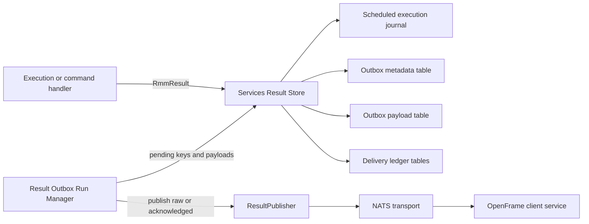
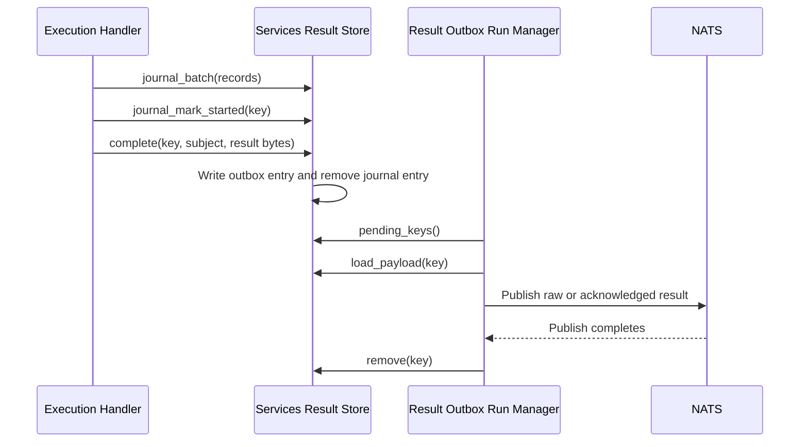
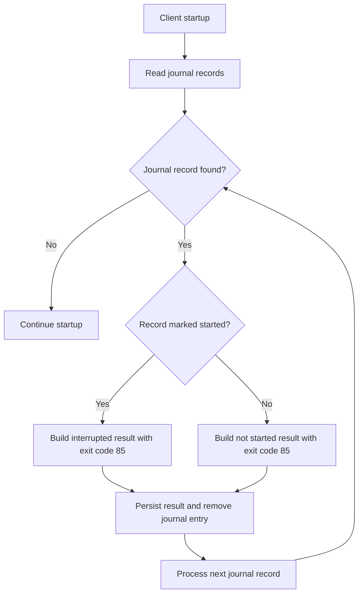
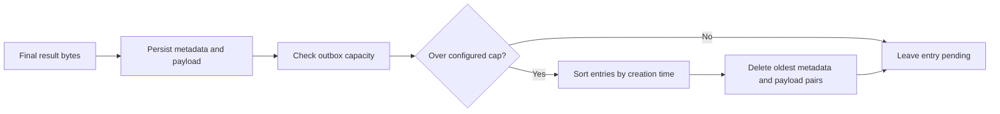

# Services Result Store

Services Result Store is the durable, device-local outbox for execution results produced by the OpenFrame client. It is implemented by the `openframe_agent_lib` dependency from [OpenFrame OSS Library](https://github.com/flamingo-stack/openframe-oss-lib/blob/7a766f00e4f58b5d89db007b878ac8d6e0c344f4/clients/openframe-client/src/services/result_store.rs) and is run by this repository's OpenFrame client deployment.

The module makes result delivery resilient to restarts and transient NATS failures. It records scheduled-script work before execution, converts unfinished work into explicit failure results on the next startup, persists outbound bytes before publication, and removes an entry only after the publisher reports success. When its local database cannot be opened, it deliberately degrades to non-durable operation instead of preventing the agent from running.

## Responsibilities

- Maintain a local Redb database containing a scheduled-execution journal, result metadata, result payloads, and delivery-ledger tables.
- Prevent duplicate journal insertion for an execution batch.
- Persist a result before handing it to the asynchronous outbox publisher.
- Restore interrupted scheduled executions as terminal `RmmResult` failure records after an agent restart.
- Constrain serialized payloads to the transport payload limit by reducing standard output, then standard error, and marking the result as truncated.
- Enforce a bounded outbox by retaining the newest entries and dropping the oldest persisted results when the configured entry cap is exceeded.

## Position in the Client

The store is a client-side reliability boundary. Execution and command handling produce outcomes; Services Result Store persists the outbound representation; the Result Outbox Run Manager retries delivery through a `ResultPublisher`. The production publisher can be backed by the NATS message publisher, while the store itself remains independent of that transport implementation.

The journal and outbox are separate on purpose. A journal record describes work that has been accepted for execution but has not yet been completed. An outbox entry contains a finalized, serialized result that remains until it is sent successfully. Completing an execution writes its outbox record and removes its journal record in the same database write transaction.

## Core Types and Storage Model

| Component | Role |
| --- | --- |
| `ResultStore` | Owns the optional Redb database handle and exposes asynchronous journal, outbox, recovery, and capacity operations. Blocking database work is delegated through `spawn_blocking`. |
| `JournalRecord` | Persists the destination subject, execution and machine identifiers, optional script and schedule identifiers, creation time, and whether execution started. |
| `ResultPublisher` | Transport abstraction with raw publication, acknowledged publication, and maximum-payload discovery operations. |
| `RmmResult` | Execution-result envelope serialized into an outbox payload. It includes identifiers, output streams, exit status, duration, timeout state, and optional error metadata. |
| `LedgerState` | Delivery ledger state model: `InFlight`, `AwaitingRestart`, or `Settled` with a delivery-result message. |

The Redb database creates these logical tables on open:

| Table | Stored value | Purpose |
| --- | --- | --- |
| `journal` | JSON-encoded `JournalRecord` | Tracks scheduled work whose final result has not been durably recorded. |
| `outbox_meta` | Subject and creation timestamp | Supplies the delivery destination and age used for outbox pruning. |
| `outbox_payload` | Serialized result bytes | Stores the exact payload to retry. |
| Delivery ledger | Ledger records | Tracks command-delivery lifecycle independently of execution result outbox entries. |
| Delivery sequence | Applied sequence data | Supports recovery and sequencing in the delivery ledger. |

An outbox key is the execution identifier, optionally suffixed with a script identifier as `execution_id:script_id`. This distinguishes script results that share one execution identifier while retaining the execution identifier as the grouping prefix for duplicate-batch checks.

## Result Lifecycle

### Normal Completion

A scheduled batch is journaled before it starts. Individual records are marked started as work begins. Once an execution result is available, `complete` writes the subject and encoded bytes into the outbox and removes the corresponding journal entry atomically. The asynchronous flusher subsequently publishes and deletes the entry only on successful transport completion.

The Result Outbox Run Manager wakes on its configured interval or an explicit notification. It reads pending entries, computes the usable payload size from the publisher's reported limit, and selects acknowledged publication only for subjects that require a stream acknowledgement. Publish failures and timeouts leave the entry intact for a later retry. A missing payload for an existing metadata record is cleaned up. A payload already larger than the current transport limit is skipped so it does not block healthy entries.

### Restart Recovery

On startup, `recover` reads journal records and creates terminal failure results for every unfinished scheduled execution:

- A record marked started becomes an exit-code `85` result whose error states that the restart interrupted work and its outcome is unknown.
- A record not marked started becomes an exit-code `85` result whose error states that the agent restarted earlier in the batch before it ran.

Each synthetic result is inserted into the outbox through `complete`, which also removes its journal record. Therefore restart recovery converts ambiguous local work into an observable result that can be retried through the standard delivery path.

The companion delivery ledger has a related restart rule. Its recovery operation finds `InFlight` deliveries and settles them as failed with an interrupted-delivery error. A handler can instead transition an in-flight delivery to `AwaitingRestart`; that state is retained rather than being treated as an interrupted failure. Settled delivery records are retained subject to ledger capacity pruning.

## Payload Sizing and Encoding

`encode_result` serializes an `RmmResult` as JSON. It first preserves the complete result when it fits. If it exceeds the permitted size, it:

1. Adds the truncation error marker.
2. Repeatedly reduces standard output by approximately one quarter, preserving UTF-8 character boundaries.
3. Reduces standard error only after standard output has become empty.
4. Returns the first serialized form that fits, or the smallest remaining serialized representation if only metadata is left.

The permitted size is calculated from the publisher's reported maximum payload. If no limit is available, the client uses its configured fallback. In both cases it subtracts configured headroom before encoding, reserving capacity for transport overhead. The outbox flusher repeats the size check against the current publisher limit because limits may differ from the one used when an entry was generated.

## Durability and Failure Handling

### Database Initialization

`open_or_degrade` initializes all required Redb tables. If the database cannot be opened, Services Result Store attempts to rename the existing path with a `redb.corrupt` extension and then opens a fresh database. If that second attempt also fails, the store remains disabled rather than failing the client process. `enabled` exposes this state.

With durability disabled, database-dependent operations return a result-store-not-durable error. The Result Outbox Run Manager detects the disabled store at startup and does not launch its flushing loop. This is a deliberate availability tradeoff: the agent continues to operate, but results are not protected across restart or transport failure until storage is restored.

### Capacity Bound

After `enqueue` or `complete`, Services Result Store checks the outbox size against the configured maximum. If over capacity, it orders metadata entries by creation timestamp and deletes the oldest metadata and payload pairs, retaining the newest configured number of records. A warning reports dropped entries and the active cap. This bounds disk use, but means that sustained inability to deliver results can cause the oldest pending outcomes to be discarded.

## Operational Considerations

- Treat warnings about a disabled result store, corrupt-store quarantine, pruning, skipped oversize entries, publishing failures, and publishing timeouts as delivery-reliability signals.
- A successful publish followed by a failed local removal can lead to a duplicate publication during a later flush. Consumers should therefore tolerate duplicate result delivery.
- Recovery generates only for journaled scheduled work. Work never journaled cannot be reconstructed as a synthetic result by this module.
- The journal's batch-presence test recognizes either the exact execution identifier or entries beginning with its `execution_id:` prefix. Callers should preserve the key convention to retain batch idempotency.
- Do not assume the stored payload can be re-encoded at flush time. The outbox persists bytes, and the flusher validates them against the then-current limit before it attempts transport.

## Integration Boundaries

Services Result Store is supplied by OpenFrame OSS Library artifact `openframe_agent_lib` version `v0.0.5`, a Cargo dependency of this repository. Its relevant implementation source is [result_store.rs](https://github.com/flamingo-stack/openframe-oss-lib/blob/7a766f00e4f58b5d89db007b878ac8d6e0c344f4/clients/openframe-client/src/services/result_store.rs).

At runtime, it is assembled with the OpenFrame client result outbox manager and NATS publishing infrastructure. The tenant configuration declares NATS as a datasource for the OpenFrame client, but this module does not open a network connection itself; it relies exclusively on the `ResultPublisher` contract for delivery.
