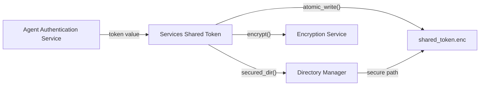
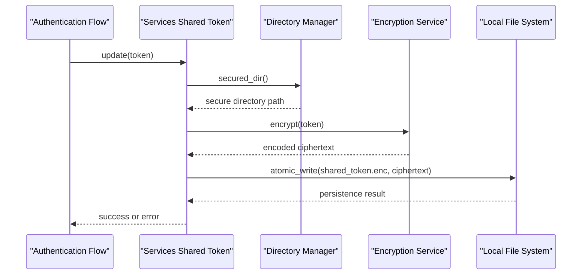
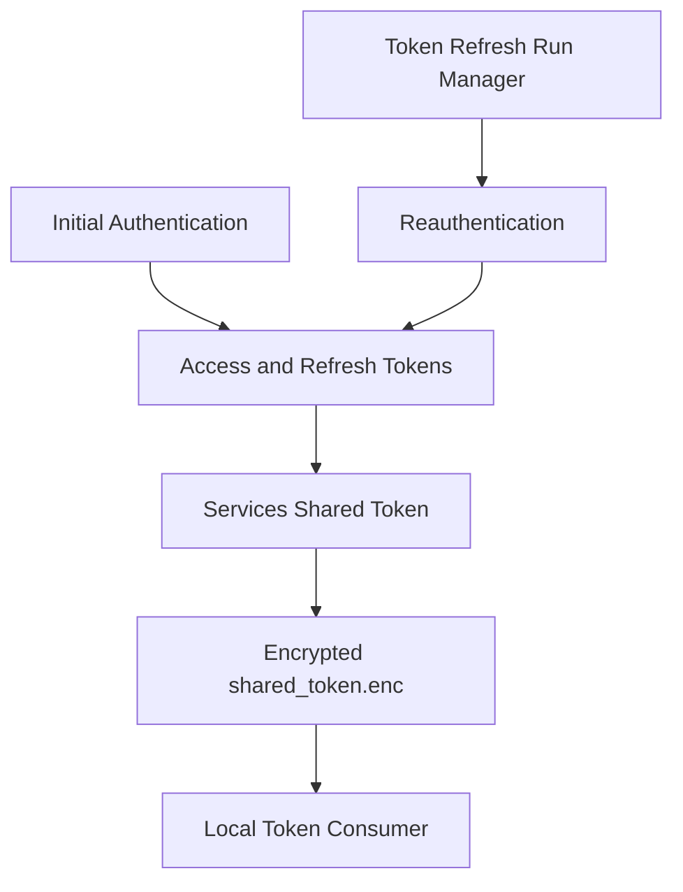

# Services Shared Token

Services Shared Token is an OpenFrame Client library component that writes the current shared access token to a predictable encrypted file for local consumers. It runs in the Rust `openframe_agent_lib` supplied by the OpenFrame OSS Library dependency, rather than being implemented directly in this tenant repository. Its compact responsibility is deliberately narrow: accept a token, encrypt it, and atomically replace `shared_token.enc` in the client secure directory.

The implementation is in [the OpenFrame OSS Library source](https://github.com/flamingo-stack/openframe-oss-lib/blob/7a766f00e4f58b5d89db007b878ac8d6e0c344f4/clients/openframe-client/src/services/shared_token_service.rs). This repository consumes `openframe_agent_lib` version `v0.0.5` and assembles it into the OpenFrame Client runtime.

## Responsibilities and Boundary

`SharedTokenService` owns no token acquisition, expiry calculation, or token parsing. It receives a `DirectoryManager` and an `EncryptionService` when constructed, then exposes one state-changing operation:

| Element | Responsibility |
| --- | --- |
| `new` | Retains the directory and encryption collaborators. |
| `update` | Derives the output path, encrypts the supplied token, and atomically persists the encrypted value. |
| `DirectoryManager` | Supplies the secured directory selected by the platform-aware client runtime. |
| `EncryptionService` | Transforms the plaintext token before it reaches persistent storage. |
| `atomic_write` | Creates the parent directory if required, writes and flushes a temporary file, then replaces the destination. |

The service returns an error if encryption or persistence fails. It does not retain a plaintext token after `update` returns, and it does not provide a read or decrypt API.

## Architecture

The client authentication service is constructed with Services Shared Token, establishing the integration point between authentication and local token publication. The proactive token refresh manager invokes reauthentication on its authentication service and records that a successful refresh updates `shared_token.enc`; this keeps the local encrypted representation aligned with renewed credentials.

## Update Flow

`update` joins the directory path with the fixed filename `shared_token.enc`. The encryption implementation uses AES-256-GCM with a newly generated 12-byte nonce for each operation, prepends that nonce to the ciphertext, and Base64-encodes the combined bytes. Consequently, the serialized output can differ when the same token is written more than once.

The write utility provides crash-resilience properties relevant to credential rotation:

1. It ensures the output directory exists.
2. It writes the encoded ciphertext to a temporary file in the target directory.
3. It flushes that temporary file to storage.
4. It atomically persists the temporary file over the destination, with Windows-specific handling when the target is held.

This ordering avoids replacing a previous token with a partially written file if an ordinary write is interrupted before persistence completes.

## Token Lifecycle Context

Initial authentication obtains credentials through the authentication client and persists the returned access and refresh tokens through the agent configuration service. Reauthentication first attempts refresh-token authentication and falls back to client credentials if that attempt fails. The refresh manager performs a refresh at startup so the shared token file is valid before tools connect, then schedules subsequent refreshes and retries failures at its configured retry interval. During tenant-deactivation suspension, it backs off and uses reauthentication as its recovery probe.

Services Shared Token itself is synchronous and does not schedule work. Authentication and refresh orchestration decide *when* a new token becomes available; this module makes the handoff durable for local use.

## Security and Operational Considerations

- **Plaintext boundary:** Pass token material directly to `update`; do not log the argument or the encrypted payload. The service's interface accepts a Rust `String`, so callers should minimize unnecessary copies and ownership transfers.
- **Storage location:** The service relies on `DirectoryManager.secured_dir()` rather than accepting a caller-selected path. Directory setup and permissions are therefore platform concerns managed outside this module.
- **File permissions:** On Unix, the shared atomic-write helper changes the temporary file to mode `0644` before replacement. Encryption protects file contents, but maintainers should validate host-level directory access controls and treat the file as sensitive credential material.
- **Failure propagation:** A failed encryption step prevents any write. A failed atomic persistence operation is returned to the caller, which must apply its authentication or refresh retry policy.
- **No cleanup policy:** This module only overwrites the current file. Provisioning, deactivation, and uninstallation flows own any removal or lifecycle policy for the token artifact.

## Maintenance Guide

When changing this component, preserve these invariants:

1. Keep the fixed artifact name and secured-directory resolution consistent with local consumers.
2. Encrypt before invoking the write operation; never introduce a plaintext fallback.
3. Preserve atomic replacement rather than writing directly to the target path.
4. Return contextual failures to the authentication layer rather than silently suppressing them.
5. Coordinate any file-format change with every client-side consumer, because the persisted value is an interoperability boundary.

The implementation has no public network endpoint and no standalone background task. Its observable contract is the encrypted `shared_token.enc` artifact produced after a successful update.