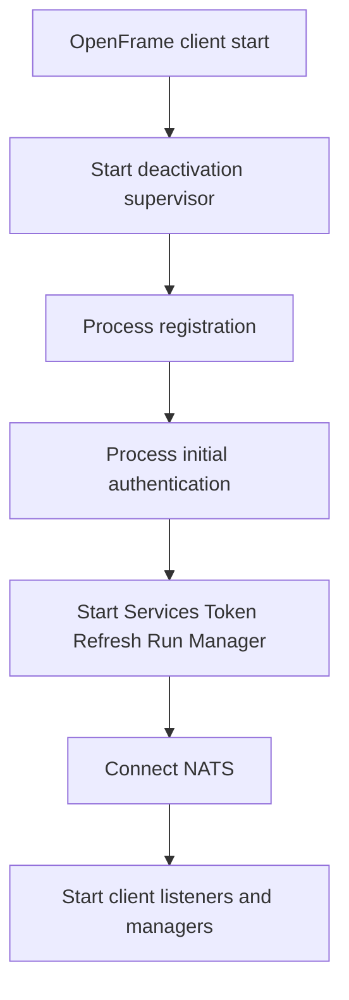
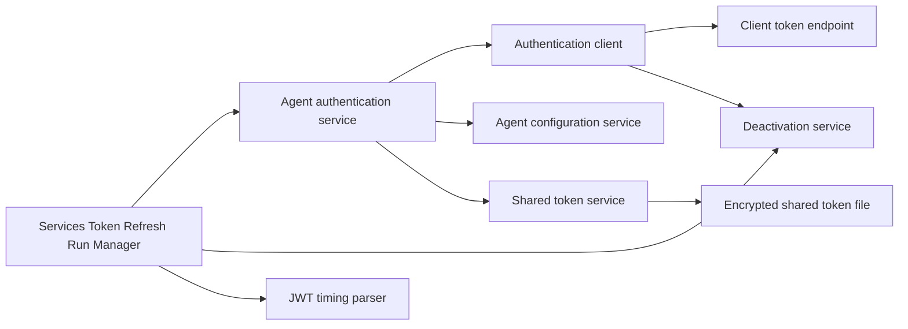
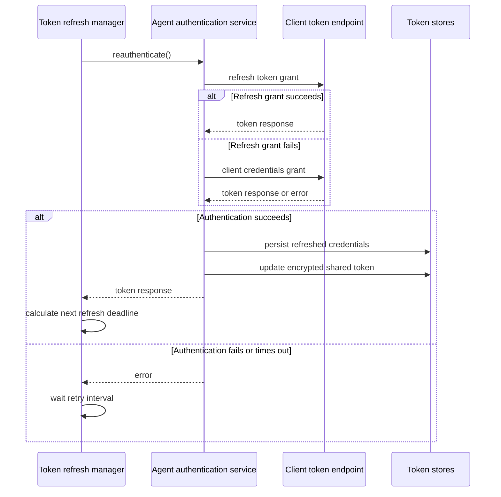
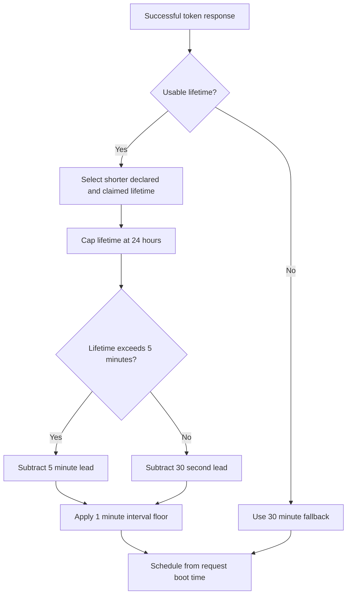
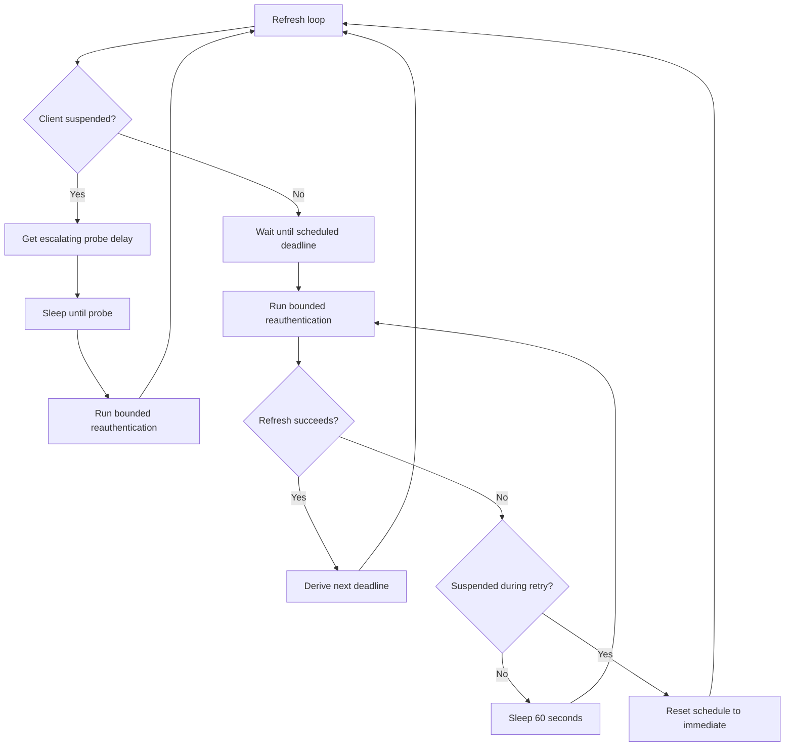

# Services Token Refresh Run Manager

Services Token Refresh Run Manager keeps an installed OpenFrame client authenticated after startup. It launches a background Tokio task that refreshes the device access token proactively, before its expiry, and relies on the authentication service to persist the resulting credentials and update the encrypted shared token used by connected tools. The implementation is supplied by the `openframe_agent_lib` dependency from OpenFrame OSS Library and is run by this repository's OpenFrame client.

The implementation is defined in [OpenFrame OSS Library token refresh source](https://github.com/flamingo-stack/openframe-oss-lib/blob/7a766f00e4f58b5d89db007b878ac8d6e0c344f4/clients/openframe-client/src/services/token_refresh_run_manager.rs).

## Responsibilities

- Start a single asynchronous, long-running refresh loop after the client completes startup authentication.
- Invoke `AgentAuthService.reauthenticate()` immediately after the manager starts, rather than trusting the lifetime of a token loaded from disk.
- Calculate the next refresh point from the newly returned token lifetime, preserving a safety lead before expiry.
- Write a renewed access token to the shared encrypted token location through the authentication service, allowing tools to continue using valid credentials without a NATS reconnection.
- Bound authentication calls to 30 seconds and retry failed refreshes every 60 seconds.
- Coordinate refresh behavior with tenant deactivation, using progressively delayed probe attempts while the client is suspended.
- Remain resilient to device wall-clock changes, long sleeps, and malformed or implausible token lifetime data.

## Placement in Client Startup

The OpenFrame client starts its deactivation supervisor before authentication. It processes registration and initial authentication, then starts Services Token Refresh Run Manager before connecting the NATS client and before starting the command and execution listeners. This sequencing ensures the shared token is refreshed promptly and is available before dependent client tools connect.

## Architecture and Dependencies

`TokenRefreshRunManager` contains cloned handles to `AgentAuthService` and `DeactivationService`, plus immutable internal timing settings. Its public surface is deliberately small:

| Component | Role |
|---|---|
| `TokenRefreshRunManager.new` | Creates the manager with the authentication service, deactivation service, and production refresh timing defaults. |
| `TokenRefreshRunManager.start` | Logs startup and spawns the asynchronous refresh loop. It returns immediately to its caller. |
| `AgentAuthService.reauthenticate` | Attempts refresh-token authentication first; if that fails, it falls back to the device client credentials. |
| `AuthClient` | Sends form-encoded requests to the client token endpoint and reports returned gateway status to the deactivation service. |
| `AgentConfigurationService` | Stores the access and refresh tokens; token updates are serialized by its write lock. |
| `SharedTokenService` | Encrypts the access token and atomically writes `shared_token.enc` in the secured directory. |
| `DeactivationService` | Exposes the suspension state and escalating probe delay used when the tenant is gone. |
| JWT utilities | Decode the JWT payload for `exp` and optional `iat` claims, without using it as the sole lifetime source. |

## Refresh Lifecycle

On startup, the manager creates a schedule that is immediately due. It therefore performs one reauthentication before waiting for an expiry-derived deadline. A successful refresh produces an `AgentTokenResponse` containing an access token, refresh token, token type, and optional `expires_in` value.

The refresh request follows this authentication order:

1. Read the stored refresh token and submit a `refresh_token` grant.
2. If that path returns an error, read persisted client credentials and submit a `client_credentials` grant.
3. On a successful response, the authentication service updates persisted access and refresh tokens and refreshes the encrypted shared access token.
4. Use the fresh response to calculate the next due time.

## Scheduling Model

### Lifetime selection

The manager treats the token response as untrusted timing input. When both sources are available, it uses the shorter of:

- positive `expires_in` from the token response; and
- the JWT lifetime calculated as `exp - iat`.

When only one source is available, it uses that value. The selected value is capped at 24 hours so an implausible claim cannot create an excessive timer. If neither source is usable, the manager logs a warning and applies a 30-minute fallback interval.

For a known lifetime, the manager schedules the next refresh at the token lifetime minus a lead time:

- For a token lasting more than five minutes, the lead is five minutes.
- For a token lasting five minutes or less, the lead is 30 seconds.
- Regardless of claims and lead time, the interval cannot be shorter than one minute.

The deadline is measured from the instant immediately before `reauthenticate()` is invoked. As a result, network latency consumes part of the interval rather than moving the deadline later and reducing the intended safety margin.

### Clock and sleep handling

The manager uses a boot-time clock for deadlines instead of relying on the wall clock or Tokio's `Instant` alone. On Linux it reads `CLOCK_BOOTTIME`; on Apple platforms it reads `CLOCK_MONOTONIC`; on other supported platforms it uses the platform `Instant` behavior. These choices allow elapsed time to continue through system sleep and hibernation.

Waiting is performed in at most 60-second slices. After each slice, the manager rereads the boot-time clock. This avoids a prolonged system sleep silently extending the refresh deadline on platforms where Tokio timers do not advance during sleep. A sleep can delay an already due refresh by no more than the configured slice duration.

The manager only uses wall-clock time to identify suspicious clock skew. If the device's request-time clock differs from the issued-at claim by at least five minutes, it emits a warning. The calculated lifetime and boot-time deadline remain independent of the local wall-clock adjustment.

## Failure, Timeout, and Suspension Behavior

Each call to `reauthenticate()` has a 30-second timeout. A returned error or timeout is logged and followed by a 60-second retry delay. The retry loop continues until a refresh succeeds or tenant suspension becomes active.

A token endpoint response is also passed to the deactivation service. A successful response lets that service record gateway health, while an HTTP 410 response can place the client into tenant-gone suspension. While suspended, Services Token Refresh Run Manager does not run its normal expiry schedule or rapid retry loop. Instead, it is the single authentication probe loop:

1. Ask `DeactivationService` for the next probe delay.
2. Sleep for that delay; the deactivation service doubles successive delays up to its configured cap.
3. Run a bounded reauthentication attempt.
4. If authentication succeeds, derive a new normal refresh schedule from the returned token.
5. Continue the outer loop so the deactivation state determines whether normal operation has resumed or another probe is needed.

If suspension begins during normal failure retries, the manager resets its schedule to immediate and returns control to the suspension path instead of performing another fixed-interval retry.

## Operational Characteristics

- **No exposed endpoint:** this is an in-process client background manager, not an HTTP or NATS listener.
- **Immediate validation at process start:** the first refresh avoids relying on an on-disk token's remaining lifetime and establishes a current shared token before tools connect.
- **Bounded work:** both retry cadence and request duration are fixed, preventing an authentication stall from blocking the loop indefinitely.
- **Defensive timing:** invalid JWT decoding, missing timing fields, negative or zero lifetime values, enormous lifetimes, clock steps, and sleeping devices are all handled without creating a hot loop or an unbounded delay.
- **Observable decisions:** startup, successful proactive refresh, pending normal refresh delay, unknown lifetime, significant clock skew, errors, timeouts, and suspension probe delays are emitted through tracing logs.

## Maintenance Considerations

Changes to this manager should preserve these invariants:

1. Never schedule a successful refresh less than the minimum interval after its request start.
2. Keep the refresh deadline independent of mutable device wall-clock time.
3. Preserve timeout and retry behavior so network failures cannot become a busy loop.
4. Treat server responses as the source of token state, and keep persistence plus encrypted shared-token updates within the authentication service rather than duplicating them in the manager.
5. Keep suspended-client probing distinct from ordinary refresh retries so deactivation backoff remains authoritative.
6. Validate behavior across Linux, macOS, and Windows, particularly sleep and hibernation semantics.
