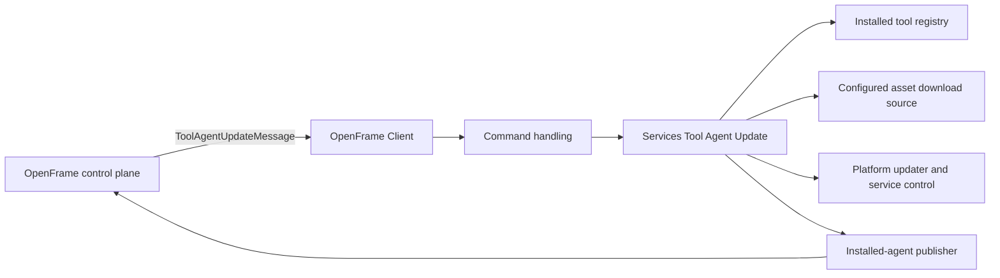
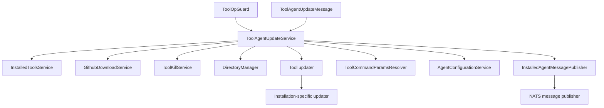
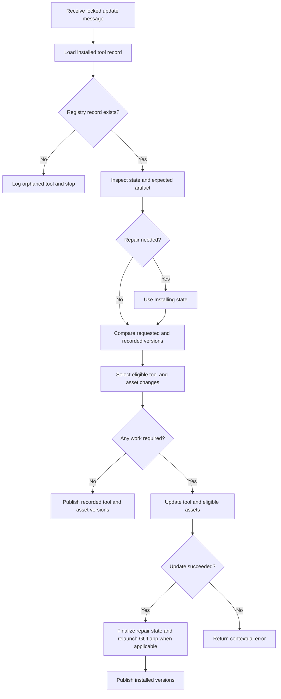
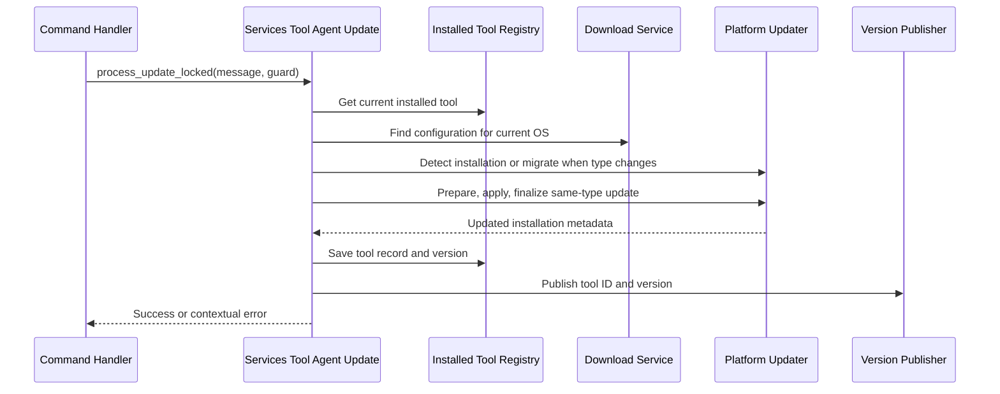
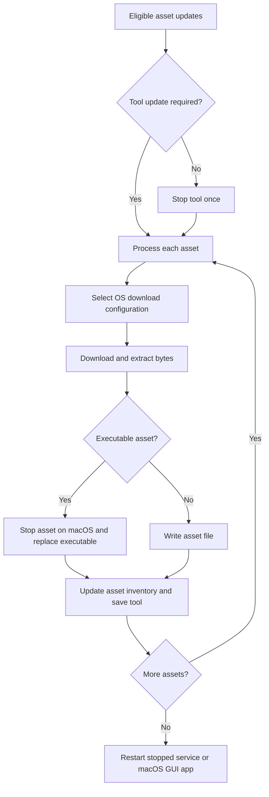

# Services Tool Agent Update

Services Tool Agent Update is the endpoint-side orchestration service that brings an already registered integrated tool, and its optional assets, to the versions requested by a `ToolAgentUpdateMessage`. It is implemented by `ToolAgentUpdateService` in the OpenFrame OSS Library's Rust client and runs as part of this repository's OpenFrame Client deployment.

Its responsibilities are deliberately narrow: reconcile a persisted tool record with a requested version, repair interrupted or missing installations, coordinate platform-specific replacement or migration, persist the resulting inventory, and publish the versions observed on the machine. It does not create an absent tool record; a separate installation delivery is required for that case.

**Implementation source:** [tool agent update service](https://github.com/flamingo-stack/openframe-oss-lib/blob/7a766f00e4f58b5d89db007b878ac8d6e0c344f4/clients/openframe-client/src/services/tool_agent_update_service.rs)

## Scope and responsibilities

The service receives a tool identifier, a target tool version, operating-system-specific download configurations, and optional asset updates. It then:

- Loads the current `InstalledTool` record through `InstalledToolsService`.
- Treats an `Installing` record or a missing expected executable or application artifact as a repair condition.
- Uses version comparison and the `ALLOW_DOWNGRADE` configuration to avoid stale downgrade deliveries, except when repair is required.
- Selects the applicable download configuration for the current operating system.
- Uses the platform updater to perform same-type updates or a migration when the installation type changes.
- Replaces changed assets, stopping the tool once when only assets change.
- Persists installation metadata only after the relevant work completes.
- Publishes tool and asset versions through the installed-agent message publisher when a machine ID is available.

## Runtime placement

The implementation is supplied by the `openframe_agent_lib` Cargo dependency, version `v0.0.5`, from the OpenFrame OSS Library. The tenant repository publishes the `openframe_client` artifact and deploys the OpenFrame Client image; the service therefore executes on managed endpoints rather than in the tenant-side Java services.

The module works alongside, but does not replace, the client installation, tool lifecycle, command-parameter, process-control, and messaging services. Those collaborators are injected when `ToolAgentUpdateService::new` constructs the service.

## Component model

| Component | Role |
|---|---|
| `ToolAgentUpdateService` | Stateful coordinator for tool and per-asset updates. |
| `new` | Stores dependencies and immediately ensures the managed directories exist. Directory-creation failure is contextualized and unwrapped during construction. |
| `process_update_locked` | Main asynchronous update entry point. It accepts a `ToolOpGuard`, so the caller provides a held per-tool operation lock for the duration of processing. |
| `publish_installed_versions` | Reads all persisted tools and reports versions for entries whose state is `Installed`, including their assets. |
| `ToolAgentUpdateMessage` | Input contract containing `tool_agent_id`, the requested tool `version`, a list of download configurations, and optional `AssetUpdate` entries. |
| `InstalledTool` and `InstalledAsset` | Persisted local inventory used to determine repair and version deltas. |
| `ToolUpdaterDeps` | Platform updater dependencies: download service, tool killer, directory manager, and command-parameter resolver. |

## Dependency architecture

### Persistence and serialization

`InstalledToolsService` supplies the local tool registry and serializes access with a writer mutex. Services Tool Agent Update retrieves a record by tool-agent identifier, mutates installation type, version, asset inventory, and state as needed, then saves the full record.

The update path does not reconstruct an untracked installation. When no record exists, it logs the tool as orphaned and returns successfully without download or replacement. This prevents a lean update delivery from guessing installation details; the tool installation workflow is expected to establish the record.

### Download selection and platform delegation

`GithubDownloadService` chooses a `DownloadConfiguration` compatible with the current OS and retrieves or extracts its payload. A missing compatible configuration is an error. The service delegates actual tool replacement to the platform updater:

- `run_update` executes prepare, apply, and finalize phases. If apply fails, it attempts rollback and returns the update error.
- Installation-type changes use migration logic rather than the same-type updater. Before migrating, the service tries to detect the actual existing installation, allowing stale metadata to be corrected without an unnecessary migration.
- The selected updater handles service, standard, or GUI-application installation behavior. Services Tool Agent Update remains responsible for recording the successful result and reporting its version.

## Update decision flow

### Repair and version rules

A record needs repair when either of these conditions is true:

1. Its persisted state is `Installing`, indicating an interrupted installation or reinstallation.
2. Its expected executable or GUI application artifact is not present at the directory-manager-derived path.

Repair forces tool processing even when the requested version equals the recorded version. If the artifact is missing, the service makes a best-effort transition to `Installing` before replacement. After a successful repair, it makes a best-effort transition to `Installed`.

For normal updates, the service compares recorded and requested tool and asset versions. When semantic comparison is available, the `ALLOW_DOWNGRADE` setting determines whether a request recognized by the comparator as a downgrade is rejected. If either version cannot be interpreted as semantic version data, the service warns and falls back to string inequality. Assets without a version or without any download configurations are excluded from the asset-update candidate set.

When neither the tool nor any asset needs work, the service republishes the currently persisted version inventory rather than downloading anything.

## Tool update and migration processing

For a detected migration, the service updates the in-memory version and installation type, saves the record, registers Windows GUI autorun when relevant, publishes the tool version, and finishes that tool update path. For a same-type update, it delegates to `run_update`, accepts optional replacement installation metadata, and then checks whether the previous aside binary has been cleared.

If the old process still holds the pre-update binary, the new bytes may already be on disk, but the service deliberately retains the previously recorded version. This avoids reporting a new version while the old executable is still running. Once the aside-binary check succeeds, it writes the new version to the registry, registers Windows GUI autorun if appropriate, and publishes the installed-agent event.

## Asset update processing

Assets are independently versioned files associated with a tool. Asset-only work stops the installed tool once before processing the candidate assets. The service then processes assets sequentially and stops at the first failure.

The executable property comes from a pre-existing persisted asset when one exists; otherwise it comes from the update message. Executable assets use atomic executable replacement behavior, and macOS stops the asset before replacement. Non-executable assets are written directly. Each completed asset updates the persisted asset list and triggers a version publication using the asset identifier and version.

If assets alone required stopping a service installation, the service tries to start that service after asset processing. A restart failure is logged rather than returned, meaning the completed asset update remains recorded. On macOS, an asset-only GUI application update attempts to launch the tool through `ToolRunManager`. If a Windows GUI application was already a GUI application before a successful overall update, the service makes a one-time user-session relaunch attempt; future logons are covered by the registered autorun entry.

## Version reporting

`publish_installed_versions` is suitable for startup or reconciliation reporting. It reads all local records, filters out anything not in the `Installed` state, then publishes:

1. The tool-agent identifier with the tool version.
2. Every associated asset identifier with its asset version.

A report first obtains the machine ID from `AgentConfigurationService`. Failure to read that ID, failure to publish, or failure to list the local registry is logged as a warning. These reporting failures do not roll back a completed update.

## Failure behavior and operational implications

| Situation | Behavior |
|---|---|
| No local registry record | Logs an orphaned-tool warning and exits without modification. |
| No configuration for the current OS | Returns an error with context naming the tool or asset. |
| Interrupted install or missing artifact | Performs repair even when versions otherwise match. |
| Stale downgrade delivery | Skips the downgrade when disabled by configuration, while allowing other eligible assets to be considered. |
| Tool updater apply failure | The platform updater attempts rollback and returns an error. |
| Asset failure | Stops the remaining asset loop and returns the error. |
| Unable to clear aside binary | Keeps the recorded tool version unchanged and returns successful tool processing. |
| Inventory save failure | Returns an error; callers should treat the requested update as not durably reconciled. |
| Version-publication failure | Warns only; it does not change update success. |

## Concurrency and state integrity

The public processing method requires a `ToolOpGuard`. The guard represents a held tool-operation lock supplied by the surrounding command workflow, preventing conflicting operations on the same tool from entering this update path concurrently. The local registry adds serialized writes, while the persisted `ToolRecordState` provides recovery context after interruption.

Maintainers should preserve these invariants when changing the service:

- Do not update an unknown tool from a lean update message.
- Do not mark the new tool version as active before the updater completes and the aside-binary check passes.
- Keep tool and asset inventory saves coupled to their successful on-disk changes.
- Continue treating missing artifacts and `Installing` state as repair triggers.
- Keep version reporting non-fatal so a transient messaging outage does not undo a local update.
- Preserve platform-specific lifecycle handling for services and GUI applications.

## Source-level maintenance guide

The constructor has eight collaborators, reflecting the service's role as an orchestration boundary. Changes are safest when they remain in one of these layers:

- **Decision logic:** repair detection, version eligibility, and selection of tool or asset work.
- **Platform work:** updater, migrator, binary writer, process stopping, service restart, autorun, and user-session launch.
- **State work:** `InstalledTool`, asset list, installation type, and record state persistence.
- **Reporting:** machine-ID lookup and installed-agent version messages.

The service logs tool and asset identifiers, versions, paths, service names, and recoverable reporting failures. These fields are the primary diagnostic trail for determining whether a delivery was rejected, repaired, downloaded, applied, persisted, restarted, or only partially reported.
