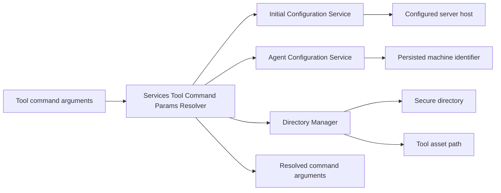
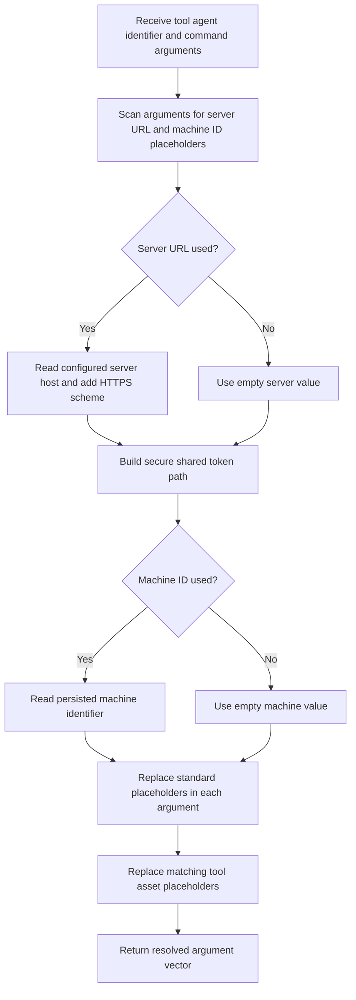
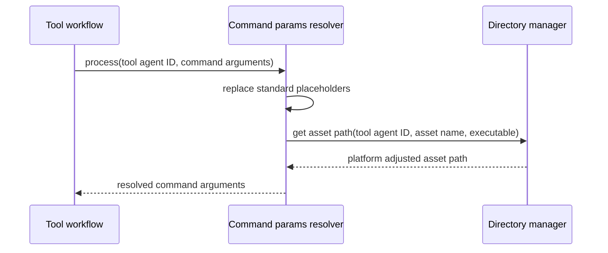
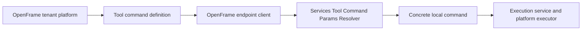

# Services Tool Command Params Resolver

Services Tool Command Params Resolver prepares a tool command immediately before the OpenFrame client runs it. It replaces supported configuration and asset placeholders in each command argument with values that are valid on the current device. The implementation is supplied by the OpenFrame OSS Library's Rust client code and is executed by this repository through the `openframe_client` Cargo dependency.

The resolver is intentionally a transformation step: it does not launch processes, download assets, or persist configuration. Its output is a new vector of command arguments, suitable for the execution path that owns those responsibilities.

**Implementation source:** [tool command params resolver](https://github.com/flamingo-stack/openframe-oss-lib/blob/7a766f00e4f58b5d89db007b878ac8d6e0c344f4/clients/openframe-client/src/services/tool_command_params_resolver.rs)

## Responsibilities

- Resolve the configured server host when an argument contains the server URL placeholder.
- Build the encrypted shared-token file location from the client secure directory.
- Read the registered machine identifier only when it is needed.
- Substitute the fixed OpenFrame secret value used by the implementation.
- Expand per-tool asset references, including the platform-specific executable suffix behavior provided by `DirectoryManager`.
- Preserve unrecognized text and placeholders that do not match the supported forms.

## Architecture

`ToolCommandParamsResolver` is constructed with three services. It has no mutable internal state; cloning it copies the service handles used for each resolution.

### Constructor dependencies

| Dependency | Used for | Resolution behavior |
| --- | --- | --- |
| `DirectoryManager` | Token and tool-asset locations | `secured_dir()` supplies the token directory; `get_asset_path()` creates a path scoped to the tool agent. |
| `InitialConfigurationService` | Server identity | `get_server_url()` reads the stored `server_host` value. |
| `AgentConfigurationService` | Device identity | `get_machine_id()` reads the persisted machine identifier. |

The resolver does not validate that a referenced asset exists, that the resulting binary is executable, or that its command can safely run. Those checks and lifecycle actions belong to the installation, tool operation, and execution portions of the client.

## Supported Placeholders

Standard substitutions operate on every argument independently. An argument can contain literal text before or after a placeholder, and repeated occurrences are replaced by Rust string replacement semantics.

| Placeholder | Replacement | Notes |
| --- | --- | --- |
| `${client.serverUrl}` | `https://` followed by the configured server host | The resolver queries the initial configuration only if this placeholder appears in at least one argument. |
| `${client.openframeSecret}` | `12345678901234567890123456789012` | This is a fixed literal in the current implementation, not a value fetched from configuration. Avoid logging resolved arguments that contain it. |
| `${client.openframeTokenPath}` | Secure-directory path joined with `shared_token.enc` | The resolver builds the path regardless of whether the placeholder occurs. |
| `${client.machineId}` | Persisted machine identifier | The resolver queries agent configuration only if this placeholder appears in at least one argument. |
| `${client.assetPath.NAME}` | Asset path for `NAME` under the specified tool agent | Dynamic form; `NAME` is captured up to the next closing brace. |

The source comment describes the asset form as an assets-path placeholder, but the regular expression and replacement syntax use the singular `assetPath` segment. Commands must use `${client.assetPath.NAME}` exactly.

## Resolution Flow

`process()` returns an error if a required configuration read fails. For example, a malformed or inaccessible initial configuration prevents a command containing `${client.serverUrl}` from being resolved. Conversely, a command that does not use the server or machine placeholders avoids the corresponding configuration read.

## Asset Path Resolution

Asset substitution is performed after standard replacement. For every match of `${client.assetPath.NAME}`, the resolver calls `DirectoryManager.get_asset_path(tool_agent_id, NAME, true)`.

This establishes the following behavior:

1. Asset paths are scoped by the provided tool agent identifier, preventing the resolver from treating an asset name as a global command path.
2. Assets referenced from commands are marked executable.
3. On Windows, an executable asset name that does not already end in `.exe` receives that extension before the path is built.
4. The resulting path is converted to a lossy string representation for insertion into the argument.

Because the asset regular expression accepts every non-closing-brace character in `NAME`, this module treats the captured value as an asset filename and delegates path construction to `DirectoryManager`. Command authors should provide a simple asset filename rather than rely on path fragments or traversal-like input.

## Component Interaction and System Position

The module sits in the endpoint client supplied by the OpenFrame OSS Library. The tenant repository consumes that library at version `v0.0.5` as the `openframe_agent_lib` Cargo artifact. This repository deploys the broader OpenFrame client service, while the resolver runs locally in the endpoint client process.

The neighboring URL parameter resolver has a narrower responsibility: it expands only the server URL in a tool URL path. Services Tool Command Params Resolver instead handles command-argument values, device identity, the token path, a fixed secret, and executable asset locations. Keep URL and command argument substitution separate so each consumer receives the format it expects.

## Operational and Security Considerations

- Treat resolved command arguments as sensitive. They can contain a secret literal, a machine identifier, an absolute secure-file path, and the configured server address.
- The token path points to `shared_token.enc`; resolution exposes the location, not the token contents.
- The server host is prefixed with `https://` by this module. Configuration should store the host in the expected host form so callers do not accidentally create a duplicated scheme.
- A missing tool asset is not detected during substitution. Failures caused by an absent executable occur later when the tool is invoked.
- Placeholder matching is textual and case-sensitive. Misspellings or unsupported placeholders remain unchanged and can be passed to the eventual command executor.

## Maintenance Guidance

When adding a placeholder, update the detection logic and the per-argument transformation together. Detection determines whether a configuration dependency is read, while transformation determines the output value. Add tests for:

- Arguments with no placeholders, one placeholder, and multiple different placeholders.
- Multiple dynamic asset references in one argument.
- Windows executable suffix insertion and filenames that already end in `.exe`.
- Propagation of configuration-read failures when a placeholder requires the unavailable value.
- Sensitive-value handling in logs around the call site.

The resolver's public surface is deliberately small:

| Element | Purpose |
| --- | --- |
| `ToolCommandParamsResolver` | Holds the directory and configuration dependencies. |
| `new()` | Constructs the resolver from its three dependencies. |
| `process()` | Converts a tool agent identifier and argument vector into resolved arguments, or returns an error. |
