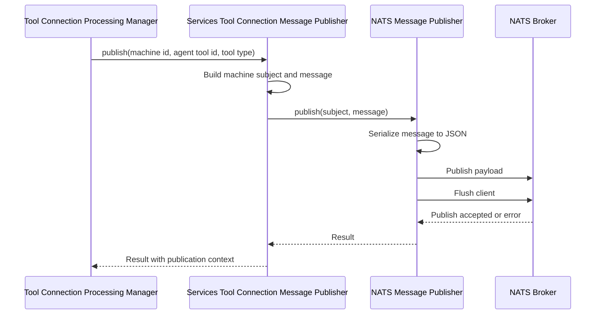
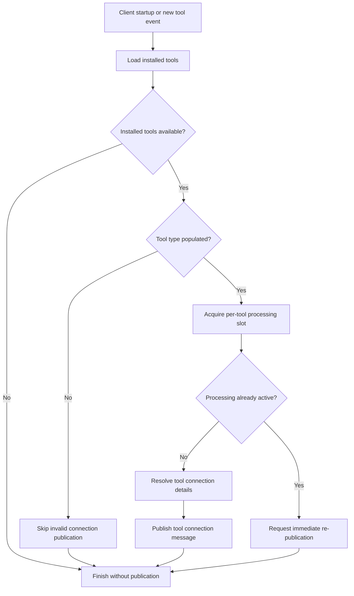

# Services Tool Connection Message Publisher

Services Tool Connection Message Publisher is the OpenFrame Client agent component that announces a locally installed integrated tool's connection identity to the platform. It is implemented by `ToolConnectionMessagePublisher` in the OpenFrame OSS Library's Rust client and is assembled at run time by this repository through the `openframe_client` dependency. Its narrow responsibility is to turn a machine identifier, tool-agent identifier, and tool type into a JSON message on a machine-scoped NATS subject.

The implementation lives in the OpenFrame OSS Library: [tool_connection_message_publisher.rs](https://github.com/flamingo-stack/openframe-oss-lib/blob/7a766f00e4f58b5d89db007b878ac8d6e0c344f4/clients/openframe-client/src/services/tool_connection_message_publisher.rs).

## Purpose and Scope

An integrated tool can be installed or re-keyed independently of the client agent. The platform therefore needs a current association between:

- the OpenFrame machine that hosts the tool;
- the tool-agent identifier assigned to that installation; and
- the tool type needed by the backend to interpret the association.

The publisher supplies that association as a one-way event. It does not discover installations, persist connection records, resolve command parameters, or establish a remote-access session. Those responsibilities remain with the surrounding tool-connection processing, local persistence, and server-side message listener components.

## Architecture

```mermaid
flowchart LR
    ProcessingManager["Tool Connection Processing Manager"] -->|"machine and tool identity"| Publisher["Services Tool Connection Message Publisher"]
    Publisher -->|"ToolConnectionMessage"| NatsPublisher["NATS Message Publisher"]
    NatsPublisher -->|"publish and flush"| NatsBroker["NATS Broker"]
    NatsBroker -->|"machine scoped subject"| BackendListener["Client Core Tool Connection Listener"]
    BackendListener -->|"connection update"| PlatformState["Platform Tool Connection State"]
```



At the agent boundary, the module is a small adapter over `NatsMessagePublisher`. It owns that publisher by value and derives `Clone`, allowing the publishing capability to be passed into asynchronous processing without duplicating message-construction rules.

### Collaborating Components

| Component | Responsibility | Relationship to this module |
|---|---|---|
| `ToolConnectionProcessingManager` | Reads installed tools, avoids duplicate per-tool processing, and re-resolves connection information when the client starts or a tool is added. | Calls `publish` after it has resolved the tool identity. |
| `ToolConnectionService` | Reads and writes locally persisted `ToolConnection` records. | Provides durable connection data to the broader processing workflow; the publisher itself does not access it. |
| `ToolConnectionMessage` | Transport model containing `agent_tool_id` and `tool_type`. | Constructed immediately before publication. |
| `NatsMessagePublisher` | Serializes a serializable payload to JSON, gets the active NATS client, publishes, and flushes. | Provides the actual transport operation. |
| Client Core `ToolConnectionListener` | Server-side NATS listener listed in the client-core server module. | Consumes the platform-side connection announcement. |

## Publication Contract

### Subject

For each call, the publisher builds this NATS subject:

```text
machine.{machine_id}.tool-connection
```

The machine identifier scopes the event to one managed machine. The subject is computed locally rather than being passed by callers, which centralizes the naming convention and prevents callers from accidentally publishing a tool-connection payload to an unrelated machine subject.

### Payload

The publisher constructs `ToolConnectionMessage` with the supplied identifiers. The NATS publisher serializes this Rust model to JSON before sending it.

```json
{
  "agent_tool_id": "tool-agent-identifier",
  "tool_type": "integrated-tool-type"
}
```

`agent_tool_id` identifies the installed tool agent. `tool_type` categorizes the integration. The publisher does not validate these values; validation belongs to the processing flow and backend. In particular, the processing manager skips installed tools with an empty tool type because the backend rejects them.

## Publication Flow



The detailed behavior is:

1. `publish` derives the machine-scoped subject using the machine identifier.
2. It builds a `ToolConnectionMessage` from the tool-agent identifier and tool type.
3. It delegates to `NatsMessagePublisher.publish`.
4. The transport serializes the message with JSON serialization, retrieves the current NATS client from `NatsConnectionManager`, publishes the payload, then flushes the client.
5. If delegation fails, the publisher adds context that includes the destination subject: `Failed to publish tool connection message to topic: ...`.

A successful return means that the underlying NATS publish-and-flush operations succeeded. It does **not** mean that the backend listener processed the message. The implementation contains a TODO for waiting for an acknowledgement and retrying on acknowledgement failure; no application-level acknowledgement or retry is currently performed by this module.

## Processing Lifecycle and Re-publication

The publisher is invoked from the adjacent tool-connection processing manager rather than operating a background loop itself.



At startup, `ToolConnectionProcessingManager.run` loads all installed tools and processes eligible entries. Its documented reason for re-resolving and re-publishing on every start is that a tool-agent identifier can change outside the agent, such as after a tool re-key or backend data reset. For a newly installed or reinstalled tool, `run_new_tool` either begins processing or wakes an already-running per-tool loop so that it can publish immediately instead of waiting for its next periodic pass.

## Error Semantics and Operational Considerations

### Failure boundaries

The publisher preserves the failure returned by `NatsMessagePublisher` and adds the target topic to its error context. Failures can therefore arise from:

- JSON serialization of the connection message;
- acquiring the active NATS client from the connection manager;
- publishing to NATS; or
- flushing the NATS client after publishing.

The module does not alter the local installation record or tool connection state as part of publication. Callers must decide how to handle the returned error, including whether to continue processing other tools.

### Delivery guarantees

This path uses `NatsMessagePublisher.publish`, which issues a core NATS publish followed by `flush`. Although the transport layer also exposes an acknowledged JetStream publishing method, this publisher does not use it. Consequently, maintainers should treat the event as a best-effort broker publication with local publish confirmation, not as an end-to-end, acknowledged delivery protocol.

### Identity changes

A tool connection event is intentionally derived from current inputs at publication time. When a tool agent receives a new identifier, rerunning the processing manager republishes the updated association. Avoid caching the subject or payload outside the call because the machine and tool identity are part of the current connection contract.

## Maintenance Guidance

When changing this module:

- Keep subject construction centralized in `build_topic_name` and preserve the `machine.{machine_id}.tool-connection` contract unless the corresponding server-side consumer is migrated in lockstep.
- Keep payload field names aligned with `ToolConnectionMessage`; the NATS publisher serializes the model directly.
- Preserve contextual errors around the delegated transport call so operational logs identify the failed subject.
- Do not claim delivery acknowledgement based on a successful `publish` result. Implement the existing acknowledgement-and-retry TODO only with compatible server-side semantics and idempotency behavior.
- Test both the normal message shape and error propagation from the NATS publisher when changing the transport or message model.

## System Placement

This module is supplied by the `openframe_agent_lib` Cargo dependency at version `v0.0.5`, sourced from the OpenFrame OSS Library. The OpenFrame OSS Tenant repository runs that library as part of its OpenFrame Client service deployment. The tenant configuration supplies NATS as a shared datasource for the client service, while the server-side client-core module includes the `ToolConnectionListener` that participates in the receiving side of this integration.
