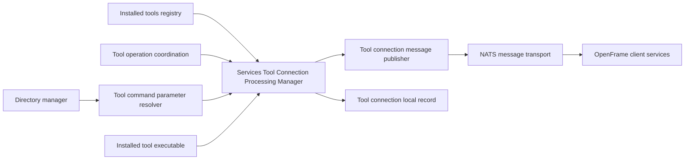
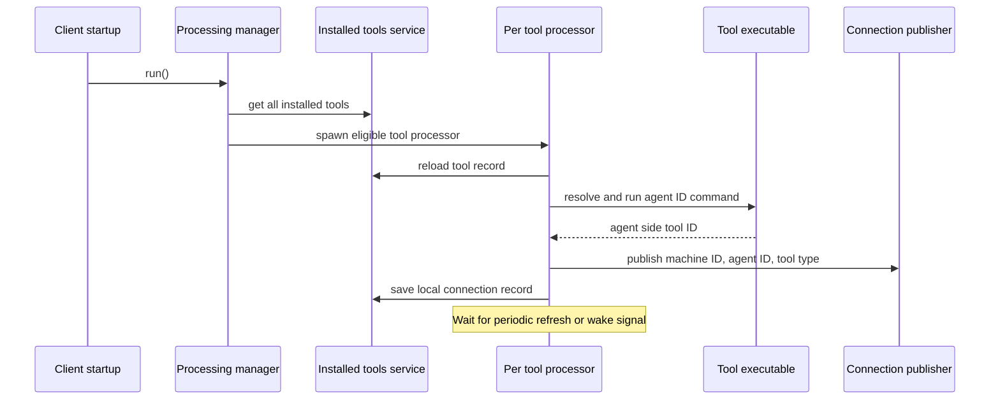
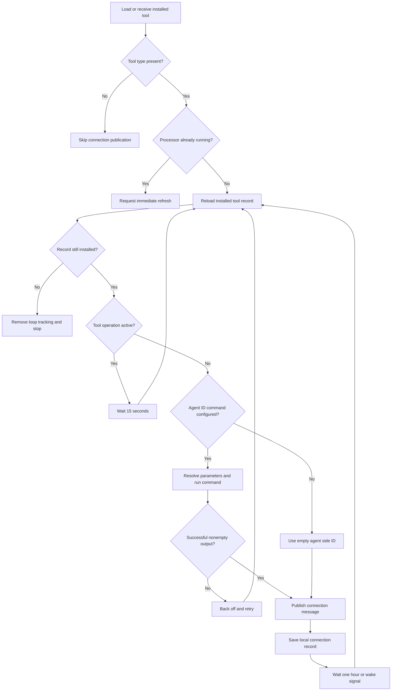

# Services Tool Connection Processing Manager

Services Tool Connection Processing Manager is the OpenFrame Client agent component that continuously resolves each installed integrated tool's agent-side identity and reports the resulting connection to the platform. It is implemented by `ToolConnectionProcessingManager` in the OpenFrame OSS Library's Rust client code, which this repository consumes through the `openframe_agent_lib` dependency.

The manager is deliberately asynchronous: `run` discovers persisted tools and starts a background processor per tool, while `run_new_tool` starts a processor for a newly installed tool or wakes the existing processor for an immediate refresh. This allows tool connection publishing to continue independently of client startup and installation workflows.

**Source:** [tool connection processing manager in OpenFrame OSS Library](https://github.com/flamingo-stack/openframe-oss-lib/blob/7a766f00e4f58b5d89db007b878ac8d6e0c344f4/clients/openframe-client/src/services/tool_connection_processing_manager.rs)

## Responsibilities

The Services Tool Connection Processing Manager:

- Loads installed-tool records at client start and ignores records with an empty tool type because the backend rejects them.
- Ensures one connection-processing loop per tool identifier while providing a wake signal for a reinstall or repeated installation event.
- Refreshes the installed-tool record on every loop iteration, so an update or reinstall supplies current command arguments and installation metadata.
- Defers identity resolution while the corresponding tool agent is marked busy by `ToolOps`.
- Resolves command placeholders, executes the tool's configured agent-ID command, and treats its trimmed standard output as the agent-side tool identifier.
- Publishes the machine ID, resolved agent-side ID, and tool type through the tool connection message publisher.
- Records a successful publication locally as a `ToolConnection` record.
- Re-resolves and republishes periodically, or immediately after a wake signal, to repair backend mappings after a tool re-key or local state change.
- Bounds command and cleanup work to prevent a hung helper process or orphan sweep from blocking the processor indefinitely.

## Position in the Client Agent

The component is part of the runtime assembled by the OpenFrame Client. It bridges locally persisted tool installation state with the message path consumed by the platform's client services. It neither installs a tool nor owns the server-side mapping; it discovers the existing tool identity and reports it.

### Collaborating components

| Component | Role in the connection workflow |
|---|---|
| `InstalledToolsService` | Provides all installed tools at startup and reloads an individual record by tool agent ID before each processing attempt. The fresh record prevents a long-running loop from using stale installation settings. |
| `ToolCommandParamsResolver` | Expands placeholders in agent-ID command arguments. Its directory manager locates the executable and the asset path used by cleanup. |
| `ToolOps` | Indicates whether a tool agent is undergoing a conflicting operation, such as an update. The manager waits rather than resolving an identity during that operation. |
| `AgentConfigurationService` | Supplies the OpenFrame machine ID required in the published connection message. |
| `ToolConnectionMessagePublisher` | Publishes the machine ID, resolved agent-side ID, and tool type over the agent messaging path. |
| `ToolConnectionService` | Persists the local `ToolConnection` record after publication, containing the tool agent ID, agent-side ID, and published state. |
| `DirectoryManager` | Builds executable and asset locations under the tool's managed directory. |
| `ProcessTree` and orphan reaper | Kill a timed-out agent-ID command together with its descendants and clean orphaned `osqueryd` helpers when applicable. |

## Lifecycle and Concurrency

`run` reads all installed tools and starts processing for each eligible tool. It returns after scheduling those background tasks; individual tools continue in their own Tokio tasks. `run_new_tool` follows the same eligibility rules for one record.

The manager uses two shared maps keyed by `tool_id`:

- A running-tool set prevents duplicate background loops.
- A notification map holds one `Notify` handle per loop.

Registration of both structures happens under the same running-tool guard. This avoids a race where a concurrent `run_new_tool` call sees a running loop but cannot find its wake handle. If the loop already exists, `run_new_tool` notifies it, causing a fresh resolution and publication instead of waiting for the normal periodic interval. When a loop stops because its record was removed, it removes its notification entry before clearing its running marker so it cannot remove a successor loop's notification entry.

## Processing Flow

For each eligible tool, the processor performs the following cycle:

1. Reload the installed-tool record using its tool agent ID.
2. Stop the loop if the record no longer exists. If the registry cannot be read, wait 15 seconds and retry rather than acting on uncertain state.
3. Replace the loop's working record with the reloaded record when it has a nonempty tool type.
4. Check `ToolOps`. If an operation is active for this tool agent, defer resolution for 15 seconds.
5. Determine the agent-side ID:
   - If no agent-ID command arguments are configured, use an empty string.
   - Otherwise expand arguments, locate the configured executable, run it with standard input disconnected, and capture both output streams.
6. On a successful, nonempty standard output, use the trimmed output as the agent-side ID.
7. Read the client machine ID and publish the connection tuple: machine ID, agent-side tool ID, and tool type.
8. Save the local `ToolConnection` record. A save failure is logged but does not invalidate an already completed publication.
9. Perform helper cleanup and wait for either the one-hour republish cadence or an immediate wake notification.

## Command Execution and Failure Handling

The agent-ID command is configured by the installed-tool record. The manager executes it with no standard input, piped standard output and error, and a 15-second timeout. On timeout, it kills the attached process tree, not only the immediate child process. This matters for commands that spawn helpers which would otherwise remain alive after the parent is terminated.

An identity-resolution failure includes placeholder expansion errors, command launch errors, timeouts, nonzero exit status, and empty standard output. Failures initially retry after 15 seconds. After more than five consecutive failures, the manager logs the connection as degraded and switches to a 300-second retry cadence. A later successful nonempty command output resets the failure counter.

Publication failures and machine-ID lookup failures retain the normal 15-second retry delay. A successful message publication is not rolled back when local record persistence fails because the remote message has already been delivered to the publisher path.

### Orphan helper cleanup

Some tool commands can launch `osqueryd` via the `${client.assetPath.osqueryd}` placeholder. For those tools only, the manager attempts to reap orphaned copies of that asset before processing, after resolution failures or timeouts, and after publication. The sweep has a 30-second upper bound and failures are logged without stopping the connection loop. Tools that do not reference that asset receive no orphan-reaping work.

On Windows, a timeout for a service-installed tool also records whether the service instance is running, aiding diagnosis of a possible service-held database or hung identity command. Other platforms and non-service installations report no service-state value.

## Persistent and Message Data

The manager uses two distinct representations:

| Data | Source or destination | Meaning |
|---|---|---|
| `InstalledTool` | Installed-tools registry | Configuration and current installation state, including tool IDs, type, executable installation details, agent-ID command arguments, run arguments, and assets. |
| Resolved agent-side tool ID | Agent-ID command standard output | The trimmed nonempty identity reported by the installed tool. It may be empty only when the tool has no configured ID command. |
| Machine ID | Agent configuration | The OpenFrame client machine identity paired with the tool connection. |
| Tool connection message | Message publisher | The remote report composed from machine ID, agent-side tool ID, and tool type. |
| `ToolConnection` | Local connection service | A post-publication local record containing tool agent ID, resolved agent-side ID, and a `published` marker. |

## Operational Notes

- A missing tool type is a configuration issue: the manager skips the record because the backend rejects empty tool types.
- A tool removal is detected on the next registry read and ends its processor. There is no explicit cancellation channel in this component.
- An update or reinstall is safe to trigger while processing is active: the loop reloads current state and a repeated new-tool event wakes the loop immediately.
- The regular one-hour republish interval is intentional. It allows the platform mapping to converge after an external tool re-key or a backend-side state loss without requiring client restart.
- Degraded resolution remains retrying rather than becoming terminal. Restoring the tool or its node identity can therefore self-heal the connection.
- Logs identify the tool ID around retries, command outcomes, degraded state, publication, local persistence failures, and termination after uninstall. These events are the primary signals for diagnosis.

## Maintenance Boundaries

Changes to this manager should preserve these behavioral contracts:

1. Never run competing agent-ID resolution loops for the same tool ID.
2. Revalidate installation state before each attempt so uninstalled or changed tools are not processed with stale data.
3. Do not resolve an ID while a tool operation owns the tool agent.
4. Bound external process execution and terminate descendants on timeout.
5. Publish a connection only with a nonempty tool type.
6. Keep publication retryable and preserve periodic reconciliation after successful publication.
7. Keep orphan cleanup scoped to tools that actually launch the relevant asset.
