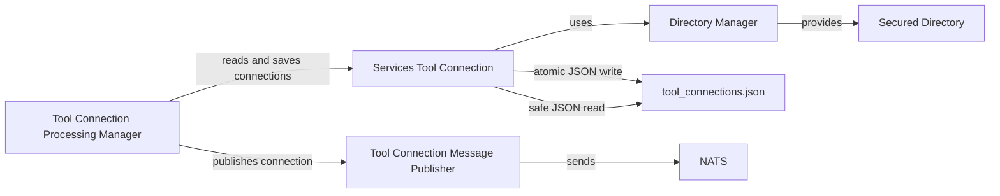
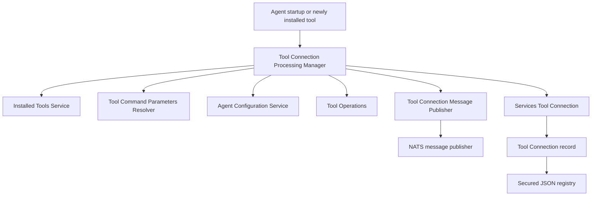
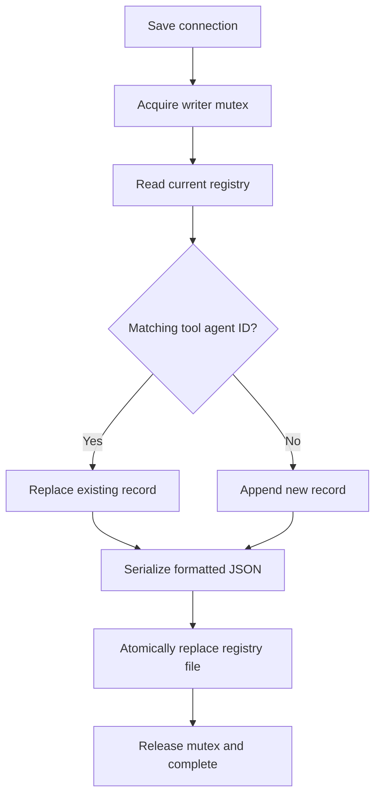
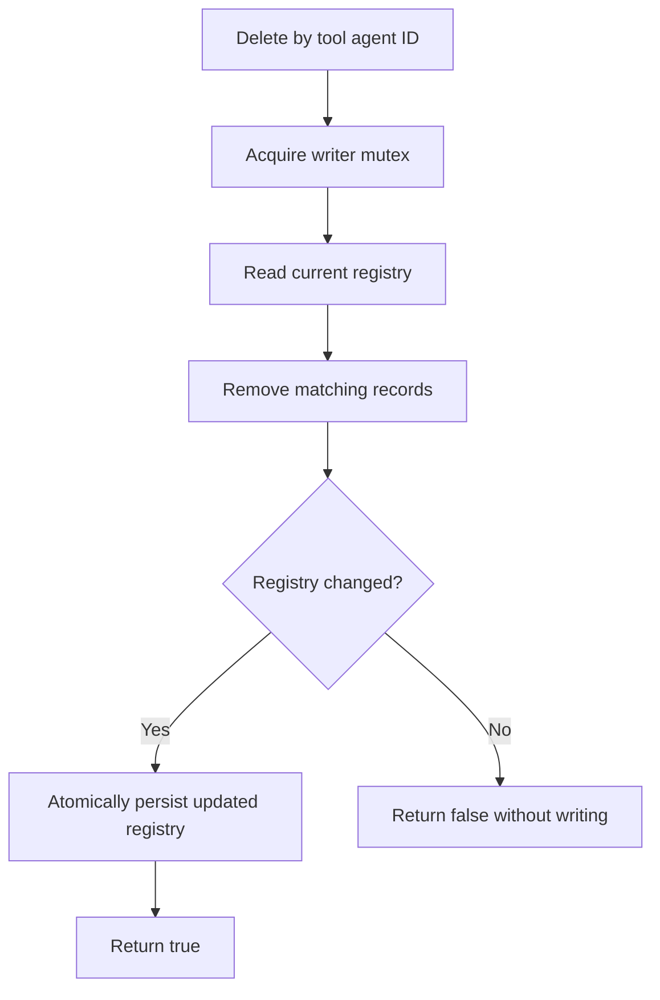

# Services Tool Connection

Services Tool Connection is the OpenFrame Client agent's durable local registry for tool-to-agent associations. It persists `ToolConnection` records in `tool_connections.json` below the agent's secured directory, allowing tool connection processing to retain the tool-agent identifier, the associated agent tool identifier, and whether the association has been published.

The implementation is supplied by the `openframe_agent_lib` Cargo artifact from [OpenFrame OSS Library](https://github.com/flamingo-stack/openframe-oss-lib/blob/7a766f00e4f58b5d89db007b878ac8d6e0c344f4/clients/openframe-client/src/services/tool_connection_service.rs). This tenant repository consumes that library as version `v0.0.5`.

## Responsibilities

Services Tool Connection provides a small persistence boundary with these guarantees:

- Creates the secured storage directory before the service is available.
- Loads all saved connections, treating a missing data file as an empty registry.
- Upserts by `tool_agent_id`; saving the same tool-agent identifier replaces its complete record rather than creating a duplicate.
- Deletes by `tool_agent_id` and returns whether a record was actually removed.
- Serializes writers with a shared asynchronous mutex, so concurrent save and delete operations do not race through separate read-modify-write cycles.
- Writes formatted JSON atomically, reducing the chance that a partially written registry becomes the active file.
- Quarantines malformed JSON during reads and continues with an empty in-memory result, rather than preventing the agent from operating.

The service does not contact NATS, start tools, resolve parameters, or decide whether a tool should be published. Those are responsibilities of neighboring OpenFrame Client services.

## Data Model

Each stored record is a `ToolConnection` with three fields:

| Field | Meaning |
| --- | --- |
| `tool_agent_id` | Identifier of the installed tool agent. This is the persistence key used for upsert and deletion. |
| `agent_tool_id` | Identifier associated with the OpenFrame Client side of the connection. |
| `published` | Whether the association has been published. The storage service preserves this value; it does not interpret or change it. |

The logical on-disk representation is a JSON array. The exact secured-directory location is platform and configuration dependent:

```text
secured directory/
└── tool_connections.json
```

## Architecture



`ToolConnectionService` owns only local persistence. `DirectoryManager` supplies and creates the secured directory. The processing manager composes the storage service with installed-tool lookup, command-parameter resolution, configuration access, per-tool operation coordination, and a NATS-backed publisher.

## Component Relationships



The processing manager's `run` method loads installed tools on agent start. It skips an empty tool list and skips tools whose type is empty because the backend rejects such publications. It also prevents duplicate work for the same tool while connection processing is already active. For a new installation, `run_new_tool` either begins processing or wakes the existing per-tool loop for immediate re-publication.

The publisher accepts a machine identifier, an agent tool identifier, and a tool type, builds a tool-specific topic and message, and publishes through the NATS message publisher. Services Tool Connection is the durable local complement to that outbound event path.

## Persistence Operations

### Initialization

`ToolConnectionService::new` derives the registry path from `DirectoryManager::secured_dir()` and invokes directory creation. Initialization fails when the secured directory cannot be prepared, avoiding a service that appears ready but cannot persist its state.

### Read

`get_all` reads and deserializes the JSON registry. A missing file yields an empty list. If JSON cannot be parsed, the shared filesystem utility attempts to rename the corrupted file to a quarantine path, logs the condition, and returns a corrupt-file outcome; the service converts that outcome to an empty list.

### Upsert



Upsert identity is intentionally limited to `tool_agent_id`. Supplying an existing identifier replaces `agent_tool_id`, `published`, and every other value in the stored record with the incoming record.

### Delete



A deletion returns `true` only when at least one matching record was removed and the updated registry was persisted. A nonmatching identifier returns `false` without changing the file.

## Write Durability and Recovery Behavior

The shared `atomic_write` utility creates a temporary file in the destination directory, writes the serialized payload, synchronizes it, then persists it over the destination. On Unix, it adjusts temporary-file permissions to match the utility's readable-file behavior. On Windows, the helper contains a held-target replacement path for a target temporarily held by another process.

This design avoids exposing an incompletely written JSON file under the registry name in the normal write path. It is not a transaction across other state: callers must coordinate any installed-tool changes, publication attempts, or remote state changes themselves.

On a malformed registry, the read path favors availability: it moves the unreadable file aside when possible and starts with an empty list. Maintainers should retain the quarantined file for diagnosis before removing it. Read failures unrelated to a missing or malformed file, such as inaccessible storage, are returned with file-path context.

## Concurrency Contract

`ToolConnectionService` is cloneable. Clones share the same `Arc<Mutex<()>>`, so calls made through those clones are serialized inside the process. `get_all` intentionally does not acquire the writer mutex because it is read-only. Consequently, a standalone read can observe either the state before or after a concurrent atomic replacement; it does not participate in the mutation critical section.

The mutex is process-local. It is not a cross-process lock, so no guarantee is made when independent agent processes use the same registry path.

## Operational Boundaries

- The registry is local agent state, not a source of truth for server-side tool configuration.
- A startup processing run intentionally re-resolves and re-publishes installed tool associations, accommodating tool-agent identity changes that occur outside the local registry.
- The processing manager refuses publication for installed tools with no `tool_type`; fixing the stored connection alone cannot make those tools publishable.
- NATS publication currently reports publishing errors with topic context. The publisher implementation notes that acknowledgement and retry behavior remain to be added.

## Maintenance Guidance

When changing the record schema or persistence behavior:

1. Preserve `tool_agent_id` as the upsert and deletion key unless all callers and stored files are migrated together.
2. Keep mutation operations inside the shared writer lock, including the read-modify-write sequence.
3. Continue using the shared quarantine-aware read helper and atomic write helper; replacing either with direct filesystem access weakens corruption recovery or write safety.
4. Consider existing registry files during schema evolution. A deserialization incompatibility causes the current file to be quarantined and the runtime registry to begin empty.
5. Test missing files, malformed files, updates of an existing identifier, deletion of a present identifier, deletion of an absent identifier, and concurrent mutation calls.

## Source

- [Tool Connection Service source](https://github.com/flamingo-stack/openframe-oss-lib/blob/7a766f00e4f58b5d89db007b878ac8d6e0c344f4/clients/openframe-client/src/services/tool_connection_service.rs)
