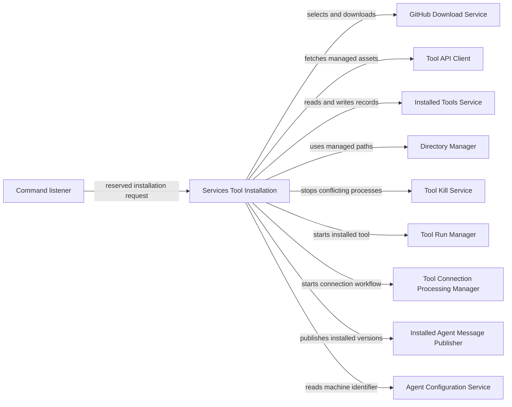
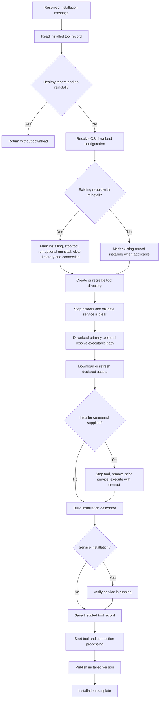
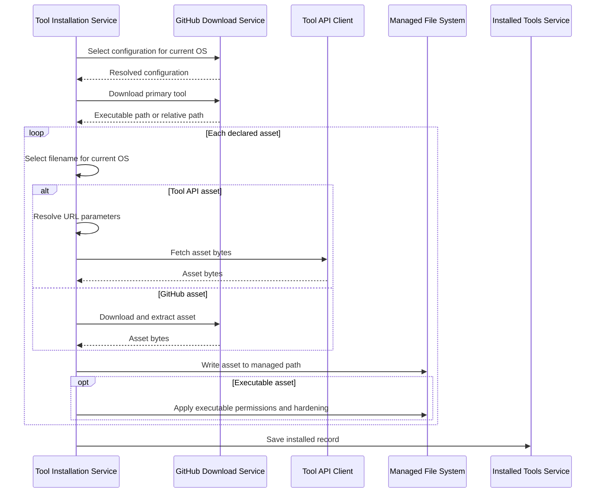

# Services Tool Installation

Services Tool Installation is the OpenFrame client-agent service that materializes a managed tool on an endpoint. It resolves an operating-system-specific download, safely replaces or repairs an existing installation, obtains auxiliary assets, executes any installer command, verifies service tools, records the installed state, starts the tool and its connection workflow, and reports installed versions.

The implementation runs in the Rust `openframe_client` agent library, artifact version `v0.0.5`, supplied by the OpenFrame OSS Library dependency. Its primary implementation is [`tool_installation_service.rs`](https://github.com/flamingo-stack/openframe-oss-lib/blob/7a766f00e4f58b5d89db007b878ac8d6e0c344f4/clients/openframe-client/src/services/tool_installation_service.rs). The tenant repository assembles and deploys the services that support this agent; it does not contain this installation implementation.

## Scope and responsibilities

`ToolInstallationService` owns the endpoint-side installation transaction after the command layer has reserved exclusive work for a tool. Its public constructor creates required managed directories, and `install_reserved` accepts a `ToolInstallationMessage` together with a `ToolOpGuard`. The guard is supplied by the tool-operation coordination layer, so the installation path is executed under a reservation rather than independently acquiring a second lock.

The service supports three installation forms defined by `InstallationType`:

| Installation form | Download destination and executable handling | Post-install behavior |
| --- | --- | --- |
| Standard | Downloads into the tool-specific managed directory. | Persists a standard installation and starts the tool supervisor. |
| Service | Downloads into the managed directory and requires a configured service name. | Runs the configured installer command when present, then requires the service to be running before recording success. |
| GUI application | Installs to `/Applications` on macOS or to the managed tool directory on other platforms. | Persists an absolute executable path; Windows additionally attempts autorun and configuration persistence. |

An install may be a first installation, a repair of a recorded tool whose executable is missing, or an explicit reinstall. A repeated request for a healthy existing installation is deliberately a no-op.

## Position in the agent

The command listener and tool-operation guard serialize management work for a tool. The installer itself coordinates with the run manager rather than clearing its tracking during a reinstall: an existing supervisor can resume against the replacement binary, avoiding a duplicate supervisor. Connection metadata is deleted before an explicit reinstall and the connection-processing manager is invoked after success to establish a fresh tool connection.

## Core collaborators

| Collaborator | Role in the installation flow |
| --- | --- |
| `GithubDownloadService` | Selects a matching download configuration and downloads, extracts, or saves the primary tool and GitHub-sourced assets. |
| `ToolApiClient` | Retrieves Tool API-sourced asset bytes after URL parameter resolution. |
| `ToolCommandParamsResolver` | Expands installation and uninstall command parameters for the concrete tool. |
| `ToolUrlParamsResolver` | Expands URL parameters before requesting a Tool API asset. |
| `InstalledToolsService` | Finds existing records, transitions them to `Installing`, and saves the final `Installed` record. |
| `DirectoryManager` | Creates and addresses the secured application-support, tool, executable, and asset locations. |
| `ToolKillService` | Stops processes, assets, and holders before replacement, download, or installer execution. |
| `ToolConnectionService` | Removes stale connection state when explicitly reinstalling. |
| `ToolRunManager` | Starts a newly installed tool and retains existing supervisor tracking during replacement. |
| `ToolConnectionProcessingManager` | Begins connection processing after the local tool has been installed and started. |
| `AgentConfigurationService` and `InstalledAgentMessagePublisher` | Obtain the endpoint machine identifier and publish installed-tool and executable-asset version reports. |

## Installation lifecycle

### Record handling and idempotency

Before destructive work, the service reads the installed-tool record. When there is no explicit reinstall and the record is not already `Installing`, it verifies that the expected executable or GUI artifact is present. A present artifact makes the request idempotent and it returns successfully. A missing artifact is treated as a repair case. An interrupted operation represented by `Installing` is also resumed through installation instead of being skipped.

The OS-specific `DownloadConfiguration` is resolved before removal of an existing installation. This ensures an unsupported operating system fails before a potentially working tool is destroyed. The selected configuration applies the requested version and its effective version override.

### Reinstall preparation

For a recorded installation with `reinstall` enabled, the service attempts the following in order:

1. Mark the record as `Installing` on a best-effort basis.
2. Stop the recorded tool and wait briefly for termination.
3. When configured, resolve and run the existing executable's uninstall command.
4. Stop processes by executable path and then by the complete tool directory, so child processes cannot retain locks.
5. Remove the tool directory with retry logic and remove persisted connection data.
6. Preserve the run manager entry so an existing supervisor does not get duplicated after replacement.

A Fleet-related reinstall includes additional best-effort cleanup for `osqueryd` and the Orbit directory. If a reinstall has no registry record, cleanup is instead performed after leftover holders are stopped and, for service installations, the service is confirmed clear.

### Process and service safety

The module builds a temporary `Installation` description before download solely to stop any leftover process or service that could hold the target. For non-standard installations, it also stops processes by tool identifier. A service that remains active after cleanup causes the operation to fail and remain retryable rather than installing over a live agent.

External uninstall and installation commands have a five-minute cap (`TOOL_COMMAND_TIMEOUT_SECS` is 300). The spawned command is configured to terminate when dropped, which prevents a timeout from leaving an orphaned installer and a permanently held operation marker. A non-zero exit status includes captured standard output and standard error in the failure. On Windows, command-launch errors also trigger file-lock diagnostics.

For service tools, any existing service is removed immediately before the install command. After that command succeeds, the service must pass `verify_service_running`; only then can the persistent record transition to `Installed`.

## Primary tool and asset materialization

The primary tool is installed from the resolved download configuration. Standard and service tools use the configured tool directory and default agent path. GUI applications use `/Applications` on macOS; elsewhere they are downloaded into the tool directory and saved with an absolute path in the installation record.

Assets are optional and independent of the primary executable. Each asset needs a local filename configuration matching the current operating system. The service skips an already-present asset except that, during reinstall, Tool API-sourced assets are refreshed because they can be server-generated configuration. Executable assets are stopped before replacement, receive executable permissions on Unix platforms, and are hardened through the platform file-access control helper. An executable asset with a version emits an installed-agent message after its processing, even when its file was already present.

## State, completion, and reporting

The persisted `InstalledTool` contains the tool identifiers, requested version, run arguments, tool-agent arguments, uninstallation arguments, resolved installation descriptor, an empty asset collection in this flow, and `ToolRecordState::Installed`. Until then, replacement and repair paths try to leave a record in `Installing`, making interrupted work detectable and eligible for repair on a future delivery.

After persistence, the service:

1. On Windows GUI applications, best-effort registers autorun and stores launch configuration. The chat tool adds a background launch argument.
2. Calls `ToolRunManager::run_new_tool` to launch supervision or execution for the installed tool.
3. Calls `ToolConnectionProcessingManager::run_new_tool` to start tool connection handling.
4. Retrieves the machine identifier and publishes the tool version through `InstalledAgentMessagePublisher`.

Failure to publish the final installed-agent message is logged but does not invalidate an otherwise complete local installation. This is intentionally different from failures that prevent installation, record persistence, tool startup, or connection processing.

## Failure behavior and operational implications

| Condition | Behavior |
| --- | --- |
| No download configuration for the endpoint OS | Fails before any destructive reinstall action. |
| Existing healthy record and artifact | Returns success without downloading. |
| Record exists but executable is missing | Warns and repairs using the requested configuration. |
| Existing service cannot be cleared | Fails so the operation can be retried instead of replacing a live service. |
| Installer or uninstaller exceeds five minutes | Terminates the child process on drop; the operation reports failure or continues as specified for the pre-reinstall uninstaller. |
| Installer command exits unsuccessfully | Fails and does not save the final installed record. |
| Service is not running after a successful installer command | Fails verification and leaves the operation retryable. |
| Final version publication fails | Logs a warning but preserves the successful installation. |

The implementation uses contextual errors around configuration selection, file-system work, download operations, command parameter expansion, command execution, record persistence, startup, and connection processing. These contexts identify the affected tool or asset and are the most useful diagnostic boundary for maintainers.

## Security and platform concerns

- Managed directories are created when the service is constructed, through `DirectoryManager::ensure_directories`.
- Tool replacement deliberately stops process holders before changing files and uses retrying directory removal for locked paths.
- Unix executable assets receive mode `0755`; executable assets additionally use the platform hardening helper where available.
- Windows GUI applications can register machine-level autorun and persist their command arguments; failures are warnings rather than installation failures.
- macOS GUI applications are placed in `/Applications`, while other GUI-app platforms retain their files in the client-managed directory.
- Service names, bundle identifiers, executable paths, and download behavior come from the resolved platform configuration, with the message-level service name serving as a fallback for service installations.

## Maintainer guidance

When changing this module, preserve these invariants:

- Resolve a valid target-platform configuration before deleting a prior installation.
- Keep `ToolOpGuard` alive throughout `install_reserved`; it is the installation reservation boundary.
- Do not clear run-manager tracking during reinstall, because this can start competing supervisors.
- Stop tool processes and verify a service is clear before replacing its files or registering its service.
- Treat the `Installed` state as a postcondition: persist it only after downloads, installer execution, and required service verification succeed.
- Keep final publication best-effort, while treating persistence, tool startup, and connection processing as required completion steps.

The module participates in the broader OpenFrame endpoint-agent control plane. Management-side services define and deliver tool installation requests, while the client library performs endpoint-local download, installation, supervision, connection setup, and installed-version reporting.
