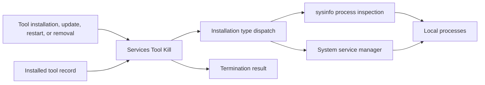
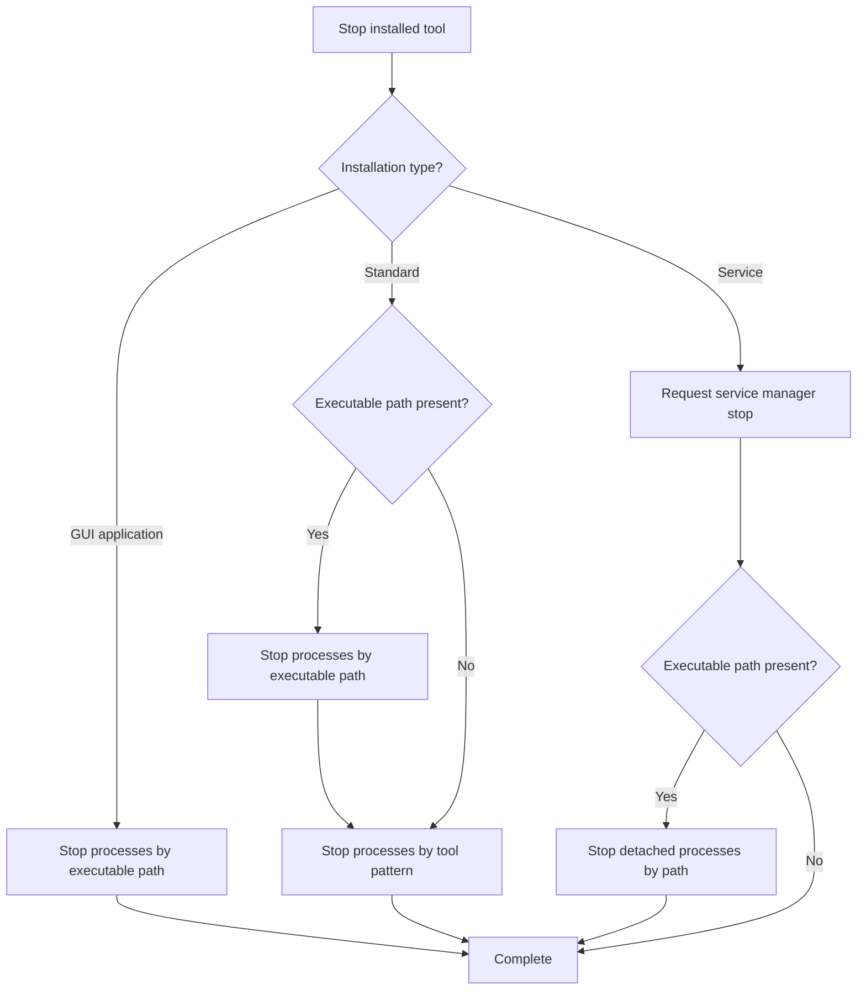
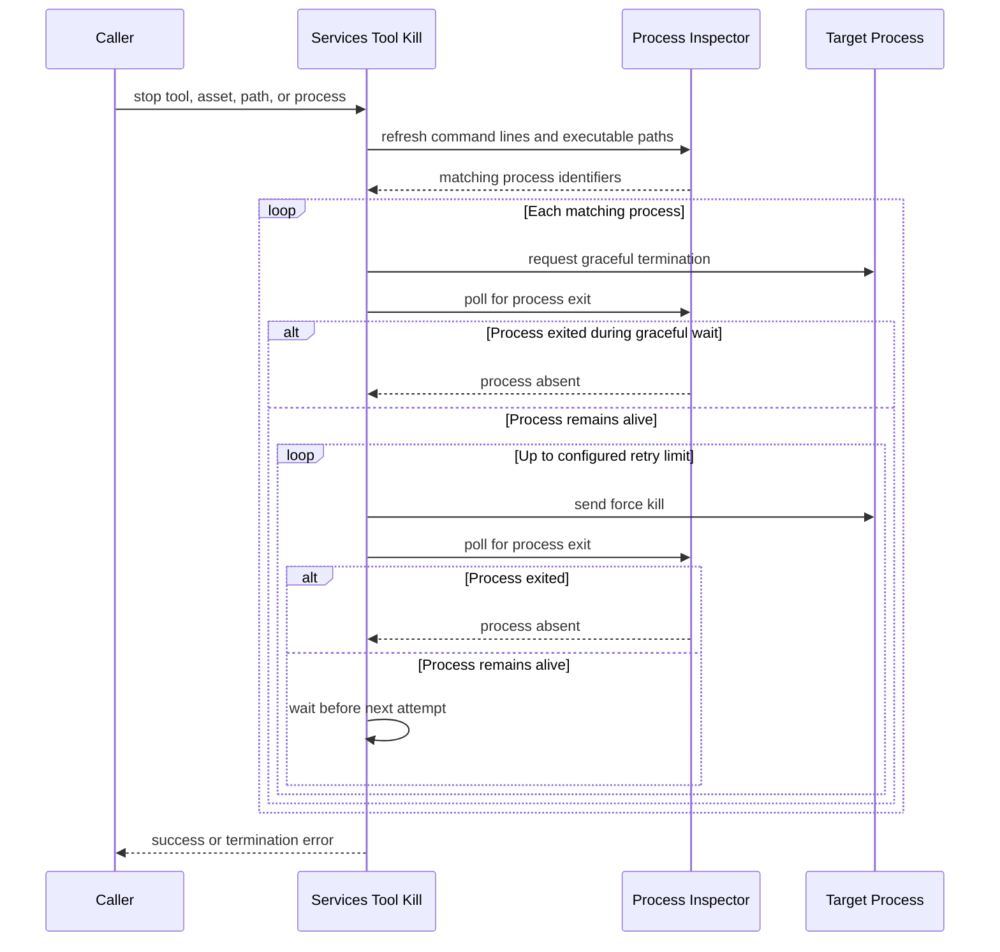

# Services Tool Kill

Services Tool Kill is the OpenFrame client capability that stops managed tool processes before installation, update, restart, or removal work proceeds. It is implemented by `ToolKillService` in the `openframe_agent_lib` crate from the OpenFrame OSS Library and runs inside this repository's OpenFrame client distribution. Its source is [tool_kill_service.rs](https://github.com/flamingo-stack/openframe-oss-lib/blob/7a766f00e4f58b5d89db007b878ac8d6e0c344f4/clients/openframe-client/src/services/tool_kill_service.rs).

The module resolves a target from an installed tool or an explicit identifier, finds matching local processes, requests termination, verifies that each process exits, and escalates to a force kill only when needed. Service-backed tools first use the operating system service manager, then clean up any remaining process by executable path.

## Responsibilities

- Stop a tool or asset identified by an OpenFrame tool identifier.
- Stop a specific process identifier for callers that already know the process.
- Stop an installed tool according to its installation type.
- Detect whether an installed tool is currently running using the same target-selection rules used during installation preparation.
- Verify termination after every signal and report failure only after the configured escalation attempts are exhausted.

The module does not install, update, register, or restart a tool itself. Those actions are owned by the surrounding client services; Services Tool Kill supplies the shutdown boundary they require.

## Position in the Client

`ToolKillService` is a stateless, cloneable service. Its public operations are asynchronous because signaling and the polling delays occur in the Tokio runtime. Process enumeration is moved to a blocking task so the system inspection does not block asynchronous work.

The behavior is supplied by the OpenFrame OSS Library artifact `openframe_agent_lib` version `v0.0.5`, which this repository consumes. It relies on the library's installed-tool model, system-service adapter, and service-stop configuration.

## Public Operations

| Operation | Input | Behavior |
|---|---|---|
| `new` | None | Creates the stateless service instance. `Default` delegates to this constructor. |
| `stop_tool` | Tool identifier | Builds a platform-specific tool command pattern and stops every matching process. |
| `stop_asset` | Asset identifier and tool identifier | Builds an asset-specific path pattern and stops every matching process. |
| `stop_tool_by_path` | Executable path | Matches the normalized executable path against command lines and executable paths. |
| `stop_process` | Process identifier and description | Applies the graceful-then-force escalation procedure to one process. |
| `stop_installed_tool` | Installed tool and deletion permission | Delegates to installation-aware shutdown using the tool identifier and installation metadata. |
| `stop_for_installation` | Tool identifier, installation metadata, deletion permission | Selects GUI application, standard executable, or system service shutdown behavior. |
| `is_installed_tool_running` | Installed tool | Returns whether one or more processes match the same target set used for shutdown. |

## Target Resolution

Services Tool Kill performs case-insensitive matching. It refreshes both command lines and executable paths, then selects a process when either value contains a target pattern. It records the process identifier and executable path before beginning termination, avoiding a long-lived process-system snapshot across asynchronous waits.

### Identifier-Based Targets

For a tool, the target pattern is based on its agent path:

| Platform family | Tool pattern | Asset pattern |
|---|---|---|
| Windows | `tool_id\\agent` | `\\tool_id\\asset_id` |
| macOS and Linux | `tool_id/agent` | `/tool_id/asset_id` |

The actual strings are lowercased before matching. A tool or asset stop can therefore match either an argument in the command line or a portion of the executable location.

### Installation-Aware Targets

The `Installation` model defines three installation forms:

| Installation form | Primary shutdown target | Additional behavior |
|---|---|---|
| GUI application | Required executable path | Stop by path. |
| Standard installation | Optional executable path and tool pattern | Stop by path when present, then stop by tool identifier. |
| Service installation | Required service name and optional executable path | Ask the system service manager to stop the service, then stop remaining processes by path when present. |

For a service without an executable path, the service manager is the only shutdown target. For standard and service installations that lack a stored executable path, the running check falls back to the tool pattern rather than incorrectly claiming that the tool is not running.

The service-manager stop is best effort with respect to process cleanup: a service-stop error is logged as a warning, but the module still attempts executable-path cleanup when that path is available. The `allow_delete` value is passed to the service manager; Windows can use it as part of its platform-specific service handling, while macOS and Linux ignore it in the shared adapter entry point.

## Termination and Verification Flow

Each selected process is handled independently. The module first asks the process to terminate using the default `sysinfo` termination mechanism. It then polls the process table at the configured interval. If the process remains alive beyond the graceful deadline, it sends an explicit `Kill` signal and polls again. Failed force attempts are retried with a one-second delay until the configured retry limit is reached.

### Timing and Escalation Policy

The shared client configuration supplies the following values:

| Setting | Value | Effect |
|---|---:|---|
| Process check interval | 500 ms | Frequency used to re-check whether a target process has exited. |
| Graceful shutdown timeout | 5 s | Maximum time to wait after the initial termination request. |
| Force-kill timeout | 3 s | Maximum time to wait after one force-kill signal. |
| Maximum force-kill retries | 3 | Number of force-kill attempts per process. |

A process that disappears before a force-kill attempt is treated as successfully stopped. A process that is still present after all attempts causes the operation to return an error; other target processes may already have been stopped before that error reaches the caller.

## Process State Query

`is_installed_tool_running` is intended for lifecycle decisions that need to know whether the installed tool is active. It creates a pattern set that mirrors `stop_for_installation`:

- GUI applications match their executable path.
- Standard tools match their executable path when available plus their tool command pattern.
- Services match their executable path when available, otherwise their tool command pattern.

The process inspection runs in a blocking task. If that task cannot be joined, the method returns `false`, preventing a join failure from propagating through a boolean status query. Callers that need to enforce shutdown should invoke a stop operation and handle its `Result` rather than relying only on this probe.

## Operational Guarantees and Limits

### Guarantees

- Empty process matches are successful no-ops. This makes shutdown safe to repeat when the process has already exited.
- Every signal is followed by an exit check, so a successful signal call alone is not considered a completed stop.
- A failed service-manager stop does not suppress executable-path cleanup for service installations.
- Logs identify the requested target, discovered process identifiers, graceful escalation, force-kill attempts, and final failure.

### Limits

- Pattern matching uses substring containment in command-line and executable-path text. Tool identifiers and installation paths must be sufficiently specific to avoid selecting an unrelated process containing the same text.
- Only processes visible to the running client are discoverable and signalable. Operating-system permissions can prevent a process from being stopped.
- The service lifecycle implementation is platform-specific. Services Tool Kill delegates the initial service stop to the library's system-service module and only performs process cleanup directly when it has an executable path.
- Process inspection occurs before termination begins. A newly spawned matching process after inspection is not part of that invocation's captured process identifier list.

## Maintenance Notes

When changing shutdown behavior, preserve consistency between target selection in `is_installed_tool_running` and `stop_for_installation`; the current design intentionally aligns their path and fallback choices. Changes to timeouts, polling cadence, or retry count belong in the shared `service_stop` configuration, not in the termination loop.

The most important regression scenarios are:

1. No process matches a requested tool, asset, or path.
2. A process exits during the graceful waiting period.
3. A process survives the graceful request and exits after force kill.
4. A process survives every force-kill attempt and produces an error.
5. GUI, standard, and service installations choose the expected target set.
6. A service-manager failure still leads to executable-path cleanup for a service with a known path.
7. Installed-tool running checks use the same fallback pattern as installation shutdown.

For the broader client lifecycle, refer to the OpenFrame client and tool-management documentation in the platform documentation. The source implementation is maintained in the OpenFrame OSS Library at the verified link above.
